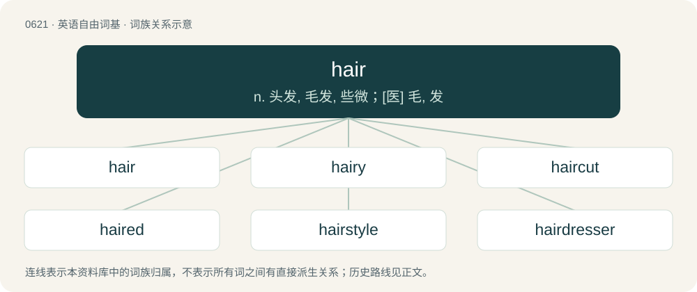

# 0692 · hair — n. 头发, 毛发, 些微；\[医\] 毛, 发

[总目录](../00_总目录_按常用程度.md)

**类型**：英语自由词基　｜　**来源语言**：见词源记录

## 核心含义与来源

- 核心含义：n. 头发, 毛发, 些微；\[医\] 毛, 发
- 英文含义：A pigmented filament of keratin which grows from a follicle on the skin of humans and other mammals.
- 词形：hair

**来源记录 1**（名词；A pigmented filament of keratin which grows from a follicle on the skin of humans and other mammals.）

From Middle English her, heer, hær, from Old English hǣr, from Proto-West Germanic \*hār, from Proto-Germanic \*hērą (“hair”), from Proto-Indo-European \*kes- (“to scrape, comb”). Cognate with Saterland Frisian Hier, Híer (“hair”), West Frisian hier (“hair”), Cimbrian haar, har (“hair”), Dutch haar (“hair”), German and Low German Haar (“hair”), Luxembourgish Hoer (“hair”), Mòcheno hor (“hair”), Yiddish האָר (hor, “hair”), Danish, Norwegian Bokmål, Norwegian Nynorsk, and Swedish hår (“hair”), Faroese and Icelandic hár (“hair”). Eclipsed non-native Middle English cheveler, chevelere (“hair”), borrowed from Old French chevelëure (“hair, head-hair, coiffure, wig”). The modern spelling with ai is not a regular representation of the vowel developed from Middle English. Rather, it is from Middle English here (haircloth) influenced by Old French haire.

## 词族图

## 单词速览（常用到不常用）

| 单词 | 音标 | 释义 |
|---|---|---|
| [hair](#w-1) | 英 /ˈhɛə/；美 /ˈhɛɚ/ | n. 头发, 毛发, 些微；\[医\] 毛, 发 |
| [hairy](#w-2) | 英 /ˈhɛə.ɹi/；美 /ˈhɛɹ.i/ | a. 多毛的, 毛状的, 长毛的 |
| [haircut](#w-3) | /ˈhɛə(ɹ)kʌt/ | n. 理发, (男子的)发式 |
| [haired](#w-4) | 英 /hɛəd/；美 /hɛɹd/ | a. 有毛发的, 长着...头发的 |
| [hairstyle](#w-5) | /ˈhєəstail/ | n. 发型 |
| [hairdresser](#w-6) | /ˈhєədresə/ | n. 美发师, 理发师 |
| [hairline](#w-7) | 美 /ˈhɛɹˌlaɪn/ | n. 发际线, 细缝, 细微的区别；\[机\] 细标线 |
| [hairless](#w-8) | 英 /ˈhɛələs/；美 /ˈhɛɹləs/ | a. 无毛的 |
| [hairpin](#w-9) | 英 /ˈhɛə.pɪn/；美 /ˈhɛɚ.pɪn/ | n. 簪, 束发夹, 夹发针 |
| [hairdo](#w-10) | /ˈhɛəˌduː/ | n. 束发, 发式, 作头发 |
| [hairdressing](#w-11) | /ˈhєədresiŋ/ | n. 理发, 美发 |
| [hairstylist](#w-12) | /ˈhεə.stailist/ | n. 发型师（等于hair stylist） |
| [hairdryer](#w-13) | /ˈheədraɪə(r)/ | n. （吹干头发的）吹风机 |
| [hairbrush](#w-14) | /ˈhєəbrʌʃ/ | n. 发刷 |
| [hairstyling](#w-15) |  | (hairstyle 的现在分词) n. 发型 |
| [haircare](#w-16) |  | n. 头发的护理 |
| [horsehair](#w-17) | /ˈhɔːsheə(r)/ | n. 马毛, 马鬃；\[医\] 马鬃 |
| [hairpiece](#w-18) | /ˈhєəpiːs/ | n. 假发 |
| [hairball](#w-19) | /ˈheəbɔːl/ | \[医\] 毛团, 毛粪石(胃肠内) |
| [shorthair](#w-20) | /ˈʃɔːtheə(r)/ | n. (身材细长的)短毛猫(亦作shorthair cat) |

## 逐词详解

### 1. hair

**词性**：名词　｜　**音标**：英 /ˈhɛə/；美 /ˈhɛɚ/

**中文释义**：n. 头发, 毛发, 些微；\[医\] 毛, 发

**英文义项**：A pigmented filament of keratin which grows from a follicle on the skin of humans and other mammals. / The collection or mass of such growths growing from the skin of humans and animals, and forming a covering for any part or the whole body.

**词源与演化**：

From Middle English her, heer, hær, from Old English hǣr, from Proto-West Germanic \*hār, from Proto-Germanic \*hērą (“hair”), from Proto-Indo-European \*kes- (“to scrape, comb”). Cognate with Saterland Frisian Hier, Híer (“hair”), West Frisian hier (“hair”), Cimbrian haar, har (“hair”), Dutch haar (“hair”), German and Low German Haar (“hair”), Luxembourgish Hoer (“hair”), Mòcheno hor (“hair”), Yiddish האָר (hor, “hair”), Danish, Norwegian Bokmål, Norwegian Nynorsk, and Swedish hår (“hair”), Faroese and Icelandic hár (“hair”). Eclipsed non-native Middle English cheveler, chevelere (“hair”), borrowed from Old French chevelëure (“hair, head-hair, coiffure, wig”). The modern spelling with ai is not a regular representation of the vowel developed from Middle English. Rather, it is from Middle English here (haircloth) influenced by Old French haire.

**例句**：

> In the western world, women usually have long hair while men usually have short hair.

该用例对应义项：Specifically, the collection of hairs on the top and sides of the human head, growing from the scalp.

### 2. hairy

**词性**：形容词　｜　**音标**：英 /ˈhɛə.ɹi/；美 /ˈhɛɹ.i/

**中文释义**：a. 多毛的, 毛状的, 长毛的

**英文义项**：Having a lot of body hair. / Having a lot of fur.

**构词拆分**：hair + -y

**词源与演化**：

From Middle English hery, heeri, hary, equivalent to hair + -y. Compare Saterland Frisian hierich (“hairy”), West Frisian hierrich (“hairy”), Dutch harig (“hairy”), German Low German harig (“hairy”), German haarig (“hairy”), Swedish hårig (“hairy”), Icelandic hárugur (“hairy”). Compare also Old English hǣriht (“hairy”) and ġehǣre (“hairy”). The sense "terrifying, scary" possibly results from a blend of hair-raising and scary.

**例句**：

> It’s a hairy problem, and will probably take several weeks to sort out.

该用例对应义项：Difficult, complex, intricate, or intimidating.

### 3. haircut

**词性**：名词　｜　**音标**：/ˈhɛə(ɹ)kʌt/

**中文释义**：n. 理发, (男子的)发式

**英文义项**：The act of cutting of the hair, often done professionally by a barber, hair stylist, or beautician. / The style into which the hair is cut.

**构词拆分**：hair + cut

**词源与演化**：

From hair + cut.

**用法示例／搭配（非完整句）**：

> to take a haircut

该用例对应义项：A partial loss, financially: thus, in a bankruptcy proceeding, the proportional reduction in the debt that will be paid to each creditor (based on an evaluation of the total debt owed and the total assets of the debtor); among investors, the negative return on investment from a losing proposition.

### 4. haired

**词性**：形容词　｜　**音标**：英 /hɛəd/；美 /hɛɹd/

**中文释义**：a. 有毛发的, 长着...头发的

**英文义项**：Bearing one's own hair as grown and yet attached; neither bald nor hairless. / Bearing some specific type of hair.

**构词拆分**：hair + -ed

**词源与演化**：

From Middle English hered, equivalent to hair + -ed. Compare Dutch behaard (“haired”), German behaart (“haired”).

**例句**：

> She was a raven-haired beauty.

该用例对应义项：Bearing some specific type of hair.

### 5. hairstyle

**词性**：名词　｜　**音标**：/ˈhєəstail/

**中文释义**：n. 发型

**英文义项**：The style in which someone's hair has been cut and arranged.

**构词拆分**：hair + style

**词源与演化**：

From hair + style.

**例句**：

> She walked slowly through the park to show off her new hairstyle.

### 6. hairdresser

**词性**：名词　｜　**音标**：/ˈhєədresə/

**中文释义**：n. 美发师, 理发师

**英文义项**：A person who cuts or styles hair as an occupation or profession.

**构词拆分**：hair + dress + -er

**词源与演化**：

From hair + dress + -er.

**例句**：

> I used to want to be a hairdresser, or a fashion designer.

### 7. hairline

**词性**：名词　｜　**音标**：美 /ˈhɛɹˌlaɪn/

**中文释义**：n. 发际线, 细缝, 细微的区别；\[机\] 细标线

**英文义项**：The line along one's forehead where hair starts growing. / A very thin line in writing, drawing, or typography.

**构词拆分**：hair + line

**词源与演化**：

From hair + line.

**例句**：

> While inspecting the new house, we found a few hairlines in one of the walls.

该用例对应义项：A very thin fissure.

### 8. hairless

**词性**：形容词　｜　**音标**：英 /ˈhɛələs/；美 /ˈhɛɹləs/

**中文释义**：a. 无毛的

**英文义项**：Destitute of hair. / Bald.

**构词拆分**：hair + -less

**词源与演化**：

From hair + -less. Piecewise doublet of hair loss. Cognate with German haarlos.

**例句**：

> A Mexican Hairless is about the size of a fox terrier and hairless except for a tufts on the head and tail.

该用例对应义项：having no hair or fur

### 9. hairpin

**词性**：名词　｜　**音标**：英 /ˈhɛə.pɪn/；美 /ˈhɛɚ.pɪn/

**中文释义**：n. 簪, 束发夹, 夹发针

**英文义项**：A pin or fastener for the hair. / A kind of ribozyme; hairpin ribozyme.

**构词拆分**：hair + pin

**词源与演化**：

From hair + pin, 1788 (as hair pin). Adjective sense 1906 in hairpin turn etc.

**例句**：

> She unlocked the car door by means of a hairpin.

### 10. hairdo

**词性**：名词　｜　**音标**：/ˈhɛəˌduː/

**中文释义**：n. 束发, 发式, 作头发

**英文义项**：A hairstyle. / A haircut.

**构词拆分**：hair + do

**词源与演化**：

From hair + do.

**例句**：

> She had a beehive hairdo for many years.

### 11. hairdressing

**词性**：名词　｜　**音标**：/ˈhєədresiŋ/

**中文释义**：n. 理发, 美发

**英文义项**：The washing, colouring, cutting and styling of the hair; the art or trade of a hairdresser.

**构词拆分**：hair + dressing

**词源与演化**：

From hair + dressing.

**例句**：

> I'm an apprentice at a hairdressing salon.

### 12. hairstylist

**词性**：名词　｜　**音标**：/ˈhεə.stailist/

**中文释义**：n. 发型师（等于hair stylist）

**英文义项**：A hairdresser.

**构词拆分**：From hair + stylist.

**词源与演化**：

From hair + stylist.

**例句**：

> I'm a hairstylist and I've no idea how to do my hair on my wedding day.

### 13. hairdryer

**词性**：名词　｜　**音标**：/ˈheədraɪə(r)/

**中文释义**：n. （吹干头发的）吹风机

**英文义项**：A small electrical appliance for drying hair, by generating a stream of hot air.

**构词拆分**：hair + dryer

**词源与演化**：

From hair + dryer.

**例句**：

> Do you honestly think you still need that old hairdryer?

### 14. hairbrush

**词性**：名词　｜　**音标**：/ˈhєəbrʌʃ/

**中文释义**：n. 发刷

**英文义项**：A brush used in hair care for brushing, tidying, and detangling hair

**构词拆分**：hair + brush

**词源与演化**：

From hair + brush.

**例句**：

> Mistakes happen said the hedgehog and stepped off the hairbrush.

### 15. hairstyling

**词性**：名词

**中文释义**：(hairstyle 的现在分词) n. 发型

**英文义项**：The act or process of styling hair.

**构词拆分**：hair + styling

**词源与演化**：

From hair + styling.

**例句**：

> Sami didn't know specific hairstyling terms.

### 16. haircare

**词性**：名词

**中文释义**：n. 头发的护理

**英文义项**：The care and treatment of the hair.

**构词拆分**：hair + care

**词源与演化**：

From hair + care.

**例句**：

> The oldest haircare tool is the comb, invented more than 5000 years ago in Persia.

### 17. horsehair

**词性**：名词　｜　**音标**：/ˈhɔːsheə(r)/

**中文释义**：n. 马毛, 马鬃；\[医\] 马鬃

**英文义项**：The hair of a horse, especially from the mane and tail, used for upholstery. / A fabric made from this.

**构词拆分**：horse + hair

**词源与演化**：

From Middle English hors her, horshere, hors-here, hors heer (also hors-hore), equivalent to horse + hair. Compare Old Norse hross-hár (“horsehair”).

**例句**：

> This antique horsehair sofa smells like old cigars.

### 18. hairpiece

**词性**：名词　｜　**音标**：/ˈhєəpiːs/

**中文释义**：n. 假发

**英文义项**：A false substitute for a person's hair; a toupee or wig.

**构词拆分**：hair + piece

**词源与演化**：

From hair + piece.

### 19. hairball

**词性**：名词　｜　**音标**：/ˈheəbɔːl/

**中文释义**：\[医\] 毛团, 毛粪石(胃肠内)

**英文义项**：A trichobezoar; a small wad of fur or mass of hair formed in the digestive system of a cat or other animal, from hair ingested while grooming. / A messy, tangled, intractable issue.

**构词拆分**：hair + ball

**词源与演化**：

From hair + ball.

**例句**：

> The contract negotiations are turning into a real hairball.

该用例对应义项：A messy, tangled, intractable issue.

### 20. shorthair

**词性**：名词　｜　**音标**：/ˈʃɔːtheə(r)/

**中文释义**：n. (身材细长的)短毛猫(亦作shorthair cat)

**英文义项**：Any of several breeds of domestic cat with relatively short hair, a slender body and a large head.

**构词拆分**：short + hair

**词源与演化**：

From short + hair.
