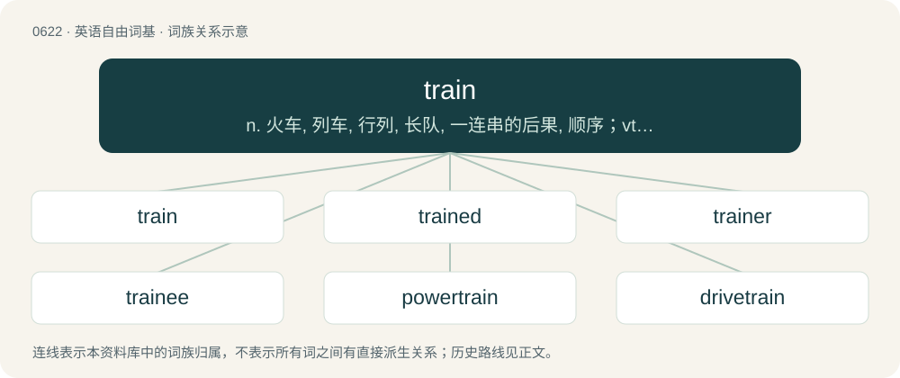

# 0693 · train — n. 火车, 列车, 行列, 长队, 一连串的后果, 顺序；vt. 训练, 教育, 对准；vi. 受训练, 锻炼

[总目录](../00_总目录_按常用程度.md)

**类型**：英语自由词基　｜　**来源语言**：见词源记录

## 核心含义与来源

- 核心含义：n. 火车, 列车, 行列, 长队, 一连串的后果, 顺序；vt. 训练, 教育, 对准；vi. 受训练, 锻炼
- 英文含义：The elongated back portion of a dress or skirt (or an ornamental piece of material added to similar effect), which drags along the ground.
- 词形：train

**来源记录 1**（名词；The elongated back portion of a dress or skirt (or an ornamental piece of material added to similar effect), which drags along the ground.）

From Middle English trayne (“train”), from Old French train (“a delay, a drawing out”), from traïner (“to pull out, to draw”), from Vulgar Latin \*traginō, from \*tragō, from Latin trahō (“to pull, to draw”), ultimately from Proto-Indo-European \*tregʰ- (“to pull, draw, drag”). The verb was derived from the noun in Middle English. For the meaning to teach compare typologically Russian ната́скивать (natáskivatʹ) (akin to тащи́ть (taščítʹ)).

## 词族图

## 单词速览（常用到不常用）

| 单词 | 音标 | 释义 |
|---|---|---|
| [train](#w-1) | 英 /ˈtɹeɪn/ | n. 火车, 列车, 行列, 长队, 一连串的后果, 顺序；vt. 训练, 教育, 对准；vi. 受训练, 锻炼 |
| [trained](#w-2) | /tɹeɪnd/ | a. 训练过的, 受过培训的；培训 |
| [trainer](#w-3) | 英 /ˈtɹeɪnə/；美 /ˈtɹeɪnɚ/ | n. 训练员, 驯马师；\[电\] 列车器 |
| [trainee](#w-4) | /tɹeɪˈni/ | n. 实习生, 新兵, 受培训者；\[经\] 学徒工, 培训人员 |
| [powertrain](#w-5) | 英 /ˈpaʊəˌtɹeɪn/；美 /ˈpaʊɚˌtɹeɪn/ | 动力传动系 |
| [drivetrain](#w-6) | /ˈdraivtrein/ | n. 动力传动系统 |
| [retrain](#w-7) | /ɹiːˈtɹeɪn/ | vt. 重新训练, 再训练 |
| [trainable](#w-8) | /ˈtɹeɪnəbəl/ | a. 可训练的, 可教育的 |

## 逐词详解

### 1. train

**词性**：名词　｜　**音标**：英 /ˈtɹeɪn/

**中文释义**：n. 火车, 列车, 行列, 长队, 一连串的后果, 顺序；vt. 训练, 教育, 对准；vi. 受训练, 锻炼

**英文义项**：The elongated back portion of a dress or skirt (or an ornamental piece of material added to similar effect), which drags along the ground. / A trail or line of something, especially gunpowder.

**词源与演化**：

From Middle English trayne (“train”), from Old French train (“a delay, a drawing out”), from traïner (“to pull out, to draw”), from Vulgar Latin \*traginō, from \*tragō, from Latin trahō (“to pull, to draw”), ultimately from Proto-Indo-European \*tregʰ- (“to pull, draw, drag”). The verb was derived from the noun in Middle English. For the meaning to teach compare typologically Russian ната́скивать (natáskivatʹ) (akin to тащи́ть (taščítʹ)).

**例句**：

> She doesn't come around any more, cuz she had a kid. She's on the family train now.

该用例对应义项：A specified topic, behavior, interest or inclination.

### 2. trained

**词性**：形容词　｜　**音标**：/tɹeɪnd/

**中文释义**：a. 训练过的, 受过培训的；培训

**英文义项**：Having undergone a course of training (sometimes in combination). / Manipulated in shape or habit.

**构词拆分**：train + -ed

**词源与演化**：

From train + -ed.

**用法示例／搭配（非完整句）**：

> fully trained troops

该用例对应义项：Having undergone a course of training (sometimes in combination).

### 3. trainer

**词性**：名词　｜　**音标**：英 /ˈtɹeɪnə/；美 /ˈtɹeɪnɚ/

**中文释义**：n. 训练员, 驯马师；\[电\] 列车器

**英文义项**：A person who trains another; a coach. / A person responsible for treating injuries sustained by players during matches; a physiotherapist.

**构词拆分**：train + -er

**词源与演化**：

From train + -er.

**用法示例／搭配（非完整句）**：

> a root trainer

该用例对应义项：A device for encouraging the roots of a plant to grow in a certain direction.

### 4. trainee

**词性**：名词　｜　**音标**：/tɹeɪˈni/

**中文释义**：n. 实习生, 新兵, 受培训者；\[经\] 学徒工, 培训人员

**英文义项**：Someone who is still in the process of being formally trained in a workplace. / A juvenile inmate being trained and (re)educated in a reformatory school.

**构词拆分**：From train + -ee.

**词源与演化**：

From train + -ee.

**例句**：

> Some trainee teachers can't cope with the recalcitrance of many pupils.

### 5. powertrain

**词性**：名词　｜　**音标**：英 /ˈpaʊəˌtɹeɪn/；美 /ˈpaʊɚˌtɹeɪn/

**中文释义**：动力传动系

**英文义项**：The group of components in a vehicle that generate power and deliver it to the road surface, water, or air.

**构词拆分**：power + train

**词源与演化**：

From power + train.

### 6. drivetrain

**词性**：名词　｜　**音标**：/ˈdraivtrein/

**中文释义**：n. 动力传动系统

**英文义项**：The mechanical parts of the powertrain, the gears and shafts, that connect the engine to the wheels in a vehicle.

**构词拆分**：drive + train

**词源与演化**：

From drive + train.

### 7. retrain

**词性**：动词　｜　**音标**：/ɹiːˈtɹeɪn/

**中文释义**：vt. 重新训练, 再训练

**英文义项**：To train again; especially, to train or study in a new subject or job

**构词拆分**：re- + train

**词源与演化**：

From re- + train.

**例句**：

> We must retrain the linguists who cannot find employment.

该用例对应义项：teach new skills

### 8. trainable

**词性**：形容词　｜　**音标**：/ˈtɹeɪnəbəl/

**中文释义**：a. 可训练的, 可教育的

**英文义项**：Capable of being trained, teachable, educatable.

**构词拆分**：train + -able

**词源与演化**：

From train + -able.
