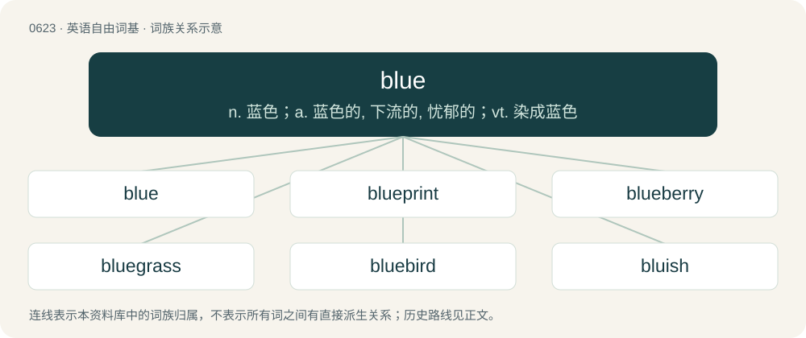

# 0694 · blue — n. 蓝色；a. 蓝色的, 下流的, 忧郁的；vt. 染成蓝色

[总目录](../00_总目录_按常用程度.md)

**类型**：英语自由词基　｜　**来源语言**：见词源记录

## 核心含义与来源

- 核心含义：n. 蓝色；a. 蓝色的, 下流的, 忧郁的；vt. 染成蓝色
- 英文含义：Of a blue hue.
- 词形：blue

**多个词源／构词路径**：同一拼写可能有不同来源；以下按词性和含义分别列出。

**来源记录 1**（形容词；Of a blue hue.）

From Middle English blew, blewe, from Anglo-Norman blew, from Middle French bleu, from Old French blöe, bleve, blef (“blue”), from Frankish \*blāu (“blue”) (perhaps through a Late Latin blāvus, blāvius (“blue”) attested from Isidore of Seville), from Proto-Germanic \*blēwaz (“blue, dark blue”), from Proto-Indo-European \*bʰlēw- (“yellow, blond, grey”). Cognate with dialectal English blow (“blue”), Scots blue, blew (“blue”), North Frisian bla, blö (“blue”), Saterland Frisian blau (“blue”), Dutch blauw (“blue”), German blau (“blue”), Danish, Norwegian Bokmål, Norwegian Nynorsk, and Swedish blå (“blue”), Faroese bláur (“blue”), Icelandic blár (“blue”), Latin flāvus (“yellow”), French bleu (“blue”), Middle Irish blá (“yellow”). Doublet of blow. Possibly related also to English blee (“colour”), from Old English blēo (“colour”); but direct derivatives of Proto-Germanic \*blēwaz (“blue, dark blue”) in Old English include: Old English blāw and blēo (“blue”), Old English blǣwen (“bluish, light-blue”), blǣhǣwen (“blue-coloured, bluish, violet or purple colour”, literally “blue-hued”). There seems to be a parallel connection in Germanic between words for blue and colour, dually exemplified by Proto-West Germanic \*blīu (“colour, blee”) and \*blāu (“blue”); and Proto-Germanic \*hiwją (“colour, hue”) and \*hāwī (“blue, purple”). (depressed): Compare typologically Russian тоска́ зелёная (toská zeljónaja) (&lt;+ зелёный (zeljónyj)). Also compare фиоле́тово (fiolétovo).

**来源记录 2**（动词；To spend (money) extravagantly; to blow.）

Uncertain; possibly from blew, past tense of blow.

## 词族图

## 单词速览（常用到不常用）

| 单词 | 音标 | 释义 |
|---|---|---|
| [blue](#w-1) | 英 /bluː/；美 /blu/ | n. 蓝色；a. 蓝色的, 下流的, 忧郁的；vt. 染成蓝色 |
| [blueprint](#w-2) | /ˈbluːˌpɹɪnt/ | n. 蓝图, 设计图, (周详的)计划；vt. 制成蓝图, 计划 |
| [blueberry](#w-3) | 英 /ˈbluːb(ə)ɹi/；美 /ˈbluˌbɛ.ɹi/ | n. 乌饭树 |
| [bluegrass](#w-4) | /ˈbluːgræs/ | n. 六月禾, 早熟禾熟植物 |
| [bluebird](#w-5) | 美 /ˈbluˌbɝd/ | n. 蓝色鸣鸟(北美产) |
| [bluish](#w-6) | /ˈbluːɪʃ/ | a. 带蓝色的 |
| [bluebell](#w-7) | 美 /ˈbluˌbɛl/ | n. 开蓝色铃状花的植物 |
| [bluestone](#w-8) | /ˈbluːstəun/ | n. 硫酸铜, 胆矾；\[化\] 胆矾; 蓝灰砂岩 |
| [bluefin](#w-9) | /ˈbluːfin/ | n. 金枪鱼 |
| [bluewater](#w-10) |  | \[地名\] \[美国\] 布卢沃特 |
| [bluer](#w-11) | /ˈbluː.ə(ɹ)/ | 染蓝检验工 |
| [bluey](#w-12) | 英 /ˈbluː.i/ | (=bluish)带蓝色的, \[澳\]樵夫的包裹 |
| [bluebeard](#w-13) |  | 【英文】Any member of the genus Caryopteris of plants native to eastern Asia, now cultivated in gardens. |
| [bluegill](#w-14) | /ˈbluːɡɪl/ | n. (美国密西西比河流域产的)浅蓝色食用大太阳鱼 |
| [blueline](#w-15) | /ˈbluːlain/ | n. \[冰\](划分冰球场成3个均等区域的)蓝线 |
| [bluefish](#w-16) | /ˈbluːfiʃ/ | n. 蓝鱼 |

## 逐词详解

### 1. blue

**词性**：形容词　｜　**音标**：英 /bluː/；美 /blu/

**中文释义**：n. 蓝色；a. 蓝色的, 下流的, 忧郁的；vt. 染成蓝色

**英文义项**：Of a blue hue. / Depressed, melancholic, sad.

**词源与演化**：

From Middle English blew, blewe, from Anglo-Norman blew, from Middle French bleu, from Old French blöe, bleve, blef (“blue”), from Frankish \*blāu (“blue”) (perhaps through a Late Latin blāvus, blāvius (“blue”) attested from Isidore of Seville), from Proto-Germanic \*blēwaz (“blue, dark blue”), from Proto-Indo-European \*bʰlēw- (“yellow, blond, grey”). Cognate with dialectal English blow (“blue”), Scots blue, blew (“blue”), North Frisian bla, blö (“blue”), Saterland Frisian blau (“blue”), Dutch blauw (“blue”), German blau (“blue”), Danish, Norwegian Bokmål, Norwegian Nynorsk, and Swedish blå (“blue”), Faroese bláur (“blue”), Icelandic blár (“blue”), Latin flāvus (“yellow”), French bleu (“blue”), Middle Irish blá (“yellow”). Doublet of blow. Possibly related also to English blee (“colour”), from Old English blēo (“colour”); but direct derivatives of Proto-Germanic \*blēwaz (“blue, dark blue”) in Old English include: Old English blāw and blēo (“blue”), Old English blǣwen (“bluish, light-blue”), blǣhǣwen (“blue-coloured, bluish, violet or purple colour”, literally “blue-hued”). There seems to be a parallel connection in Germanic between words for blue and colour, dually exemplified by Proto-West Germanic \*blīu (“colour, blee”) and \*blāu (“blue”); and Proto-Germanic \*hiwją (“colour, hue”) and \*hāwī (“blue, purple”). (depressed): Compare typologically Russian тоска́ зелёная (toská zeljónaja) (&lt;+ зелёный (zeljónyj)). Also compare фиоле́тово (fiolétovo).

**例句**：

> The divers got them out of the car just in time – they were starting to turn blue.

该用例对应义项：Having a bluish or purplish shade to the skin due to a lack of oxygen to the normally deep-red red blood cells; cyanotic.

### 2. blueprint

**词性**：动词　｜　**音标**：/ˈbluːˌpɹɪnt/

**中文释义**：n. 蓝图, 设计图, (周详的)计划；vt. 制成蓝图, 计划

**英文义项**：To make a blueprint for. / To make a detailed operational plan for; to design or plan out.

**构词拆分**：blue + print

**词源与演化**：

From blue + print. Introduced by Sir John Herschel in 1842.

**例句**：

> The architect blueprinted the renovation plan once the client had signed off.

该用例对应义项：To make a blueprint for.

### 3. blueberry

**词性**：名词　｜　**音标**：英 /ˈbluːb(ə)ɹi/；美 /ˈbluˌbɛ.ɹi/

**中文释义**：n. 乌饭树

**英文义项**：An edible round berry, belonging to the cowberry group (Vaccinium sect. Cyanococcus), with flared crowns at the end, that turns blue on ripening. / The shrub of the above-mentioned berry.

**构词拆分**：blue + berry

**词源与演化**：

From blue + berry.

**例句**：

> He prepared the blueberry sauce with which to flavor the duck.

### 4. bluegrass

**词性**：名词　｜　**音标**：/ˈbluːgræs/

**中文释义**：n. 六月禾, 早熟禾熟植物

**英文义项**：Kentucky bluegrass (Poa pratensis).

**构词拆分**：blue + grass

**词源与演化**：

From blue + grass, from the bluish appearance of the massed grass in late Spring.

**例句**：

> It's widely used in Western orchestral music, rock music, jazz, and bluegrass.

### 5. bluebird

**词性**：名词　｜　**音标**：美 /ˈbluˌbɝd/

**中文释义**：n. 蓝色鸣鸟(北美产)

**英文义项**：Any of various North American birds of the genus Sialia in the thrush family. Their plumage is blue or blue and red. / Any of various African starlings of the genus Lamprotornis, family Sturnidae, having predominantly glossy blue plumage.

**构词拆分**：blue + bird

**词源与演化**：

From blue + bird.

**例句**：

> The eastern bluebird is the state bird of Missouri and New York.

### 6. bluish

**词性**：形容词　｜　**音标**：/ˈbluːɪʃ/

**中文释义**：a. 带蓝色的

**英文义项**：Having a tint or hue similar to the colour blue. / Somewhat depressed; sad.

**构词拆分**：blue + -ish

**词源与演化**：

From Middle English blewissh, blewisch (also Middle English bloysh), equivalent to blue + -ish.

**例句**：

> The corners of his lips showed a bluish tinge that really worried the nurse.

### 7. bluebell

**词性**：名词　｜　**音标**：美 /ˈbluˌbɛl/

**中文释义**：n. 开蓝色铃状花的植物

**英文义项**：common bluebell (Hyacinthoides non-scripta) / Spanish bluebell (Hyacinthoides hispanica)

**构词拆分**：blue + bell

**词源与演化**：

From blue + bell.

### 8. bluestone

**词性**：名词　｜　**音标**：/ˈbluːstəun/

**中文释义**：n. 硫酸铜, 胆矾；\[化\] 胆矾; 蓝灰砂岩

**英文义项**：Any of several bluish-grey varieties of stone used for construction / A form of dolerite which appears blue when wet or freshly broken.

**构词拆分**：blue + stone

**词源与演化**：

From blue + stone.

### 9. bluefin

**词性**：名词　｜　**音标**：/ˈbluːfin/

**中文释义**：n. 金枪鱼

**英文义项**：bluefin tuna, any of a number of types of tuna characterised by their blue fins.

**构词拆分**：blue + fin

**词源与演化**：

From blue + fin.

**例句**：

> Bluefin tuna can live up to 40 years.

### 10. bluewater

**词性**：形容词

**中文释义**：\[地名\] \[美国\] 布卢沃特

**英文义项**：Oceangoing, capable of travelling in rough seas.

**构词拆分**：blue + water

**词源与演化**：

From blue + water, from the blue of deep oceanic waters.

**例句**：

> Almost every maritime country has some kind of bluewater navy.

该用例对应义项：Oceangoing, capable of travelling in rough seas.

### 11. bluer

**词性**：名词　｜　**音标**：/ˈbluː.ə(ɹ)/

**中文释义**：染蓝检验工

**英文义项**：A blue blazer, part of the school uniform at Harrow School.

**构词拆分**：blue + -er (“Oxford -er”)

**词源与演化**：

From blue + -er (“Oxford -er”). Used at Harrow School in London, United Kingdom.

**例句**：

> COVID-19 lockdowns brought bluer skies to some of the world's smoggy cities.

### 12. bluey

**词性**：形容词　｜　**音标**：英 /ˈbluː.i/

**中文释义**：(=bluish)带蓝色的, \[澳\]樵夫的包裹

**英文义项**：Having a colour similar to blue.

**构词拆分**：From blue + -y.

**词源与演化**：

From blue + -y.

### 13. bluebeard

**词性**：名词

**英文义项**：Any member of the genus Caryopteris of plants native to eastern Asia, now cultivated in gardens.

**构词拆分**：blue + beard

**词源与演化**：

From blue + beard.

### 14. bluegill

**词性**：名词　｜　**音标**：/ˈbluːɡɪl/

**中文释义**：n. (美国密西西比河流域产的)浅蓝色食用大太阳鱼

**英文义项**：Any member of the species Lepomis macrochirus of North American sunfish.

**构词拆分**：blue + gill

**词源与演化**：

From blue + gill.

### 15. blueline

**词性**：名词　｜　**音标**：/ˈbluːlain/

**中文释义**：n. \[冰\](划分冰球场成3个均等区域的)蓝线

**英文义项**：A reproduction of the material submitted for printing, computer-generated or printed from film, provided to the customer for approval before the material is printed.

**构词拆分**：blue + line

**词源与演化**：

From blue + line.

### 16. bluefish

**词性**：名词　｜　**音标**：/ˈbluːfiʃ/

**中文释义**：n. 蓝鱼

**英文义项**：A voracious fish (Pomatomus saltatrix) found in waters of the Atlantic and Indian Ocean. / The puddingwife wrasse (Halichoeres radiatus).

**构词拆分**：blue + fish

**词源与演化**：

From blue + fish.

**例句**：

> Common game fish found in this area are striped bass and bluefish.
