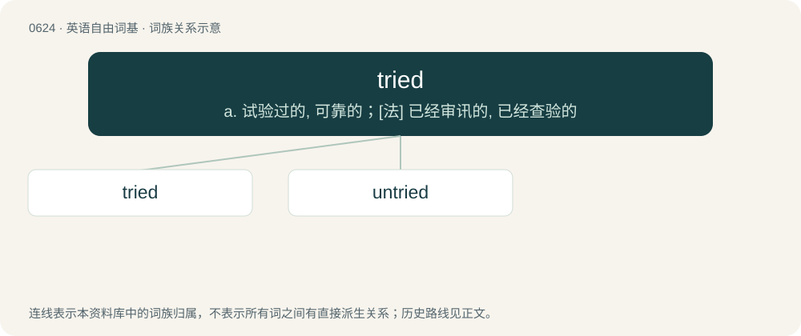

# 0696 · tried — a. 试验过的, 可靠的；\[法\] 已经审讯的, 已经查验的

[总目录](../00_总目录_按常用程度.md)

**类型**：英语自由词基　｜　**来源语言**：见词源记录

## 核心含义与来源

- 核心含义：a. 试验过的, 可靠的；\[法\] 已经审讯的, 已经查验的
- 英文含义：Tested, hence, proven to be firm or reliable.
- 词形：tried

**来源记录 1**（形容词；Tested, hence, proven to be firm or reliable.）

From Middle English tried, tryed, equivalent to try + -ed.

## 词族图

## 单词速览（常用到不常用）

| 单词 | 音标 | 释义 |
|---|---|---|
| [tried](#w-1) | /tɹaɪd/ | a. 试验过的, 可靠的；\[法\] 已经审讯的, 已经查验的 |
| [untried](#w-2) | /.ʌnˈtraid/ | a. 未试过的, 未经实验的, 无经验的；\[法\] 未经审讯的, 未审理的, 未经考验的 |

## 逐词详解

### 1. tried

**词性**：形容词　｜　**音标**：/tɹaɪd/

**中文释义**：a. 试验过的, 可靠的；\[法\] 已经审讯的, 已经查验的

**英文义项**：Tested, hence, proven to be firm or reliable. / Put on trial, taken before a lawcourt.

**构词拆分**：try + -ed

**词源与演化**：

From Middle English tried, tryed, equivalent to try + -ed.

**例句**：

> The excited woman tried to explain the accident all in one breath.

### 2. untried

**词性**：形容词　｜　**音标**：/.ʌnˈtraid/

**中文释义**：a. 未试过的, 未经实验的, 无经验的；\[法\] 未经审讯的, 未审理的, 未经考验的

**英文义项**：Not yet tried or tested; unknown. / Not put on trial; not taken before a legal court.

**构词拆分**：un- + tried

**词源与演化**：

From un- + tried.

**例句**：

> The new guy was inexperienced and untried.

该用例对应义项：Not yet tried or tested; unknown.
