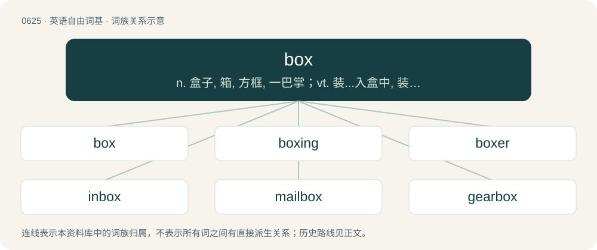

# 0697 · box — n. 盒子, 箱, 方框, 一巴掌；vt. 装...入盒中, 装箱, 打耳光；vi. 拳击

[总目录](../00_总目录_按常用程度.md)

**类型**：英语自由词基　｜　**来源语言**：见词源记录

## 核心含义与来源

- 核心含义：n. 盒子, 箱, 方框, 一巴掌；vt. 装...入盒中, 装箱, 打耳光；vi. 拳击
- 英文含义：A cuboid space; a cuboid container, often with a hinged lid.
- 词形：box

**多个词源／构词路径**：同一拼写可能有不同来源；以下按词性和含义分别列出。

**来源记录 1**（名词；A cuboid space; a cuboid container, often with a hinged lid.）

From Middle English box (“container, box, cup”), from Old English box (“box, case”), from Proto-West Germanic \*buhsā (“box”) from Late Latin buxis (“box”), Latin pyxis (“small box for medicines or toiletries”), of uncertain origin; compare Ancient Greek πυξίς (puxís, “box or tablet made of boxwood; box; cylinder”) and πύξος (púxos, “box tree; boxwood”). Doublet of piseog, pyx, and pyxis. Cognate with Middle Dutch bosse, busse (“jar; tin; round box”) (modern Dutch bos (“wood, forest”), bus (“container, box; bushing of a wheel”)), Old High German buhsa (Middle High German buhse, bühse, modern German Büchse (“box; can”)), Swedish bössa (“box”). The humorous plural form boxen is from box + -en, by analogy with oxen. (motor racing): Used since it is more distinct over the radio compared to pit. Also from German Boxenstopp (“pit stop”).

**来源记录 2**（名词；Any of various evergreen shrubs or trees of genus Buxus, especially common box, European box, or boxwood (Buxus sempervirens) which is often used for making hedges and topiary.）

From Middle English box (“box tree; boxwood”), from Old English box (“box tree”), from Proto-West Germanic \*buhs (“box tree; thing made from boxwood”), from Latin buxus (“box tree; thing made from boxwood”), buxum (“box tree; boxwood”), possibly from πύξος (púxos, “box tree; boxwood”).

**来源记录 3**（名词；A blow with the fist.）

From Middle English box (“a blow; a stroke with a weapon”); further origin uncertain, with relation to Proto-Germanic \*boki-, whence Danish bask (“a blow; a stripe”), Danish baske (“to flap, move around, beat violently”), Middle Dutch boke (“a blow, a hit”), bōken (“to slap, strike”) (modern Dutch beuken (“to slap”)), West Frisian bûkje, bûtse, bûtsje (“to slap”), West Frisian and Saterland Frisian batsje (“to slap”), Low German betschen (“to slap, beat with a flat hand”), Middle High German buc (“a blow, a stroke”), bochen (“to slap, strike”), and further onomatopoeic shaping. The verb is from Middle English boxen (“to beat or whip (an animal)”), which is derived from the noun.

**来源记录 4**（名词；A Mediterranean food fish of the genus Boops, which is a variety of sea bream; a bogue or oxeye.）

From Latin bōx, from Ancient Greek βῶξ (bôx, “box (marine fish)”), from βοῦς (boûs, “ox”) + ὤψ (ṓps, “eye, view”), a reference to the large size of the fish's eyes relative to its body.

## 词族图

## 单词速览（常用到不常用）

| 单词 | 音标 | 释义 |
|---|---|---|
| [box](#w-1) | 英 /bɒks/；美 /bɑks/ | n. 盒子, 箱, 方框, 一巴掌；vt. 装...入盒中, 装箱, 打耳光；vi. 拳击 |
| [boxing](#w-2) | 英 /ˈbɒksɪŋ/；美 /ˈbɑːksɪŋ/ | n. 拳击；\[医\] 围模(牙科) |
| [boxer](#w-3) | 英 /ˈbɒksə/；美 /ˈbɑksɚ/ | n. 拳师 |
| [inbox](#w-4) | 英 /ˈɪnbɒks/；美 /ˈɪnbɑks/ | \[计\] 入站 |
| [mailbox](#w-5) | /ˈmeɪl.bɑks/ | n. 邮筒, 邮箱；\[计\] 邮箱, 电子邮箱 |
| [gearbox](#w-6) | 英 /ˈɡɪəˌbɒks/；美 /ˈɡɪəɹˌbɒks/ | n. 变速箱；\[化\] 齿轮箱; 变速箱 |
| [dropbox](#w-7) | 英 /ˈdɹɒp.bɒks/；美 /ˈdɹɑp.bɑks/ | 【英文】A box wherein objects can be deposited by one person for later collection by another. |
| [jukebox](#w-8) | 英 /ˈd͡ʒuːkbɒks/；美 /ˈd͡ʒukˌbɑks/ | n. 自动唱机 |
| [sandbox](#w-9) | 英 /ˈsænd.bɒks/；美 /ˈsæn(d).bɑks/ | n. 沙箱, 沙盒 |
| [toolbox](#w-10) | 英 /ˈtuːlˌbɒks/；美 /ˈtuːlˌbɑks/ | n. 工具箱；\[计\] 工具箱 |
| [lunchbox](#w-11) | /ˈlʌntʃˌbɒks/ | n. 饭盒；便当 |
| [matchbox](#w-12) | /ˈmætʃbɒks/ | n. 火柴盒 |
| [boxy](#w-13) | /ˈbɒk.si/ | a. 似盒子的, 盒状的 |
| [shoebox](#w-14) | /ˈʃuːbɒks/ | 鞋盒 |
| [letterbox](#w-15) |  | n. 邮筒, 邮箱, 投信口, 信箱 |
| [soapbox](#w-16) | /ˈsəʊpbɒks/ | n. 肥皂盒, 临时演说台；a. 街头演说的 |
| [boxcar](#w-17) | /ˈbɒkskɑː/ | n. 有盖货车；\[电\] 转换盒 |
| [checkbox](#w-18) | 英 /ˈtʃɛkbɒks/；美 /ˈt͡ʃɛkbɑks/ | 检验栏, 检验盒 |
| [firebox](#w-19) | /ˈfaiəbɒks/ | n. 火室, 燃烧室；\[化\] 燃烧室 |
| [skybox](#w-20) |  | （体育场的）贵宾看台 |
| [icebox](#w-21) | 英 /ˈʌɪsbɒks/ | n. 冷藏库, 冰箱, 冷冻室；\[法\] 冰箱, 无名死尸安置处, 单人牢房 |
| [boxwood](#w-22) | /ˈbɒkswud/ | n. 黄杨木材, 黄杨木；\[医\] 黄杨 |
| [pillbox](#w-23) | 英 /ˈpɪl bɒks/；美 /ˈpɪl bɑːks/ | n. 碉堡, 掩体, 药丸盒, 筒形女帽 |
| [chatterbox](#w-24) | /ˈtʃæ.tə(ɹ)ˌbɒks/ | n. 喋喋不休者 |
| [lockbox](#w-25) | /ˈlɔkbɔks/ | n. 有锁的箱子 |
| [beatbox](#w-26) | /ˈbiːt.bɑks/ | n. 打击体验；电子节奏鼓 |
| [lightbox](#w-27) |  | n. 光箱特效；航行识别灯控制箱 |
| [tinderbox](#w-28) | /ˈtindəbɒks/ | n. 火绒合, 高度易燃物, 容易发火的人 |
| [unbox](#w-29) | /,ʌnˈbɔks/ | vt.从箱子中取出 |

## 逐词详解

### 1. box

**词性**：名词　｜　**音标**：英 /bɒks/；美 /bɑks/

**中文释义**：n. 盒子, 箱, 方框, 一巴掌；vt. 装...入盒中, 装箱, 打耳光；vi. 拳击

**英文义项**：A cuboid space; a cuboid container, often with a hinged lid. / A cuboid container and its contents; as much as fills such a container.

**词源与演化**：

From Middle English box (“container, box, cup”), from Old English box (“box, case”), from Proto-West Germanic \*buhsā (“box”) from Late Latin buxis (“box”), Latin pyxis (“small box for medicines or toiletries”), of uncertain origin; compare Ancient Greek πυξίς (puxís, “box or tablet made of boxwood; box; cylinder”) and πύξος (púxos, “box tree; boxwood”). Doublet of piseog, pyx, and pyxis. Cognate with Middle Dutch bosse, busse (“jar; tin; round box”) (modern Dutch bos (“wood, forest”), bus (“container, box; bushing of a wheel”)), Old High German buhsa (Middle High German buhse, bühse, modern German Büchse (“box; can”)), Swedish bössa (“box”). The humorous plural form boxen is from box + -en, by analogy with oxen. (motor racing): Used since it is more distinct over the radio compared to pit. Also from German Boxenstopp (“pit stop”).

**例句**：

> This text would stand out better if we put it in a coloured box.

该用例对应义项：A rectangle: an oblong or a square.

### 2. boxing

**词性**：名词　｜　**音标**：英 /ˈbɒksɪŋ/；美 /ˈbɑːksɪŋ/

**中文释义**：n. 拳击；\[医\] 围模(牙科)

**英文义项**：A sport where two opponents punch each other with gloved fists to head and torso; the object being to score more points by the end of the match or by knockout, or technical knockout.

**构词拆分**：box + -ing

**词源与演化**：

From box (“to punch”) + -ing.

**例句**：

> Boxing has been defined as the art of hitting without being hit.

### 3. boxer

**词性**：名词　｜　**音标**：英 /ˈbɒksə/；美 /ˈbɑksɚ/

**中文释义**：n. 拳师

**英文义项**：A participant in a boxing match; a fighter who boxes. / A type of internal combustion engine in which cylinders are arranged in two banks on either side of a single crankshaft.

**构词拆分**：box + -er

**词源与演化**：

From box + -er.

**例句**：

> You can tell she's a boxer by looking at her nose.

该用例对应义项：A participant in a boxing match; a fighter who boxes.

### 4. inbox

**词性**：名词　｜　**音标**：英 /ˈɪnbɒks/；美 /ˈɪnbɑks/

**中文释义**：\[计\] 入站

**英文义项**：A container in which papers to be dealt with are put. / An electronic folder serving the same purpose, but for electronic files, especially email.

**构词拆分**：in + box

**词源与演化**：

From in + box.

**例句**：

> The kids, my ex, my parents, the job, bills — my inbox is full.

该用例对应义项：The aggregate of items that demand one's attention or effort.

### 5. mailbox

**词性**：名词　｜　**音标**：/ˈmeɪl.bɑks/

**中文释义**：n. 邮筒, 邮箱；\[计\] 邮箱, 电子邮箱

**英文义项**：A collection point for mail intended for onward delivery, a secure box or receptacle for this purpose. / A delivery point for mail, a box, compartment or slot for this purpose.

**构词拆分**：mail + box

**词源与演化**：

From mail + box.

**例句**：

> Put this stamp on the postcard and drop it in the mailbox.

### 6. gearbox

**词性**：名词　｜　**音标**：英 /ˈɡɪəˌbɒks/；美 /ˈɡɪəɹˌbɒks/

**中文释义**：n. 变速箱；\[化\] 齿轮箱; 变速箱

**英文义项**：An enclosed gear train. / That part of a car's transmission containing the train of gears, and to which the gear lever is connected.

**构词拆分**：gear + box

**词源与演化**：

From gear + box.

**例句**：

> Tom had to have a new gearbox fitted to his car.

### 7. dropbox

**词性**：名词　｜　**音标**：英 /ˈdɹɒp.bɒks/；美 /ˈdɹɑp.bɑks/

**英文义项**：A box wherein objects can be deposited by one person for later collection by another. / A computer folder to which files may be dragged and dropped and from which users of other computers on the network can access those files.

**构词拆分**：drop + box

**词源与演化**：

From drop + box.

### 8. jukebox

**词性**：名词　｜　**音标**：英 /ˈd͡ʒuːkbɒks/；美 /ˈd͡ʒukˌbɑks/

**中文释义**：n. 自动唱机

**英文义项**：A coin-operated machine that plays recorded music, with push-buttons to make selections. / A software application capable of replaying tracks from a digital music collection.

**构词拆分**：juke (“roadside café”) + box

**词源与演化**：

First use appears c. 1939, from juke (“roadside café”) + box, replacing older collocational terms such as nickel-in-a-slot phonograph, coin-in-the-slot phonograph, and coin-operated phonograph.

**例句**：

> Tom and Mary are sitting at a table over near the jukebox.

### 9. sandbox

**词性**：名词　｜　**音标**：英 /ˈsænd.bɒks/；美 /ˈsæn(d).bɑks/

**中文释义**：n. 沙箱, 沙盒

**英文义项**：A children's play area consisting of a box filled with sand. / A box filled with sand that is shaped to form a mould for metal casting.

**构词拆分**：sand + box

**词源与演化**：

From sand + box.

**例句**：

> Running a program in a sandbox can prevent it from doing any damage to the system.

该用例对应义项：An isolated area where a program can be executed with a restricted portion of the resources available.

### 10. toolbox

**词性**：名词　｜　**音标**：英 /ˈtuːlˌbɒks/；美 /ˈtuːlˌbɑks/

**中文释义**：n. 工具箱；\[计\] 工具箱

**英文义项**：A storage case for tools. / A set of pre-existing routines for use in writing new programs.

**构词拆分**：tool + box

**词源与演化**：

From tool + box.

**例句**：

> I left my toolbox in the basement next to the furnace.

### 11. lunchbox

**词性**：名词　｜　**音标**：/ˈlʌntʃˌbɒks/

**中文释义**：n. 饭盒；便当

**英文义项**：A container for transporting meals, especially lunch. / The penis when enclosed in clothing.

**构词拆分**：lunch + box

**词源与演化**：

From lunch + box.

**例句**：

> Jack was carrying his lunchbox with him.

该用例对应义项：A lunch packaged in a disposable box to be taken away to eat.

### 12. matchbox

**词性**：名词　｜　**音标**：/ˈmætʃbɒks/

**中文释义**：n. 火柴盒

**英文义项**：A small box, usually a small cardboard box, in which matches are kept.

**构词拆分**：match + box

**词源与演化**：

From match + box.

**例句**：

> You saved all your baby teeth in this matchbox? That's gross!

### 13. boxy

**词性**：形容词　｜　**音标**：/ˈbɒk.si/

**中文释义**：a. 似盒子的, 盒状的

**英文义项**：Box-shaped, boxlike, or otherwise suggestive of boxes (with right angles or at least blunt profiles).

**构词拆分**：box + -y

**词源与演化**：

From box + -y.

### 14. shoebox

**词性**：名词　｜　**音标**：/ˈʃuːbɒks/

**中文释义**：鞋盒

**英文义项**：The box in which shoes are sold. / A small, cramped residence or similar space.

**构词拆分**：shoe + box

**词源与演化**：

From shoe + box.

**例句**：

> In one shoebox he had a whole collection of seeds he had saved from last year.

该用例对应义项：The box in which shoes are sold.

### 15. letterbox

**词性**：名词

**中文释义**：n. 邮筒, 邮箱, 投信口, 信箱

**英文义项**：A collection point for mail intended for onward delivery, a secure box or receptacle for this purpose. / A delivery point for mail, a box, compartment or slot for this purpose.

**构词拆分**：letter + box

**词源与演化**：

From letter + box.

**例句**：

> A wad of junk mail was pushed through the letterbox in the front door and dropped onto the mat.

该用例对应义项：A delivery point for mail, a box, compartment or slot for this purpose.

### 16. soapbox

**词性**：名词　｜　**音标**：/ˈsəʊpbɒks/

**中文释义**：n. 肥皂盒, 临时演说台；a. 街头演说的

**英文义项**：A crate for packing soap. / A small platform, being or resembling a literal soapbox, on which a person stands in order to give an impromptu speech or espouse their views.

**构词拆分**：soap + box

**词源与演化**：

From soap + box. The figurative use of the word derives from the fact that soap products in the US used to be commonly transported to stores in large wooden boxes. It used to be common for individuals to give impromptu rally speeches to their neighbors by finding something to stand on like a soapbox.

**例句**：

> Please stop using council meetings as your own personal soapbox.

该用例对应义项：A platform or outlet, such as a media platform, that a person uses to express their opinions.

### 17. boxcar

**词性**：名词　｜　**音标**：/ˈbɒkskɑː/

**中文释义**：n. 有盖货车；\[电\] 转换盒

**英文义项**：An enclosed railway goods wagon, typically with a sliding door.

**构词拆分**：box + car

**词源与演化**：

From box + car.

**例句**：

> Tom lives in an abandoned boxcar.

### 18. checkbox

**词性**：名词　｜　**音标**：英 /ˈtʃɛkbɒks/；美 /ˈt͡ʃɛkbɑks/

**中文释义**：检验栏, 检验盒

**英文义项**：A space on a paper form that can be optionally filled with a check mark. / An on-screen box that can be optionally filled with a check mark, to enable or disable a setting.

**构词拆分**：check + box

**词源与演化**：

From check + box.

### 19. firebox

**词性**：名词　｜　**音标**：/ˈfaiəbɒks/

**中文释义**：n. 火室, 燃烧室；\[化\] 燃烧室

**英文义项**：The chamber of a steam engine, or a steam locomotive, in which the fuel is burned. / The part of a fireplace where the fuel is burned.

**构词拆分**：fire + box

**词源与演化**：

From fire + box. In the sense of a redheaded woman, from box (“vagina”).

### 20. skybox

**词性**：名词

**中文释义**：（体育场的）贵宾看台

**英文义项**：A seating area for VIPs in a stadium. / A cube with textures on its inner faces, used to simulate the sky or similar backdrop around a three-dimensional playfield.

**构词拆分**：sky + box

**词源与演化**：

From sky + box.

### 21. icebox

**词性**：名词　｜　**音标**：英 /ˈʌɪsbɒks/

**中文释义**：n. 冷藏库, 冰箱, 冷冻室；\[法\] 冰箱, 无名死尸安置处, 单人牢房

**英文义项**：A box or compartment containing ice, typically used to keep provisions cool. / A compartment in a refrigerator that is colder than the rest of the refrigerator and is used as a freezer.

**构词拆分**：ice + box

**词源与演化**：

From ice + box.

**例句**：

> I moved here from the icebox of the upper Midwest.

该用例对应义项：A city with a cold or snowy climate.

### 22. boxwood

**词性**：名词　｜　**音标**：/ˈbɒkswud/

**中文释义**：n. 黄杨木材, 黄杨木；\[医\] 黄杨

**英文义项**：The box tree, Buxus sempervirens. / The hard, close-grained wood of this tree, used in delicate woodwork and in making inlays.

**构词拆分**：box + wood

**词源与演化**：

From box + wood; box from Latin buxus (“box-tree, object made of boxwood”), of uncertain origin; compare Ancient Greek πύξος (púxos).

### 23. pillbox

**词性**：名词　｜　**音标**：英 /ˈpɪl bɒks/；美 /ˈpɪl bɑːks/

**中文释义**：n. 碉堡, 掩体, 药丸盒, 筒形女帽

**英文义项**：A small box in which pills are kept. / A flat, concrete gun emplacement.

**构词拆分**：From pill + box.

**词源与演化**：

From pill + box.

### 24. chatterbox

**词性**：名词　｜　**音标**：/ˈtʃæ.tə(ɹ)ˌbɒks/

**中文释义**：n. 喋喋不休者

**英文义项**：One who chats or talks to excess. / Synonym of cootie catcher (“children's fortune-telling device”).

**构词拆分**：chatter + box

**词源与演化**：

From chatter + box.

**例句**：

> Sven was so verbose that his friends resorted to calling him a chatterbox.

### 25. lockbox

**词性**：名词　｜　**音标**：/ˈlɔkbɔks/

**中文释义**：n. 有锁的箱子

**英文义项**：A box with a built-in lock; usually, a portable one.

**构词拆分**：lock + box

**词源与演化**：

From lock + box.

### 26. beatbox

**词性**：名词　｜　**音标**：/ˈbiːt.bɑks/

**中文释义**：n. 打击体验；电子节奏鼓

**英文义项**：A type of electronic percussion device.

**构词拆分**：beat + box

**词源与演化**：

From beat + box.

### 27. lightbox

**词性**：名词

**中文释义**：n. 光箱特效；航行识别灯控制箱

**英文义项**：A box containing a source of light and a white, translucent cover, used to view photographic transparencies. / A box containing fluorescent tubes or LED technology, used to treat people with seasonal affective disorder (SAD) and circadian rhythm disorders.

**构词拆分**：light + box

**词源与演化**：

From light + box. In the Internet sense, originally the name of one specific technique.

### 28. tinderbox

**词性**：名词　｜　**音标**：/ˈtindəbɒks/

**中文释义**：n. 火绒合, 高度易燃物, 容易发火的人

**英文义项**：A place that is so dry and hot that there is danger of fire. / A potentially dangerous situation.

**构词拆分**：tinder + box

**词源与演化**：

From tinder + box, first use appears c. 1530, in the writings of John Palsgrave.

**例句**：

> The Balkans are the tinderbox of Europe.

该用例对应义项：a dangerous state of affairs; a situation that is a potential source of violence

### 29. unbox

**词性**：动词　｜　**音标**：/,ʌnˈbɔks/

**中文释义**：vt.从箱子中取出

**英文义项**：To remove from a box. / To retrieve (a value of a primitive type) from the object in which it is boxed.

**构词拆分**：un- + box

**词源与演化**：

From un- + box.
