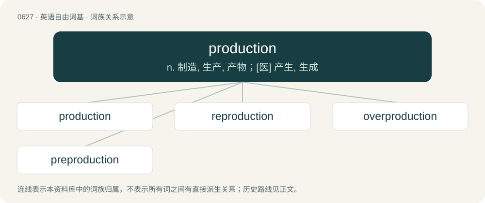

# 0699 · production — n. 制造, 生产, 产物；\[医\] 产生, 生成

[总目录](../00_总目录_按常用程度.md)

**类型**：英语自由词基　｜　**来源语言**：见词源记录

## 核心含义与来源

- 核心含义：n. 制造, 生产, 产物；\[医\] 产生, 生成
- 英文含义：The act of producing, making or creating something.
- 词形：production

**来源记录 1**（名词；The act of producing, making or creating something.）

From Middle English produccioun, from Old French production, from Latin prōductiō, prōductiōnem (“a lengthening, prolonging”). Equivalent to produce + -tion. See produce.

## 词族图

## 单词速览（常用到不常用）

| 单词 | 音标 | 释义 |
|---|---|---|
| [production](#w-1) | 英 /pɹəˈdʌkʃn̩/；美 /pɹəˈdʌkʃən/ | n. 制造, 生产, 产物；\[医\] 产生, 生成 |
| [reproduction](#w-2) | /ˌɹiːpɹəˈdʌkʃən/ | n. 再现, 复制, 生殖, 繁殖, 复制品；\[医\] 生殖, 复现(心理) |
| [overproduction](#w-3) | /.əuvəprəˈdʌkʃən/ | n. 生产过剩；\[化\] 生产过剩; 超产 |
| [preproduction](#w-4) | /priːprəˈdʌkʃən/ | \[化\] 试验性生产 |

## 逐词详解

### 1. production

**词性**：名词　｜　**音标**：英 /pɹəˈdʌkʃn̩/；美 /pɹəˈdʌkʃən/

**中文释义**：n. 制造, 生产, 产物；\[医\] 产生, 生成

**英文义项**：The act of producing, making or creating something. / The act of bringing something forward, out, etc., for use or consideration.

**构词拆分**：produce + -tion

**词源与演化**：

From Middle English produccioun, from Old French production, from Latin prōductiō, prōductiōnem (“a lengthening, prolonging”). Equivalent to produce + -tion. See produce.

**例句**：

> If you get the chance, try and catch the new production of "Hamlet."

该用例对应义项：The presentation of a theatrical work.

### 2. reproduction

**词性**：名词　｜　**音标**：/ˌɹiːpɹəˈdʌkʃən/

**中文释义**：n. 再现, 复制, 生殖, 繁殖, 复制品；\[医\] 生殖, 复现(心理)

**英文义项**：The act of reproducing new individuals biologically. / The act of making copies.

**构词拆分**：re- + production

**词源与演化**：

From re- + production.

**例句**：

> Unauthorized reproduction of this article is prohibited.

该用例对应义项：The act of making copies.

### 3. overproduction

**词性**：名词　｜　**音标**：/.əuvəprəˈdʌkʃən/

**中文释义**：n. 生产过剩；\[化\] 生产过剩; 超产

**英文义项**：The production of more of a commodity than can be used or sold.

**构词拆分**：over- + production

**词源与演化**：

From over- + production.

**例句**：

> The price of cabbage fell because of overproduction.

### 4. preproduction

**词性**：名词　｜　**音标**：/priːprəˈdʌkʃən/

**中文释义**：\[化\] 试验性生产

**英文义项**：All the preliminary arrangements that are made before the start of a project, especially before the filming of a movie. / The production of a material or substance before it is needed, in anticipation of future requirements.

**构词拆分**：pre- + production

**词源与演化**：

From pre- + production.
