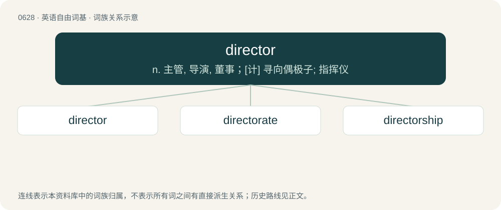

# 0700 · director — n. 主管, 导演, 董事；\[计\] 寻向偶极子; 指挥仪

[总目录](../00_总目录_按常用程度.md)

**类型**：英语自由词基　｜　**来源语言**：见词源记录

## 核心含义与来源

- 核心含义：n. 主管, 导演, 董事；\[计\] 寻向偶极子; 指挥仪
- 英文含义：One who directs; the person in charge of managing a department or directorate (e.g., director of engineering), project, or production (as in a show or film, e.g., film director).
- 词形：director

**来源记录 1**（名词；One who directs; the person in charge of managing a department or directorate (e.g., director of engineering), project, or production (as in a show or film, e.g., film director).）

Borrowed from Middle French directeur and its source Late Latin dīrēctōrem, from Latin dīrēctus. By surface analysis, direct + -or.

## 词族图

## 单词速览（常用到不常用）

| 单词 | 音标 | 释义 |
|---|---|---|
| [director](#w-1) | 英 /dɪˈɹɛk.tə(ɹ)/；美 /dɪˈɹɛk.tɚ/ | n. 主管, 导演, 董事；\[计\] 寻向偶极子; 指挥仪 |
| [directorate](#w-2) | 英 /dɪˈɹɛktəɹət/；/daɪˈɹɛktəɹət/ | n. 理事之职务, 董事会, 理事会；\[经\] 董事会 |
| [directorship](#w-3) | /diˈrektəʃip/ | n. 管理者的职位 |

## 逐词详解

### 1. director

**词性**：名词　｜　**音标**：英 /dɪˈɹɛk.tə(ɹ)/；美 /dɪˈɹɛk.tɚ/

**中文释义**：n. 主管, 导演, 董事；\[计\] 寻向偶极子; 指挥仪

**英文义项**：One who directs; the person in charge of managing a department or directorate (e.g., director of engineering), project, or production (as in a show or film, e.g., film director). / A member of a board of directors.

**词源与演化**：

Borrowed from Middle French directeur and its source Late Latin dīrēctōrem, from Latin dīrēctus. By surface analysis, direct + -or.

**例句**：

> \[...\] the confusion between directors who know nothing and managers who know everything \[...\].

该用例对应义项：A member of a board of directors.

### 2. directorate

**词性**：名词　｜　**音标**：英 /dɪˈɹɛktəɹət/；/daɪˈɹɛktəɹət/

**中文释义**：n. 理事之职务, 董事会, 理事会；\[经\] 董事会

**英文义项**：An agency headed by a director, usually a subdivision of a major government department. / A body of directors.

**构词拆分**：director + -ate

**词源与演化**：

From director + -ate.

**例句**：

> Over three million Indonesians have become new tax payers in the last year, according to the Directorate General of Taxation.

### 3. directorship

**词性**：名词　｜　**音标**：/diˈrektəʃip/

**中文释义**：n. 管理者的职位

**英文义项**：The office of a director.

**构词拆分**：director + -ship

**词源与演化**：

From director + -ship.

**例句**：

> The corporate bylaws require a quorum of outside directors, so as to balance the directorship.

该用例对应义项：The office of a director.
