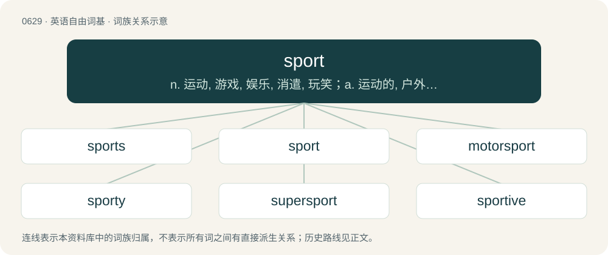

# 0701 · sport — n. 运动, 游戏, 娱乐, 消遣, 玩笑；a. 运动的, 户外穿戴的；vi. 游戏, 参加体育运动, 戏弄, 产生变种

[总目录](../00_总目录_按常用程度.md)

**类型**：英语自由词基　｜　**来源语言**：见词源记录

## 核心含义与来源

- 核心含义：n. 运动, 游戏, 娱乐, 消遣, 玩笑；a. 运动的, 户外穿戴的；vi. 游戏, 参加体育运动, 戏弄, 产生变种
- 英文含义：Any activity that uses physical exertion or skills competitively under a set of rules that is not based on aesthetics.
- 词形：sport

**来源记录 1**（名词；Any activity that uses physical exertion or skills competitively under a set of rules that is not based on aesthetics.）

From Middle English sporten (“to divert, disport”, verb) and sport, spoort, sporte (noun), apheretic shortenings of disporten (verb) and disport, disporte (noun), from Old French desporter (“to divert, amuse, please, play; to seek amusement”), etymologically meaning "to carry away (the mind from serious matters)," from des- + porter, from Latin dis- + Latin portāre, ultimately from Latin deportāre, from de- + portāre, from Proto-Indo-European \*per- (“to lead, pass over”)). Replaced native English laik, lake (“sport, fun, amusement”), and Middle English spile, spyl (“fun, sport, play”). More at disport. Doublet of disport and deport.

## 词族图

## 单词速览（常用到不常用）

| 单词 | 音标 | 释义 |
|---|---|---|
| [sports](#w-1) | /spɔːɹts/ | n. (英)运动会, 运动的, 适用于运动的, 运动会的, 与运动会有关的 |
| [sport](#w-2) | 英 /spɔːt/；美 /spoɹt/ | n. 运动, 游戏, 娱乐, 消遣, 玩笑；a. 运动的, 户外穿戴的；vi. 游戏, 参加体育运动, 戏弄, 产生变种 |
| [motorsport](#w-3) |  | n. 赛车运动; 摩托车运动 |
| [sporty](#w-4) | 英 /ˈspɔːti/；美 /ˈspɔɹti/ | a. 象运动员的, 有体育道德精神的, 炫耀的, 华而不实的, 花哨的, 供娱乐的 |
| [supersport](#w-5) |  | 【英文】Of or pertaining to a class of superbike having a four-stroke engine of between 400 and 600cc for four-cylinder machines, or between 600 and 750cc for twins |
| [sportive](#w-6) | 英 /ˈspɔː(ɹ)tɪv/；/ˈspoɹtɪv/ | a. 嬉戏着的, 戏谑的, 闹着玩的, 运动的 |
| [sportster](#w-7) | /ˈspɔːtstə/ | n. \[口语\]赛车, 跑车；\[罕用语\]运动衣 |

## 逐词详解

### 1. sports

**词性**：名词　｜　**音标**：/spɔːɹts/

**中文释义**：n. (英)运动会, 运动的, 适用于运动的, 运动会的, 与运动会有关的

**英文义项**：Synonym of sport (“the class of physical activies; athletics”).

**构词拆分**：sport + -s

**词源与演化**：

From sport + -s.

**例句**：

> If it were not for sports, how dull school life would be!

### 2. sport

**词性**：名词　｜　**音标**：英 /spɔːt/；美 /spoɹt/

**中文释义**：n. 运动, 游戏, 娱乐, 消遣, 玩笑；a. 运动的, 户外穿戴的；vi. 游戏, 参加体育运动, 戏弄, 产生变种

**英文义项**：Any activity that uses physical exertion or skills competitively under a set of rules that is not based on aesthetics. / A person who exhibits either good or bad sportsmanship.

**词源与演化**：

From Middle English sporten (“to divert, disport”, verb) and sport, spoort, sporte (noun), apheretic shortenings of disporten (verb) and disport, disporte (noun), from Old French desporter (“to divert, amuse, please, play; to seek amusement”), etymologically meaning "to carry away (the mind from serious matters)," from des- + porter, from Latin dis- + Latin portāre, ultimately from Latin deportāre, from de- + portāre, from Proto-Indo-European \*per- (“to lead, pass over”)). Replaced native English laik, lake (“sport, fun, amusement”), and Middle English spile, spyl (“fun, sport, play”). More at disport. Doublet of disport and deport.

**例句**：

> Basketball is her favorite sport, and she also enjoys various other sports as well.

该用例对应义项：Any activity that uses physical exertion or skills competitively under a set of rules that is not based on aesthetics.

### 3. motorsport

**词性**：名词

**中文释义**：n. 赛车运动; 摩托车运动

**英文义项**：auto racing / Any sport involving automobiles (motor cars) other than racing; e.g. time trials

**构词拆分**：motor + sport

**词源与演化**：

From motor + sport.

### 4. sporty

**词性**：形容词　｜　**音标**：英 /ˈspɔːti/；美 /ˈspɔɹti/

**中文释义**：a. 象运动员的, 有体育道德精神的, 炫耀的, 华而不实的, 花哨的, 供娱乐的

**英文义项**：Fond of sports. / Suitable for use in sport.

**构词拆分**：sport + -y

**词源与演化**：

From sport + -y.

**例句**：

> My new car looks sporty but is actually very practical.

该用例对应义项：stylish with a fun, bold, vibrant quality or appearance.

### 5. supersport

**词性**：形容词

**英文义项**：Of or pertaining to a class of superbike having a four-stroke engine of between 400 and 600cc for four-cylinder machines, or between 600 and 750cc for twins

**构词拆分**：super- + sport

**词源与演化**：

From super- + sport.

### 6. sportive

**词性**：形容词　｜　**音标**：英 /ˈspɔː(ɹ)tɪv/；/ˈspoɹtɪv/

**中文释义**：a. 嬉戏着的, 戏谑的, 闹着玩的, 运动的

**英文义项**：Playful, coltish. / Interested in sport.

**构词拆分**：sport + -ive

**词源与演化**：

From sport + -ive.

**例句**：

> Jeunesse Sportive de Kabylie is one of Algeria's best soccer teams.

### 7. sportster

**词性**：名词　｜　**音标**：/ˈspɔːtstə/

**中文释义**：n. \[口语\]赛车, 跑车；\[罕用语\]运动衣

**英文义项**：A sporty automobile or motorcycle.

**构词拆分**：sport + -ster

**词源与演化**：

sport + -ster
