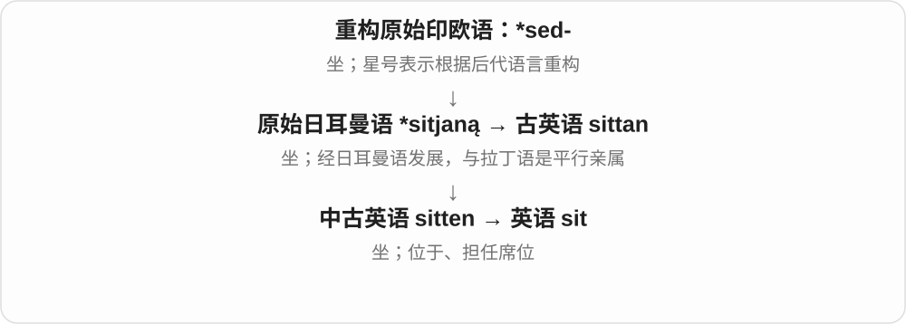
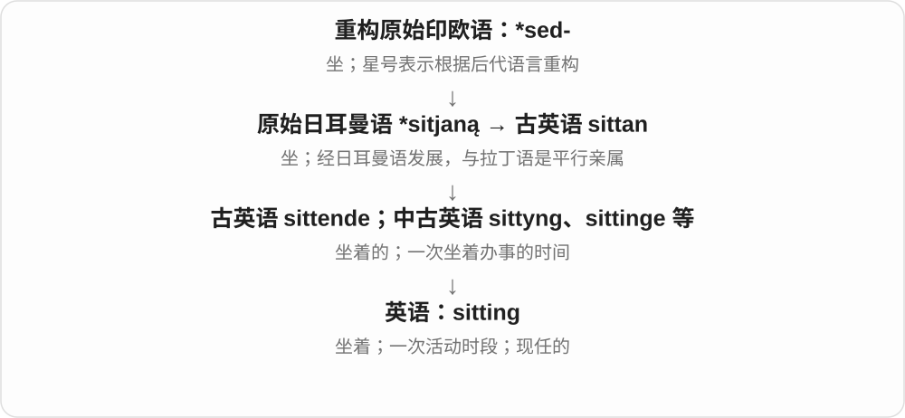
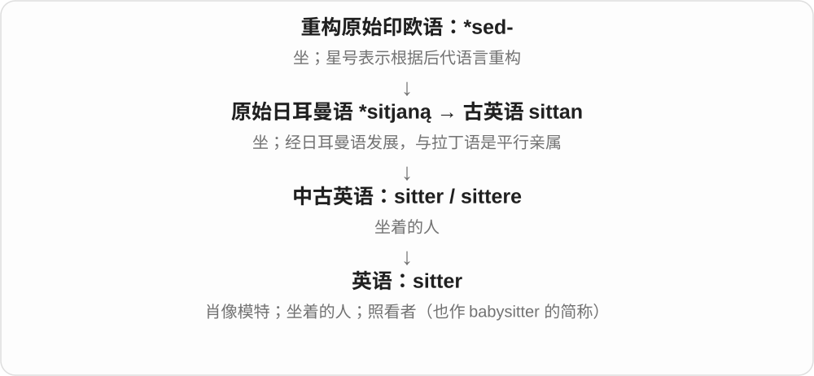

# 0703 · sit — 坐；坐着；任职或开会

[逐词精讲目录](../00_逐词精讲目录.md) · [总目录](../00_总目录_按常用程度.md)

## 核心词根与来源

sit 是古英语 sittan 传下的本源词。sitting 可指坐着的状态、一场会议或一段坐着完成的活动；sitter 是坐着的人，也发展出照看者等固定用法。

**SIT：身体处于坐姿，也可以坐在某个位置履职**

坐在椅子上，或坐到议会、评审席上工作。

- **动作与状态**：sit
- **一段活动及相关人**：sitting · sitter
- **坐下、坐着的过去与分词 sat**：sit · sat
- **sit → sits：坐着与处在某位置**：sit · sits · sat · sitting

## 词形与演化规律

sit–sat–sat；sitting、sitter 双写 t。sitting president 的现任义来自处于该席位，不是说总统此刻一定坐着。

sit → sat → sat；与 set 的放置动作不要混淆。

古英语 sittan 的本族传承，与拉丁 sedere 是远源亲属，不是拉丁直接变成 sit。

## 单词速览（按词族由简到繁）

同一基础词的相关扩展放在一起，先读基础形式，再读扩展；各组之间优先读常用的。具体词源关系见各词讲解。

| 单词 | 音标 | 核心意思 |
|---|---|---|
| [sit](#w-1) | /sɪt/ | 坐；位于；担任委员；开会；照看 |
| [sitting](#w-2) | /ˈsɪtɪŋ/ | 坐着；一次持续活动；开庭或会议的一次；现任的 |
| [sat](#w-4) | /sæt/ | 坐着、坐下了；sit 的过去式、过去分词 |
| [sits](#w-5) | /sɪts/ | 坐着；处在某位置；开会、开庭等〔第三人称单数〕 |
| [sitter](#w-3) | 英 /ˈsɪtə/；美 /ˈsɪtər/ | 照看孩子或宠物的人；肖像画模特；坐着的人 |

## 逐词讲解

### 1. sit — 坐；位于；担任委员；开会；照看

**音标**：/sɪt/

**先抓住这个画面**

sit 最直观是把身体安放在座位上；扩大后，物品可以“放在那儿”，委员可以“占一个席位”。

**怎么拆**

经古英语 sittan、中古英语 sitten 继承而来，与拉丁 sedēre 是共同祖先 *sed- 的不同后代，不能画成 sedēre 变成 sit。

**怎么变成今天的意思**

sit on a chair 是坐着；a house sits on a hill 是房子坐落山上；sit on a committee 是担任委员。sit for a portrait 是坐着让人画肖像。

**常见搭配与例句**

sit down；sit on a committee；sit an exam（英式）；sit for a portrait。

> She sat beside the window and opened her book.

她坐在窗边，打开了书。

> He sits on the museum’s advisory committee.

他担任博物馆顾问委员会委员。

> The cottage sits at the edge of the forest.

小屋坐落在森林边缘。

**别混淆**

seat 作动词是让别人坐下、安排座位；sit 通常是主体自己坐。过去式和过去分词都是 sat。

### 2. sitting — 坐着；一次持续活动；开庭或会议的一次；现任的

**音标**：/ˈsɪtɪŋ/

**先抓住这个画面**

sitting 把“坐下来”的动作拉成一段时间：一口气读完、一场会议、一顿分批供应的餐，都可以围绕这段时间来理解。

**怎么拆**

现代 sit + -ing；名词可追到中古英语 sittyng，分词另承古英语 sittende 等形式，后来汇为现代拼写。

**怎么变成今天的意思**

in one sitting 是一口气做完；a sitting president 是现任总统，像仍坐在职位的席位上；a court sitting 是一次开庭。

**常见搭配与例句**

in one sitting；a sitting president；the morning sitting。

> I read the short novel in one sitting.

我一口气读完了这部短篇小说。

> The sitting president attended the ceremony.

现任总统出席了仪式。

> The court’s morning sitting ended at noon.

法院上午的庭审在中午结束。

**别混淆**

session 和名词 sitting 都可指一次会议；sitting 还常说一口气做事的时段，现任义则是形容词。

### 3. sat — 坐着、坐下了；sit 的过去式、过去分词

**音标**：/sæt/

**先抓住这个画面**

把坐的姿势或坐下的动作放在过去，用 sat。The box sat on the shelf 又可说箱子一直待在架子上。

**怎么拆**

接古英语 sittan 的过去式 sæt 等旧强变位形式；现代过去分词也采用 sat，较早另有 sitten 等。

**怎么变成今天的意思**

**古英语 sittan、sæt 等**  
坐及相应过去形式

↓

**现代 sit → sat → sat**  
过去与过去分词同形

sat down 坐下了；sat by the window 坐在窗边；sat still 一动不动地坐着；have sat here 已在这里坐着。

**常见搭配与例句**

sat beside a friend；sat on the floor。

> We sat by the window and watched the rain.

我们坐在窗边看雨。

> The old box sat untouched on the shelf for years.

那只旧箱子在架子上放了多年，一直没人动。

**别混淆**

sit 是坐、处于位置，set 通常是放置：She sat down；She set the bag down。sat 的 /æ/ 不同于 set 的 /e/。

### 4. sits — 坐着；处在某位置；开会、开庭等〔第三人称单数〕

**音标**：/sɪts/

**先抓住这个画面**

身体落到一个稳定位置，就是 sits 的坐；建筑、物体稳稳放在那里，也能借这个姿态说。

**怎么拆**

sit + -s，/t/ 后读 /s/。sit 继承古英语 sittan，与拉丁 sedere 是更远共同祖先的不同后代，不是直接从拉丁借来。

**怎么变成今天的意思**

**古英语 sittan → sit**  
坐、处于坐姿；扩到处在位置、担任等

↓

**sit + -s → sits**  
某人坐着；某物位于；某机构开会等

sits by the window 坐在窗边；sits on a hill 坐落在山上；sits on a committee 担任委员会成员。

**常见搭配与例句**

sits quietly 安静坐着；the court sits 开庭，属正式机构用法。

> She sits near the window when she reads.

她读书时坐在窗边。

> The old house sits at the top of the hill.

老房子坐落在山顶。

**别混淆**

sits 是现在三单；过去式、分词是 sat，ing 形式是 sitting。sit on a committee 通常说成员身份，不是坐在委员会这个物体上。

### 5. sitter — 照看孩子或宠物的人；肖像画模特；坐着的人

**音标**：英 /ˈsɪtə/；美 /ˈsɪtər/

**先抓住这个画面**

sitter 的不同义围绕不同的 sit：可以是坐着让画家画的人，也可以是留下来替你照看孩子的人。

**怎么拆**

sit + -er，中古英语已有 sitter / sittere；现代照看义也常是 babysitter 等词的简称。

**怎么变成今天的意思**

找人照看孩子可说 find a sitter；艺术语境 the sitter 是坐着供画家描绘的人。足球口语 a sitter 还可指极容易得分的机会。

**常见搭配与例句**

hire a sitter；a portrait sitter；miss a sitter。

> We need a sitter for the children on Saturday evening.

周六晚上我们需要一个人来照看孩子。

> The painter asked the sitter to turn slightly towards the light.

画家请肖像模特略微转向光线。

**别混淆**

model 范围很广，不必是坐姿肖像模特；sitter 在肖像画里突出被描绘的人。

## 这一组要分清什么

sit 通常不及物，seat someone 是安排某人坐下。sitter 可指照看孩子的人，不能只译成坐者。

## 串起来练习

We sat through the whole sitting while the sitter looked after the children.

我们坐着参加了整场会议，保姆则照看孩子。
