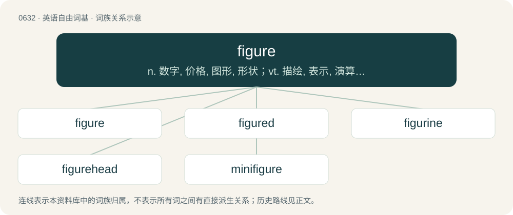

# 0704 · figure — n. 数字, 价格, 图形, 形状；vt. 描绘, 表示, 演算, 认为；vi. 计算, 出现, 估计

[总目录](../00_总目录_按常用程度.md)

**类型**：英语自由词基　｜　**来源语言**：见词源记录

## 核心含义与来源

- 核心含义：n. 数字, 价格, 图形, 形状；vt. 描绘, 表示, 演算, 认为；vi. 计算, 出现, 估计
- 英文含义：A drawing or diagram conveying information.
- 词形：figure

**来源记录 1**（名词；A drawing or diagram conveying information.）

From Middle English figure, borrowed from Old French figure, from Latin figūra (“form, shape, form of a word, a figure of speech, Late Latin a sketch, drawing”), from fingō (“to form, shape, mold, fashion”), from Proto-Indo-European \*dʰeyǵʰ- (“to mold, shape, form, knead”). Cognate with Ancient Greek τεῖχος (teîkhos), Sanskrit देग्धि (dégdhi), Old English dāg (“dough”). More at dough. Doublet of figura.

## 词族图

## 单词速览（常用到不常用）

| 单词 | 音标 | 释义 |
|---|---|---|
| [figure](#w-1) | 英 /ˈfɪɡə/；美 /ˈfɪɡɚ/ | n. 数字, 价格, 图形, 形状；vt. 描绘, 表示, 演算, 认为；vi. 计算, 出现, 估计 |
| [figured](#w-2) | 英 /ˈfɪɡəd/ | a. 有形状的, 有图案的, 用图表表现的, 用图画表现的 |
| [figurine](#w-3) | 英 /fɪɡ(j)əˈɹin/；美 /fɪɡ(j)əˈɹin/ | n. 小雕像 |
| [figurehead](#w-4) | /ˈfɪɡjəɹˌhɛd/ | n. 装饰船头的人像, 傀儡领袖 |
| [minifigure](#w-5) |  | 【英文】A small figure of a person, especially in toys such as Lego. |

## 逐词详解

### 1. figure

**词性**：名词　｜　**音标**：英 /ˈfɪɡə/；美 /ˈfɪɡɚ/

**中文释义**：n. 数字, 价格, 图形, 形状；vt. 描绘, 表示, 演算, 认为；vi. 计算, 出现, 估计

**英文义项**：A drawing or diagram conveying information. / The representation of any form, as by drawing, painting, modelling, carving, embroidering, etc.; especially, a representation of the human body.

**词源与演化**：

From Middle English figure, borrowed from Old French figure, from Latin figūra (“form, shape, form of a word, a figure of speech, Late Latin a sketch, drawing”), from fingō (“to form, shape, mold, fashion”), from Proto-Indo-European \*dʰeyǵʰ- (“to mold, shape, form, knead”). Cognate with Ancient Greek τεῖχος (teîkhos), Sanskrit देग्धि (dégdhi), Old English dāg (“dough”). More at dough. Doublet of figura.

**例句**：

> He cut a sorry figure standing there in the rain.

该用例对应义项：The appearance or impression made by the conduct or career of a person.

### 2. figured

**词性**：形容词　｜　**音标**：英 /ˈfɪɡəd/

**中文释义**：a. 有形状的, 有图案的, 用图表表现的, 用图画表现的

**英文义项**：Having a pattern considered attractive appearing on a section. / Adorned with a figure or figures.

**构词拆分**：From figure + -ed.

**词源与演化**：

From figure + -ed.

**例句**：

> Figured wood is especially sought after for its distinctive texture.

该用例对应义项：Having a pattern considered attractive appearing on a section.

### 3. figurine

**词性**：名词　｜　**音标**：英 /fɪɡ(j)əˈɹin/；美 /fɪɡ(j)əˈɹin/

**中文释义**：n. 小雕像

**英文义项**：A small carved or molded figure; a statuette.

**构词拆分**：figure + -ine

**词源与演化**：

Borrowed from French figurine, equivalent to figure + -ine.

**例句**：

> Tom accidentally knocked Mary's favourite figurine off the shelf and broke it.

### 4. figurehead

**词性**：名词　｜　**音标**：/ˈfɪɡjəɹˌhɛd/

**中文释义**：n. 装饰船头的人像, 傀儡领袖

**英文义项**：A carved figure on the prow of a sailing ship. / Someone in a nominal position of leadership who has little to no actual power.

**构词拆分**：figure + head

**词源与演化**：

From figure + head.

**例句**：

> President Jackson is just a figurehead for the international conspiracy of Esperantists.

### 5. minifigure

**词性**：名词

**英文义项**：A small figure of a person, especially in toys such as Lego.

**构词拆分**：mini- + figure

**词源与演化**：

From mini- + figure.
