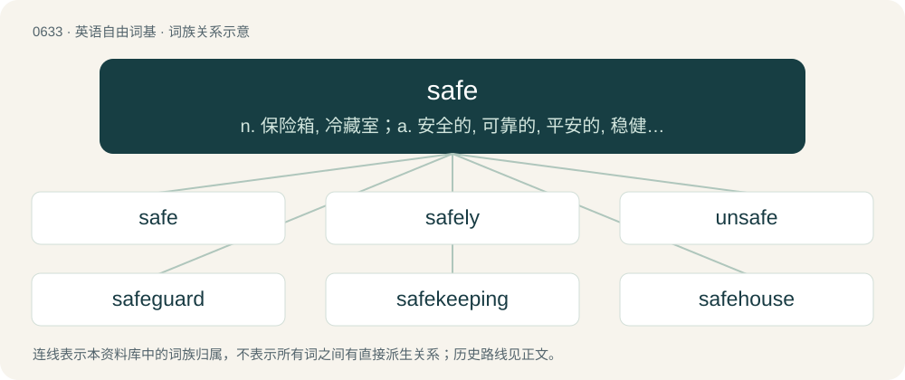

# 0705 · safe — n. 保险箱, 冷藏室；a. 安全的, 可靠的, 平安的, 稳健的, 有把握的

[总目录](../00_总目录_按常用程度.md)

**类型**：英语自由词基　｜　**来源语言**：见词源记录

## 核心含义与来源

- 核心含义：n. 保险箱, 冷藏室；a. 安全的, 可靠的, 平安的, 稳健的, 有把握的
- 英文含义：Not in danger; out of harm's reach.
- 词形：safe

**来源记录 1**（形容词；Not in danger; out of harm's reach.）

From Middle English sauf, safe, saf, saaf, from Old French sauf, saulf, salf (“safe”), from Latin salvus (“whole, safe”), from Proto-Italic \*salawos, from Proto-Indo-European \*solh₂- (“whole, every”). Displaced Old English sicor (“secure, sure”).

## 词族图

## 单词速览（常用到不常用）

| 单词 | 音标 | 释义 |
|---|---|---|
| [safe](#w-1) | /ˈseɪ̯f/ | n. 保险箱, 冷藏室；a. 安全的, 可靠的, 平安的, 稳健的, 有把握的 |
| [safely](#w-2) | /ˈseɪfli/ | adv. 安全地, 确实地 |
| [unsafe](#w-3) | /ʌnˈseɪf/ | a. 不安全的, 不安稳的, 危险的；\[经\] 不安全 |
| [safeguard](#w-4) | 英 /ˈseɪfɡɑːd/；美 /ˈseɪfɡɑɹd/ | n. 保卫, 保护措施, 防护设施；vt. 保卫, 保护 |
| [safekeeping](#w-5) | /ˈseifˈkiːpiŋ/ | n. 保护, 保管；\[经\] 安全保管 |
| [safehouse](#w-6) | 美 /ˈseɪfˌhaʊs/ | 【英文】A secure location, known to only a few trusted people, suitable for hiding witnesses, agents or other persons perceived as being in danger. |

## 逐词详解

### 1. safe

**词性**：形容词　｜　**音标**：/ˈseɪ̯f/

**中文释义**：n. 保险箱, 冷藏室；a. 安全的, 可靠的, 平安的, 稳健的, 有把握的

**英文义项**：Not in danger; out of harm's reach. / Free from risk.

**词源与演化**：

From Middle English sauf, safe, saf, saaf, from Old French sauf, saulf, salf (“safe”), from Latin salvus (“whole, safe”), from Proto-Italic \*salawos, from Proto-Indo-European \*solh₂- (“whole, every”). Displaced Old English sicor (“secure, sure”).

**例句**：

> The pitcher attempted to pick off the runner at first, but he was safe.

该用例对应义项：When a batter successfully reaches first base, or when a baserunner successfully advances to the next base or returns to the base he last occupied; not out.

### 2. safely

**词性**：副词　｜　**音标**：/ˈseɪfli/

**中文释义**：adv. 安全地, 确实地

**英文义项**：In a safe manner; without risk; using caution above all else. / In a secure manner; without the possibility of injury or harm resulting.

**构词拆分**：safe + -ly

**词源与演化**：

From Middle English savely; equivalent to safe + -ly.

**例句**：

> We are safely out of there.

该用例对应义项：with safety; in a safe manner

### 3. unsafe

**词性**：形容词　｜　**音标**：/ʌnˈseɪf/

**中文释义**：a. 不安全的, 不安稳的, 危险的；\[经\] 不安全

**英文义项**：Not safe (various senses); dangerous.

**构词拆分**：un- + safe

**词源与演化**：

From un- (not) + safe.

**例句**：

> Do you really think it would be unsafe to do that?

### 4. safeguard

**词性**：名词　｜　**音标**：英 /ˈseɪfɡɑːd/；美 /ˈseɪfɡɑɹd/

**中文释义**：n. 保卫, 保护措施, 防护设施；vt. 保卫, 保护

**英文义项**：Something that serves as a guard or protection; a defense. / One who, or that which, defends or protects; defence; protection.

**构词拆分**：safe + guard

**词源与演化**：

From Middle English savegard, from Middle French sauvegarde, from Old French salve garde, sauve garde, reconstructed as safe + guard.

**例句**：

> Getting a flu shot is a good safeguard against illness.

该用例对应义项：Something that serves as a guard or protection; a defense.

### 5. safekeeping

**词性**：名词　｜　**音标**：/ˈseifˈkiːpiŋ/

**中文释义**：n. 保护, 保管；\[经\] 安全保管

**英文义项**：the act of keeping something safe; protection from harm, damage, loss, or theft / the storage of assets in a protected area

**构词拆分**：safe + keeping

**词源与演化**：

From safe + keeping.

**例句**：

> I locked the documents in my bureau for safekeeping.

该用例对应义项：the storage of assets in a protected area

### 6. safehouse

**词性**：名词　｜　**音标**：美 /ˈseɪfˌhaʊs/

**英文义项**：A secure location, known to only a few trusted people, suitable for hiding witnesses, agents or other persons perceived as being in danger.

**构词拆分**：safe + house

**词源与演化**：

From safe + house.
