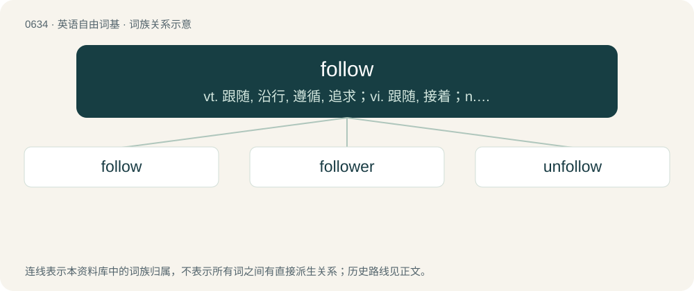

# 0707 · follow — vt. 跟随, 沿行, 遵循, 追求；vi. 跟随, 接着；n. 跟随, 追随

[总目录](../00_总目录_按常用程度.md)

**类型**：英语自由词基　｜　**来源语言**：见词源记录

## 核心含义与来源

- 核心含义：vt. 跟随, 沿行, 遵循, 追求；vi. 跟随, 接着；n. 跟随, 追随
- 英文含义：To go after; to pursue; to move behind in the same path or direction, especially with the intent of catching.
- 词形：follow

**来源记录 1**（动词；To go after; to pursue; to move behind in the same path or direction, especially with the intent of catching.）

From Middle English folwen, folȝen, folgen, from Old English folgian (“to follow, pursue”), from Proto-West Germanic \*folgēn, from Proto-Germanic \*fulgāną (“to follow”).

## 词族图

## 单词速览（常用到不常用）

| 单词 | 音标 | 释义 |
|---|---|---|
| [follow](#w-1) | 英 /ˈfɒləʊ/；美 /ˈfɑloʊ/ | vt. 跟随, 沿行, 遵循, 追求；vi. 跟随, 接着；n. 跟随, 追随 |
| [follower](#w-2) | 英 /ˈfɒləʊə(ɹ)/ | n. 从者, 属下, 追补者；\[电\] 随动机 |
| [unfollow](#w-3) |  | 【英文】To cease to subscribe to (a feed of another user's activity). |

## 逐词详解

### 1. follow

**词性**：动词　｜　**音标**：英 /ˈfɒləʊ/；美 /ˈfɑloʊ/

**中文释义**：vt. 跟随, 沿行, 遵循, 追求；vi. 跟随, 接着；n. 跟随, 追随

**英文义项**：To go after; to pursue; to move behind in the same path or direction, especially with the intent of catching. / To go or come after in a sequence.

**词源与演化**：

From Middle English folwen, folȝen, folgen, from Old English folgian (“to follow, pursue”), from Proto-West Germanic \*folgēn, from Proto-Germanic \*fulgāną (“to follow”).

**例句**：

> It follows that if two numbers are not equal then one is larger than the other.

该用例对应义项：To be a logical consequence of something.

### 2. follower

**词性**：名词　｜　**音标**：英 /ˈfɒləʊə(ɹ)/

**中文释义**：n. 从者, 属下, 追补者；\[电\] 随动机

**英文义项**：One who follows, comes after another. / Something that comes after another thing.

**构词拆分**：follow + -er

**词源与演化**：

From Middle English folwer, folwere, folewer, from Old English folgere (“follower; attendant; disciple”), equivalent to follow + -er. Cognate with Saterland Frisian Foulger, West Frisian folger, Dutch volger, German Folger, Swedish följare.

**例句**：

> I have over 50 followers on Twitter, but all my tweets only get 10 likes.

该用例对应义项：An account holder who subscribes to see content from another account on a social media platform.

### 3. unfollow

**词性**：动词

**英文义项**：To cease to subscribe to (a feed of another user's activity).

**构词拆分**：un- + follow

**词源与演化**：

From un- + follow.
