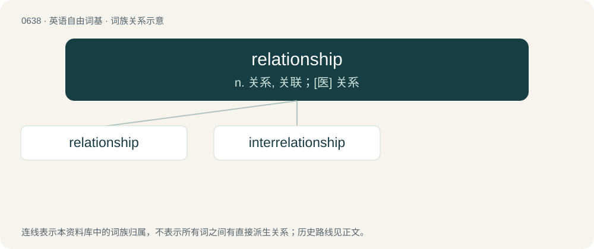

# 0709 · relationship — n. 关系, 关联；\[医\] 关系

[总目录](../00_总目录_按常用程度.md)

**类型**：英语自由词基　｜　**来源语言**：见词源记录

## 核心含义与来源

- 核心含义：n. 关系, 关联；\[医\] 关系
- 英文含义：A connection or association; the condition of being related.
- 词形：relationship

**来源记录 1**（名词；A connection or association; the condition of being related.）

From relation + -ship. Displaced native Old English sibb.

## 词族图

## 单词速览（常用到不常用）

| 单词 | 音标 | 释义 |
|---|---|---|
| [relationship](#w-1) | 英 /ɹɪˈleɪʃ(ə)nˌʃɪp/；/ɹəˈleɪʃ(ə)nˌʃɪp/ | n. 关系, 关联；\[医\] 关系 |
| [interrelationship](#w-2) | 英 /ˌɪntə.ɹɪˈleɪ.ʃən.ʃɪp/；美 /ˌɪntɚ.ɹɪˈleɪ.ʃən.ʃɪp/ | n. 相互关系 |

## 逐词详解

### 1. relationship

**词性**：名词　｜　**音标**：英 /ɹɪˈleɪʃ(ə)nˌʃɪp/；/ɹəˈleɪʃ(ə)nˌʃɪp/

**中文释义**：n. 关系, 关联；\[医\] 关系

**英文义项**：A connection or association; the condition of being related. / The links between the x-values and y-values of ordered pairs of numbers especially coordinates.

**构词拆分**：relation + -ship

**词源与演化**：

From relation + -ship. Displaced native Old English sibb.

**例句**：

> They have been in a relationship for ten years, but have never married.

该用例对应义项：A romantic or sexual involvement.

### 2. interrelationship

**词性**：形容词　｜　**音标**：英 /ˌɪntə.ɹɪˈleɪ.ʃən.ʃɪp/；美 /ˌɪntɚ.ɹɪˈleɪ.ʃən.ʃɪp/

**中文释义**：n. 相互关系

**英文义项**：Between multiple relationships; interrelation

**构词拆分**：inter- + relationship

**词源与演化**：

From inter- + relationship.
