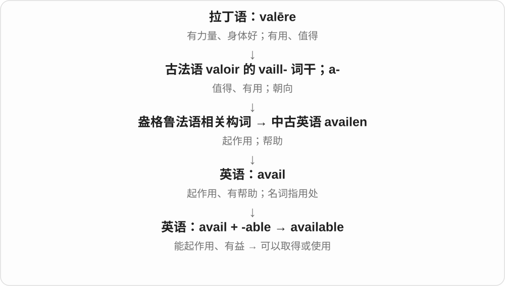
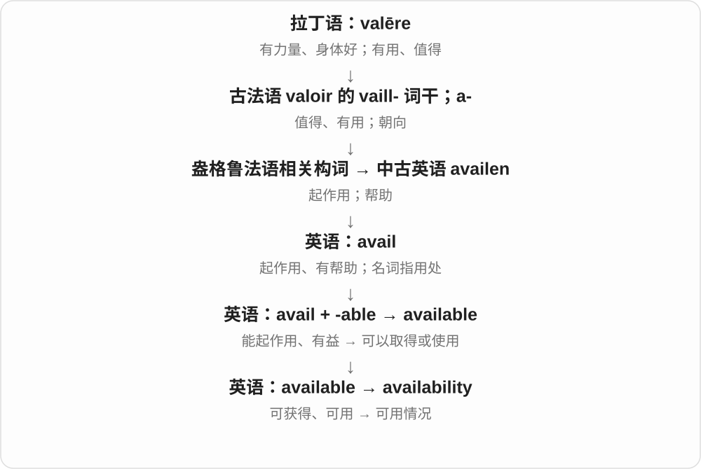
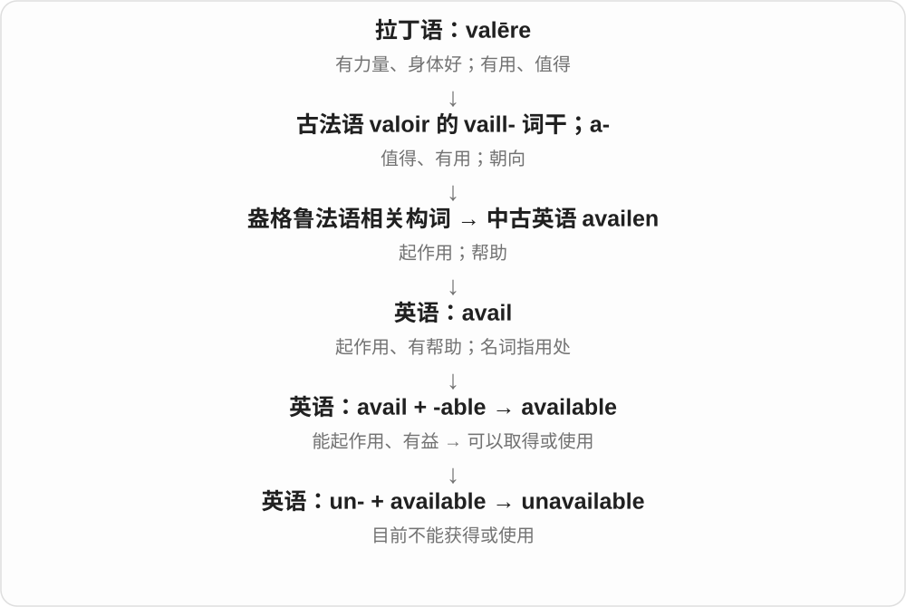

# 0710 · available — 可获得；有空；可用

[逐词精讲目录](../00_逐词精讲目录.md) · [总目录](../00_总目录_按常用程度.md)

## 核心词根与来源

available 联系 avail 的有用、起作用一支，形成能供利用的意思。availability 名词化谈可用程度，unavailable 否定获取或使用条件。

**AVAILABLE：轮到需要时拿得到、用得上**

房间能订到、工具能使用、某人有时间，都属于可供使用。

- **可用与不可用**：available · unavailable
- **可用程度或时间**：availability

## 词形与演化规律

available + -ity → availability；un- + available → unavailable。可用不等于免费，也不等于当前一定适合某个人。

## 单词速览（按词族由简到繁）

同一基础词的相关扩展放在一起，先读基础形式，再读扩展；各组之间优先读常用的。具体词源关系见各词讲解。

| 单词 | 音标 | 核心意思 |
|---|---|---|
| [available](#w-1) | 英、美 /əˈveɪləbəl/ | 可获得、可使用的；有空的 |
| [availability](#w-2) | 英、美 /əˌveɪləˈbɪləti/ | 可获得性；有货、可用情况；空闲时间 |
| [unavailable](#w-3) | 英、美 /ˌʌnəˈveɪləbəl/ | 无法获得或使用的；没有空的 |

## 逐词讲解

### 1. available — 可获得、可使用的；有空的

**音标**：英、美 /əˈveɪləbəl/

**先抓住这个画面**

东西在那里，并且你现在有机会拿来用；说人 available，则通常是他有时间回应或参加。

**怎么拆**

avail + -able；从“能起作用、有益”发展到“可供使用、可以取得”。

**怎么变成今天的意思**

available online 是网上可获得；available for a meeting 是有空开会。东西存在不等于一定 available：可能已售完、被预约，或你没有权限。

**常见搭配与例句**

available to users；available for purchase；readily available。

> The guide is available online at no charge.

这份指南可以在网上免费获取。

> Are you available for a short meeting tomorrow?

你明天有空开个短会吗？

**别混淆**

accessible 强调能接近、能使用的便利或条件；available 强调有得用、有得取。

### 2. availability — 可获得性；有货、可用情况；空闲时间

**音标**：英、美 /əˌveɪləˈbɪləti/

**先抓住这个画面**

不只问“有没有”，还问什么时间、多少数量、哪些人能用到。

**怎么拆**

available 的 -able 变为 -ability，形成状态名词。

**怎么变成今天的意思**

check availability 可以查房间、票或人的时间。limited availability 是供应或可用名额有限，不一定已经完全没有。

**常见搭配与例句**

check availability；subject to availability；staff availability。

> Please send me your availability for next week.

请把你下周有空的时间发给我。

> The website shows the current availability of each room.

网站显示每个房间目前是否可订。

**别混淆**

availability 看有得用的情况；affordability 看价格是否负担得起。

### 3. unavailable — 无法获得或使用的；没有空的

**音标**：英、美 /ˌʌnəˈveɪləbəl/

**先抓住这个画面**

你现在想用它、买它或联系这个人，但眼下用不了、拿不到或联系不上。

**怎么拆**

un-“不” + available。

**怎么变成今天的意思**

可以是暂时缺货、服务停用，也可以是人忙着。temporarily unavailable 表示暂不可用；不要自动推断东西永久消失了。

**常见搭配与例句**

temporarily unavailable；unavailable for comment；currently unavailable。

> The booking system is temporarily unavailable.

预订系统暂时无法使用。

> The manager was unavailable for comment on Tuesday.

经理周二无法接受采访作出评论。

**别混淆**

unavailable 不可用；unwilling 是不愿意，人的缺席不一定出于不愿意。

## 这一组要分清什么

available 是能拿到、能安排；accessible 更强调能接近或使用。一个 available room 也可能价格很高。

## 串起来练习

Please check room availability and tell me when you are available.

请查一下空房情况，并告诉我你什么时候有空。
