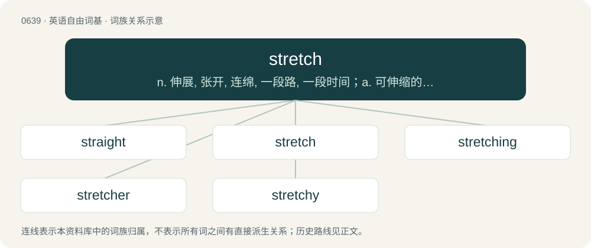

# 0710 · stretch — n. 伸展, 张开, 连绵, 一段路, 一段时间；a. 可伸缩的, 弹性的；vt. 伸展, 张开, 曲解, 使过度伸展

[总目录](../00_总目录_按常用程度.md)

**类型**：英语自由词基　｜　**来源语言**：见词源记录

## 核心含义与来源

- 核心含义：n. 伸展, 张开, 连绵, 一段路, 一段时间；a. 可伸缩的, 弹性的；vt. 伸展, 张开, 曲解, 使过度伸展
- 英文含义：To lengthen by pulling.
- 词形：stretch

**来源记录 1**（动词；To lengthen by pulling.）

From Middle English strecchen, from Old English streċċan (“to stretch, hold out, extend, spread out, prostrate”), from Proto-West Germanic \*strakkjan (“to stretch, make taut or tight”), from Proto-Indo-European \*(s)treg-, \*streg-, \*treg- (“stiff, rigid”). Cognate with West Frisian strekke, Dutch strekken (“to stretch, straighten”), German strecken (“to stretch, straighten, elongate”), Danish strække (“to stretch”), Swedish sträcka (“to stretch”), Dutch strak (“taut, tight”), Albanian shtriqem (“to stretch”). More at stark.

## 词族图

## 单词速览（常用到不常用）

| 单词 | 音标 | 释义 |
|---|---|---|
| [straight](#w-1) | /stɹeɪt/ | n. 直线, 直；a. 直的, 笔直的, 正直的, 直接的, 连续的, 整齐的；adv. 直接地, 立即, 不断地 |
| [stretch](#w-2) | /stɹɛt͡ʃ/ | n. 伸展, 张开, 连绵, 一段路, 一段时间；a. 可伸缩的, 弹性的；vt. 伸展, 张开, 曲解, 使过度伸展 |
| [stretching](#w-3) | /ˈstɹɛt͡ʃɪŋ/ | \[机\] 伸展作业, 锻伸作业 |
| [stretcher](#w-4) | 英 /ˈstɹɛt͡ʃə/；美 /ˈstɹɛt͡ʃɚ/ | n. 担架, 延伸器；\[医\] 担架 |
| [stretchy](#w-5) | /ˈstɹɛt͡ʃi/ | a. 可延伸的, 有弹性的, 易延伸过长的 |

## 逐词详解

### 1. straight

**词性**：形容词　｜　**音标**：/stɹeɪt/

**中文释义**：n. 直线, 直；a. 直的, 笔直的, 正直的, 直接的, 连续的, 整齐的；adv. 直接地, 立即, 不断地

**英文义项**：Not crooked, curly, or bent; having a constant direction throughout its length. / Direct, undeviating.

**构词拆分**：stretch + -ed

**词源与演化**：

From Middle English streight, streght, streiȝt, the past participle of strecchen (“to stretch”), from Old English streċċan (past participle ġestreaht, ġestreht), from Proto-West Germanic \*strakkjan (“to stretch”). Cognate with Scots straicht (“straight”), Dutch gestrekt (“stretched”), German gestreckt (“stretched”), Danish strakt (“stretched”), Faroese and Norn strekti (“stretched”), Icelandic strekkti (“stretched”), Norwegian strekte (“stretched”), Swedish sträckte (“stretched”). Doublet of straught. Equivalent to stretch + -ed. In some senses, conflated with strait (“narrow, constricted”), which is from Latin strictus via Old French estreit.

**例句**：

> After four straight wins, Mudchester United are top of the league.

该用例对应义项：In a row, in unbroken sequence; consecutive.

### 2. stretch

**词性**：动词　｜　**音标**：/stɹɛt͡ʃ/

**中文释义**：n. 伸展, 张开, 连绵, 一段路, 一段时间；a. 可伸缩的, 弹性的；vt. 伸展, 张开, 曲解, 使过度伸展

**英文义项**：To lengthen by pulling. / To lengthen when pulled.

**词源与演化**：

From Middle English strecchen, from Old English streċċan (“to stretch, hold out, extend, spread out, prostrate”), from Proto-West Germanic \*strakkjan (“to stretch, make taut or tight”), from Proto-Indo-European \*(s)treg-, \*streg-, \*treg- (“stiff, rigid”). Cognate with West Frisian strekke, Dutch strekken (“to stretch, straighten”), German strecken (“to stretch, straighten, elongate”), Danish strække (“to stretch”), Swedish sträcka (“to stretch”), Dutch strak (“taut, tight”), Albanian shtriqem (“to stretch”). More at stark.

**例句**：

> To say crossing the street was brave is stretching the meaning of "brave" considerably.

该用例对应义项：To make inaccurate by exaggeration.

### 3. stretching

**词性**：名词　｜　**音标**：/ˈstɹɛt͡ʃɪŋ/

**中文释义**：\[机\] 伸展作业, 锻伸作业

**英文义项**：The act by which something is stretched. / A form of physical exercise in which a specific skeletal muscle (or muscle group) is deliberately elongated to its fullest length in order to improve the muscle's felt elasticity and reaffirm comfortable muscle tone.

**构词拆分**：stretch + -ing

**词源与演化**：

From Middle English strecching, strecchinge, equivalent to stretch + -ing.

**例句**：

> Under pressure, those aneurysms can expand like balloons, stretching the arterial wall.

### 4. stretcher

**词性**：名词　｜　**音标**：英 /ˈstɹɛt͡ʃə/；美 /ˈstɹɛt͡ʃɚ/

**中文释义**：n. 担架, 延伸器；\[医\] 担架

**英文义项**：Someone or something that stretches. / A simple litter designed to carry a sick, injured, or dead person.

**构词拆分**：From stretch + -er.

**词源与演化**：

From stretch + -er.

**例句**：

> The last time I saw Tom, he was on a stretcher.

### 5. stretchy

**词性**：形容词　｜　**音标**：/ˈstɹɛt͡ʃi/

**中文释义**：a. 可延伸的, 有弹性的, 易延伸过长的

**英文义项**：Capable of stretching; elastic. / Inclined to stretch, as from weariness.

**构词拆分**：From stretch + -y.

**词源与演化**：

From stretch + -y.
