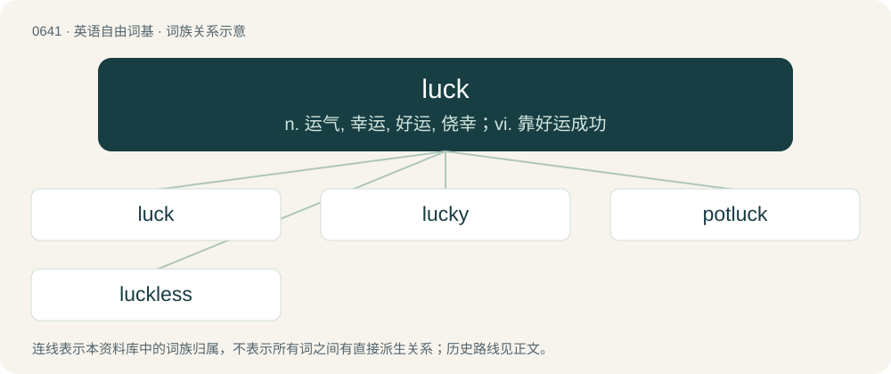

# 0711 · luck — n. 运气, 幸运, 好运, 侥幸；vi. 靠好运成功

[总目录](../00_总目录_按常用程度.md)

**类型**：英语自由词基　｜　**来源语言**：见词源记录

## 核心含义与来源

- 核心含义：n. 运气, 幸运, 好运, 侥幸；vi. 靠好运成功
- 英文含义：Something that happens to someone by chance, a chance occurrence.
- 词形：luck

**来源记录 1**（名词；Something that happens to someone by chance, a chance occurrence.）

From Middle English luk, lukke, from Middle Dutch luc, geluc, gelucke (“good luck, fortune”) or Middle Low German lücke, gelücke (“lot, fortune, fate, luck”), of obscure origin; perhaps ultimately related to German Lücke (“gap, opening”) in the sense of "space or opportunity", hence "chance". Cognate with West Frisian gelok (“luck”), Saterland Frisian Gluk (“luck”), Dutch luk, geluk (“luck, happiness”), Dutch Low Saxon luk (“luck”), German Low German and German Glück (“luck, good fortune, happiness”), Danish and Norwegian Bokmål lykke (“luck, happiness”), Norwegian Nynorsk lukke (“luck, happiness”), Swedish lycka (“luck, happiness”), Icelandic lukka (“happiness”). According to the OED, it may be related to lock. A loanword into English in the 15th century (probably as a gambling term), Middle Dutch luc, gelucke has parallels with Middle High German lücke, gelücke ("luck, skill, chance, profession, livelihood"; whence Modern German Glück). The word occurs only from the 12th century, apparently first in Rhine Frankish. Perhaps from a Frankish \*galukki, derived from Proto-Germanic \*lukjǭ (“opening”). The word enters standard Middle High German during the 13th century, and spreads to English and Scandinavian in the Late Middle Ages. Its origin seems to have been regional or dialectal, and there were competing German words such as gevelle or schick, or the Latinate fortūne from Latin fortūna. Its etymology is unknown, although there are numerous proposals as to its derivations from a number of roots. Use as a verb in American English is late (1940s), but there was a Middle English verb lukken (“to chance, to happen by good fortune”) in the 15th century.

## 词族图

## 单词速览（常用到不常用）

| 单词 | 音标 | 释义 |
|---|---|---|
| [luck](#w-1) | 英 /lʌk/；美 /lʌk/ | n. 运气, 幸运, 好运, 侥幸；vi. 靠好运成功 |
| [lucky](#w-2) | 英 /ˈlʌki/ | a. 幸运的, 吉祥的, 好运的, 侥幸的 |
| [potluck](#w-3) | 英 /ˌpɒtˈlʌk/；美 /ˈpɑtˌlʌk/ | n. 家常便饭 |
| [luckless](#w-4) | /ˈlʌklis/ | a. 不幸的, 坏运气的 |

## 逐词详解

### 1. luck

**词性**：名词　｜　**音标**：英 /lʌk/；美 /lʌk/

**中文释义**：n. 运气, 幸运, 好运, 侥幸；vi. 靠好运成功

**英文义项**：Something that happens to someone by chance, a chance occurrence. / A favourable chance occurrence.

**词源与演化**：

From Middle English luk, lukke, from Middle Dutch luc, geluc, gelucke (“good luck, fortune”) or Middle Low German lücke, gelücke (“lot, fortune, fate, luck”), of obscure origin; perhaps ultimately related to German Lücke (“gap, opening”) in the sense of "space or opportunity", hence "chance". Cognate with West Frisian gelok (“luck”), Saterland Frisian Gluk (“luck”), Dutch luk, geluk (“luck, happiness”), Dutch Low Saxon luk (“luck”), German Low German and German Glück (“luck, good fortune, happiness”), Danish and Norwegian Bokmål lykke (“luck, happiness”), Norwegian Nynorsk lukke (“luck, happiness”), Swedish lycka (“luck, happiness”), Icelandic lukka (“happiness”). According to the OED, it may be related to lock. A loanword into English in the 15th century (probably as a gambling term), Middle Dutch luc, gelucke has parallels with Middle High German lücke, gelücke ("luck, skill, chance, profession, livelihood"; whence Modern German Glück). The word occurs only from the 12th century, apparently first in Rhine Frankish. Perhaps from a Frankish \*galukki, derived from Proto-Germanic \*lukjǭ (“opening”). The word enters standard Middle High German during the 13th century, and spreads to English and Scandinavian in the Late Middle Ages. Its origin seems to have been regional or dialectal, and there were competing German words such as gevelle or schick, or the Latinate fortūne from Latin fortūna. Its etymology is unknown, although there are numerous proposals as to its derivations from a number of roots. Use as a verb in American English is late (1940s), but there was a Middle English verb lukken (“to chance, to happen by good fortune”) in the 15th century.

**例句**：

> Gilbert had some bad luck yesterday — he got pick-pocketed and lost fifty dollars.

该用例对应义项：Something that happens to someone by chance, a chance occurrence.

### 2. lucky

**词性**：形容词　｜　**音标**：英 /ˈlʌki/

**中文释义**：a. 幸运的, 吉祥的, 好运的, 侥幸的

**英文义项**：Favoured by luck; fortunate; having good success or good fortune. / Producing, or resulting in, good fortune

**构词拆分**：luck + -y

**词源与演化**：

From Middle English lukky, equivalent to luck + -y. Cognate with Scots lucky (“lucky”), West Frisian lokkich (“lucky, fortunate”), Dutch gelukkig (“lucky, fortunate, happy”). Compare also Danish lykkelig (“happy”), Swedish lycklig (“happy, lucky”), German glücklich (“happy”), Saterland Frisian glukkelk (“happy”).

**例句**：

> The downed pilot is very lucky to be alive.

该用例对应义项：Favoured by luck; fortunate; having good success or good fortune.

### 3. potluck

**词性**：名词　｜　**音标**：英 /ˌpɒtˈlʌk/；美 /ˈpɑtˌlʌk/

**中文释义**：n. 家常便饭

**英文义项**：A meal, especially one offered to a guest, consisting of whatever food is available. / Whatever is available in a particular situation.

**构词拆分**：pot + luck

**词源与演化**：

From pot + luck. According to the Oxford English Dictionary, sense 3 (“a shared meal consisting of whatever guests have brought”) is unlikely to have been influenced by potlatch.

**例句**：

> Here are some leftover beans and meat; we can make a good potluck stew from them.

该用例对应义项：A meal, especially one offered to a guest, consisting of whatever food is available.

### 4. luckless

**词性**：形容词　｜　**音标**：/ˈlʌklis/

**中文释义**：a. 不幸的, 坏运气的

**英文义项**：Unsuccessful, in a failing manner. / Without luck, unfortunate.

**构词拆分**：luck + -less

**词源与演化**：

From luck + -less.

**例句**：

> The search party returned dejected from the luckless search.

该用例对应义项：Unsuccessful, in a failing manner.
