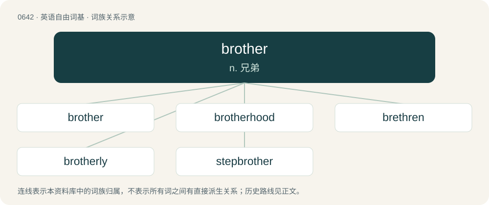

# 0712 · brother — n. 兄弟

[总目录](../00_总目录_按常用程度.md)

**类型**：英语自由词基　｜　**来源语言**：见词源记录

## 核心含义与来源

- 核心含义：n. 兄弟
- 英文含义：Son of the same parents as another person.
- 词形：brother

**来源记录 1**（名词；Son of the same parents as another person.）

Inherited from Middle English brother, broþer, from Old English brōþor, brōðer, from Proto-West Germanic \*brōþer, from Proto-Germanic \*brōþēr (“brother”), from Proto-Indo-European \*bʰréh₂tēr (“brother”). Doublet of bhai, bru, frater, friar, pal, and vai. Cognates Cognate with Scots breeder, bridder, brither, broder, brother, bruther (“brother”), Yola brover, brower (“brother”), North Frisian brouder, bruler, Bröđer (“brother”), Saterland Frisian Brour, Brúur (“brother”), West Frisian broer (“brother”), Alemannic German briöder, bruder, brueder, bröder, Brüeder, Brüädär (“brother”), Bavarian pruadar, prueder, pruider (“brother”), Central Franconian Broder (“brother”), Cimbrian pruadar, pruudar (“brother”), Dutch broeder, broer (“brother”), German Bruder (“brother”), German Low German Broor (“brother”), Limburgish broor, Broër (“brother”), Luxembourgish Brudder (“brother; monk”), Mòcheno pruader (“brother”), Vilamovian brüder (“brother”), Yiddish ברודער (bruder, “brother”), Danish, Norwegian Bokmål, Norwegian Nynorsk, and Swedish broder, bror (“brother”), Elfdalian bruoðer (“brother”), Faroese and Icelandic bróðir (“brother”), Crimean Gothic bruder (“brother”), Gothic 𐌱𐍂𐍉𐌸𐌰𐍂 (brōþar, “brother”); also Breton breur (“brother”), Cornish broder (“brother”), Irish bráthair (“brother”), Manx braar (“brother; friar, monk”), Scottish Gaelic bràthair (“brother”), Welsh brawd (“brother”), Latin frāter (“brother; sibling”), Ancient Greek βρά (brá, “brother”), φρᾱ́τηρ (phrā́tēr, “brother, citizen, clansman, kinsman”), Phrygian βρατερε (bratere, “brother”), Lydian 𐤡𐤭𐤠𐤱𐤭𐤳𐤦𐤳 (prafršiš, “brother”), Latgalian bruoļs (“brother”), Latvian brālis (“brother”), Lithuanian brólis (“brother”), Old Prussian brāti, brote (“brother”), Belarusian, Bulgarian, Macedonian, Russian, and Ukrainian брат (brat, “brother”), Czech bratr (“brother”), Polish, Slovak, and Slovene brat (“brother”), Serbo-Croatian бра̏т, brȁt (“brother; buddy, mate”), Armenian ապեր (aper), ախպար (axpar), ախպեր (axper), եղբայր (eġbayr, “brother; buddy”), Baluchi برات (barát, “brother”), Central Kurdish and Southern Kurdish برا (bra, “brother”), Northern Kurdish bira (“as a brother”), Ossetian ӕрвад (ærvad), ӕрвадӕ (ærvadæ, “brother”), Pashto ورور (wror, “brother”), Persian برادر (barādar, birādar / barâdar), برار (birār / berâr), وردار (vardâr, “brother; comrade; dude”), Ashkun břa (“younger brother”), Kamkata-viri břo (“brother”), Tregami brā (“brother”), Waigali brā, břā (“brother”), Tocharian A pracar (“brother”), Tocharian B procer (“brother”), Sanskrit भ्रातृ (bhrātṛ, “brother; friend”).

## 词族图

## 单词速览（常用到不常用）

| 单词 | 音标 | 释义 |
|---|---|---|
| [brother](#w-1) | 英 /ˈbɹʌðə/；美 /ˈbɹʌðɚ/ | n. 兄弟 |
| [brotherhood](#w-2) | 英 /ˈbɹʌðəˌhʊd/；美 /ˈbɹʌðɚˌhʊd/ | n. 手足情谊, 兄弟关系 |
| [brethren](#w-3) | /ˈbɹɛðɹən/ | n. 弟兄们, 教友们 |
| [brotherly](#w-4) | 英 /ˈbɹʌð.ə.li/；美 /ˈbɹʌð.ɚ.li/ | a. 兄弟的, 亲兄弟似的, 亲切的 |
| [stepbrother](#w-5) | /ˈstepbrʌðə/ | n. 异父(母)兄弟；\[法\] 继父与其前妻所生的儿子, 继兄弟 |

## 逐词详解

### 1. brother

**词性**：名词　｜　**音标**：英 /ˈbɹʌðə/；美 /ˈbɹʌðɚ/

**中文释义**：n. 兄弟

**英文义项**：Son of the same parents as another person. / A male having at least one parent in common with another person (see half-brother, stepbrother).

**词源与演化**：

Inherited from Middle English brother, broþer, from Old English brōþor, brōðer, from Proto-West Germanic \*brōþer, from Proto-Germanic \*brōþēr (“brother”), from Proto-Indo-European \*bʰréh₂tēr (“brother”). Doublet of bhai, bru, frater, friar, pal, and vai. Cognates Cognate with Scots breeder, bridder, brither, broder, brother, bruther (“brother”), Yola brover, brower (“brother”), North Frisian brouder, bruler, Bröđer (“brother”), Saterland Frisian Brour, Brúur (“brother”), West Frisian broer (“brother”), Alemannic German briöder, bruder, brueder, bröder, Brüeder, Brüädär (“brother”), Bavarian pruadar, prueder, pruider (“brother”), Central Franconian Broder (“brother”), Cimbrian pruadar, pruudar (“brother”), Dutch broeder, broer (“brother”), German Bruder (“brother”), German Low German Broor (“brother”), Limburgish broor, Broër (“brother”), Luxembourgish Brudder (“brother; monk”), Mòcheno pruader (“brother”), Vilamovian brüder (“brother”), Yiddish ברודער (bruder, “brother”), Danish, Norwegian Bokmål, Norwegian Nynorsk, and Swedish broder, bror (“brother”), Elfdalian bruoðer (“brother”), Faroese and Icelandic bróðir (“brother”), Crimean Gothic bruder (“brother”), Gothic 𐌱𐍂𐍉𐌸𐌰𐍂 (brōþar, “brother”); also Breton breur (“brother”), Cornish broder (“brother”), Irish bráthair (“brother”), Manx braar (“brother; friar, monk”), Scottish Gaelic bràthair (“brother”), Welsh brawd (“brother”), Latin frāter (“brother; sibling”), Ancient Greek βρά (brá, “brother”), φρᾱ́τηρ (phrā́tēr, “brother, citizen, clansman, kinsman”), Phrygian βρατερε (bratere, “brother”), Lydian 𐤡𐤭𐤠𐤱𐤭𐤳𐤦𐤳 (prafršiš, “brother”), Latgalian bruoļs (“brother”), Latvian brālis (“brother”), Lithuanian brólis (“brother”), Old Prussian brāti, brote (“brother”), Belarusian, Bulgarian, Macedonian, Russian, and Ukrainian брат (brat, “brother”), Czech bratr (“brother”), Polish, Slovak, and Slovene brat (“brother”), Serbo-Croatian бра̏т, brȁt (“brother; buddy, mate”), Armenian ապեր (aper), ախպար (axpar), ախպեր (axper), եղբայր (eġbayr, “brother; buddy”), Baluchi برات (barát, “brother”), Central Kurdish and Southern Kurdish برا (bra, “brother”), Northern Kurdish bira (“as a brother”), Ossetian ӕрвад (ærvad), ӕрвадӕ (ærvadæ, “brother”), Pashto ورور (wror, “brother”), Persian برادر (barādar, birādar / barâdar), برار (birār / berâr), وردار (vardâr, “brother; comrade; dude”), Ashkun břa (“younger brother”), Kamkata-viri břo (“brother”), Tregami brā (“brother”), Waigali brā, břā (“brother”), Tocharian A pracar (“brother”), Tocharian B procer (“brother”), Sanskrit भ्रातृ (bhrātṛ, “brother; friend”).

**例句**：

> Listen, brother, I don't know what you want, but I’m not interested.

该用例对应义项：A form of address to a man.

### 2. brotherhood

**词性**：名词　｜　**音标**：英 /ˈbɹʌðəˌhʊd/；美 /ˈbɹʌðɚˌhʊd/

**中文释义**：n. 手足情谊, 兄弟关系

**英文义项**：The state of being brothers or a brother (also figuratively). / An association of people for any purpose, such as a society of monks; a fraternity.

**构词拆分**：brother + -hood；brother + -red

**词源与演化**：

From Middle English brotherhod, equivalent to brother + -hood, from earlier brotherhede, alteration (influenced by suffixes in -hood, -head) of Early Middle English brotherrede (“brotherhood, fraternity”), from Old English brōþorrǣden (“brotherhood, fellowship”), equivalent to brother + -red (see brotherred). More at brother, -red. Piecewise doublet of friarhood.

**例句**：

> James formed a kind of brotherhood for ex-pats who were working in Valencia.

该用例对应义项：An association of people for any purpose, such as a society of monks; a fraternity.

### 3. brethren

**词性**：名词　｜　**音标**：/ˈbɹɛðɹən/

**中文释义**：n. 弟兄们, 教友们

**英文义项**：kinsmen

**构词拆分**：brother + -en (plural ending)

**词源与演化**：

From Early Modern English brethren, plural of brother, from Middle English brethren, from Middle English brethere, brether + -en (plural ending). Ultimately from Old English brōþor, brōþru (“brothers, brethren”), influenced by Old English brēþer, dative singular of brōþor (“brother”). Equivalent to brother + -en (plural ending). Compare German Brüder (“brothers, brethren”). More at brother. The vowel change (from o to e) is called umlaut.

**例句**：

> And though he knew his brethren, he was not known by them.

### 4. brotherly

**词性**：形容词　｜　**音标**：英 /ˈbɹʌð.ə.li/；美 /ˈbɹʌð.ɚ.li/

**中文释义**：a. 兄弟的, 亲兄弟似的, 亲切的

**英文义项**：Of or characteristic of brothers.

**构词拆分**：brother + -ly (adjectival suffix)

**词源与演化**：

From Middle English brotherly, from Old English brōþorlīċ, from Proto-West Germanic \*brōþerlīk, from Proto-Germanic \*brōþērlīkaz, equivalent to brother + -ly (adjectival suffix). Cognate with Dutch broederlijk (“brotherly”), German brüderlich (“brotherly”), Swedish broderlig (“brotherly”). Piecewise doublet of friarly.

**用法示例／搭配（非完整句）**：

> brotherly love

该用例对应义项：Of or characteristic of brothers.

### 5. stepbrother

**词性**：名词　｜　**音标**：/ˈstepbrʌðə/

**中文释义**：n. 异父(母)兄弟；\[法\] 继父与其前妻所生的儿子, 继兄弟

**英文义项**：The son of one's stepparent by a previous relationship. / The stepson of one's parent who is not one's half-brother.

**构词拆分**：step- + brother

**词源与演化**：

From step- + brother.

**例句**：

> He has become a role model for his younger stepbrother.
