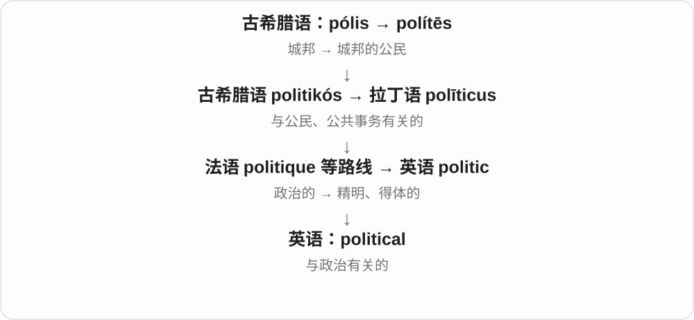
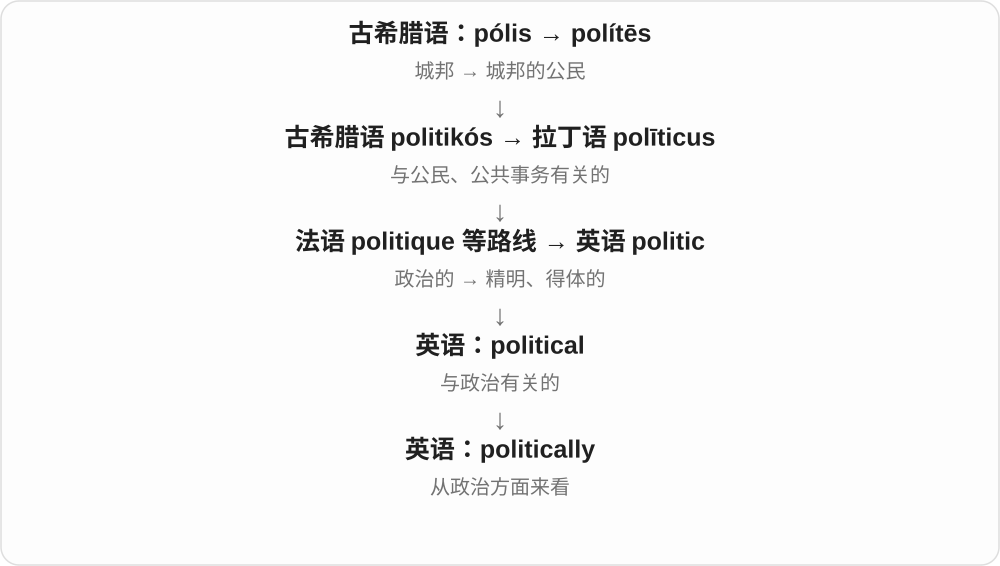
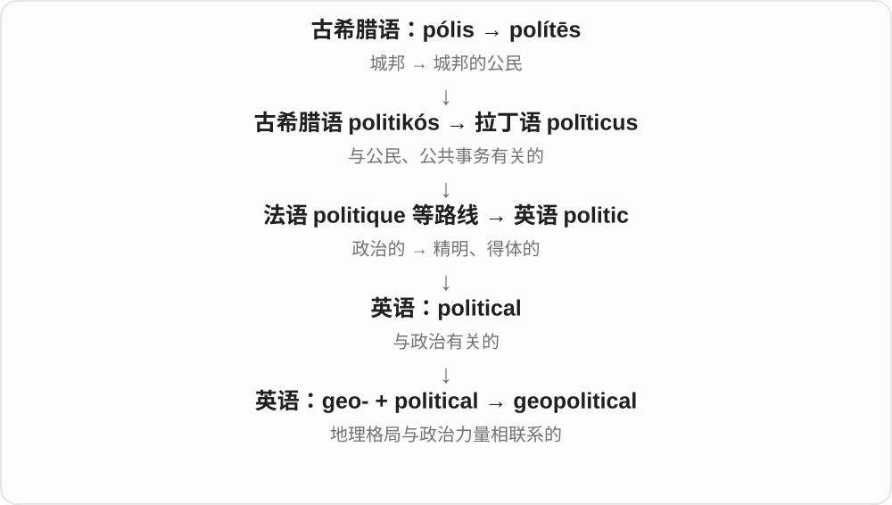
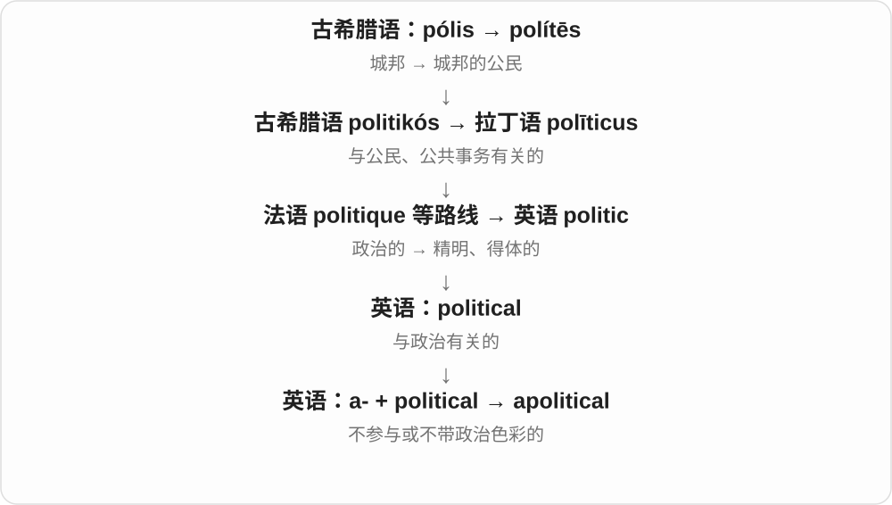

# 0712 · political — 政治的；涉及公共权力的

[逐词精讲目录](../00_逐词精讲目录.md) · [总目录](../00_总目录_按常用程度.md)

## 核心词根与来源

political 联系 politic 与 -al，远源经过希腊城市、公民和治理词族。politically 转成副词；geopolitical 加入地理因素；apolitical 说不涉政治或对政治不感兴趣。

**POLITICAL：围绕公共决策、权力与立场**

同一项决定会牵动不同群体的利益和权力关系。

- **政治相关**：political · politically
- **地理与回避政治**：geopolitical · apolitical

## 词形与演化规律

political → politically；geo- + political → geopolitical；a- + political → apolitical。geopolitical 是整体的地缘政治概念，不只是地图好看。

## 单词速览（按词族由简到繁）

同一基础词的相关扩展放在一起，先读基础形式，再读扩展；各组之间优先读常用的。具体词源关系见各词讲解。

| 单词 | 音标 | 核心意思 |
|---|---|---|
| [political](#w-1) | 英 /pəˈlɪtɪkəl/；美 /pəˈlɪtɪkəl/、/pəˈlɪtəkəl/ | 政治的；涉及权力关系的 |
| [politically](#w-2) | 英 /pəˈlɪtɪkli/；美 /pəˈlɪtɪkli/、/pəˈlɪtəkli/ | 在政治上；从政治角度；出于政治考虑 |
| [geopolitical](#w-3) | 英 /ˌdʒiːəʊpəˈlɪtɪkəl/；美 /ˌdʒiːoʊpəˈlɪtəkəl/ | 地缘政治的 |
| [apolitical](#w-4) | 英 /ˌeɪpəˈlɪtɪkəl/；美 /ˌeɪpəˈlɪtəkəl/ | 不关心政治的；不涉政治、保持政治中立的 |

## 逐词讲解

### 1. political — 政治的；涉及权力关系的

**音标**：英 /pəˈlɪtɪkəl/；美 /pəˈlɪtɪkəl/、/pəˈlɪtəkəl/

**先抓住这个画面**

问的不是一个人喜不喜欢某事，而是谁能作决定、谁的利益受到影响、大家怎样分配公共资源。

**怎么拆**

英语 politic + -al。politic 早先已有“政治的”意思，后来这一常用义主要由 political 承担。

**怎么变成今天的意思**

既能客观描述 political history，也能暗示某决定出于争取支持或权力盘算。形容人很 political，还可说此人关心政治、政治意识强。

**常见搭配与例句**

political debate；political power；a political decision；political science。

> The course examines the political history of the region.

这门课研究该地区的政治史。

> She felt that the appointment was a political decision.

她觉得这次任命是出于政治考虑。

**别混淆**

political 是政治相关；politic 多说做法明智、懂得分寸；polite 是有礼貌，属于另一词源。

### 2. politically — 在政治上；从政治角度；出于政治考虑

**音标**：英 /pəˈlɪtɪkli/；美 /pəˈlɪtɪkli/、/pəˈlɪtəkli/

**先抓住这个画面**

给一句话加上观察角度：论的是政治立场、权力影响或支持者反应。

**怎么拆**

political + -ly；-ically 通常压缩读成 /ɪkli/ 或 /əkli/，不必一字母一音地读。

**怎么变成今天的意思**

politically active 是积极参与政治；politically sensitive 是牵动政治利益、容易引发争议。它不等于“用政客腔说话”。

**常见搭配与例句**

politically active；politically sensitive；politically motivated。

> The students became politically active during the campaign.

学生们在这次运动中开始积极参与政治活动。

> The two friends disagree politically but still respect each other.

这两个朋友政治立场不同，但仍相互尊重。

**别混淆**

politically 限定政治方面；personally 限定个人方面。一个人可私下友好，政治立场却相反。

### 3. geopolitical — 地缘政治的

**音标**：英 /ˌdʒiːəʊpəˈlɪtɪkəl/；美 /ˌdʒiːoʊpəˈlɪtəkəl/

**先抓住这个画面**

某个港口的重要性，不仅是货物多，还因为它的位置会影响国家之间的控制力和关系；这种重要性就是 geopolitical。

**怎么拆**

geo- + political，是 geopolitics 对应的形容词。不要机械写成 geopolitics + -al，实际词形是 political 这套形容词结构。

**怎么变成今天的意思**

常修饰 tensions、interests、risk、importance。范围既能涉及安全，也能涉及资源、交通和经济联系。

**常见搭配与例句**

geopolitical tensions；geopolitical interests；geopolitical importance。

> The canal has considerable geopolitical importance.

这条运河具有相当大的地缘政治意义。

> The report separates commercial risks from geopolitical risks.

报告把商业风险与地缘政治风险分开讨论。

**别混淆**

geographical 只说地理方面；geopolitical 必须还牵涉权力或国家关系。

### 4. apolitical — 不关心政治的；不涉政治、保持政治中立的

**音标**：英 /ˌeɪpəˈlɪtɪkəl/；美 /ˌeɪpəˈlɪtəkəl/

**先抓住这个画面**

没有把自己放进政治争论里：可能是没兴趣，也可能是机构刻意不站政治队。

**怎么拆**

a-“无、不” + political。这里的 a- 来自希腊语否定组合形式，不是英语不定冠词。

**怎么变成今天的意思**

形容人时常指不关心政治；形容机构时常指不涉党派或保持中立。具体是“没兴趣”还是“保持距离”，要看语境。

**常见搭配与例句**

remain apolitical；an apolitical organization；largely apolitical。

> He used to be apolitical, but the local dispute changed that.

他以前不关心政治，但当地这场争议改变了他的态度。

> The charity describes itself as apolitical.

这家慈善机构称自己不涉政治。

**别混淆**

apolitical 不等于反对政治，也不等于没有任何价值观；nonpartisan 更明确强调不偏向某党派。

## 这一组要分清什么

political 不等于 polite 礼貌；apolitical 也不等于对所有事情都没有观点。

## 串起来练习

The report examines political decisions and their geopolitical consequences.

报告考察政治决定及其地缘政治后果。
