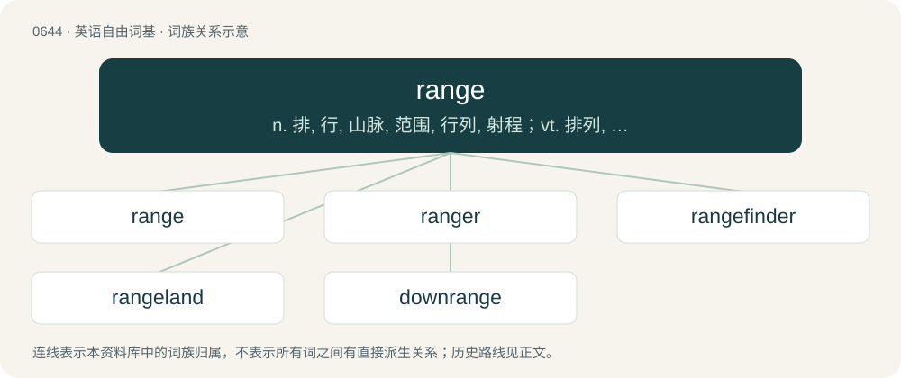

# 0713 · range — n. 排, 行, 山脉, 范围, 行列, 射程；vt. 排列, 归类于, 使并列, 放牧；vi. 平行, 延伸, 漫游

[总目录](../00_总目录_按常用程度.md)

**类型**：英语自由词基　｜　**来源语言**：见词源记录

## 核心含义与来源

- 核心含义：n. 排, 行, 山脉, 范围, 行列, 射程；vt. 排列, 归类于, 使并列, 放牧；vi. 平行, 延伸, 漫游
- 英文含义：A line or series of mountains, buildings, etc.
- 词形：range

**来源记录 1**（名词；A line or series of mountains, buildings, etc.）

From Middle English rengen, from Old French rengier (“to range, to rank, to order”), from the noun renc, reng, ranc, rang (“a rank, row”), from Frankish \*hring, from Proto-Germanic \*hringaz (“ring, circle, curve”). Doublet of ring.

## 词族图

## 单词速览（常用到不常用）

| 单词 | 音标 | 释义 |
|---|---|---|
| [range](#w-1) | 英 /ˈɹeɪnd͡ʒ/；/ˈɹeːnd͡ʒ/ | n. 排, 行, 山脉, 范围, 行列, 射程；vt. 排列, 归类于, 使并列, 放牧；vi. 平行, 延伸, 漫游 |
| [ranger](#w-2) | 英 /ˈɹeɪ̯nd͡ʒə/；美 /ˈɹeɪ̯nd͡ʒɚ/ | n. 王室守林人, 骑警, 漫游者 |
| [rangefinder](#w-3) | /ˈreindʒ,faində/ | 测距仪 |
| [rangeland](#w-4) | /ˈreindʒlænd/ | n. 牧场 |
| [downrange](#w-5) | /ˈdajnˈreindʒ/ | a. 发射中心和沿着试验航向的；adv. 发射中心和沿着试验航向地 |

## 逐词详解

### 1. range

**词性**：名词　｜　**音标**：英 /ˈɹeɪnd͡ʒ/；/ˈɹeːnd͡ʒ/

**中文释义**：n. 排, 行, 山脉, 范围, 行列, 射程；vt. 排列, 归类于, 使并列, 放牧；vi. 平行, 延伸, 漫游

**英文义项**：A line or series of mountains, buildings, etc. / A fireplace; a fire or other cooking apparatus; now specifically, a large cooking stove with many burners (hotplates).

**词源与演化**：

From Middle English rengen, from Old French rengier (“to range, to rank, to order”), from the noun renc, reng, ranc, rang (“a rank, row”), from Frankish \*hring, from Proto-Germanic \*hringaz (“ring, circle, curve”). Doublet of ring.

**例句**：

> By playing in comedies as well as in dramas he has proved his range as an actor.

该用例对应义项：The variety of roles that an actor can play in a satisfactory way.

### 2. ranger

**词性**：名词　｜　**音标**：英 /ˈɹeɪ̯nd͡ʒə/；美 /ˈɹeɪ̯nd͡ʒɚ/

**中文释义**：n. 王室守林人, 骑警, 漫游者

**英文义项**：One who ranges; a rover. / A roving robber; one who seeks plunder.

**构词拆分**：range + -er

**词源与演化**：

From range (verb) + -er.

**例句**：

> Ziri volunteered to be a ranger to ear credits while in college.

### 3. rangefinder

**词性**：名词　｜　**音标**：/ˈreindʒ,faində/

**中文释义**：测距仪

**英文义项**：Any of several designs of optical (or other) instrument used to measure the distance to an object

**构词拆分**：range + finder

**词源与演化**：

From range + finder.

### 4. rangeland

**词性**：名词　｜　**音标**：/ˈreindʒlænd/

**中文释义**：n. 牧场

**英文义项**：Unimproved land that is suitable for the grazing of livestock.

**构词拆分**：range + land

**词源与演化**：

From range + land.

### 5. downrange

**词性**：形容词　｜　**音标**：/ˈdajnˈreindʒ/

**中文释义**：a. 发射中心和沿着试验航向的；adv. 发射中心和沿着试验航向地

**英文义项**：In the horizontal direction away from the launch site of a rocket or projectile in the direction of its travel.

**构词拆分**：down + range

**词源与演化**：

From down + range.
