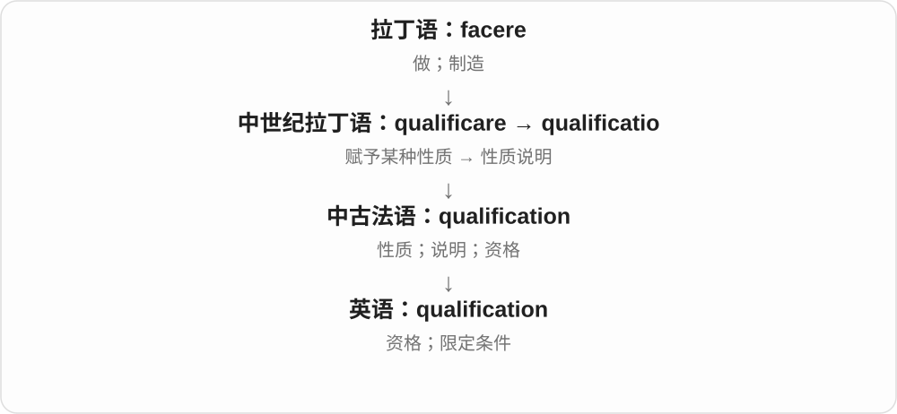

# 0716 · quality — 性质、质量；资格与限定

[逐词精讲目录](../00_逐词精讲目录.md) · [总目录](../00_总目录_按常用程度.md)

## 核心词根与来源

quality 借法语上接拉丁 quālitās；qualify 另经法语接中世纪拉丁性质 + 使的组合。它们是历史词族关系，不能把所有变化都伪装成现代英语临时加后缀。

**QUALITY：是什么样；QUALIFY：条件与范围如何界定**

先从 quality 性质进入，再看 qualify 的资格与限定两分支。qualified、unqualified 用支持和成功的搭配对照。

- **性质、质量与定性**：quality · qualitative
- **资格、条件与限定**：qualify · qualification · qualified · qualifier
- **否定的不同方向**：unqualified · disqualify
- **quality → qualities：东西是什么样，有哪些特点**：quality · qualities
- **qualify、qualification → qualifications：具备性质、资格**：qualify · qualification · qualifications

## 词形与演化规律

quality → qualitative；qualify → qualification、qualified、qualifier；un- → unqualified；dis- → disqualify。

拉丁 qualis、qualitas 经法语进入，特质可数，整体质量通常不数。

qualification 经法语接拉丁名词，不只现场给 qualify 加 tion。

## 单词速览（按词族由简到繁）

同一基础词的相关扩展放在一起，先读基础形式，再读扩展；各组之间优先读常用的。具体词源关系见各词讲解。

| 单词 | 音标 | 核心意思 |
|---|---|---|
| [quality](#w-1) | /ˈkwɒləti/；美 /ˈkwɑːləti/ | 质量；品质；特征、优点 |
| [qualify](#w-2) | 英 /ˈkwɒlɪfaɪ/；美 /ˈkwɑːləfaɪ/ | 具备资格；使符合条件；限定、修正说法 |
| [qualified](#w-4) | 英 /ˈkwɒlɪfaɪd/；美 /ˈkwɑːləfaɪd/ | 合格、有资质的；有限度、带保留的 |
| [unqualified](#w-7) | 英 /ʌnˈkwɒlɪfaɪd/；美 /ʌnˈkwɑːləfaɪd/ | 不合格、无资质的；无保留的、十足的 |
| [qualification](#w-5) | /ˌkwɒlɪfɪˈkeɪʃən/ | 资格；资历；限定条件 |
| [qualifications](#w-10) | 英 /ˌkwɒlɪfɪˈkeɪʃənz/；美 /ˌkwɑːlɪfɪˈkeɪʃənz/ | 资格、资历、学历证书〔复数〕；限定条件、保留意见〔复数〕 |
| [qualifier](#w-6) | 英 /ˈkwɒlɪfaɪə/；美 /ˈkwɑːləfaɪər/ | 资格赛；入围者；限定词语 |
| [disqualify](#w-8) | 英 /dɪsˈkwɒlɪfaɪ/；美 /dɪsˈkwɑːləfaɪ/ | 取消资格；使不具备资格 |
| [qualities](#w-9) | 英 /ˈkwɒlətiz/；美 /ˈkwɑːlətiz/ | 特质、特点；优点〔复数〕 |
| [qualitative](#w-3) | 英 /ˈkwɒlɪtətɪv/；美 /ˈkwɑːləteɪtɪv/ | 性质上的；定性的 |

## 逐词讲解

### 1. quality — 质量；品质；特征、优点

**音标**：/ˈkwɒləti/；美 /ˈkwɑːləti/

**先抓住这个画面**

先问它是什么样，再问做得好不好。单数常说质量，复数 qualities 经常说一个人的特点、优点。

**怎么拆**

经法语来自拉丁 quālitās，接 quālis 什么样。历史是性质名词，不是把 quantity 数量改几个字母变成质量。

**怎么变成今天的意思**

**拉丁 quālis 什么样 → quālitās → 法语 qualité → quality**  
某物是什么性质 → 特点、质量

↓

**现代英语 quality**  
性质、质量；人物特点与优点

high quality 高质量，leadership qualities 领导品质，quality of life 生活质量；quality time 指专心陪伴的相处时间。

**常见搭配与例句**

high quality；quality of life；leadership qualities；quality time。

> The company focuses on quality rather than quantity.

公司注重质量，而非数量。

> Patience is one of her best qualities.

耐心是她最好的品质之一。

**别混淆**

quality 质量、性质，quantity 数量；a quality product 常有品质好的评价，不只是说东西有某种性质。

### 2. qualify — 具备资格；使符合条件；限定、修正说法

**音标**：英 /ˈkwɒlɪfaɪ/；美 /ˈkwɑːləfaɪ/

**先抓住这个画面**

一条常用路是条件够了、可以参加；另一条是给话加条件，让它别说得太满。

**怎么拆**

经法语 qualifier 及中世纪拉丁 qualificāre，历史接 quālis 什么样 + facere 使、做的组合成分。不是现代英语直接把 quality 尾巴改成 fy 才第一次造出来。

**怎么变成今天的意思**

**拉丁 quālis 什么样 → quālitās → 法语 qualité → quality**  
某物是什么性质 → 特点、质量

↓

**中世纪拉丁 qualificāre → 法语 qualifier → qualify**  
赋予、说明性质 → 使具资格；限定说法

qualify for the final 获得决赛资格，qualify as a teacher 取得教师资格；qualify a statement 为说法加限制。

**常见搭配与例句**

qualify for；qualify as；qualify someone to do；qualify a statement。

> The team qualified for the final.

球队获得了决赛资格。

> She qualified her earlier statement by adding a condition.

她补充一个条件，对先前的说法作了限定。

**别混淆**

qualify for 针对准入对象，qualify as 针对身份；qualify my support 可能是给支持加保留，绝非让支持拿证。

### 3. qualified — 合格、有资质的；有限度、带保留的

**音标**：英 /ˈkwɒlɪfaɪd/；美 /ˈkwɑːləfaɪd/

**先抓住这个画面**

说人时常是条件、训练达标；说支持或赞同时，反而可能是有条件地支持。

**怎么拆**

qualify 以辅音字母 f 加 y 结尾，加 -ed 时 y 改 i，成为 qualified。两种主要形容词义接 qualify 的资格、限定两分支。

**怎么变成今天的意思**

**拉丁 quālis 什么样 → quālitās → 法语 qualité → quality**  
某物是什么性质 → 特点、质量

↓

**中世纪拉丁 qualificāre → 法语 qualifier → qualify**  
赋予、说明性质 → 使具资格；限定说法

↓

**qualify + -ed → qualified**  
具资格 → 合格；被限定 → 有保留

a qualified teacher 合格教师，qualified support 有保留的支持；well qualified for 很适合、很有资质担任。

**常见搭配与例句**

a qualified teacher；qualified support；qualified approval。

> A qualified electrician checked the wiring.

一位合格电工检查了线路。

> The proposal received only qualified support.

提议只获得了有保留的支持。

**别混淆**

qualified support 不是完全支持；unqualified support 无保留支持。别把形容词只记成合格。

### 4. unqualified — 不合格、无资质的；无保留的、十足的

**音标**：英 /ʌnˈkwɒlɪfaɪd/；美 /ʌnˈkwɑːləfaɪd/

**先抓住这个画面**

否定的是哪个意思很关键：人没资格是不合格，支持没有限制则是全力支持。

**怎么拆**

un- 不、没有 + qualified，同时可否定具资格与被限定两种状态，形成看似相反的现代语气。

**怎么变成今天的意思**

**拉丁 quālis 什么样 → quālitās → 法语 qualité → quality**  
某物是什么性质 → 特点、质量

↓

**中世纪拉丁 qualificāre → 法语 qualifier → qualify**  
赋予、说明性质 → 使具资格；限定说法

↓

**un- + qualified → unqualified**  
无资格；另一路无任何限定

unqualified staff 无资质人员，unqualified support 无保留支持，an unqualified success 十足的成功。

**常见搭配与例句**

unqualified staff；unqualified support；an unqualified success。

> The event was an unqualified success.

活动取得了十足的成功。

> He was unqualified for the technical role.

他不具备担任该技术岗位的资格。

**别混淆**

unqualified success 是毫无疑问的成功，不是不合格的成功；先判 qualified 资格还是限定这条义。

### 5. qualification — 资格；资历；限定条件

**音标**：/ˌkwɒlɪfɪˈkeɪʃən/

**先抓住这个画面**

门口写着进入要求，你满足了，就有 qualification；一句话后面加“但只在这些条件下”，也是给它加 qualification。

**怎么拆**

qualis（什么性质）+ facere → qualificare，再形成 qualificatio，经法语 qualification 借入。现代英语中，qualify 与 qualification 形成动词、名词的形态对应。

**怎么变成今天的意思**

某种性质使人符合要求，便有资格、证书义；给说法加性质说明，则成为保留和限制。两个义项都在说明适用到什么程度。

**常见搭配与例句**

professional qualifications；meet the qualifications；without qualification。

> What qualifications are required for this position?

这个职位要求具备哪些资格？

> I agree with your proposal, with one qualification.

我赞成你的提议，但有一个保留条件。

**别混淆**

qualification 不只指学历；certificate 是证明文件，qualification 可指实际资历或条件。

### 6. qualifications — 资格、资历、学历证书〔复数〕；限定条件、保留意见〔复数〕

**音标**：英 /ˌkwɒlɪfɪˈkeɪʃənz/；美 /ˌkwɑːlɪfɪˈkeɪʃənz/

**先抓住这个画面**

有什么证明你适合做这件事，是 qualifications：学历、训练、经验等都可能算。另一支是给一句话加条件，让它不至于说得太满。

**怎么拆**

qualification 经法语接中世纪拉丁 qualificatio、qualificare，qualis 什么性质与 facere 做相关。现代可对照 qualify，但名词独立借入；加复数 -s，尾 /nz/。

**怎么变成今天的意思**

**拉丁赋予性质材料 → 法语 qualification → 英语借词**  
性质说明 → 资格、限制条件

↓

**qualification + -s → qualifications**  
多项资历、证书；几条限定或保留

academic qualifications 学历、学术资历；professional qualifications 专业资格；with some qualifications 有些保留地。

**常见搭配与例句**

relevant qualifications 相关资格、资历；qualifications for a role 任职资格。

> The notice lists the qualifications needed for the role.

通知列出了这个岗位需要的资历。

> She agreed with the idea, but added a few qualifications.

她赞同这个想法，但补充了几条限定条件。

**别混淆**

qualifications 不只等于证书。经验可能也是资历；表达看法时 qualifications 则可能是补充的限制条件，需看对象。

### 7. qualifier — 资格赛；入围者；限定词语

**音标**：英 /ˈkwɒlɪfaɪə/；美 /ˈkwɑːləfaɪər/

**先抓住这个画面**

可以是一场决定谁能参加的比赛、一个已取得资格的人，也可以是给说法加条件的词。

**怎么拆**

qualify + -er，词尾 y 改 i，成为 qualifier。不同义分别接资格与限定两分支。

**怎么变成今天的意思**

**拉丁 quālis 什么样 → quālitās → 法语 qualité → quality**  
某物是什么性质 → 特点、质量

↓

**中世纪拉丁 qualificāre → 法语 qualifier → qualify**  
赋予、说明性质 → 使具资格；限定说法

↓

**qualify + -er → qualifier**  
决定、获得资格者或事项；限定成分

a World Cup qualifier 世界杯预选赛，a surprise qualifier 意外入围者；a qualifier such as usually 是诸如通常这样的限定成分。

**常见搭配与例句**

a World Cup qualifier；a final qualifier；add a qualifier。

> The team won its first qualifier.

球队赢得了首场资格赛。

> Adding the qualifier usually made the claim more accurate.

加上通常这个限定词，让说法更准确了。

**别混淆**

qualifier 可以是比赛、参赛者或语言成分；不是永远指资格证书，证书要看 certificate 等具体词。

### 8. disqualify — 取消资格；使不具备资格

**音标**：英 /dɪsˈkwɒlɪfaɪ/；美 /dɪsˈkwɑːləfaɪ/

**先抓住这个画面**

原本想参加、被选中，某项规则或情况让它失去准入资格。

**怎么拆**

dis- 取消、相反 + qualify，形成取消资格动词。disqualify someone from doing 是常用结构。

**怎么变成今天的意思**

**拉丁 quālis 什么样 → quālitās → 法语 qualité → quality**  
某物是什么性质 → 特点、质量

↓

**中世纪拉丁 qualificāre → 法语 qualifier → qualify**  
赋予、说明性质 → 使具资格；限定说法

↓

**dis- + qualify → disqualify**  
资格被取消、受阻 → 取消资格

disqualify a competitor 取消选手资格，be disqualified from the race 被取消比赛资格；原因可能是违规或资格条件不符。

**常见搭配与例句**

disqualify someone from；be disqualified for；disqualify a competitor。

> The runner was disqualified for a false start.

跑者因抢跑被取消资格。

> The rule disqualifies employees from entering the competition.

规则规定员工没有资格参加这项比赛。

**别混淆**

disqualify 资格被取消，lose 比赛落败；输了比赛不自动等于被取消资格。

### 9. qualities — 特质、特点；优点〔复数〕

**音标**：英 /ˈkwɒlətiz/；美 /ˈkwɑːlətiz/

**先抓住这个画面**

说一个人耐心、诚实，一种材料柔软、耐用，是在列它有哪些 qualities。数的是一个个性质、特点。

**怎么拆**

quality 的辅音字母加 y 改为 ies，结尾 /tiz/。quality 经法语接拉丁 qualitas，较早 qualis 是什么样，先抓住性质而不是只背质量好坏。

**怎么变成今天的意思**

**拉丁 qualis → qualitas → 法语 → quality**  
什么样 → 性质、特点、质量

↓

**quality → qualities**  
多种性质、优点

leadership qualities 领导者所需特质；personal qualities 个人品质。

**常见搭配与例句**

useful qualities 有用特性；the qualities of a material 一种材料的特点。

> Patience is one of her best qualities.

耐心是她最好的品质之一。

> The fabric has several useful qualities.

这种面料有几种实用特性。

**别混淆**

qualities 常数具体特质；the quality of the work 通常说工作整体质量。不能所有场合都把 qualities 译成多个质量。

### 10. qualitative — 性质上的；定性的

**音标**：英 /ˈkwɒlɪtətɪv/；美 /ˈkwɑːləteɪtɪv/

**先抓住这个画面**

问发生了什么、是什么体验、有哪些特点，而不只是问有几个、多少分。

**怎么拆**

经拉丁性质词的对应形容词形式与法语等进入英语，现代与 quality 相联系。不能把整个词简单译成质量好的。

**怎么变成今天的意思**

**拉丁 quālis 什么样 → quālitās → 法语 qualité → quality**  
某物是什么性质 → 特点、质量

↓

**拉丁性质词的形容词分支 → qualitative**  
关于性质、特点 → 定性的

qualitative research 定性研究，qualitative data 定性资料，a qualitative difference 性质上的差别；方法名不自动评价研究好坏。

**常见搭配与例句**

qualitative research；qualitative data；a qualitative difference。

> The study uses qualitative interviews to explore people’s experiences.

研究用定性访谈探索人们的经历。

> There is a qualitative difference between the two approaches.

这两种方法存在性质上的差别。

**别混淆**

qualitative 关注性质，quantitative 关注数量；实际研究可以把两类方法结合，并非互相排斥。

## 这一组要分清什么

qualified support 有保留，unqualified support 无保留；qualitative 定性不等于质量好；qualification 可有资格与保留条件义，已有精讲可连读。

## 串起来练习

The qualified coach gave the team unqualified support.

那位有资质的教练给予球队毫无保留的支持。
