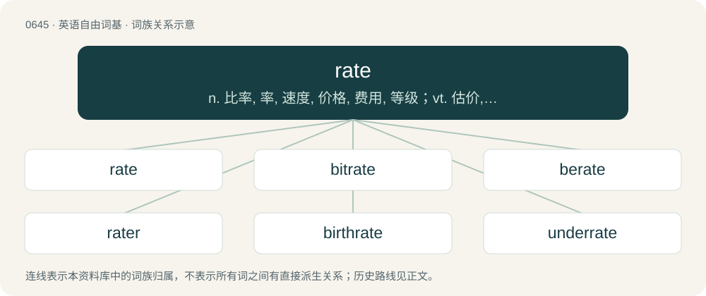

# 0716 · rate — n. 比率, 率, 速度, 价格, 费用, 等级；vt. 估价, 认为, 鉴定等级, 责骂；vi. 被评价, 责骂

[总目录](../00_总目录_按常用程度.md)

**类型**：英语自由词基　｜　**来源语言**：见词源记录

## 核心含义与来源

- 核心含义：n. 比率, 率, 速度, 价格, 费用, 等级；vt. 估价, 认为, 鉴定等级, 责骂；vi. 被评价, 责骂
- 英文含义：The proportional relationship between one amount, value etc. and another.
- 词形：rate

**来源记录 1**（名词；The proportional relationship between one amount, value etc. and another.）

From Middle English rate, from Old French rate, from Medieval Latin rata, from Latin prō ratā parte (“according to a fixed part”), from ratus (“fixed”), from rērī (“think, deem, judge, estimate", originally "reckon, calculate”).

## 词族图

## 单词速览（常用到不常用）

| 单词 | 音标 | 释义 |
|---|---|---|
| [rate](#w-1) | 英 /ɹeɪt/ | n. 比率, 率, 速度, 价格, 费用, 等级；vt. 估价, 认为, 鉴定等级, 责骂；vi. 被评价, 责骂 |
| [bitrate](#w-2) | 美 /ˈbɪtˌɹeɪt/ | n. 比特率；位率；位速率 |
| [berate](#w-3) | /bɪˈɹeɪt/ | vt. 严责 |
| [rater](#w-4) | /ˈɹeɪtə(ɹ)/ | n. 定价人 |
| [birthrate](#w-5) | /ˈbəːθreit/ | n. 出生率 |
| [underrate](#w-6) | /.ʌndəˈreit/ | vt. 低估, 对...估计过低, 看轻 |
| [workrate](#w-7) |  | 【英文】The rate at which work is performed. |
| [ratepayer](#w-8) | /ˈreit.peiə/ | n. 地方税纳税人 |

## 逐词详解

### 1. rate

**词性**：名词　｜　**音标**：英 /ɹeɪt/

**中文释义**：n. 比率, 率, 速度, 价格, 费用, 等级；vt. 估价, 认为, 鉴定等级, 责骂；vi. 被评价, 责骂

**英文义项**：The proportional relationship between one amount, value etc. and another. / Speed.

**词源与演化**：

From Middle English rate, from Old French rate, from Medieval Latin rata, from Latin prō ratā parte (“according to a fixed part”), from ratus (“fixed”), from rērī (“think, deem, judge, estimate", originally "reckon, calculate”).

**例句**：

> We pay an hourly rate of between $10 – $15 per hour depending on qualifications and experience.

该用例对应义项：A wage calculated in relation to a unit of time.

### 2. bitrate

**词性**：名词　｜　**音标**：美 /ˈbɪtˌɹeɪt/

**中文释义**：n. 比特率；位率；位速率

**英文义项**：The frequency at which bits (binary digits) pass a given physical or metaphorical point, measured in bps (bits per second).

**构词拆分**：bit + rate

**词源与演化**：

From bit + rate.

**例句**：

> You need high bitrate for streaming.

### 3. berate

**词性**：动词　｜　**音标**：/bɪˈɹeɪt/

**中文释义**：vt. 严责

**英文义项**：To chide or scold vehemently.

**构词拆分**：be- + rate

**词源与演化**：

From be- + rate (“to scold, upbraid”).

**例句**：

> What society tells people that they can “do whatever they want” to dissidents, and yet berates anyone for treating them well?

该用例对应义项：To chide or scold vehemently.

### 4. rater

**词性**：名词　｜　**音标**：/ˈɹeɪtə(ɹ)/

**中文释义**：n. 定价人

**英文义项**：One who provides a rating or assessment.

**构词拆分**：rate (“to appraise”) + -er

**词源与演化**：

From rate (“to appraise”) + -er.

**例句**：

> The three raters agreed on the score.

该用例对应义项：One who provides a rating or assessment.

### 5. birthrate

**词性**：名词　｜　**音标**：/ˈbəːθreit/

**中文释义**：n. 出生率

**英文义项**：The ratio of total live births to total population for a specific community or nation in a specified period; often expressed in births per thousand per year.

**构词拆分**：birth + rate

**词源与演化**：

From birth + rate.

**例句**：

> If your group has a low birthrate, congratulations! You're enjoying prosperity.

### 6. underrate

**词性**：动词　｜　**音标**：/.ʌndəˈreit/

**中文释义**：vt. 低估, 对...估计过低, 看轻

**英文义项**：To underestimate; to make too low a rate or estimate.

**构词拆分**：under- + rate

**词源与演化**：

From under- + rate.

**例句**：

> There is no duty we so much underrate as the duty of being happy.

### 7. workrate

**词性**：名词

**英文义项**：The rate at which work is performed.

**构词拆分**：work + rate

**词源与演化**：

From work + rate.

### 8. ratepayer

**词性**：名词　｜　**音标**：/ˈreit.peiə/

**中文释义**：n. 地方税纳税人

**英文义项**：Someone who pays for a public utility or service.

**构词拆分**：rate + payer

**词源与演化**：

From rate + payer.

**例句**：

> The government is supposed to mediate between ratepayers and the power company.

该用例对应义项：Someone who pays for a public utility or service.
