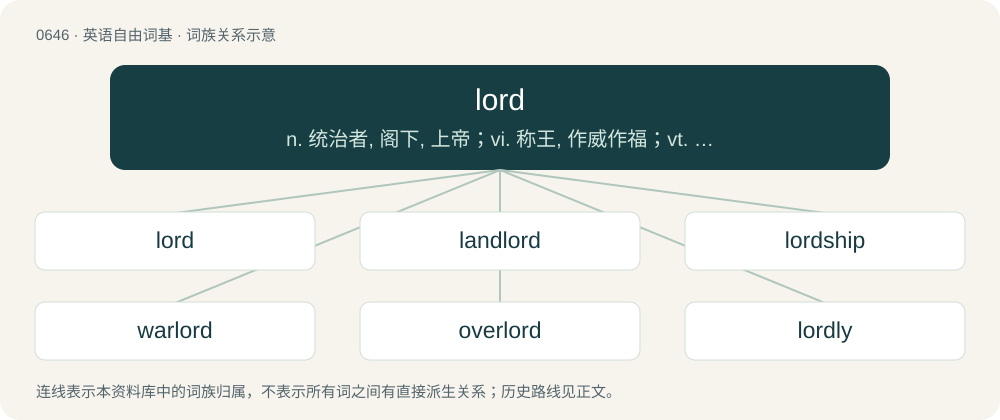

# 0717 · lord — n. 统治者, 阁下, 上帝；vi. 称王, 作威作福；vt. 使成贵族

[总目录](../00_总目录_按常用程度.md)

**类型**：英语自由词基　｜　**来源语言**：见词源记录

## 核心含义与来源

- 核心含义：n. 统治者, 阁下, 上帝；vi. 称王, 作威作福；vt. 使成贵族
- 英文含义：One possessing similar mastery over others; (historical) any feudal superior generally; any nobleman or aristocrat; any chief, prince, or sovereign ruler; in Scotland, a male member of the lowest rank of nobility (the equivalent rank in England is baron)
- 词形：lord

**来源记录 1**（名词；One possessing similar mastery over others; (historical) any feudal superior generally; any nobleman or aristocrat; any chief, prince, or sovereign ruler; in Scotland, a male member of the lowest rank of nobility (the equivalent rank in England is baron)）

From Middle English lord and lorde (attested from the 15th century), from earlier (14th century) lourde and other variants which dropped the intervocalic consonant of earlier lowerd, louerd, loverd, laford, and lhoaverd; from Old English hlāford &lt; hlāfweard, a compound of hlāf (“bread”) + weard (“guardian”); see loaf and ward. The term was already being applied broadly prior to the literary development of Old English and was influenced by its common use to translate Latin dominus. Compare Scots laird (“lord”), preserving a separate vowel development (from northern/Scottish Middle English lard, laverd), the Old English compound hlāf-ǣta (“servant”, literally “bread-eater”), and modern English lady, from Old English hlǣfdīġe (“bread-kneader”). The Middle English word laford was borrowed by Icelandic, where it survives as lávarður. Doublet of hlaford and laird.

## 词族图

## 单词速览（常用到不常用）

| 单词 | 音标 | 释义 |
|---|---|---|
| [lord](#w-1) | 英 /lɔːd/；美 /loɹd/ | n. 统治者, 阁下, 上帝；vi. 称王, 作威作福；vt. 使成贵族 |
| [landlord](#w-2) | 英 /ˈlænd.lɔːd/；美 /ˈlæn(d).lɔɹd/ | n. 房东, 地主；\[经\] 业主, 地主, 房东 |
| [lordship](#w-3) | 英 /ˈlɔːd.ʃɪp/；美 /ˈlɔɹd.ʃɪp/ | n. 贵族身分, 主权, 支配 |
| [warlord](#w-4) | 英 /ˈwɔːlɔːd/；美 /ˈwɔɹlɔɹd/ | n. 军阀, 军阀式领袖 |
| [overlord](#w-5) | /ˈəʊvə(ɹ)lɔː(ɹ)d/ | n. 大君主, 最高君主, 霸主；\[法\] 霸权, 霸主地位, 封建君主 |
| [lordly](#w-6) | 英 /lɔːdli/；美 /loɹdli/ | a. 有威严的, 贵族似的, 高傲的；adv. 贵族般地, 有气派地, 傲然地 |

## 逐词详解

### 1. lord

**词性**：名词　｜　**音标**：英 /lɔːd/；美 /loɹd/

**中文释义**：n. 统治者, 阁下, 上帝；vi. 称王, 作威作福；vt. 使成贵族

**英文义项**：One possessing similar mastery over others; (historical) any feudal superior generally; any nobleman or aristocrat; any chief, prince, or sovereign ruler; in Scotland, a male member of the lowest rank of nobility (the equivalent rank in England is baron) / A peer of the realm, particularly a temporal one

**词源与演化**：

From Middle English lord and lorde (attested from the 15th century), from earlier (14th century) lourde and other variants which dropped the intervocalic consonant of earlier lowerd, louerd, loverd, laford, and lhoaverd; from Old English hlāford &lt; hlāfweard, a compound of hlāf (“bread”) + weard (“guardian”); see loaf and ward. The term was already being applied broadly prior to the literary development of Old English and was influenced by its common use to translate Latin dominus. Compare Scots laird (“lord”), preserving a separate vowel development (from northern/Scottish Middle English lard, laverd), the Old English compound hlāf-ǣta (“servant”, literally “bread-eater”), and modern English lady, from Old English hlǣfdīġe (“bread-kneader”). The Middle English word laford was borrowed by Icelandic, where it survives as lávarður. Doublet of hlaford and laird.

**例句**：

> If you tell a lie, Lord Emma will rip out your tongue.

### 2. landlord

**词性**：名词　｜　**音标**：英 /ˈlænd.lɔːd/；美 /ˈlæn(d).lɔɹd/

**中文释义**：n. 房东, 地主；\[经\] 业主, 地主, 房东

**英文义项**：A person that leases real property; a lessor. / The owner or manager of a public house.

**构词拆分**：land + lord

**词源与演化**：

From Middle English londlord, landlorde, from Old English landhlāford, equivalent to land + lord. Cognate with Scots landlaird, Middle Low German lantlord (“homeowner, landlord”).

**例句**：

> The landlord told him to leave because he hadn't paid his rent.

### 3. lordship

**词性**：名词　｜　**音标**：英 /ˈlɔːd.ʃɪp/；美 /ˈlɔɹd.ʃɪp/

**中文释义**：n. 贵族身分, 主权, 支配

**英文义项**：The state or condition of being a lord. / Title applied to a lord, bishop, judge, or another man with a title.

**构词拆分**：lord + -ship

**词源与演化**：

From Middle English lordschipe, from Old English hlāfordsċiepe, equivalent to lord + -ship. Cognate with Scots lairdschip. Doublet of lairdship.

**例句**：

> May I ask that the order be granted, if your lordship so pleases?

该用例对应义项：Title applied to a lord, bishop, judge, or another man with a title.

### 4. warlord

**词性**：名词　｜　**音标**：英 /ˈwɔːlɔːd/；美 /ˈwɔɹlɔɹd/

**中文释义**：n. 军阀, 军阀式领袖

**英文义项**：A military commander or bandit leader wielding civilian power in an area where the government is weak.

**构词拆分**：war + lord

**词源与演化**：

From war + lord.

**例句**：

> The high court decided to try the fugitive warlord in abstentia.

### 5. overlord

**词性**：名词　｜　**音标**：/ˈəʊvə(ɹ)lɔː(ɹ)d/

**中文释义**：n. 大君主, 最高君主, 霸主；\[法\] 霸权, 霸主地位, 封建君主

**英文义项**：A ruler of other rulers. / Anyone with overarching power or authority in a given domain.

**构词拆分**：over- + lord

**词源与演化**：

From Middle English oferrlaferrd, orlard, our-lord, ouyr-lord, equivalent to over- + lord.

**例句**：

> The crusty old professor was overlord of the history department, and few dared to cross his will.

该用例对应义项：Anyone with overarching power or authority in a given domain.

### 6. lordly

**词性**：形容词　｜　**音标**：英 /lɔːdli/；美 /loɹdli/

**中文释义**：a. 有威严的, 贵族似的, 高傲的；adv. 贵族般地, 有气派地, 傲然地

**英文义项**：Of or relating to a lord. / Having the qualities of a lord; lordlike; noble

**构词拆分**：lord + -ly (forming adjectives)

**词源与演化**：

From Middle English lordly, lordlich, from Old English hlāfordlīċ (“lordly; heroic; noble”), equivalent to lord + -ly (forming adjectives).

**例句**：

> Show us your lordly might: demonstrate that you can order people and get them to obey.

该用例对应义项：Of or relating to a lord.
