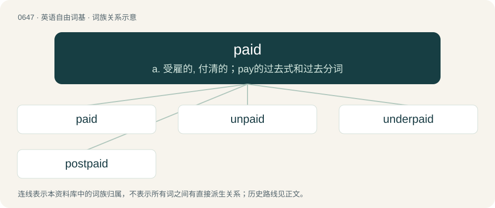

# 0718 · paid — a. 受雇的, 付清的；pay的过去式和过去分词

[总目录](../00_总目录_按常用程度.md)

**类型**：英语自由词基　｜　**来源语言**：见词源记录

## 核心含义与来源

- 核心含义：a. 受雇的, 付清的；pay的过去式和过去分词
- 英文含义：Not free of charge; costing money.
- 词形：paid

**来源记录 1**（形容词；Not free of charge; costing money.）

From Middle English paid, payd, ipaid, ypayd, past participle of Middle English paien, payen (“to pay”), equivalent to pay + -ed.

## 词族图

## 单词速览（常用到不常用）

| 单词 | 音标 | 释义 |
|---|---|---|
| [paid](#w-1) | 英 /peɪd/ | a. 受雇的, 付清的；pay的过去式和过去分词 |
| [unpaid](#w-2) | 英 /ʌnˈpeɪd/ | a. 未付款的, 不支薪水的；\[经\] 未付的, 未缴纳的 |
| [underpaid](#w-3) | /,ʌndəˈpeid/ | underpay的过去式和过去分词；\[经\] 未足额支付 |
| [postpaid](#w-4) | /ˈpəustˈpeid/ | 【英文】Paid after the service (used especially of cellular phones). |

## 逐词详解

### 1. paid

**词性**：形容词　｜　**音标**：英 /peɪd/

**中文释义**：a. 受雇的, 付清的；pay的过去式和过去分词

**英文义项**：Not free of charge; costing money. / Receiving pay.

**构词拆分**：pay + -ed

**词源与演化**：

From Middle English paid, payd, ipaid, ypayd, past participle of Middle English paien, payen (“to pay”), equivalent to pay + -ed.

**例句**：

> I thought his house would be nicer than this. I thought that motherf\*cker was paid.

该用例对应义项：Having money (i.e. rich, wealthy, etc.).

### 2. unpaid

**词性**：形容词　｜　**音标**：英 /ʌnˈpeɪd/

**中文释义**：a. 未付款的, 不支薪水的；\[经\] 未付的, 未缴纳的

**英文义项**：Not paid for. / Of work: done without agreed payment, usually voluntarily.

**构词拆分**：un- + paid

**词源与演化**：

From un- + paid.

**用法示例／搭配（非完整句）**：

> an unpaid position

该用例对应义项：Of work: done without agreed payment, usually voluntarily.

### 3. underpaid

**词性**：形容词　｜　**音标**：/,ʌndəˈpeid/

**中文释义**：underpay的过去式和过去分词；\[经\] 未足额支付

**英文义项**：Getting too little financial compensation for one's work.

**构词拆分**：under- + paid

**词源与演化**：

From under- + paid.

**例句**：

> I am underpaid and overworked.

该用例对应义项：Getting too little financial compensation for one's work.

### 4. postpaid

**词性**：形容词　｜　**音标**：/ˈpəustˈpeid/

**英文义项**：Paid after the service (used especially of cellular phones).

**构词拆分**：post- + paid

**词源与演化**：

From post- + paid.
