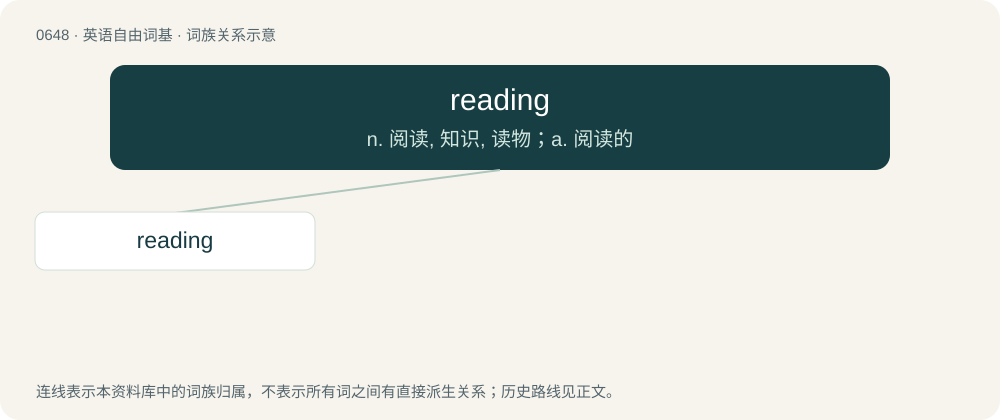

# 0719 · reading — n. 阅读, 知识, 读物；a. 阅读的

[总目录](../00_总目录_按常用程度.md)

**类型**：英语自由词基　｜　**来源语言**：见词源记录

## 核心含义与来源

- 核心含义：n. 阅读, 知识, 读物；a. 阅读的
- 英文含义：The process of interpreting written language.
- 词形：reading

**来源记录 1**（名词；The process of interpreting written language.）

From Middle English reding, redynge, redunge, from Old English rǣding (“reading”), equivalent to read + -ing.

## 词族图

## 单词速览（常用到不常用）

| 单词 | 音标 | 释义 |
|---|---|---|
| [reading](#w-1) | /ˈɹiːdɪŋ/ | n. 阅读, 知识, 读物；a. 阅读的 |

## 逐词详解

### 1. reading

**词性**：名词　｜　**音标**：/ˈɹiːdɪŋ/

**中文释义**：n. 阅读, 知识, 读物；a. 阅读的

**英文义项**：The process of interpreting written language. / The process of interpreting a symbol, a sign or a measuring device.

**构词拆分**：read + -ing

**词源与演化**：

From Middle English reding, redynge, redunge, from Old English rǣding (“reading”), equivalent to read + -ing.

**例句**：

> He glanced across and took note of the speedometer reading.

该用例对应义项：A value indicated by a measuring device.
