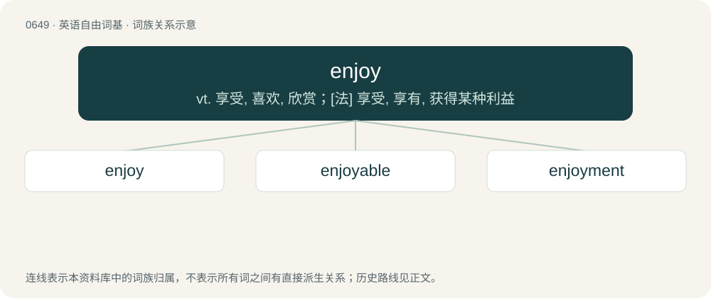

# 0720 · enjoy — vt. 享受, 喜欢, 欣赏；\[法\] 享受, 享有, 获得某种利益

[总目录](../00_总目录_按常用程度.md)

**类型**：英语自由词基　｜　**来源语言**：见词源记录

## 核心含义与来源

- 核心含义：vt. 享受, 喜欢, 欣赏；\[法\] 享受, 享有, 获得某种利益
- 英文含义：To receive pleasure or satisfaction from something.
- 词形：enjoy

**来源记录 1**（动词；To receive pleasure or satisfaction from something.）

From Middle English enjoyen, from Old French enjoier, anjoier, enjoer (“to give joy, receive with joy, rejoice”), equivalent to en- + joy.

## 词族图

## 单词速览（常用到不常用）

| 单词 | 音标 | 释义 |
|---|---|---|
| [enjoy](#w-1) | 英 /ɛnˈd͡ʒɔɪ/ | vt. 享受, 喜欢, 欣赏；\[法\] 享受, 享有, 获得某种利益 |
| [enjoyable](#w-2) | /ɛnˈd͡ʒɔɪ.ə.bl̩/ | a. 可从中得到乐趣的, 令人愉快的 |
| [enjoyment](#w-3) | /ɪnˈd͡ʒɔɪ.mənt/ | n. 享乐, 快乐, 享受；\[经\] 使用权 |

## 逐词详解

### 1. enjoy

**词性**：动词　｜　**音标**：英 /ɛnˈd͡ʒɔɪ/

**中文释义**：vt. 享受, 喜欢, 欣赏；\[法\] 享受, 享有, 获得某种利益

**英文义项**：To receive pleasure or satisfaction from something. / To have the use or benefit of something.

**构词拆分**：en- + joy

**词源与演化**：

From Middle English enjoyen, from Old French enjoier, anjoier, enjoer (“to give joy, receive with joy, rejoice”), equivalent to en- + joy.

**例句**：

> I've really enjoyed you and your sister showing me around.

该用例对应义项：To receive pleasure or satisfaction from something.

### 2. enjoyable

**词性**：形容词　｜　**音标**：/ɛnˈd͡ʒɔɪ.ə.bl̩/

**中文释义**：a. 可从中得到乐趣的, 令人愉快的

**英文义项**：Pleasant, capable of giving pleasure.

**构词拆分**：enjoy + -able

**词源与演化**：

From enjoy + -able.

**例句**：

> That was an enjoyable day; I had a lot of fun.

该用例对应义项：Pleasant, capable of giving pleasure.

### 3. enjoyment

**词性**：名词　｜　**音标**：/ɪnˈd͡ʒɔɪ.mənt/

**中文释义**：n. 享乐, 快乐, 享受；\[经\] 使用权

**英文义项**：The condition of enjoying anything. / An enjoyable state of mind; a feeling of satisfaction or delight from a situation.

**构词拆分**：enjoy + -ment

**词源与演化**：

From enjoy + -ment.

**例句**：

> Few activities better the enjoyment of a hearty meal eaten in good company.

该用例对应义项：The condition of enjoying anything.
