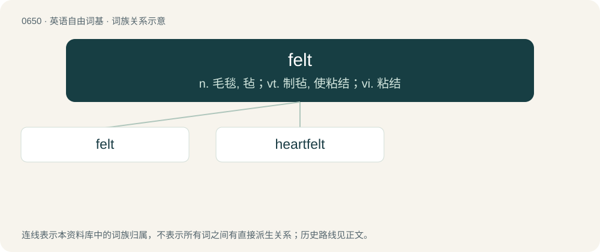

# 0721 · felt — n. 毛毯, 毡；vt. 制毡, 使粘结；vi. 粘结

[总目录](../00_总目录_按常用程度.md)

**类型**：英语自由词基　｜　**来源语言**：见词源记录

## 核心含义与来源

- 核心含义：n. 毛毯, 毡；vt. 制毡, 使粘结；vi. 粘结
- 英文含义：A cloth or stuff made of matted fibres of wool, or wool and fur, fulled or wrought into a compact substance by rolling and pressure, with lees or size, without spinning or weaving.
- 词形：felt

**多个词源／构词路径**：同一拼写可能有不同来源；以下按词性和含义分别列出。

**来源记录 1**（名词；A cloth or stuff made of matted fibres of wool, or wool and fur, fulled or wrought into a compact substance by rolling and pressure, with lees or size, without spinning or weaving.）

From Middle English felt, from Old English felt, from Proto-West Germanic \*felt (compare Dutch vilt, German Filz, Danish, Norwegian Bokmål, Norwegian Nynorsk, and Swedish filt, French feutre), from Proto-Indo-European \*pilto, \*pilso 'felt' (compare Latin pilleus (“felt”, adjective), Old Church Slavonic плъсть (plŭstĭ), Albanian plis, Ancient Greek πῖλος (pîlos)), from \*pel- 'to beat'. More at anvil.

**来源记录 2**（形容词；That has been experienced or perceived.）

From Old English fēled, corresponding to feel + -ed.

## 词族图

## 单词速览（常用到不常用）

| 单词 | 音标 | 释义 |
|---|---|---|
| [felt](#w-1) | /ˈfɛlt/ | n. 毛毯, 毡；vt. 制毡, 使粘结；vi. 粘结 |
| [heartfelt](#w-2) | 英 /ˈhɑːt.fɛlt/；美 /ˈhɑːɹt.fɛlt/ | a. 衷心的, 真心真意的 |

## 逐词详解

### 1. felt

**词性**：动词　｜　**音标**：/ˈfɛlt/

**中文释义**：n. 毛毯, 毡；vt. 制毡, 使粘结；vi. 粘结

**英文义项**：To make into felt or a feltlike substance; to cause to adhere and mat together. / To cover with, or as if with, felt.

**词源与演化**：

From Middle English felt, from Old English felt, from Proto-West Germanic \*felt (compare Dutch vilt, German Filz, Danish, Norwegian Bokmål, Norwegian Nynorsk, and Swedish filt, French feutre), from Proto-Indo-European \*pilto, \*pilso 'felt' (compare Latin pilleus (“felt”, adjective), Old Church Slavonic плъсть (plŭstĭ), Albanian plis, Ancient Greek πῖλος (pîlos)), from \*pel- 'to beat'. More at anvil.

**用法示例／搭配（非完整句）**：

> to felt the cylinder of a steam engine

该用例对应义项：To cover with, or as if with, felt.

### 2. heartfelt

**词性**：形容词　｜　**音标**：英 /ˈhɑːt.fɛlt/；美 /ˈhɑːɹt.fɛlt/

**中文释义**：a. 衷心的, 真心真意的

**英文义项**：Believed or felt deeply and sincerely.

**构词拆分**：heart + felt

**词源与演化**：

From heart + felt.

**例句**：

> She expressed her heartfelt sympathies at the death of his mother.

该用例对应义项：Believed or felt deeply and sincerely.
