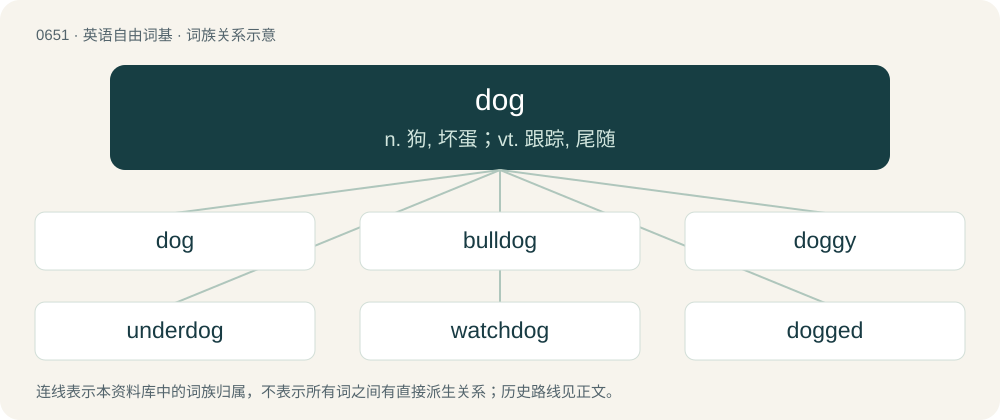

# 0723 · dog — n. 狗, 坏蛋；vt. 跟踪, 尾随

[总目录](../00_总目录_按常用程度.md)

**类型**：英语自由词基　｜　**来源语言**：见词源记录

## 核心含义与来源

- 核心含义：n. 狗, 坏蛋；vt. 跟踪, 尾随
- 英文含义：The species Canis familiaris (sometimes designated Canis lupus familiaris), domesticated for thousands of years and of highly variable appearance because of human breeding.
- 词形：dog

**多个词源／构词路径**：同一拼写可能有不同来源；以下按词性和含义分别列出。

**来源记录 1**（名词；The species Canis familiaris (sometimes designated Canis lupus familiaris), domesticated for thousands of years and of highly variable appearance because of human breeding.）

Inherited from Middle English dogge (akin to Scots dug), from Old English dogga, docga, of uncertain origin. The original meaning seems to have been a common dog, as opposed to a well-bred one, or something like 'cur', and perhaps later came to be used for stocky dogs. Possibly a pet-form diminutive with suffix -ga (compare frocga (“frog”), \*picga (“pig”)), appended to a base \*dog-, \*doc- of unclear origin and meaning. One possibility is Old English dox (“dark, swarthy”) (compare frocga from frox). Another proposal is that it derives from Proto-West Germanic \*dugan (“to be suitable”), the origin of Old English dugan (“to be good, worthy, useful”), English dow, Dutch deugen, German taugen. The theory goes that it could have been an epithet for dogs, commonly used by children, meaning "good/useful animal". Another one is that it is related to \*docce (“stock, muscle”), from Proto-West Germanic \*dokkā (“round mass, ball, muscle, doll”), whence English dock (“stumpy tail”). In 14th-century England, hound (from Old English hund) was the general word for all domestic canines, and dog referred to a subtype resembling the modern mastiff and bulldog. By the 16th century, dog had become the general word, and hound had begun to refer only to breeds used for hunting. In the 16th century, the word dog was adopted by several continental European languages as their word for mastiff. Despite similarities in forms and meaning, it is not related to Mbabaram dog.

**来源记录 2**（形容词；Of inferior quality; very bad.）

Clipping of dogshit.

## 词族图

## 单词速览（常用到不常用）

| 单词 | 音标 | 释义 |
|---|---|---|
| [dog](#w-1) | 英 /dɒɡ/；/dɔɡ/ | n. 狗, 坏蛋；vt. 跟踪, 尾随 |
| [bulldog](#w-2) | 英 /ˈbʊl.dɒɡ/；美 /ˈbʊl.dɔɡ/ | n. 喇叭狗 |
| [doggy](#w-3) | 英 /ˈdɒ.ɡi/；美 /ˈdɔ.ɡi/ | n. 小狗儿；a. 时髦的, 装阔气的 |
| [underdog](#w-4) | 英 /ˈʌndəˌdɒɡ/；美 /ˈʌndɚˌdɔɡ/ | n. 斗败了的狗, 失败者, 受害者；\[法\] 受压迫者, 在不健全的社会的受害者 |
| [watchdog](#w-5) | 英 /ˈwɒt͡ʃˌdɒɡ/；美 /ˈwɑːt͡ʃˌdɑːɡ/ | n. 看门狗, 监察人；\[化\] 监控设备; 监视器 |
| [dogged](#w-6) | 英 /ˈdɒɡɪd/；美 /ˈdɔɡɪd/ | a. 顽固的, 顽强的 |
| [doggo](#w-7) | 英 /ˈdɒɡəʊ/；美 /ˈdɔɡoʊ/ | adv. 隐秘地；躲藏地；一动也不动地 |
| [dogfight](#w-8) | 英 /ˈdɒɡ.faɪt/ | n. 混战, 斗狗, 空战, 狗咬狗；vi. 在空中格斗 |
| [sheepdog](#w-9) |  | n. 牧羊狗 |
| [dogfish](#w-10) | /ˈdɒgfiʃ/ | n. 狗鲨, 巨头鲸 |
| [slumdog](#w-11) |  | 【英文】A person who lives in the slums of cities. |

## 逐词详解

### 1. dog

**词性**：名词　｜　**音标**：英 /dɒɡ/；/dɔɡ/

**中文释义**：n. 狗, 坏蛋；vt. 跟踪, 尾随

**英文义项**：The species Canis familiaris (sometimes designated Canis lupus familiaris), domesticated for thousands of years and of highly variable appearance because of human breeding. / Any member of the family Canidae, including domestic dogs, wolves, coyotes, jackals, and their relatives (extant and extinct).

**词源与演化**：

Inherited from Middle English dogge (akin to Scots dug), from Old English dogga, docga, of uncertain origin. The original meaning seems to have been a common dog, as opposed to a well-bred one, or something like 'cur', and perhaps later came to be used for stocky dogs. Possibly a pet-form diminutive with suffix -ga (compare frocga (“frog”), \*picga (“pig”)), appended to a base \*dog-, \*doc- of unclear origin and meaning. One possibility is Old English dox (“dark, swarthy”) (compare frocga from frox). Another proposal is that it derives from Proto-West Germanic \*dugan (“to be suitable”), the origin of Old English dugan (“to be good, worthy, useful”), English dow, Dutch deugen, German taugen. The theory goes that it could have been an epithet for dogs, commonly used by children, meaning "good/useful animal". Another one is that it is related to \*docce (“stock, muscle”), from Proto-West Germanic \*dokkā (“round mass, ball, muscle, doll”), whence English dock (“stumpy tail”). In 14th-century England, hound (from Old English hund) was the general word for all domestic canines, and dog referred to a subtype resembling the modern mastiff and bulldog. By the 16th century, dog had become the general word, and hound had begun to refer only to breeds used for hunting. In the 16th century, the word dog was adopted by several continental European languages as their word for mastiff. Despite similarities in forms and meaning, it is not related to Mbabaram dog.

**例句**：

> That modification turned his Dodge hemi into a dog.

该用例对应义项：Something that performs poorly.

### 2. bulldog

**词性**：名词　｜　**音标**：英 /ˈbʊl.dɒɡ/；美 /ˈbʊl.dɔɡ/

**中文释义**：n. 喇叭狗

**英文义项**：A breed of dog developed in England by the crossing of the bullbaiting dog and the Pug to produce a ladies' companion dog, having a very smooth coat, a flattened face, wrinkly cheeks, powerful front legs, and smaller hind legs. / The original form of this breed, the English bulldog.

**构词拆分**：bull + dog

**词源与演化**：

From bull + dog, in reference to bullbaiting.

**例句**：

> His bulldog determination was destined to bring him the opportunity he was seeking.

该用例对应义项：A stubborn or determined person.

### 3. doggy

**词性**：名词　｜　**音标**：英 /ˈdɒ.ɡi/；美 /ˈdɔ.ɡi/

**中文释义**：n. 小狗儿；a. 时髦的, 装阔气的

**英文义项**：A dog, especially a small one. / A junior temporarily assigned to do minor duties for a senior; a gofer.

**构词拆分**：dog + -y

**词源与演化**：

From dog + -y (diminutive suffix).

**例句**：

> That's such a cute little doggy, Keira!

该用例对应义项：A dog, especially a small one.

### 4. underdog

**词性**：名词　｜　**音标**：英 /ˈʌndəˌdɒɡ/；美 /ˈʌndɚˌdɔɡ/

**中文释义**：n. 斗败了的狗, 失败者, 受害者；\[法\] 受压迫者, 在不健全的社会的受害者

**英文义项**：A competitor thought unlikely to win. / Somebody at a disadvantage.

**构词拆分**：under- + dog

**词源与演化**：

From under- + dog.

**例句**：

> They were the underdogs in the basketball competition.

该用例对应义项：A competitor thought unlikely to win.

### 5. watchdog

**词性**：名词　｜　**音标**：英 /ˈwɒt͡ʃˌdɒɡ/；美 /ˈwɑːt͡ʃˌdɑːɡ/

**中文释义**：n. 看门狗, 监察人；\[化\] 监控设备; 监视器

**英文义项**：A guard dog. / An individual or group that monitors the activities of another entity (such as an individual, corporation, non-profit group, or governmental organization) on behalf of the public to ensure that entity does not behave illegally or unethically.

**构词拆分**：watch + dog

**词源与演化**：

From watch + dog.

**例句**：

> A dog that barks all the time isn't a good watchdog.

### 6. dogged

**词性**：形容词　｜　**音标**：英 /ˈdɒɡɪd/；美 /ˈdɔɡɪd/

**中文释义**：a. 顽固的, 顽强的

**英文义项**：stubbornly persevering, steadfast

**构词拆分**：dog + -ed

**词源与演化**：

From Middle English dogged, doggid, doggyd (“characteristics similar to that of a dog”), equivalent to dog + -ed.

**例句**：

> It is the dogged who wins.

### 7. doggo

**词性**：名词　｜　**音标**：英 /ˈdɒɡəʊ/；美 /ˈdɔɡoʊ/

**中文释义**：adv. 隐秘地；躲藏地；一动也不动地

**英文义项**：A dog.

**构词拆分**：dog + -o (colloquializing suffix)

**词源与演化**：

The noun is from dog + -o (colloquializing suffix), perhaps after the adverb. The adverb is probably of the same origin.

### 8. dogfight

**词性**：名词　｜　**音标**：英 /ˈdɒɡ.faɪt/

**中文释义**：n. 混战, 斗狗, 空战, 狗咬狗；vi. 在空中格斗

**英文义项**：A twisting turning battle between two or more military aircraft, especially between fighters. / A fight between dogs, especially as part of the blood sport of dogfighting.

**构词拆分**：dog + fight

**词源与演化**：

From dog + fight.

**例句**：

> The two bi-planes swirled around each other like angry wasps in a violent dogfight.

该用例对应义项：A twisting turning battle between two or more military aircraft, especially between fighters.

### 9. sheepdog

**词性**：名词

**中文释义**：n. 牧羊狗

**英文义项**：Any of various breeds of dog used for herding sheep; an individual of such a breed. / Any of various breeds of dog used for guarding sheep; an individual of such a breed.

**构词拆分**：sheep + dog

**词源与演化**：

From sheep + dog.

**例句**：

> The sheepdog barked loudly, alerting Matthew to a jackal lurking near the flock.

### 10. dogfish

**词性**：名词　｜　**音标**：/ˈdɒgfiʃ/

**中文释义**：n. 狗鲨, 巨头鲸

**英文义项**：Any of various small sharks / Especially those from the family Squalidae

**构词拆分**：dog + fish

**词源与演化**：

From dog + fish. Compare Greek σκυλόψαρο (skylópsaro, “dogfish”), Latin canicula (“dogfish”, literally “little dog”), Italian pescecane (“dogfish”), French chien de mer (literally “dog of the sea”), German Meerhund (literally “seadog”) and Hundfisch (“dogfish”), and English seadog. For non-Indo-European cognates, see Maltese kelb il-baħar (literally “dog of the sea”) and Turkish köpek balığı (“shark”), likely calques from Indo-European languages.

**例句**：

> Among the 250 shark species that may be threatened by the fin trade are hammerheads, the plankton-eating basking shark and the spiny dogfish.

### 11. slumdog

**词性**：名词

**英文义项**：A person who lives in the slums of cities.

**构词拆分**：slum + dog

**词源与演化**：

From slum + dog; first appeared in the 2008 British romantic comedy film Slumdog Millionaire.
