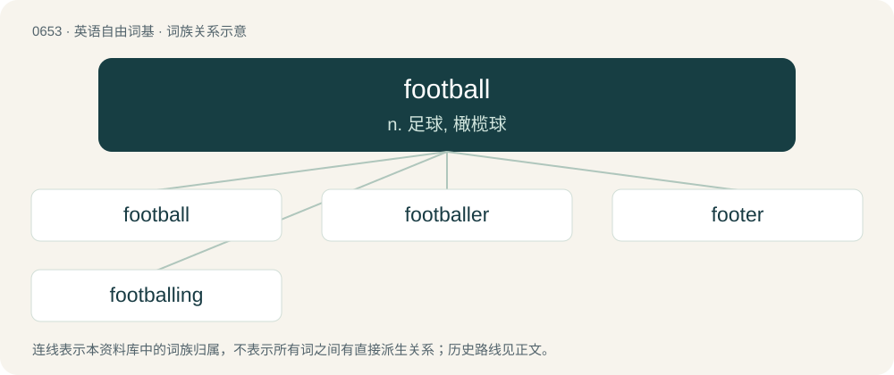

# 0726 · football — n. 足球, 橄榄球

[总目录](../00_总目录_按常用程度.md)

**类型**：英语自由词基　｜　**来源语言**：见词源记录

## 核心含义与来源

- 核心含义：n. 足球, 橄榄球
- 英文含义：A sport played on foot in which teams attempt to get a ball into a goal or zone defended by the other team.
- 词形：football

**来源记录 1**（名词；A sport played on foot in which teams attempt to get a ball into a goal or zone defended by the other team.）

From Middle English fotbal, footbal, equivalent to foot + ball, because the ball was primarily manipulated with the feet in early versions of the game (though some modern varieties involve more handling than kicking). The name for the briefcase is a play on “dropkick”, the code name of an early version of the nuclear war plan.

## 词族图

## 单词速览（常用到不常用）

| 单词 | 音标 | 释义 |
|---|---|---|
| [football](#w-1) | 英 /ˈfʊt.bɔːl/；/ˈfʊt.bɔl/ | n. 足球, 橄榄球 |
| [footballer](#w-2) | 英 /ˈfʊtbɔːlə/；/ˈfʊtbɔlɚ/ | n. 足球员, 足球选手 |
| [footer](#w-3) | /ˈfʊtə(ɹ)/ | 【英文】Football / soccer. |
| [footballing](#w-4) | /ˈfʊtbɔːlɪŋ/ | a. 足球的；和足球运动有关的 |

## 逐词详解

### 1. football

**词性**：名词　｜　**音标**：英 /ˈfʊt.bɔːl/；/ˈfʊt.bɔl/

**中文释义**：n. 足球, 橄榄球

**英文义项**：A sport played on foot in which teams attempt to get a ball into a goal or zone defended by the other team. / The ball used in any game called "football".

**构词拆分**：foot + ball

**词源与演化**：

From Middle English fotbal, footbal, equivalent to foot + ball, because the ball was primarily manipulated with the feet in early versions of the game (though some modern varieties involve more handling than kicking). The name for the briefcase is a play on “dropkick”, the code name of an early version of the nuclear war plan.

**例句**：

> Roman and medieval football matches were more violent than any modern type of football.

该用例对应义项：A sport played on foot in which teams attempt to get a ball into a goal or zone defended by the other team.

### 2. footballer

**词性**：名词　｜　**音标**：英 /ˈfʊtbɔːlə/；/ˈfʊtbɔlɚ/

**中文释义**：n. 足球员, 足球选手

**英文义项**：One who plays association football. / One who plays Australian rules football.

**构词拆分**：football + -er

**词源与演化**：

From football + -er. For the kyphosid sense, named for the resemblance of their stripes to football uniforms.

**例句**：

> The footballer was sent off for giving the referee the middle finger.

### 3. footer

**词性**：名词　｜　**音标**：/ˈfʊtə(ɹ)/

**英文义项**：Football / soccer. / A football.

**构词拆分**：football + -er

**词源与演化**：

From football + -er (“Oxford -er”).

### 4. footballing

**词性**：形容词　｜　**音标**：/ˈfʊtbɔːlɪŋ/

**中文释义**：a. 足球的；和足球运动有关的

**英文义项**：Relating to the sport of football.

**构词拆分**：football + -ing

**词源与演化**：

From football + -ing.

**例句**：

> He is truly what you might call a footballing genius.
