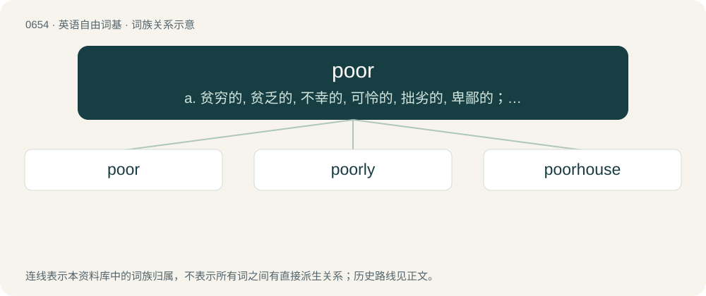

# 0727 · poor — a. 贫穷的, 贫乏的, 不幸的, 可怜的, 拙劣的, 卑鄙的；\[经\] 低劣的, 不良的

[总目录](../00_总目录_按常用程度.md)

**类型**：英语自由词基　｜　**来源语言**：见词源记录

## 核心含义与来源

- 核心含义：a. 贫穷的, 贫乏的, 不幸的, 可怜的, 拙劣的, 卑鄙的；\[经\] 低劣的, 不良的
- 英文含义：With no or few possessions or money, particularly in relation to contemporaries who do have them.
- 词形：poor

**来源记录 1**（形容词；With no or few possessions or money, particularly in relation to contemporaries who do have them.）

Inherited from Middle English povre, povere, from Old French and Anglo-Norman povre, poure, from Latin pauper, ultimately from Proto-Indo-European \*peh₂w- (“few, small”). Doublet of pauper. Displanced native wantsome, Middle English unlede (“poor”, from Old English unlǣde), Middle English unweli, unwely (“poor, unwealthy”, from Old English un- + weliġ (“well-to-do, prosperous, rich”)) and almost fully arm.

## 词族图

## 单词速览（常用到不常用）

| 单词 | 音标 | 释义 |
|---|---|---|
| [poor](#w-1) | /pʊɚ/ | a. 贫穷的, 贫乏的, 不幸的, 可怜的, 拙劣的, 卑鄙的；\[经\] 低劣的, 不良的 |
| [poorly](#w-2) | 英 /ˈpʊə.li/；美 /ˈpʊɹ.li/ | adv. 贫穷地, 不充分地, 贫乏地；a. 身体不舒服的 |
| [poorhouse](#w-3) | /ˈpuəhaus/ | n. 救济院 |

## 逐词详解

### 1. poor

**词性**：形容词　｜　**音标**：/pʊɚ/

**中文释义**：a. 贫穷的, 贫乏的, 不幸的, 可怜的, 拙劣的, 卑鄙的；\[经\] 低劣的, 不良的

**英文义项**：With no or few possessions or money, particularly in relation to contemporaries who do have them. / Of low quality.

**词源与演化**：

Inherited from Middle English povre, povere, from Old French and Anglo-Norman povre, poure, from Latin pauper, ultimately from Proto-Indo-European \*peh₂w- (“few, small”). Doublet of pauper. Displanced native wantsome, Middle English unlede (“poor”, from Old English unlǣde), Middle English unweli, unwely (“poor, unwealthy”, from Old English un- + weliġ (“well-to-do, prosperous, rich”)) and almost fully arm.

**例句**：

> We were so poor that we couldn't afford shoes.

该用例对应义项：With no or few possessions or money, particularly in relation to contemporaries who do have them.

### 2. poorly

**词性**：副词　｜　**音标**：英 /ˈpʊə.li/；美 /ˈpʊɹ.li/

**中文释义**：adv. 贫穷地, 不充分地, 贫乏地；a. 身体不舒服的

**英文义项**：In a poor manner or condition; without plenty, or sufficiency, or suitable provision for comfort. / With little or no success; indifferently; with little profit or advantage.

**构词拆分**：poor + -ly

**词源与演化**：

From Middle English poorly, pouerly, poreliche, poureliche, pouerliche, equivalent to poor + -ly.

**例句**：

> She looked poorly on that suggestion.

该用例对应义项：In a negative manner; with disapproval; unfavorably.

### 3. poorhouse

**词性**：名词　｜　**音标**：/ˈpuəhaus/

**中文释义**：n. 救济院

**英文义项**：A charitable institution where poor or homeless people are lodged. / A workhouse.

**构词拆分**：poor + house

**词源与演化**：

From poor + house.
