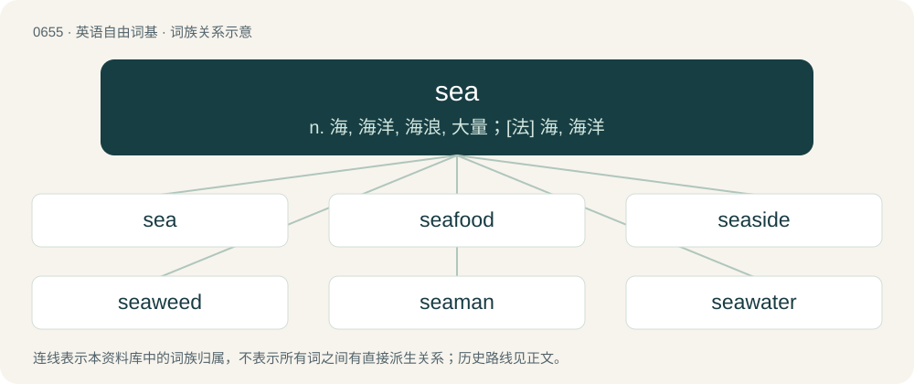

# 0728 · sea — n. 海, 海洋, 海浪, 大量；\[法\] 海, 海洋

[总目录](../00_总目录_按常用程度.md)

**类型**：英语自由词基　｜　**来源语言**：见词源记录

## 核心含义与来源

- 核心含义：n. 海, 海洋, 海浪, 大量；\[法\] 海, 海洋
- 英文含义：A large body of salt water.
- 词形：sea

**来源记录 1**（名词；A large body of salt water.）

Inherited from Middle English see, from Old English sǣ, from Proto-West Germanic \*saiwi (“body of water”), from Proto-Germanic \*saiwiz, itself either: \* Derived from Proto-Indo-European \*sh₂ey-wo- (“to be fierce, afflict”). Related to Latin saevus (“wild, fierce”), Tocharian B saiwe (“itch”), and Latvian sievs, sīvs (“sharp, biting”). More at sore. \* Derived from Proto-Germanic \*sīhwaną (“to percolate, filter”), from Proto-Indo-European \*seykʷ-. Cognates Cognate with Yola zea, zee (“sea”), North Frisian See, sia, siie (“sea; lake”), Saterland Frisian See, Säi (“sea”), West Frisian see (“sea”), Cimbrian and Mòcheno sea (“lake”), Dutch zee (“sea”), German and German Low German See (“sea”), Limburgish Sië, zieë (“sea, ocean; lake”), Luxembourgish Séi (“lake”), West Flemish zji (“sea; seaside”), Danish sø (“sea; lake”), Faroese sjógvur (“sea; big wave”), Icelandic sjár, sjór, sær (“sea”), Norwegian Bokmål and Norwegian Nynorsk sjø (“sea, ocean; lake”), Swedish sjö (“sea; lake; big wave”), Gothic 𐍃𐌰𐌹𐍅𐍃 (saiws, “lake, sea; marshland”).

## 词族图

## 单词速览（常用到不常用）

| 单词 | 音标 | 释义 |
|---|---|---|
| [sea](#w-1) | /siː/ | n. 海, 海洋, 海浪, 大量；\[法\] 海, 海洋 |
| [seafood](#w-2) | /ˈsiːfuːd/ | n. 海味, 海鲜, 鱼类 |
| [seaside](#w-3) | /ˌsiːˈsaɪd/ | a. 海边的, 海滨的；n. 海滨 |
| [seaweed](#w-4) | 英 /ˈsiːwiːd/；美 /ˈsiwid/ | n. 海草, 海藻；\[医\] 海藻 |
| [seaman](#w-5) | /ˈsiːmən/ | n. 船员, 海员, 水兵；\[法\] 海员, 水手, 精通海事者 |
| [seawater](#w-6) | /ˈsiː.wɒtə/ | n. 海水；\[化\] 海水 |
| [seaboard](#w-7) | /ˈsiːbɒːd/ | n. 海岸, 沿海地带；a. 海边的 |
| [seagull](#w-8) | 英 /ˈsiː.ɡʌl/ | n. 鸥 |
| [seabed](#w-9) | /ˈsiːbed/ | n. 海底, 海床 |
| [seashore](#w-10) | 英 /ˈsiːʃɔː/；美 /ˈsiːʃoɹ/ | n. 海岸, 海滨 |
| [seaport](#w-11) | /ˈsiːpɒːt/ | n. 海港, 港口城市 |
| [undersea](#w-12) | /ˈʌndəsiː/ | a. 海面下的；adv. 在海面下 |
| [seafloor](#w-13) | /ˈsiːflɔː/ | n. 海底 |
| [seafront](#w-14) | /ˈsiːfrʌnt/ | n. 面向海的一面 |
| [seafaring](#w-15) | /ˈsiː.fєəriŋ/ | n. 航海业, 航海；a. 航海的, 在海上工作的 |
| [seaplane](#w-16) | 美 /ˈsiˌpleɪn/ | n. 水上飞机 |
| [seaway](#w-17) | /ˈsiːwei/ | \[经\] 海运航线 |
| [subsea](#w-18) | /sʌbˈsiː/ | a. 海底的 ；adv. 在海底 |
| [seaward](#w-19) | 英 /ˈsiːwəd/；美 /ˈsiwəɹd/ | n. 朝海的方向；a. 面海的, 向海的；adv. 往海那边 |
| [seawall](#w-20) |  | n. 海塘；防波堤 |
| [seashell](#w-21) | 美 /ˈsiˌʃɛl/ | n. 海贝壳 |
| [seabird](#w-22) | /ˈsiːbɜː(ɹ)d/ | n. 海鸟 |
| [seaborne](#w-23) | /ˈsiːbɒːn/ | a. 海上的, 漂流的；\[经\] 海运的, 由海轮装运的 |
| [seacoast](#w-24) | /ˈsiːkəust/ | n. 海岸, 沿岸 |
| [seagrass](#w-25) | 美 /ˈsiˌɡɹæs/ | 海草 |
| [seaworthy](#w-26) | 英 /ˈsiːwɜːði/；美 /ˈsiːwɝði/ | a. 适于航海的, 经得起航海的；\[法\] 适于航海的 |
| [seahawk](#w-27) |  | 【英文】A rapacious gull-like bird of the genus Stercorarius. |
| [seascape](#w-28) | 美 /ˈsiˌskeɪp/ | n. 海景, 海景画 |
| [seasick](#w-29) | /ˈsiːsɪk/ | a. 晕船的 |
| [seagoing](#w-30) | /ˈsiː.gəuiŋ/ | a. 适于远航的 |
| [seasickness](#w-31) | /ˈsiːsɪk.nəs/ | \[医\] 晕船 |
| [seafarer](#w-32) | 美 /ˈsiˌfeɹɚ/；/ˈsiˌfɛɹɚ/ | n. 船员, 航海家；\[法\] 海员, 水手, 海上旅行者 |

## 逐词详解

### 1. sea

**词性**：名词　｜　**音标**：/siː/

**中文释义**：n. 海, 海洋, 海浪, 大量；\[法\] 海, 海洋

**英文义项**：A large body of salt water. / The ocean; the continuous body of salt water covering a majority of the Earth's surface.

**词源与演化**：

Inherited from Middle English see, from Old English sǣ, from Proto-West Germanic \*saiwi (“body of water”), from Proto-Germanic \*saiwiz, itself either: \* Derived from Proto-Indo-European \*sh₂ey-wo- (“to be fierce, afflict”). Related to Latin saevus (“wild, fierce”), Tocharian B saiwe (“itch”), and Latvian sievs, sīvs (“sharp, biting”). More at sore. \* Derived from Proto-Germanic \*sīhwaną (“to percolate, filter”), from Proto-Indo-European \*seykʷ-. Cognates Cognate with Yola zea, zee (“sea”), North Frisian See, sia, siie (“sea; lake”), Saterland Frisian See, Säi (“sea”), West Frisian see (“sea”), Cimbrian and Mòcheno sea (“lake”), Dutch zee (“sea”), German and German Low German See (“sea”), Limburgish Sië, zieë (“sea, ocean; lake”), Luxembourgish Séi (“lake”), West Flemish zji (“sea; seaside”), Danish sø (“sea; lake”), Faroese sjógvur (“sea; big wave”), Icelandic sjár, sjór, sær (“sea”), Norwegian Bokmål and Norwegian Nynorsk sjø (“sea, ocean; lake”), Swedish sjö (“sea; lake; big wave”), Gothic 𐍃𐌰𐌹𐍅𐍃 (saiws, “lake, sea; marshland”).

**例句**：

> Seaman, sea gauge, sea monster, sea horse, sea level, seaworthy, seaport, seaboard, etc.

该用例对应义项：Living or used in or on the sea; of, near, or like the sea.

### 2. seafood

**词性**：名词　｜　**音标**：/ˈsiːfuːd/

**中文释义**：n. 海味, 海鲜, 鱼类

**英文义项**：Food from the sea, including that derived from fish, shellfish, crustaceans, cephalopods, seaweed, algae, marine mammals, and other marine organisms. / Food from any aquatic source, including not only salt water but also fresh water.

**构词拆分**：sea + food

**词源与演化**：

From sea + food.

**例句**：

> This is by far the best seafood restaurant in this area.

### 3. seaside

**词性**：名词　｜　**音标**：/ˌsiːˈsaɪd/

**中文释义**：a. 海边的, 海滨的；n. 海滨

**英文义项**：The area by and around the sea; including the beach, promenade or cliffs.

**构词拆分**：sea + side

**词源与演化**：

From Middle English see-syde, sey-syde, see syde, se side, equivalent to sea + side. Compare waterside.

**例句**：

> This summer, I'm going to the seaside at Weymouth. I'm very excited about it!

该用例对应义项：The area by and around the sea; including the beach, promenade or cliffs.

### 4. seaweed

**词性**：名词　｜　**音标**：英 /ˈsiːwiːd/；美 /ˈsiwid/

**中文释义**：n. 海草, 海藻；\[医\] 海藻

**英文义项**：Any of numerous marine algae, such as a kelp. / Any of various fresh water plants and algae.

**构词拆分**：sea + weed

**词源与演化**：

From sea + weed.

**例句**：

> Mary tasted seaweed for the first time and liked it.

### 5. seaman

**词性**：名词　｜　**音标**：/ˈsiːmən/

**中文释义**：n. 船员, 海员, 水兵；\[法\] 海员, 水手, 精通海事者

**英文义项**：Synonym of sailor, particularly on a maritime vessel. / A person of the lowest rank in the Navy, below able seaman.

**构词拆分**：sea + -man

**词源与演化**：

From Middle English seeman, seman, from Old English sǣmann. Cognate with Saterland Frisian Seemon (“seaman, sailor”), West Frisian seeman (“seaman, sailor”), Dutch zeeman (“seaman, sailor”), German Low German Seemann (“seaman, sailor”), German Seemann (“seaman, sailor”), Swedish sjöman (“seaman, sailor”), Norwegian sjømann (“seaman, sailor”). Equivalent to sea + -man.

**例句**：

> The seaman had to clean the ship down to the copper bolts.

### 6. seawater

**词性**：名词　｜　**音标**：/ˈsiː.wɒtə/

**中文释义**：n. 海水；\[化\] 海水

**英文义项**：The saltwater of a sea or ocean.

**构词拆分**：sea + water

**词源与演化**：

From Middle English seewater, se water, from Old English sǣwæter (“seawater”), equivalent to sea + water. Cognate with Saterland Frisian Seewoater (“seawater”), West Frisian seewetter (“seawater”), Dutch zeewater (“seawater”), Icelandic sjóvatn (“seawater”).

**例句**：

> You can not drink the seawater, for it is too salty.

### 7. seaboard

**词性**：名词　｜　**音标**：/ˈsiːbɒːd/

**中文释义**：n. 海岸, 沿海地带；a. 海边的

**英文义项**：The area bordering the sea; a coastline; a sealine.

**构词拆分**：sea + board

**词源与演化**：

From earlier sea-bord, perhaps continuing (with change in meaning) Middle English see bord (“porthole cover, seaward side”), equivalent to sea + board.

**例句**：

> This place has the best vegan food on the eastern seaboard.

### 8. seagull

**词性**：名词　｜　**音标**：英 /ˈsiː.ɡʌl/

**中文释义**：n. 鸥

**英文义项**：Any of several white, often dark-backed birds of the family Laridae having long, pointed wings and short legs. / The symbol ̼, which combines under a letter as a sort of accent.

**构词拆分**：sea + gull

**词源与演化**：

From sea + gull. The second element is from a Brythonic language. Compare Welsh gwylan, Breton gouelan.

**例句**：

> The seagull dove into the river and caught a fish.

### 9. seabed

**词性**：名词　｜　**音标**：/ˈsiːbed/

**中文释义**：n. 海底, 海床

**英文义项**：The floor or bottom of the sea or ocean.

**构词拆分**：sea + bed

**词源与演化**：

From sea + bed.

**例句**：

> The boat was brought up from the seabed by the Algerian authorities.

### 10. seashore

**词性**：名词　｜　**音标**：英 /ˈsiːʃɔː/；美 /ˈsiːʃoɹ/

**中文释义**：n. 海岸, 海滨

**英文义项**：The coastal land bordering a sea or an ocean. / The foreshore, the strip of land between low water and high water.

**构词拆分**：sea + shore

**词源与演化**：

From sea + shore.

**例句**：

> We often took a walk along the seashore together in the morning.

### 11. seaport

**词性**：名词　｜　**音标**：/ˈsiːpɒːt/

**中文释义**：n. 海港, 港口城市

**英文义项**：A town or harbour with facilities for seagoing ships to dock and take on or discharge cargo.

**构词拆分**：sea + port

**词源与演化**：

From sea + port.

**例句**：

> Gdańsk is the largest Polish seaport and an important cultural centre.

### 12. undersea

**词性**：形容词　｜　**音标**：/ˈʌndəsiː/

**中文释义**：a. 海面下的；adv. 在海面下

**英文义项**：Existing, relating to, or made for use beneath the sea, that is, beneath the sea surface, inside the sea.

**构词拆分**：under- + sea

**词源与演化**：

From under- + sea.

**例句**：

> A tsunami is a series of waves caused by earthquakes or undersea volcanic eruptions.

### 13. seafloor

**词性**：名词　｜　**音标**：/ˈsiːflɔː/

**中文释义**：n. 海底

**英文义项**：Synonym of seabed.

**构词拆分**：sea + floor

**词源与演化**：

From sea + floor.

**例句**：

> The seafloor is often covered with sediment.

该用例对应义项：Synonym of seabed.

### 14. seafront

**词性**：名词　｜　**音标**：/ˈsiːfrʌnt/

**中文释义**：n. 面向海的一面

**英文义项**：The seashore, the coast. / The waterfront of a seaside town.

**构词拆分**：sea + front

**词源与演化**：

From sea + front.

**例句**：

> In Algiers, the Sablette Seafront is a popular place for Friday outings.

### 15. seafaring

**词性**：形容词　｜　**音标**：/ˈsiː.fєəriŋ/

**中文释义**：n. 航海业, 航海；a. 航海的, 在海上工作的

**英文义项**：Living one's life at sea. / Fit to travel on the sea; seagoing.

**构词拆分**：sea + faring (“travelling; journeying; going”)

**词源与演化**：

From Middle English safarinde, see farand, se farinde, equivalent to sea + faring (“travelling; journeying; going”). Compare Old English sǣ-līþende (“seafaring”). Cognate with Dutch zeevarend (“seafaring”), German Low German seefahrend (“seafaring”), German seefahrend (“seafaring”), Danish søfarende (“seafaring”), Swedish sjöfarande (“seafaring”).

**例句**：

> A rowing boat is not a seafaring craft.

该用例对应义项：Fit to travel on the sea; seagoing.

### 16. seaplane

**词性**：名词　｜　**音标**：美 /ˈsiˌpleɪn/

**中文释义**：n. 水上飞机

**英文义项**：Any aircraft capable of taking off from, and alighting on the surface of water.

**构词拆分**：sea + plane

**词源与演化**：

From sea + plane. Supposedly coined by Winston Churchill.

**例句**：

> What specific knowledge is needed to be able to pilot a seaplane?

### 17. seaway

**词性**：名词　｜　**音标**：/ˈsiːwei/

**中文释义**：\[经\] 海运航线

**英文义项**：A lane or route at sea that is regularly used by ships; a sea lane or trade route. / An inland waterway used by seagoing shipping.

**构词拆分**：sea + way

**词源与演化**：

From Middle English seewey, from Old English sǣweġ (“a seaway, a path through the sea”), equivalent to sea + way. Compare Saterland Frisian Seegong (“seaway, swell”), German Seegang (“seaway, swell”).

**例句**：

> The Portuguese Vasco da Gama discovered the seaway that leads from Portugal, around the continent of Africa, to India.

### 18. subsea

**词性**：形容词　｜　**音标**：/sʌbˈsiː/

**中文释义**：a. 海底的 ；adv. 在海底

**英文义项**：Beneath the sea, that is, beneath the sea surface, inside the sea.

**构词拆分**：sub- + sea

**词源与演化**：

From sub- + sea.

### 19. seaward

**词性**：形容词　｜　**音标**：英 /ˈsiːwəd/；美 /ˈsiwəɹd/

**中文释义**：n. 朝海的方向；a. 面海的, 向海的；adv. 往海那边

**英文义项**：Being in or facing towards the sea.

**构词拆分**：sea + -ward

**词源与演化**：

From Middle English seaward, seward (attested only as an adjective), equivalent to sea + -ward.

**例句**：

> The landward side of the fort faced more dangerous guns than the seaward side, which only faced what could be put on a ship.

该用例对应义项：Being in or facing towards the sea.

### 20. seawall

**词性**：名词

**中文释义**：n. 海塘；防波堤

**英文义项**：A coastal defence in the form of a wall or an embankment.

**构词拆分**：sea + wall

**词源与演化**：

From Middle English se-walle, from Old English sǣweall (“seawall”), equivalent to sea + wall.

### 21. seashell

**词性**：名词　｜　**音标**：美 /ˈsiˌʃɛl/

**中文释义**：n. 海贝壳

**英文义项**：The empty shell of a marine mollusk. / The animal living inside a seashell.

**构词拆分**：sea + shell

**词源与演化**：

From sea + shell.

**例句**：

> The seashells on the beach are toxic and best avoided.

该用例对应义项：The animal living inside a seashell.

### 22. seabird

**词性**：名词　｜　**音标**：/ˈsiːbɜː(ɹ)d/

**中文释义**：n. 海鸟

**英文义项**：Any bird that spends most of its time in coastal waters or over the oceans.

**构词拆分**：sea + bird

**词源与演化**：

From sea + bird.

**例句**：

> Sami got sick from eating a seabird.

### 23. seaborne

**词性**：形容词　｜　**音标**：/ˈsiːbɒːn/

**中文释义**：a. 海上的, 漂流的；\[经\] 海运的, 由海轮装运的

**英文义项**：Transported on the sea or ocean, especially by floating on the sea.

**构词拆分**：sea + borne (“carried, supported”)

**词源与演化**：

From sea + borne (“carried, supported”).

### 24. seacoast

**词性**：名词　｜　**音标**：/ˈsiːkəust/

**中文释义**：n. 海岸, 沿岸

**英文义项**：The coastal land bordering a sea or ocean.

**构词拆分**：sea + coast

**词源与演化**：

From Middle English see-cost, see-coste, see coost, equivalent to sea + coast. Compare West Frisian seekoast (“seacoast”), Dutch zeekust (“seacoast”), German Seeküste (“seacoast”).

**例句**：

> Tom and Mary drove along the seacoast.

### 25. seagrass

**词性**：名词　｜　**音标**：美 /ˈsiˌɡɹæs/

**中文释义**：海草

**英文义项**：Any of various grass-like marine plants that grow underwater in salt water.

**构词拆分**：sea + grass

**词源与演化**：

From sea + grass.

**例句**：

> Seagrass provides a protective environment in which young fish can develop.

该用例对应义项：any of various seaweeds that grow underwater in shallow beds

### 26. seaworthy

**词性**：形容词　｜　**音标**：英 /ˈsiːwɜːði/；美 /ˈsiːwɝði/

**中文释义**：a. 适于航海的, 经得起航海的；\[法\] 适于航海的

**英文义项**：Fit for service at sea.

**构词拆分**：From sea + -worthy.

**词源与演化**：

From sea + -worthy.

**例句**：

> This boat is no longer seaworthy.

### 27. seahawk

**词性**：名词

**英文义项**：A rapacious gull-like bird of the genus Stercorarius. / An osprey, Pandion haliaetus.

**构词拆分**：sea + hawk

**词源与演化**：

From sea + hawk.

### 28. seascape

**词性**：名词　｜　**音标**：美 /ˈsiˌskeɪp/

**中文释义**：n. 海景, 海景画

**英文义项**：A view of the sea. / A piece of art that depicts the sea or shoreline.

**构词拆分**：sea + -scape

**词源与演化**：

From sea + -scape.

### 29. seasick

**词性**：形容词　｜　**音标**：/ˈsiːsɪk/

**中文释义**：a. 晕船的

**英文义项**：Suffering from sickness, nausea or dizziness due to the motion of a ship or boat at sea.

**构词拆分**：sea + sick

**词源与演化**：

From Middle English see seke, equivalent to sea + sick.

**例句**：

> People who get seasick easily shouldn't join the navy.

该用例对应义项：Suffering from sickness, nausea or dizziness due to the motion of a ship or boat at sea.

### 30. seagoing

**词性**：形容词　｜　**音标**：/ˈsiː.gəuiŋ/

**中文释义**：a. 适于远航的

**英文义项**：Travelling out to sea. / Made for, fit for sailing on, or used on the high seas.

**构词拆分**：sea + going

**词源与演化**：

From sea + going.

**用法示例／搭配（非完整句）**：

> a seagoing seal

该用例对应义项：Travelling out to sea.

### 31. seasickness

**词性**：名词　｜　**音标**：/ˈsiːsɪk.nəs/

**中文释义**：\[医\] 晕船

**英文义项**：Nausea, dizziness, etc. caused by the motion of a ship; a form of motion sickness.

**构词拆分**：seasick + -ness；sea + sickness

**词源与演化**：

From seasick + -ness or sea + sickness. Compare Middle English seknesse of the see (“seasickness”, literally “sickness of the sea”).

**例句**：

> Take seasickness medication at least an hour before you board.

### 32. seafarer

**词性**：名词　｜　**音标**：美 /ˈsiˌfeɹɚ/；/ˈsiˌfɛɹɚ/

**中文释义**：n. 船员, 航海家；\[法\] 海员, 水手, 海上旅行者

**英文义项**：Someone whose occupation is operating a ship or boat at sea, for either civilian or military purposes. / Anyone who travels by sea.

**构词拆分**：sea + farer (“traveler”)；seafare + -er

**词源与演化**：

From Middle English \*se-farere (suggested by se-farende, sa farinde (“sea-faring”)) equivalent to sea + farer (“traveler”) and to seafare + -er. Cognate with Middle Dutch seevarer, whence Modern Dutch zeevaarder (“seafarer”), West Frisian seefarder (“seafarer”), German Seefahrer (“seafarer”), Swedish sjöfarare (“seafarer”).

**例句**：

> An intergovernmental panel will draw up plans to relieve seafarers who have been stuck at sea during a crisis.

该用例对应义项：Someone whose occupation is operating a ship or boat at sea, for either civilian or military purposes.
