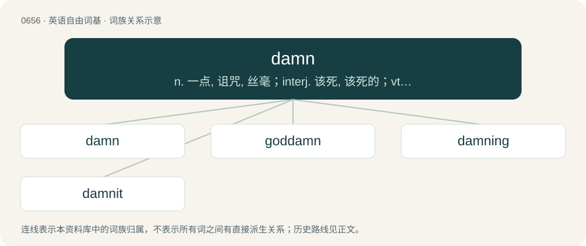

# 0729 · damn — n. 一点, 诅咒, 丝毫；interj. 该死, 该死的；vt. 诅咒, 罚...下地狱

[总目录](../00_总目录_按常用程度.md)

**类型**：英语自由词基　｜　**来源语言**：见词源记录

## 核心含义与来源

- 核心含义：n. 一点, 诅咒, 丝毫；interj. 该死, 该死的；vt. 诅咒, 罚...下地狱
- 英文含义：To condemn.
- 词形：damn

**来源记录 1**（动词；To condemn.）

From Middle English dampnen, from Old French damner, from Latin damnāre (“to condemn, inflict loss upon”), from damnum (“loss”).

## 词族图

## 单词速览（常用到不常用）

| 单词 | 音标 | 释义 |
|---|---|---|
| [damn](#w-1) | 英 /ˈdæm/；美 /ˈdæm/ | n. 一点, 诅咒, 丝毫；interj. 该死, 该死的；vt. 诅咒, 罚...下地狱 |
| [goddamn](#w-2) | emphatic/intensifier /ˈɡɒd.dæm/ | a. 该死的, 完全的, 十足的, 讨厌的 |
| [damning](#w-3) | /ˈdæmɪŋ/ | n. 诅咒；a. 受永罚的, 毁灭的, 咒骂的 |
| [damnit](#w-4) | /dæmɪt/ | 【英文】Synonym of dammit. |

## 逐词详解

### 1. damn

**词性**：动词　｜　**音标**：英 /ˈdæm/；美 /ˈdæm/

**中文释义**：n. 一点, 诅咒, 丝毫；interj. 该死, 该死的；vt. 诅咒, 罚...下地狱

**英文义项**：To condemn. / To condemn; to declare guilty; to doom; to adjudge to punishment.

**词源与演化**：

From Middle English dampnen, from Old French damner, from Latin damnāre (“to condemn, inflict loss upon”), from damnum (“loss”).

**例句**：

> The official position is that anyone who does this will be damned for all eternity.

该用例对应义项：To condemn.

### 2. goddamn

**词性**：形容词　｜　**音标**：emphatic/intensifier /ˈɡɒd.dæm/

**中文释义**：a. 该死的, 完全的, 十足的, 讨厌的

**英文义项**：Damned by God. / Used as an intensifier.

**构词拆分**：God + damn

**词源与演化**：

From God + damn; originally, and sometimes still, a present subjunctive expression of a wish that God smite someone for their wickedness; compare also antonymous God bless, God bless you, and God love (someone or something).

**例句**：

> You were in the background; you were a goddamn extra! That's good enough!

该用例对应义项：Used as an intensifier.

### 3. damning

**词性**：形容词　｜　**音标**：/ˈdæmɪŋ/

**中文释义**：n. 诅咒；a. 受永罚的, 毁灭的, 咒骂的

**英文义项**：Condemning; (often) sufficient to defeat a political or commercial rival.

**构词拆分**：damn + -ing

**词源与演化**：

From Middle English dampnynge; equivalent to damn + -ing.

**用法示例／搭配（非完整句）**：

> damning evidence was clear for all to see

该用例对应义项：Condemning; (often) sufficient to defeat a political or commercial rival.

### 4. damnit

**词性**：感叹词　｜　**音标**：/dæmɪt/

**英文义项**：Synonym of dammit.

**构词拆分**：damn + it

**词源与演化**：

Nonstandard contraction of damn + it
