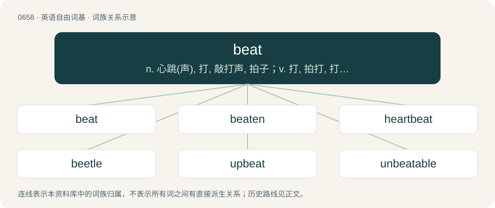

# 0731 · beat — n. 心跳(声), 打, 敲打声, 拍子；v. 打, 拍打, 打败；a. 疲乏的, 颓废的

[总目录](../00_总目录_按常用程度.md)

**类型**：英语自由词基　｜　**来源语言**：见词源记录

## 核心含义与来源

- 核心含义：n. 心跳(声), 打, 敲打声, 拍子；v. 打, 拍打, 打败；a. 疲乏的, 颓废的
- 英文含义：A stroke; a blow.
- 词形：beat

**多个词源／构词路径**：同一拼写可能有不同来源；以下按词性和含义分别列出。

**来源记录 1**（名词；A stroke; a blow.）

Inherited from Middle English beten, from Old English bēatan (“to beat, pound, strike, lash, dash, thrust, hurt, injure”), from Proto-West Germanic \*bautan, from Proto-Germanic \*bautaną (“to push, strike”). Cognates Cognate with Dutch boten, botten, butten (“to push, strike”), German boßen (“to thrash”), Gothic \*𐌱𐌰𐌿𐍄𐌰𐌽 (\*bautan, “to beat, strike”) (whence, probably, Galician and Portuguese botar (“to expel; to throw”)); also Latin fūstis (“club, cudgel, knobbed stick, staff”), \*fūtō (“to strike”), Albanian bahe, hobe (“sling”), Armenian բութ (butʻ), բույթ (buytʻ, “thumb”).

**来源记录 2**（动词；simple past tense of beat）

From Middle English bet (simple past of beten "to beat"), from Old English bēot (simple past of bēatan "to beat"). Middle English bet would regularly yield \*beet; the modern form is influenced by the present stem and the past participle beaten, perhaps by analogy with the Early Modern English paradigm eat:eat (“ate”):eaten. Pronunciations with /ɛ/ (from Middle English bette, alternative simple past of beten) are possibly analogous to read (/ɹɛd/), led, met, etc.

**来源记录 3**（名词；A beatnik.）

From beatnik, or beat generation.

## 词族图

## 单词速览（常用到不常用）

| 单词 | 音标 | 释义 |
|---|---|---|
| [beat](#w-1) | /biːt/ | n. 心跳(声), 打, 敲打声, 拍子；v. 打, 拍打, 打败；a. 疲乏的, 颓废的 |
| [beaten](#w-2) | /ˈbiː.tən/ | a. 被打败了的, 筋疲力竭的, 敲平的, 踏平的；beat的过去分词 |
| [heartbeat](#w-3) | 英 /ˈhɑːtˌbiːt/；美 /ˈhɑɹtˌbit/ | n. 心跳 |
| [beetle](#w-4) | /ˈbiːtəl/ | 【英文】To beat with a heavy mallet. |
| [upbeat](#w-5) | /ʌpˈbit/ | n. 弱拍, 上升, 兴旺；a. 上升的, 乐观的 |
| [unbeatable](#w-6) | /.ʌnˈbiːtəbl/ | a. 无敌的, 无与伦比的 |
| [beater](#w-7) | 英 /ˈbiːtə/；美 /ˈbitɚ/ | n. 打的人, 拍打树丛惊起猎物的人, 搅拌器；\[化\] 打浆机 |
| [deadbeat](#w-8) | 英 /ˈdɛdbiːt/ | n. 赖债不还的人, 游手好闲的人, 落魄者；a. 直进式的, 非周期的 |
| [offbeat](#w-9) | /ˈɒfbiːt/ | a. 不平常的, 离奇的, 不落俗套的；n. 弱拍 |
| [downbeat](#w-10) | /ˈdaʊnbiːt/ | n. 强拍, 下降, 低沉, 衰退；a. 悲观的, 低沉的 |
| [drumbeat](#w-11) | /ˈdrʌmbiːt/ | n. 鼓声 |
| [beaty](#w-12) | /ˈbiːti/ | a. 摇摆的, 节奏强烈的 |
| [afrobeat](#w-13) |  | 【英文】Music that combines West African musical styles (such as traditional Yoruba music and highlife) with American funk, jazz, and soul influences, with a focus on chanted vocals, complex intersecting rhythms, and percuss |
| [beatbox](#w-14) | /ˈbiːt.bɑks/ | n. 打击体验；电子节奏鼓 |
| [beatable](#w-15) | /ˈbiːtəbl/ | a. 可打的；可击的；经打的（beat的变形） |

## 逐词详解

### 1. beat

**词性**：名词　｜　**音标**：/biːt/

**中文释义**：n. 心跳(声), 打, 敲打声, 拍子；v. 打, 拍打, 打败；a. 疲乏的, 颓废的

**英文义项**：A stroke; a blow. / A pulsation or throb.

**词源与演化**：

Inherited from Middle English beten, from Old English bēatan (“to beat, pound, strike, lash, dash, thrust, hurt, injure”), from Proto-West Germanic \*bautan, from Proto-Germanic \*bautaną (“to push, strike”). Cognates Cognate with Dutch boten, botten, butten (“to push, strike”), German boßen (“to thrash”), Gothic \*𐌱𐌰𐌿𐍄𐌰𐌽 (\*bautan, “to beat, strike”) (whence, probably, Galician and Portuguese botar (“to expel; to throw”)); also Latin fūstis (“club, cudgel, knobbed stick, staff”), \*fūtō (“to strike”), Albanian bahe, hobe (“sling”), Armenian բութ (butʻ), բույթ (buytʻ, “thumb”).

**例句**：

> I love watching her dance to a pretty drum beat with a bouncy rhythm!

该用例对应义项：A rhythm.

### 2. beaten

**词性**：形容词　｜　**音标**：/ˈbiː.tən/

**中文释义**：a. 被打败了的, 筋疲力竭的, 敲平的, 踏平的；beat的过去分词

**英文义项**：Defeated. / Repeatedly struck, or formed or flattened by blows.

**构词拆分**：beat + -en

**词源与演化**：

From beat + -en.

**用法示例／搭配（非完整句）**：

> a beaten path; beaten gold; the beaten victims of the attack

该用例对应义项：Repeatedly struck, or formed or flattened by blows.

### 3. heartbeat

**词性**：名词　｜　**音标**：英 /ˈhɑːtˌbiːt/；美 /ˈhɑɹtˌbit/

**中文释义**：n. 心跳

**英文义项**：One pulsation of the heart; especially an irregular one, hence the emotion which causes it. / The rhythm at which a heart pulsates, a cardiac indicator.

**构词拆分**：heart + beat

**词源与演化**：

From heart + beat.

**例句**：

> If your heartbeat doesn't normalize soon, consult a doctor!

该用例对应义项：The rhythm at which a heart pulsates, a cardiac indicator.

### 4. beetle

**词性**：动词　｜　**音标**：/ˈbiːtəl/

**英文义项**：To beat with a heavy mallet. / To finish by subjecting to a hammering process in a beetle or beetling machine.

**构词拆分**：beat + -le

**词源与演化**：

From Middle English betel, from Old English bȳtel, bīetel (“hammer”), from Proto-West Germanic \*bautil (“hammer, mallet”), equivalent to beat + -le. Cognate with Low German Bötel (“mallet”).

**用法示例／搭配（非完整句）**：

> to beetle cotton goods

该用例对应义项：To finish by subjecting to a hammering process in a beetle or beetling machine.

### 5. upbeat

**词性**：形容词　｜　**音标**：/ʌpˈbit/

**中文释义**：n. 弱拍, 上升, 兴旺；a. 上升的, 乐观的

**英文义项**：Having a fast pace, tempo, or beat. / Having a positive, lively, or perky tone, attitude, etc.

**构词拆分**：From up- + beat.

**词源与演化**：

From up- + beat.

**例句**：

> The notes are easy, but it's an upbeat tune and should be played fairly quickly.

该用例对应义项：Having a fast pace, tempo, or beat.

### 6. unbeatable

**词性**：形容词　｜　**音标**：/.ʌnˈbiːtəbl/

**中文释义**：a. 无敌的, 无与伦比的

**英文义项**：That cannot be beaten, defeated or overcome

**构词拆分**：un- + beat + -able

**词源与演化**：

From un- + beat + -able. Beatable is a back-formation.

**例句**：

> At the moment you are unbeatable. Even the others notice.

### 7. beater

**词性**：名词　｜　**音标**：英 /ˈbiːtə/；美 /ˈbitɚ/

**中文释义**：n. 打的人, 拍打树丛惊起猎物的人, 搅拌器；\[化\] 打浆机

**英文义项**：Someone or something that beats. / A kitchen implement for mixing.

**构词拆分**：beat + -er

**词源与演化**：

From Middle English beter, betere, bettere, from Old English bēatere (“a beater; boxer, fighter; champion”), equivalent to beat + -er. Related to beetle (“a type of mallet”).

**例句**：

> Ziri asked Rima if he could borrow her beater.

### 8. deadbeat

**词性**：名词　｜　**音标**：英 /ˈdɛdbiːt/

**中文释义**：n. 赖债不还的人, 游手好闲的人, 落魄者；a. 直进式的, 非周期的

**英文义项**：A lazy or irresponsible person who is often unemployed, often depending upon wealthy or otherwise financially independent people for support. / A person who defaults on debts.

**构词拆分**：dead + beat

**词源与演化**：

From dead + beat. As an adjective, of a person, to be exhausted, first use appears c. the 1820s. During the American Civil War, it also became a derogatory adjective, in the sense of "a person that defaults on their debts or avoids responsibilities" and "sponger", "vagabond". This sense dates from c. 1863. Possibly related to good for nothing.

**例句**：

> Why would she go out of her way to help a deadbeat like you?

### 9. offbeat

**词性**：名词　｜　**音标**：/ˈɒfbiːt/

**中文释义**：a. 不平常的, 离奇的, 不落俗套的；n. 弱拍

**英文义项**：The beats not normally accented in a measure. / An unconventional person, someone who does not follow the beat, who chooses not to conform.

**构词拆分**：off- + beat

**词源与演化**：

From off- + beat; not following the beat (e.g., of a drum that sounds out cadence).

**例句**：

> The congregation clapped along on the offbeat.

该用例对应义项：The beats not normally accented in a measure.

### 10. downbeat

**词性**：名词　｜　**音标**：/ˈdaʊnbiːt/

**中文释义**：n. 强拍, 下降, 低沉, 衰退；a. 悲观的, 低沉的

**英文义项**：The accented beat at the beginning of a bar (indicated by a conductor with a downward stroke).

**构词拆分**：down + beat

**词源与演化**：

From down + beat.

**例句**：

> Everyone was exhausted, so the party was a somewhat downbeat affair.

### 11. drumbeat

**词性**：名词　｜　**音标**：/ˈdrʌmbiːt/

**中文释义**：n. 鼓声

**英文义项**：The beating of a drum. / The sound of a beating drum.

**构词拆分**：drum + beat

**词源与演化**：

From drum + beat.

**例句**：

> This music has a groovy drumbeat that makes me dance!

该用例对应义项：A repetitive beating sound.

### 12. beaty

**词性**：形容词　｜　**音标**：/ˈbiːti/

**中文释义**：a. 摇摆的, 节奏强烈的

**英文义项**：Having a pronounced beat.

**构词拆分**：beat + -y

**词源与演化**：

From beat + -y.

### 13. afrobeat

**词性**：名词

**英文义项**：Music that combines West African musical styles (such as traditional Yoruba music and highlife) with American funk, jazz, and soul influences, with a focus on chanted vocals, complex intersecting rhythms, and percussion.

**构词拆分**：Afro- + beat

**词源与演化**：

From Afro- + beat.

### 14. beatbox

**词性**：名词　｜　**音标**：/ˈbiːt.bɑks/

**中文释义**：n. 打击体验；电子节奏鼓

**英文义项**：A type of electronic percussion device.

**构词拆分**：beat + box

**词源与演化**：

From beat + box.

### 15. beatable

**词性**：形容词　｜　**音标**：/ˈbiːtəbl/

**中文释义**：a. 可打的；可击的；经打的（beat的变形）

**英文义项**：Able to be beaten or bettered. / Able to be beaten or thrashed.

**构词拆分**：beat + -able

**词源与演化**：

From beat + -able, in the sense of "able to be bettered" as a back-formation from unbeatable.
