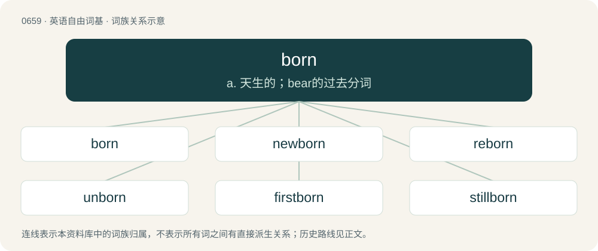

# 0732 · born — a. 天生的；bear的过去分词

[总目录](../00_总目录_按常用程度.md)

**类型**：英语自由词基　｜　**来源语言**：见词源记录

## 核心含义与来源

- 核心含义：a. 天生的；bear的过去分词
- 英文含义：Having from birth (or as if from birth) a certain quality or character; innate; inherited.
- 词形：born

**来源记录 1**（形容词；Having from birth (or as if from birth) a certain quality or character; innate; inherited.）

From Middle English born, boren, borne, iborne, from Old English boren, ġeboren, from Proto-West Germanic \*boran, \*gaboran, from Proto-Germanic \*buranaz, past participle of Proto-Germanic \*beraną (“to bear, carry”), equivalent to bear + -en. Cognate with Saterland Frisian gebooren (“born”), West Frisian berne (“born”), Dutch geboren (“born”), German geboren (“born”), Swedish boren (“born”).

## 词族图

## 单词速览（常用到不常用）

| 单词 | 音标 | 释义 |
|---|---|---|
| [born](#w-1) | 英 /bɔːn/；美 /boɹn/ | a. 天生的；bear的过去分词 |
| [newborn](#w-2) | /ˈnjuːbɒːn/ | n. 婴儿；a. 新生的 |
| [reborn](#w-3) | /.riːˈbɒːn/ | a. 再生的, 更新的 |
| [unborn](#w-4) | /.ʌnˈbɒːn/ | a. 未诞生的, 未来的, 在胎内的；\[法\] 未诞生的, 未来的, 原来存在的 |
| [firstborn](#w-5) | /ˈfɜː(ɹ)stˌbɔː(ɹ)n/ | a. 第一胎生的；n. 初生儿, 长男, 长女 |
| [stillborn](#w-6) | /ˈstɪlbɔː(ɹ)n/ | a. 生下来已死的, 死产的；\[医\] 死产的 |
| [freeborn](#w-7) | 英 /ˌfɹiːˈbɔːn/；美 /ˈfɹiˌboɹn/ | a. 生而自由的, 自由民的, 适合于自由民的 |

## 逐词详解

### 1. born

**词性**：形容词　｜　**音标**：英 /bɔːn/；美 /boɹn/

**中文释义**：a. 天生的；bear的过去分词

**英文义项**：Having from birth (or as if from birth) a certain quality or character; innate; inherited.

**构词拆分**：bear + -en

**词源与演化**：

From Middle English born, boren, borne, iborne, from Old English boren, ġeboren, from Proto-West Germanic \*boran, \*gaboran, from Proto-Germanic \*buranaz, past participle of Proto-Germanic \*beraną (“to bear, carry”), equivalent to bear + -en. Cognate with Saterland Frisian gebooren (“born”), West Frisian berne (“born”), Dutch geboren (“born”), German geboren (“born”), Swedish boren (“born”).

**例句**：

> In the United States, information describing the operation of nuclear weapons is born secret.

该用例对应义项：Having from birth (or as if from birth) a certain quality or character; innate; inherited.

### 2. newborn

**词性**：形容词　｜　**音标**：/ˈnjuːbɒːn/

**中文释义**：n. 婴儿；a. 新生的

**英文义项**：Recently born. / Born anew, reborn.

**构词拆分**：new + born

**词源与演化**：

From new + born.

**用法示例／搭配（非完整句）**：

> newborn child

该用例对应义项：Recently born.

### 3. reborn

**词性**：形容词　｜　**音标**：/.riːˈbɒːn/

**中文释义**：a. 再生的, 更新的

**英文义项**：Revived or regenerated, especially emotionally or spiritually. / Reincarnated.

**构词拆分**：re- + born

**词源与演化**：

From re- + born.

**例句**：

> I will show that it's possible to be reborn from one's ashes.

### 4. unborn

**词性**：名词　｜　**音标**：/.ʌnˈbɒːn/

**中文释义**：a. 未诞生的, 未来的, 在胎内的；\[法\] 未诞生的, 未来的, 原来存在的

**英文义项**：A single unborn offspring at any stage of gestation. / Unborn offspring collectively.

**构词拆分**：un- + born

**词源与演化**：

From Middle English unborn, from Old English unboren, from Proto-Germanic \*unburanaz. Equivalent to un- + born.

**例句**：

> Inheritance law allows property to be left to the unborn.

该用例对应义项：Unborn offspring collectively.

### 5. firstborn

**词性**：名词　｜　**音标**：/ˈfɜː(ɹ)stˌbɔː(ɹ)n/

**中文释义**：a. 第一胎生的；n. 初生儿, 长男, 长女

**英文义项**：The first child to be born to a parent or family.

**构词拆分**：By surface analysis, first (adverb) + born

**词源与演化**：

From Middle English first borne. By surface analysis, first (adverb) + born.

**例句**：

> Rumpelstiltskin spun straw into gold, in exchange for the woman's firstborn child.

### 6. stillborn

**词性**：形容词　｜　**音标**：/ˈstɪlbɔː(ɹ)n/

**中文释义**：a. 生下来已死的, 死产的；\[医\] 死产的

**英文义项**：Dead at birth. / Ignored, without influence, or unsuccessful from the outset; abortive.

**构词拆分**：still + born

**词源与演化**：

From English still + born. First attested in 1597.

**例句**：

> My botched sentence must be the stillborn child of an aborted copy and paste.

### 7. freeborn

**词性**：形容词　｜　**音标**：英 /ˌfɹiːˈbɔːn/；美 /ˈfɹiˌboɹn/

**中文释义**：a. 生而自由的, 自由民的, 适合于自由民的

**英文义项**：Born free rather than in bondage or as a slave

**构词拆分**：free + born

**词源与演化**：

From free + born.
