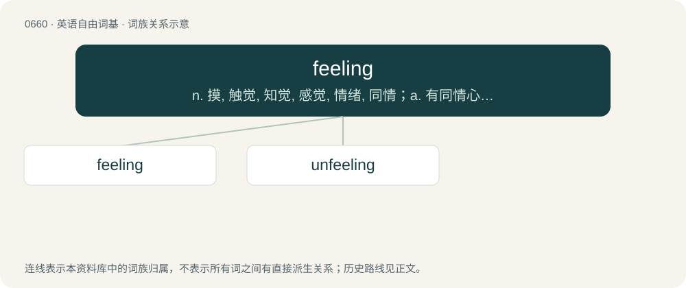

# 0733 · feeling — n. 摸, 触觉, 知觉, 感觉, 情绪, 同情；a. 有同情心的, 有感觉的, 仁慈的, 动人的

[总目录](../00_总目录_按常用程度.md)

**类型**：英语自由词基　｜　**来源语言**：见词源记录

## 核心含义与来源

- 核心含义：n. 摸, 触觉, 知觉, 感觉, 情绪, 同情；a. 有同情心的, 有感觉的, 仁慈的, 动人的
- 英文含义：Emotionally sensitive.
- 词形：feeling

**来源记录 1**（形容词；Emotionally sensitive.）

From Middle English felynge, equivalent to feel + -ing.

## 词族图

## 单词速览（常用到不常用）

| 单词 | 音标 | 释义 |
|---|---|---|
| [feeling](#w-1) | 英 /ˈfiː.lɪŋ/；美 /ˈfi.lɪŋ/ | n. 摸, 触觉, 知觉, 感觉, 情绪, 同情；a. 有同情心的, 有感觉的, 仁慈的, 动人的 |
| [unfeeling](#w-2) | /.ʌnˈfiːliŋ/ | a. 无感觉的, 无情的, 冷酷的 |

## 逐词详解

### 1. feeling

**词性**：形容词　｜　**音标**：英 /ˈfiː.lɪŋ/；美 /ˈfi.lɪŋ/

**中文释义**：n. 摸, 触觉, 知觉, 感觉, 情绪, 同情；a. 有同情心的, 有感觉的, 仁慈的, 动人的

**英文义项**：Emotionally sensitive. / Expressive of great sensibility; attended by, or evincing, sensibility.

**构词拆分**：feel + -ing

**词源与演化**：

From Middle English felynge, equivalent to feel + -ing.

**例句**：

> Despite the rough voice, the coach is surprisingly feeling.

该用例对应义项：Emotionally sensitive.

### 2. unfeeling

**词性**：形容词　｜　**音标**：/.ʌnˈfiːliŋ/

**中文释义**：a. 无感觉的, 无情的, 冷酷的

**英文义项**：Without emotion or sympathy.

**构词拆分**：un- + feeling

**词源与演化**：

From un- + feeling.

**例句**：

> He accused me of being an unfeeling father and husband.
