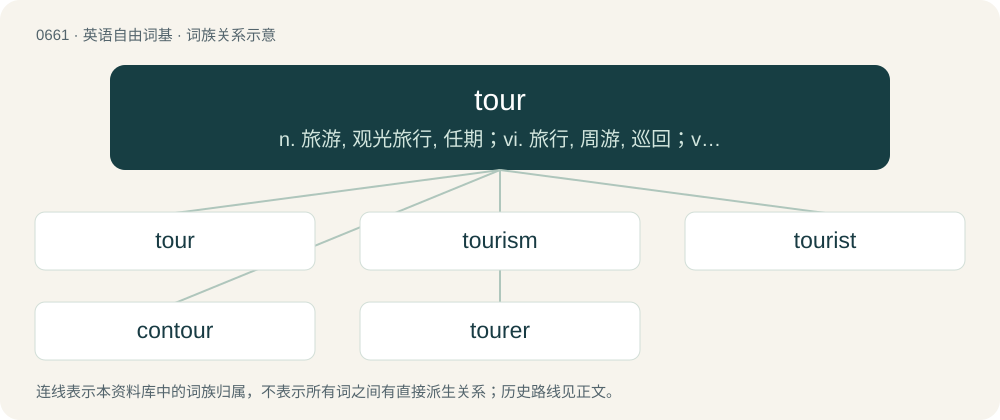

# 0734 · tour — n. 旅游, 观光旅行, 任期；vi. 旅行, 周游, 巡回；vt. 周游, 观光, 游历, 使巡回演出

[总目录](../00_总目录_按常用程度.md)

**类型**：英语自由词基　｜　**来源语言**：见词源记录

## 核心含义与来源

- 核心含义：n. 旅游, 观光旅行, 任期；vi. 旅行, 周游, 巡回；vt. 周游, 观光, 游历, 使巡回演出
- 英文含义：A journey through a particular building, estate, country, etc.
- 词形：tour

**多个词源／构词路径**：同一拼写可能有不同来源；以下按词性和含义分别列出。

**来源记录 1**（名词；A journey through a particular building, estate, country, etc.）

From Old French tour, tourn, from the verb torner, tourner.

**来源记录 2**（名词；A tower.）

From Old French tor, French tour (“tower”).

## 词族图

## 单词速览（常用到不常用）

| 单词 | 音标 | 释义 |
|---|---|---|
| [tour](#w-1) | /tɔː(ɹ)/ | n. 旅游, 观光旅行, 任期；vi. 旅行, 周游, 巡回；vt. 周游, 观光, 游历, 使巡回演出 |
| [tourism](#w-2) | 英 /ˈtʊəɹɪzəm/；美 /ˈtʊɹɪzəm/ | n. 观光业, 游览；\[经\] 旅游业 |
| [tourist](#w-3) | 英 /ˈtʊəɹɪst/；美 /ˈtʊɹɪst/ | n. 观光客, 旅行者；a. 旅游的 |
| [contour](#w-4) | /ˈkɒntɔː/ | n. 轮廓；vt. 画轮廓；a. 显示轮廓的 |
| [tourer](#w-5) | 英 /ˈtʊəɹə/；美 /ˈtʊɹɚ/ | n. 游览车 |

## 逐词详解

### 1. tour

**词性**：名词　｜　**音标**：/tɔː(ɹ)/

**中文释义**：n. 旅游, 观光旅行, 任期；vi. 旅行, 周游, 巡回；vt. 周游, 观光, 游历, 使巡回演出

**英文义项**：A journey through a particular building, estate, country, etc. / A guided visit to a particular place, or virtual place.

**词源与演化**：

From Old French tour, tourn, from the verb torner, tourner.

**例句**：

> On the company's website, you can take a virtual tour of the headquarters.

该用例对应义项：A guided visit to a particular place, or virtual place.

### 2. tourism

**词性**：名词　｜　**音标**：英 /ˈtʊəɹɪzəm/；美 /ˈtʊɹɪzəm/

**中文释义**：n. 观光业, 游览；\[经\] 旅游业

**英文义项**：The act of travelling or sightseeing, particularly away from one's home. / The industry in which such travels and sightseeing are organized.

**构词拆分**：tour + -ism

**词源与演化**：

From tour + -ism.

**例句**：

> Tourism brings a lot of tax revenue to the area.

该用例对应义项：The industry in which such travels and sightseeing are organized.

### 3. tourist

**词性**：名词　｜　**音标**：英 /ˈtʊəɹɪst/；美 /ˈtʊɹɪst/

**中文释义**：n. 观光客, 旅行者；a. 旅游的

**英文义项**：Someone who travels for pleasure rather than for business; a leisure visitor. / One who only has a superficial interest in something.

**构词拆分**：tour + -ist

**词源与演化**：

From tour + -ist. Doublet of turista.

**例句**：

> Tourist shops are full of kitsch.

该用例对应义项：Someone who travels for pleasure rather than for business; a leisure visitor.

### 4. contour

**词性**：名词　｜　**音标**：/ˈkɒntɔː/

**中文释义**：n. 轮廓；vt. 画轮廓；a. 显示轮廓的

**英文义项**：An outline, boundary or border, usually of curved shape. / A line on a map or chart delineating those points which have the same altitude or other plotted quantity: a contour line or isopleth; (metonymically) the landform or its surface.

**构词拆分**：con- + tour

**词源与演化**：

Borrowed from French contour, from contourner, equivalent to con- + tour.

**用法示例／搭配（非完整句）**：

> the low drag contour of a modern automobile

该用例对应义项：An outline, boundary or border, usually of curved shape.

### 5. tourer

**词性**：名词　｜　**音标**：英 /ˈtʊəɹə/；美 /ˈtʊɹɚ/

**中文释义**：n. 游览车

**英文义项**：An open-top or soft-top motor car suitable for touring. / A touring bicycle.

**构词拆分**：tour + -er

**词源与演化**：

From tour + -er.
