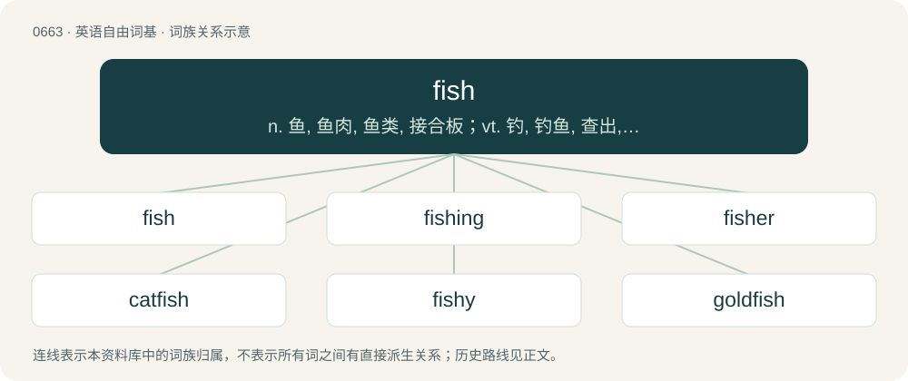

# 0736 · fish — n. 鱼, 鱼肉, 鱼类, 接合板；vt. 钓, 钓鱼, 查出, 用接合板连接；vi. 捕鱼, 钓鱼, 用钩捞取, 摸索寻找

[总目录](../00_总目录_按常用程度.md)

**类型**：英语自由词基　｜　**来源语言**：见词源记录

## 核心含义与来源

- 核心含义：n. 鱼, 鱼肉, 鱼类, 接合板；vt. 钓, 钓鱼, 查出, 用接合板连接；vi. 捕鱼, 钓鱼, 用钩捞取, 摸索寻找
- 英文含义：A typically cold-blooded vertebrate animal that lives in water, moving with the help of fins and breathing with gills; any vertebrate that is not a tetrapod.
- 词形：fish

**多个词源／构词路径**：同一拼写可能有不同来源；以下按词性和含义分别列出。

**来源记录 1**（名词；A typically cold-blooded vertebrate animal that lives in water, moving with the help of fins and breathing with gills; any vertebrate that is not a tetrapod.）

From Middle English fisch, from Old English fisċ (“fish”), from Proto-West Germanic \*fisk, from Proto-Germanic \*fiskaz (“fish”), from Proto-Indo-European \*piskós (“fish”). Cognates Cognate with Yola wish (“fish”), North Frisian fasch, fask, Fesk (“fish”), Saterland Frisian Fisk (“fish”), West Frisian fisk (“fish”), Cimbrian biss, visch, viss (“fish”), Dutch vis (“fish”), Dutch Low Saxon and Mòcheno visch (“fish”), German Fisch (“fish”), German Low German Fösch (“fish”), Luxembourgish Fësch (“fish”), Yiddish פֿיש (fish, “fish”), Danish, Elfdalian, Norwegian Bokmål, Norwegian Nynorsk, and Swedish fisk (“fish”), Faroese and Icelandic fiskur (“fish”), Gothic 𐍆𐌹𐍃𐌺𐍃 (fisks, “fish”), Crimean Gothic fisct (“fish”). Compare Irish iasc (“fish”), Latin piscis (“fish”).

**来源记录 2**（名词；A period of time spent fishing.）

Deverbal from to fish (etymology 3).

**来源记录 3**（动词；To hunt fish or other aquatic animals in a body of water, or to collect coral or pearls from the bottom of the sea.）

From Old English fiscian, from Proto-West Germanic \*fiskōn, from Proto-Germanic \*fiskōną. Cognates Cognate with Saterland Frisian fiskje (“to fish”), Dutch vissen (“to fish”), German fischen (“to fish”), Limburgish vésche, vèsse (“to fish”), Luxembourgish fëschen (“to fish”), Danish, Norwegian Bokmål and Norwegian Nynorsk fiske (“to fish”), Faroese, Icelandic and Swedish fiska (“to fish”), Gothic 𐍆𐌹𐍃𐌺𐍉𐌽 (fiskōn, “to fish”).

## 词族图

## 单词速览（常用到不常用）

| 单词 | 音标 | 释义 |
|---|---|---|
| [fish](#w-1) | 英 /fɪʃ/ | n. 鱼, 鱼肉, 鱼类, 接合板；vt. 钓, 钓鱼, 查出, 用接合板连接；vi. 捕鱼, 钓鱼, 用钩捞取, 摸索寻找 |
| [fishing](#w-2) | /ˈfɪʃɪŋ/ | n. 钓鱼, 鱼业；a. 钓鱼的 |
| [fisher](#w-3) | 英 /ˈfɪʃə/；美 /ˈfɪʃɚ/ | n. 渔夫, 食鱼动物, 渔船 |
| [catfish](#w-4) | /ˈkætfɪʃ/ | n. 鲶鱼 |
| [fishy](#w-5) | 英 /ˈfɪʃi/ | a. 鱼似的, 多鱼的, 腥臭的, 呆滞的 |
| [goldfish](#w-6) | /ˈɡoʊldfɪʃ/ | n. 金鱼 |
| [jellyfish](#w-7) | /ˈd͡ʒɛliˌfɪʃ/ | n. 水母, 海蜇, 意志薄弱的人；\[医\] 海蛰, 水母 |
| [fishery](#w-8) | /ˈfɪʃəɹi/ | n. 渔业；\[法\] 捕鱼, 捕鱼权 |
| [shellfish](#w-9) | /ˈʃɛl.fɪʃ/ | n. 贝, 甲壳类水生物；\[医\] 牡蛎 |
| [starfish](#w-10) | /ˈstɑː(ɹ)fɪʃ/ | n. 海星 |
| [fishman](#w-11) |  | n. 捕鱼人, 捕鱼船 |
| [swordfish](#w-12) | /ˈsɔː(ɹ)dfɪʃ/ | n. 箭鱼 |
| [blackfish](#w-13) | 英 /ˈblakfɪʃ/ | n. 黑鲸 |
| [whitefish](#w-14) | /ˈhwaitfiʃ/ | n. 白鲑, 白鲸 |
| [cuttlefish](#w-15) | 英 /ˈkʌtl̩fɪʃ/；美 /ˈkʌt(ə)lfɪʃ/ | n. 墨鱼, 乌贼 |
| [fishnet](#w-16) | /ˈfɪʃ.nɛt/ | n. 鱼网, 伪装网 |
| [zebrafish](#w-17) | /ˈziːbɹəˌfɪʃ/ | n. 斑马鱼 |
| [fisheye](#w-18) | /ˈfɪʃˌaɪ/ | n. 鱼眼石, 怀疑的注视 |
| [sunfish](#w-19) | /ˈsʌnˌfɪʃ/ | n. 翻车鱼, 太阳鱼 |
| [dogfish](#w-20) | /ˈdɒgfiʃ/ | n. 狗鲨, 巨头鲸 |
| [blowfish](#w-21) | 英 /ˈbləʊˌfɪʃ/；美 /ˈbloʊˌfɪʃ/ | n. 河豚 |
| [fishmonger](#w-22) | 英 /ˈfɪʃˌmʌŋɡ.ə/；美 /ˈfɪʃˌmʌŋɡ.əɹ/ | n. 鱼贩, 鱼商 |
| [sailfish](#w-23) | /ˈseɪlˌfɪʃ/ | n. 旗鱼 |
| [rockfish](#w-24) | 英 /ˈɹɒk.fɪʃ/；美 /ˈɹɑk.fɪʃ/ | n. 岩鱼 |
| [fishtail](#w-25) | /ˈfɪʃteɪl/ | a. 鱼尾状的；vi. 摆尾飞行 |
| [clownfish](#w-26) | 美 /ˈklaʊnˌfɪʃ/ | n. 小丑鱼；海葵鱼 |
| [codfish](#w-27) | /ˈkɒdfiʃ/ | n. 鳕 |
| [bluefish](#w-28) | /ˈbluːfiʃ/ | n. 蓝鱼 |
| [kingfish](#w-29) | /ˈkiŋfiʃ/ | n. 大海鱼, (美)(非正式)首领, 头子 |
| [monkfish](#w-30) | /ˈmʌŋk.fɪʃ/ | 扁鲨；僧鲨 |
| [redfish](#w-31) | /ˈredfiʃ/ | n. 鲑鱼 |
| [silverfish](#w-32) | /ˈsɪlvə(ɹ)fɪʃ/ | n. 银色的鱼, 蠹虫 |
| [fishbone](#w-33) | /ˈfiʃbəun/ | n. 鱼骨 |
| [parrotfish](#w-34) | /ˈpærətfiʃ/ | n. \[鱼\]鹦嘴鱼, 隆头鱼 |

## 逐词详解

### 1. fish

**词性**：名词　｜　**音标**：英 /fɪʃ/

**中文释义**：n. 鱼, 鱼肉, 鱼类, 接合板；vt. 钓, 钓鱼, 查出, 用接合板连接；vi. 捕鱼, 钓鱼, 用钩捞取, 摸索寻找

**英文义项**：A typically cold-blooded vertebrate animal that lives in water, moving with the help of fins and breathing with gills; any vertebrate that is not a tetrapod. / Any vertebrate, including tetrapods.

**词源与演化**：

From Middle English fisch, from Old English fisċ (“fish”), from Proto-West Germanic \*fisk, from Proto-Germanic \*fiskaz (“fish”), from Proto-Indo-European \*piskós (“fish”). Cognates Cognate with Yola wish (“fish”), North Frisian fasch, fask, Fesk (“fish”), Saterland Frisian Fisk (“fish”), West Frisian fisk (“fish”), Cimbrian biss, visch, viss (“fish”), Dutch vis (“fish”), Dutch Low Saxon and Mòcheno visch (“fish”), German Fisch (“fish”), German Low German Fösch (“fish”), Luxembourgish Fësch (“fish”), Yiddish פֿיש (fish, “fish”), Danish, Elfdalian, Norwegian Bokmål, Norwegian Nynorsk, and Swedish fisk (“fish”), Faroese and Icelandic fiskur (“fish”), Gothic 𐍆𐌹𐍃𐌺𐍃 (fisks, “fish”), Crimean Gothic fisct (“fish”). Compare Irish iasc (“fish”), Latin piscis (“fish”).

**例句**：

> Though Lena is a vegetarian, she doesn't have any problem with eating fish.

该用例对应义项：The flesh of the fish used as food.

### 2. fishing

**词性**：名词　｜　**音标**：/ˈfɪʃɪŋ/

**中文释义**：n. 钓鱼, 鱼业；a. 钓鱼的

**英文义项**：The act of catching fish. / The act of catching other forms of seafood, separately or together with fish.

**构词拆分**：fish + -ing

**词源与演化**：

From Middle English fischynge, equivalent to fish + -ing.

**例句**：

> We had a good day's fishing at the weekend.

该用例对应义项：The act of catching fish.

### 3. fisher

**词性**：名词　｜　**音标**：英 /ˈfɪʃə/；美 /ˈfɪʃɚ/

**中文释义**：n. 渔夫, 食鱼动物, 渔船

**英文义项**：A person who catches fish, especially for a living or for sport; a person engaging in the pastime of fishing.

**构词拆分**：fish + -er

**词源与演化**：

From Middle English fischer, fischare, from Old English fisċere (“fisher”), from Proto-Germanic \*fiskārijaz (“fisher”), equivalent to fish + -er. Cognate with Saterland Frisian Fisker (“fisher”), West Frisian fisker (“fisher”), Dutch visser (“fisher”), German Low German Fisker, Fisser (“fisher”), German Fischer (“fisher”), Danish fisker (“fisher”), Swedish fiskare (“fisher”).

**例句**：

> This is the boy whose name is Tom Fisher.

### 4. catfish

**词性**：动词　｜　**音标**：/ˈkætfɪʃ/

**中文释义**：n. 鲶鱼

**英文义项**：To fish for catfish.

**构词拆分**：cat + fish

**词源与演化**：

From cat + fish. Likely so named for its prominent barbels like a cat's whiskers. Compare West Frisian katfisk (“catfish”), Dutch katvis (“catfish”). Compare also German Seekatze (“catfish”, literally “sea-cat”).

**例句**：

> I only use this rod for catfishing.

该用例对应义项：To fish for catfish.

### 5. fishy

**词性**：形容词　｜　**音标**：英 /ˈfɪʃi/

**中文释义**：a. 鱼似的, 多鱼的, 腥臭的, 呆滞的

**英文义项**：Of, from, or similar to fish. / Suspicious; inspiring doubt.

**构词拆分**：fish + -y

**词源与演化**：

From Middle English fishi, fischey, equivalent to fish + -y.

**例句**：

> I don't trust him; his claims seem fishy to me.

该用例对应义项：Suspicious; inspiring doubt.

### 6. goldfish

**词性**：名词　｜　**音标**：/ˈɡoʊldfɪʃ/

**中文释义**：n. 金鱼

**英文义项**：A type of small fish, Carassius auratus, typically orange-colored. / A person with an unreliable memory.

**构词拆分**：gold + fish

**词源与演化**：

From gold + fish.

**例句**：

> For the children's fair we'll have a few games they can play, so that each child "wins" a goldfish as a prize.

该用例对应义项：A type of small fish, Carassius auratus, typically orange-colored.

### 7. jellyfish

**词性**：名词　｜　**音标**：/ˈd͡ʒɛliˌfɪʃ/

**中文释义**：n. 水母, 海蜇, 意志薄弱的人；\[医\] 海蛰, 水母

**英文义项**：An almost transparent aquatic animal; any one of the acalephs, especially one of the larger species, having a jellylike appearance. / Any of various species of cnidarians in the subphylum Medusozoa, including box jellyfish (class Cubozoa), true jellyfish (class Scyphozoa), stalked jellyfish (class Staurozoa), and certain hydrozoans.

**构词拆分**：jelly + fish

**词源与演化**：

From jelly + fish. From being an aquatic creature (i.e. fish) that is gelatinous (“jelly”). Despite the name, jellyfish are not biologically classified as fish. The term appeared in the mid-19th century and displaced various older terms such as sea jelly (now much less common), blubber/sea blubber, nettle/sea nettle (both now referring to specific jellyfish species), and, in scientific literature, medusa.

**例句**：

> He won't go near the water because he's deathly afraid of jellyfish.

### 8. fishery

**词性**：名词　｜　**音标**：/ˈfɪʃəɹi/

**中文释义**：n. 渔业；\[法\] 捕鱼, 捕鱼权

**英文义项**：Fishing: the catching, processing and marketing of fish or other seafood. / A place where fish or other seafood are caught: a fishing ground (for example, a territorial one).

**构词拆分**：fish + -ery

**词源与演化**：

From fish + -ery.

**例句**：

> The fishery remained empty and devoid of fish for many centuries.

### 9. shellfish

**词性**：名词　｜　**音标**：/ˈʃɛl.fɪʃ/

**中文释义**：n. 贝, 甲壳类水生物；\[医\] 牡蛎

**英文义项**：A fisheries and colloquial term for an aquatic invertebrate having an inner or outer shell, such as a mollusc or crustacean, especially when edible. / A culinary and nutritional term for several groups of non-piscine, non-tetrapod, aquatic animals that are used as a food source. The term often exclusively refers to edible aquatic crustaceans, bivalve mollusks and cephalopod mollusks; but sometimes echinoderms may be included as well.

**构词拆分**：shell + fish

**词源与演化**：

Inherited from Middle English schellefyssch, from Old English sċielfisċ. Equivalent to shell + fish.

**例句**：

> Tom and Mary walked on the beach and searched for seashells and shellfish.

### 10. starfish

**词性**：名词　｜　**音标**：/ˈstɑː(ɹ)fɪʃ/

**中文释义**：n. 海星

**英文义项**：Any of various echinoderms (not in fact fish) with usually five arms, many of which eat bivalves or corals by everting their stomach. / A woman (or, less commonly, a gay man) who reluctantly takes part in sexual intercourse, and lies on the back while spreading the limbs.

**构词拆分**：star + fish

**词源与演化**：

From star + fish.

**例句**：

> Rocky coasts of BC often have plenty of starfish, many purple.

### 11. fishman

**词性**：名词

**中文释义**：n. 捕鱼人, 捕鱼船

**英文义项**：A man who sells fish. / A mythic or fictional being that is part man, part fish.

**构词拆分**：fish + -man

**词源与演化**：

From Middle English fisscheman; equivalent to fish + -man.

### 12. swordfish

**词性**：名词　｜　**音标**：/ˈsɔː(ɹ)dfɪʃ/

**中文释义**：n. 箭鱼

**英文义项**：A large marine fish with a long, pointed bill, Xiphias gladius. / A sudoku technique involving possible cell locations for a digit, or pair, or triple, in uniquely three rows and three columns only. This allows for the elimination of candidates around the grid.

**构词拆分**：sword + fish

**词源与演化**：

From Middle English swerdfysche, from Old English \*sweordfisċ. Equivalent to sword + fish.

**例句**：

> The swordfish was a bit dry, but it tasted good.

### 13. blackfish

**词性**：名词　｜　**音标**：英 /ˈblakfɪʃ/

**中文释义**：n. 黑鲸

**英文义项**：An Atlantic salmon, Salmo salar, especially a female after spawning. / Any of various dark-colored fish of the Old World, especially the rudderfish (Centrolophus niger).

**构词拆分**：black + fish

**词源与演化**：

From black + fish.

### 14. whitefish

**词性**：名词　｜　**音标**：/ˈhwaitfiʃ/

**中文释义**：n. 白鲑, 白鲸

**英文义项**：Any of several North American freshwater fish, of the genus Coregonus, used as food. / Any of several other fish, such as whiting (Merlangius merlangus) or menhaden (Brevoortia spp. and Ethmidium spp.).

**构词拆分**：white + fish

**词源与演化**：

From white + fish.

### 15. cuttlefish

**词性**：名词　｜　**音标**：英 /ˈkʌtl̩fɪʃ/；美 /ˈkʌt(ə)lfɪʃ/

**中文释义**：n. 墨鱼, 乌贼

**英文义项**：Any squid-like cephalopods (marine mollusks) of the order Sepiida that have eight arms, two retractable tentacles, and a calcareous internal shell, and can eject a dark ink when threatened.

**构词拆分**：cuttle + fish

**词源与演化**：

From cuttle + fish.

**例句**：

> You can buy cuttlefish at the fish market.

### 16. fishnet

**词性**：名词　｜　**音标**：/ˈfɪʃ.nɛt/

**中文释义**：n. 鱼网, 伪装网

**英文义项**：A net used to catch fish. / A fabric mesh with an open diamond-shaped structure.

**构词拆分**：fish + net

**词源与演化**：

From Middle English fishnet; equivalent to fish + net.

**例句**：

> The fishnets were hung over bushes to dry.

该用例对应义项：A net used to catch fish.

### 17. zebrafish

**词性**：名词　｜　**音标**：/ˈziːbɹəˌfɪʃ/

**中文释义**：n. 斑马鱼

**英文义项**：A small striped fish of species Danio rerio, originally from India but now common as an aquarium fish and as a subject of genetic experiments. / A member of certain species of Percina (logperch).

**构词拆分**：zebra + fish

**词源与演化**：

From zebra + fish.

### 18. fisheye

**词性**：名词　｜　**音标**：/ˈfɪʃˌaɪ/

**中文释义**：n. 鱼眼石, 怀疑的注视

**英文义项**：An unfriendly or suspicious glance. / An undesirable effect in paint, particularly automotive finishes, normally caused by oil or other contaminants on the painted surface.

**构词拆分**：fish + eye

**词源与演化**：

From fish + eye.

### 19. sunfish

**词性**：名词　｜　**音标**：/ˈsʌnˌfɪʃ/

**中文释义**：n. 翻车鱼, 太阳鱼

**英文义项**：Any of various small freshwater fishes of the family Centrarchidae, often with iridescent colours and having a laterally compressed body. / Any of various large marine fishes of the family Molidae that have an oval compressed body.

**构词拆分**：sun + fish

**词源与演化**：

\* From sun + fish. \* (type of fish): Perhaps from the rounded body shape.

**例句**：

> Then, in the middle of the Tasman Sea, the 98-foot yacht's progress was temporarily halted when it ran into a giant sunfish.

### 20. dogfish

**词性**：名词　｜　**音标**：/ˈdɒgfiʃ/

**中文释义**：n. 狗鲨, 巨头鲸

**英文义项**：Any of various small sharks / Especially those from the family Squalidae

**构词拆分**：dog + fish

**词源与演化**：

From dog + fish. Compare Greek σκυλόψαρο (skylópsaro, “dogfish”), Latin canicula (“dogfish”, literally “little dog”), Italian pescecane (“dogfish”), French chien de mer (literally “dog of the sea”), German Meerhund (literally “seadog”) and Hundfisch (“dogfish”), and English seadog. For non-Indo-European cognates, see Maltese kelb il-baħar (literally “dog of the sea”) and Turkish köpek balığı (“shark”), likely calques from Indo-European languages.

**例句**：

> Among the 250 shark species that may be threatened by the fin trade are hammerheads, the plankton-eating basking shark and the spiny dogfish.

### 21. blowfish

**词性**：名词　｜　**音标**：英 /ˈbləʊˌfɪʃ/；美 /ˈbloʊˌfɪʃ/

**中文释义**：n. 河豚

**英文义项**：Any species of fish of the family Tetraodontidae that have the ability to inflate themselves to a globe several times their normal size by swallowing water or air when threatened. / A delicacy popular in Japan, consisting of the fish served raw as sushi or perhaps fried. It may, if improperly prepared, contain considerably deadly levels of neurotoxins.

**构词拆分**：blow + fish

**词源与演化**：

From blow + fish.

**例句**：

> Blowfish is a delicacy in Japan.

### 22. fishmonger

**词性**：名词　｜　**音标**：英 /ˈfɪʃˌmʌŋɡ.ə/；美 /ˈfɪʃˌmʌŋɡ.əɹ/

**中文释义**：n. 鱼贩, 鱼商

**英文义项**：A person who sells fish. / A shop that sells fish; a fishmonger's shop, a fishmonger's.

**构词拆分**：fish + monger

**词源与演化**：

From Middle English fisshemonger; equivalent to fish + monger.

**例句**：

> The fishmonger guarantees the origin and freshness of his products.

### 23. sailfish

**词性**：名词　｜　**音标**：/ˈseɪlˌfɪʃ/

**中文释义**：n. 旗鱼

**英文义项**：A fish of the genus Istiophorus, having a characteristic sail-like fin on its back. / The basking shark (Cetorhinus maximus).

**构词拆分**：sail + fish

**词源与演化**：

From sail + fish.

**例句**：

> It took us four hours to land that sailfish.

### 24. rockfish

**词性**：名词　｜　**音标**：英 /ˈɹɒk.fɪʃ/；美 /ˈɹɑk.fɪʃ/

**中文释义**：n. 岩鱼

**英文义项**：A fish in the family Sebastidae, marine fishes that inhabit oceans around the world / Sebastes, mainly of the North Pacific

**构词拆分**：rock + fish

**词源与演化**：

From rock + fish.

### 25. fishtail

**词性**：动词　｜　**音标**：/ˈfɪʃteɪl/

**中文释义**：a. 鱼尾状的；vi. 摆尾飞行

**英文义项**：To swing the back of a vehicle (originally an aircraft) from side to side. / To cause the back of (a vehicle) to swing from side to side.

**构词拆分**：fish + tail

**词源与演化**：

From Middle English fisch tayle, equivalent to fish + tail.

**例句**：

> As we approached the runway, the pilot fishtailed slightly to reduce landing speed.

该用例对应义项：To swing the back of a vehicle (originally an aircraft) from side to side.

### 26. clownfish

**词性**：名词　｜　**音标**：美 /ˈklaʊnˌfɪʃ/

**中文释义**：n. 小丑鱼；海葵鱼

**英文义项**：Any of the colorful fish of genera Amphiprion and Premnas in subfamily Amphiprioninae of family Pomacentridae, native to the Pacific and Indian Oceans, notable for their mutual relationship with sea anemones.

**构词拆分**：clown + fish

**词源与演化**：

From clown + fish.

**例句**：

> A lone clownfish was swimming in the aquarium.

### 27. codfish

**词性**：名词　｜　**音标**：/ˈkɒdfiʃ/

**中文释义**：n. 鳕

**英文义项**：A cod (any of various fish, especially the Atlantic cod). / The flesh of a cod as food.

**构词拆分**：cod + fish

**词源与演化**：

From cod + fish.

**例句**：

> I'm sick of eating codfish cakes.

### 28. bluefish

**词性**：名词　｜　**音标**：/ˈbluːfiʃ/

**中文释义**：n. 蓝鱼

**英文义项**：A voracious fish (Pomatomus saltatrix) found in waters of the Atlantic and Indian Ocean. / The puddingwife wrasse (Halichoeres radiatus).

**构词拆分**：blue + fish

**词源与演化**：

From blue + fish.

**例句**：

> Common game fish found in this area are striped bass and bluefish.

### 29. kingfish

**词性**：名词　｜　**音标**：/ˈkiŋfiʃ/

**中文释义**：n. 大海鱼, (美)(非正式)首领, 头子

**英文义项**：Any of several food fishes of the genus Menticirrhus from the Atlantic; kingcroakers. / opah (Lampris guttatus), of the United Kingdom

**构词拆分**：king + fish

**词源与演化**：

From king + fish.

### 30. monkfish

**词性**：名词　｜　**音标**：/ˈmʌŋk.fɪʃ/

**中文释义**：扁鲨；僧鲨

**英文义项**：Any large bottom-dwelling anglerfish of the genus Lophius, such as Lophius piscatorius, of the Atlantic, having a large head and mouth. / An angel shark, of the genus Squatina.

**构词拆分**：monk + fish

**词源与演化**：

From monk + fish.

### 31. redfish

**词性**：名词　｜　**音标**：/ˈredfiʃ/

**中文释义**：n. 鲑鱼

**英文义项**：Any member of the genus Sebastes, or edible red rockfishs. / especially Sebastes norvegicus, found in North American waters, also called rosefish or ocean perch.

**构词拆分**：red + fish

**词源与演化**：

From red + fish.

### 32. silverfish

**词性**：名词　｜　**音标**：/ˈsɪlvə(ɹ)fɪʃ/

**中文释义**：n. 银色的鱼, 蠹虫

**英文义项**：A small wingless insect of species Lepisma saccharinum, with silvery scales; a type of bristletail. / Ctenolepisma lineata (four-lined silverfish).

**构词拆分**：silver + fish

**词源与演化**：

From silver + fish: from its appearance, in the case of the insect.

### 33. fishbone

**词性**：名词　｜　**音标**：/ˈfiʃbəun/

**中文释义**：n. 鱼骨

**英文义项**：A bone from a fish. / Something with an appearance or structure suggestive of a fish's skeleton.

**构词拆分**：fish + bone

**词源与演化**：

From fish + bone.

**例句**：

> He choked on a fishbone.

该用例对应义项：A bone from a fish.

### 34. parrotfish

**词性**：名词　｜　**音标**：/ˈpærətfiʃ/

**中文释义**：n. \[鱼\]鹦嘴鱼, 隆头鱼

**英文义项**：Any of several tropical marine fish of the family Scaridae known for their beak-like mass of teeth used to scrape algae from rocks or coral.

**构词拆分**：parrot + fish

**词源与演化**：

From parrot + fish.
