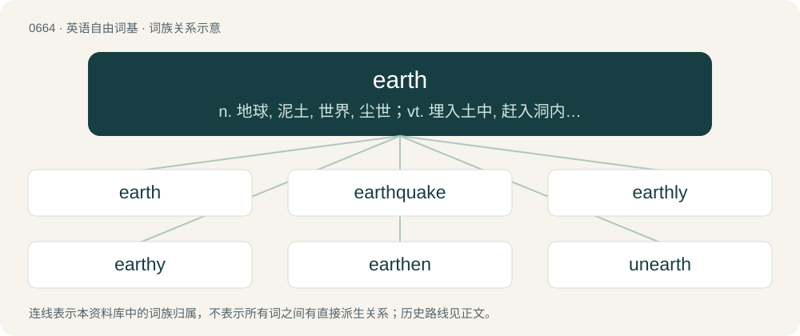

# 0738 · earth — n. 地球, 泥土, 世界, 尘世；vt. 埋入土中, 赶入洞内；vi. 躲入洞内

[总目录](../00_总目录_按常用程度.md)

**类型**：英语自由词基　｜　**来源语言**：见词源记录

## 核心含义与来源

- 核心含义：n. 地球, 泥土, 世界, 尘世；vt. 埋入土中, 赶入洞内；vi. 躲入洞内
- 英文含义：Soil.
- 词形：earth

**来源记录 1**（名词；Soil.）

From Middle English erthe, from Old English eorþe, from Proto-West Germanic \*erþu, from Proto-Germanic \*erþō (“dirt, ground, earth”), from Proto-Indo-European \*h₁érteh₂ (“earth”). Cognates Cognate with Scots erd, yerd, yird, yirth (“earth, loam, mould, soil; ground”), Yola eard, eart, eord, eorth, erth (“earth”), North Frisian eerd, eerde, iarde, Iart, iir, jard, örd, Öört (“earth; world”), Saterland Frisian Idde, Äid, Äide (“earth; soil; ground”), West Frisian ierde (“earth; soil; ground”), Alemannic German Ëërde (“earth”), Bavarian Erd, Erdn (“world; soil; ground”), Central Franconian Ääd (“earth”), Cimbrian èerda (“earth”), Dutch aard, aarde (“earth”), German Erde (“earth; soil; ground; world”), German Low German Eer (“earth”), Limburgish eerd (“earth”), Luxembourgish Äerd (“earth; soil”), Vilamovian Ād (“earth”), Yiddish ערד (erd, “earth; soil”), Danish, Norwegian Bokmål, Norwegian Nynorsk, and Swedish jord (“earth”), Faroese jørð (“earth”), Icelandic jörð (“earth”), Norn yurn (“the earth”), Gothic 𐌰𐌹𐍂𐌸𐌰 (airþa, “earth”); also Latin ōra (“border, edge, rim”), Breton erv (“ridge between furrows”), Welsh erw (“acre”), Ancient Greek ἔραζε (éraze, “to the ground”), Lithuanian erdvė (“expanse, space”), Albanian varr, vorr (“grave”), Tocharian B āre (“dust, loose earth”), Sanskrit उर्वरा (urvarā, “fertile soil, field yielding crops”), Hittite 𒅕𒄩𒀸 (er-ḫa-aš /⁠erḫaš⁠/, “border, boundary, line”). Probably unrelated, but of unknown etymology, is Old Armenian երկիր (erkir, “earth”). Likewise, the phonologically similar Proto-Semitic \*ʔarṣ́- – whence Arabic أَرْض (ʔarḍ), Hebrew אֶרֶץ (ʾereṣ) – is probably unrelated.

## 词族图

## 单词速览（常用到不常用）

| 单词 | 音标 | 释义 |
|---|---|---|
| [earth](#w-1) | 英 /ɜːθ/；美 /ɝθ/ | n. 地球, 泥土, 世界, 尘世；vt. 埋入土中, 赶入洞内；vi. 躲入洞内 |
| [earthquake](#w-2) | 英 /ˈɜːθkweɪk/；美 /ˈɝθkweɪk/ | n. 地震 |
| [earthly](#w-3) | 英 /ˈəːθli/ | a. 地球的, 俗世的, 可能的 |
| [earthy](#w-4) | 英 /ˈɜː.θi/；美 /ˈɝθi/ | a. 土的, 土质的, 土味的 |
| [earthen](#w-5) | 英 /ˈɜː(ɹ)θən/；美 /ˈɝθən/ | a. 土制的, 陶制的 |
| [unearth](#w-6) | /ʌnˈɜː(ɹ)θ/ | vt. 发掘, 掘出, 从洞中赶出, 揭露, 发现 |
| [earthbound](#w-7) | 美 /ˈɝθbaʊnd/ | a. 只在地球上的, 只在地面的, 只在陆地的, 世俗的, 平凡的, 缺乏想象力的 |
| [earthworm](#w-8) | /ˈɜː(ɹ)θˌwɜː(ɹ)m/ | n. 蚯蚓 |
| [earthwork](#w-9) | 英 /ˈɜːθwɜːk/；美 /ˈɝθwɝk/ | n. 土木工事, 土方工程 |
| [earthling](#w-10) | 英 /ˈɜːθlɪŋ/；美 /ˈɝθlɪŋ/ | n. 世人, 俗人, 俗物 |
| [earthing](#w-11) | /ˈɜː(ɹ)θɪŋ/ | n. 接地；\[电\] 接地 |

## 逐词详解

### 1. earth

**词性**：名词　｜　**音标**：英 /ɜːθ/；美 /ɝθ/

**中文释义**：n. 地球, 泥土, 世界, 尘世；vt. 埋入土中, 赶入洞内；vi. 躲入洞内

**英文义项**：Soil. / Any general rock-based material.

**词源与演化**：

From Middle English erthe, from Old English eorþe, from Proto-West Germanic \*erþu, from Proto-Germanic \*erþō (“dirt, ground, earth”), from Proto-Indo-European \*h₁érteh₂ (“earth”). Cognates Cognate with Scots erd, yerd, yird, yirth (“earth, loam, mould, soil; ground”), Yola eard, eart, eord, eorth, erth (“earth”), North Frisian eerd, eerde, iarde, Iart, iir, jard, örd, Öört (“earth; world”), Saterland Frisian Idde, Äid, Äide (“earth; soil; ground”), West Frisian ierde (“earth; soil; ground”), Alemannic German Ëërde (“earth”), Bavarian Erd, Erdn (“world; soil; ground”), Central Franconian Ääd (“earth”), Cimbrian èerda (“earth”), Dutch aard, aarde (“earth”), German Erde (“earth; soil; ground; world”), German Low German Eer (“earth”), Limburgish eerd (“earth”), Luxembourgish Äerd (“earth; soil”), Vilamovian Ād (“earth”), Yiddish ערד (erd, “earth; soil”), Danish, Norwegian Bokmål, Norwegian Nynorsk, and Swedish jord (“earth”), Faroese jørð (“earth”), Icelandic jörð (“earth”), Norn yurn (“the earth”), Gothic 𐌰𐌹𐍂𐌸𐌰 (airþa, “earth”); also Latin ōra (“border, edge, rim”), Breton erv (“ridge between furrows”), Welsh erw (“acre”), Ancient Greek ἔραζε (éraze, “to the ground”), Lithuanian erdvė (“expanse, space”), Albanian varr, vorr (“grave”), Tocharian B āre (“dust, loose earth”), Sanskrit उर्वरा (urvarā, “fertile soil, field yielding crops”), Hittite 𒅕𒄩𒀸 (er-ḫa-aš /⁠erḫaš⁠/, “border, boundary, line”). Probably unrelated, but of unknown etymology, is Old Armenian երկիր (erkir, “earth”). Likewise, the phonologically similar Proto-Semitic \*ʔarṣ́- – whence Arabic أَرْض (ʔarḍ), Hebrew אֶרֶץ (ʾereṣ) – is probably unrelated.

**例句**：

> New space telescopes may accelerate the search for other earths that may be out there.

该用例对应义项：Any planet similar to the Earth (our earth): an exoplanet viewed as another earth, or a potential one.

### 2. earthquake

**词性**：名词　｜　**音标**：英 /ˈɜːθkweɪk/；美 /ˈɝθkweɪk/

**中文释义**：n. 地震

**英文义项**：A shaking of the ground, caused by volcanic activity or movement around geologic faults. / Such a quake specifically occurring on the planet Earth, as opposed to other celestial bodies.

**构词拆分**：earth + quake

**词源与演化**：

From Middle English erthequake, corresponding to earth + quake. Displaced Middle English eorð byfung (“earthquake”) from Old English eorþbeofung (literally “earth shaking”).

**例句**：

> Selling the company caused an earthquake among the employees.

该用例对应义项：a disturbance that is extremely disruptive

### 3. earthly

**词性**：形容词　｜　**音标**：英 /ˈəːθli/

**中文释义**：a. 地球的, 俗世的, 可能的

**英文义项**：Relating to the earth or this world, as opposed to heaven or the heavens. / Used in negative contructions for emphasis.

**构词拆分**：earth + -ly

**词源与演化**：

From Middle English erthely, erthlich, ierðlich, from Old English eorþlīċ, corresponding to earth + -ly. Cognate with Old Norse jarðligr (“earthly”).

**例句**：

> There is no earthly way, I mean no way on earth, that I will ever do that.

该用例对应义项：Used in negative contructions for emphasis.

### 4. earthy

**词性**：形容词　｜　**音标**：英 /ˈɜː.θi/；美 /ˈɝθi/

**中文释义**：a. 土的, 土质的, 土味的

**英文义项**：Resembling dirt or soil (i.e. earth). / Composed, or largely composed, of soil.

**构词拆分**：earth + -y

**词源与演化**：

From Middle English erthy, equivalent to earth + -y. Compare German erdig (“earthy”), Swedish jordig (“earthy”).

**例句**：

> She was an earthy soul, the salt of the earth as they say of such rural folk, untarnished by false civilization.

该用例对应义项：Down-to-earth, not artificial, natural.

### 5. earthen

**词性**：形容词　｜　**音标**：英 /ˈɜː(ɹ)θən/；美 /ˈɝθən/

**中文释义**：a. 土制的, 陶制的

**英文义项**：Made of earth or mud. / Made of clay.

**构词拆分**：By surface analysis, earth + -en (“made of”)

**词源与演化**：

From Middle English erthen, urthen, from Old English eorþen, yrþen, ierþen (“made of earth”), from Proto-Germanic \*irþīnaz. Cognate with Dutch aarden (“earthen”), German irden (“earthen”). By surface analysis, earth + -en (“made of”).

**例句**：

> The earthen pizza oven was lined with hot coals.

### 6. unearth

**词性**：动词　｜　**音标**：/ʌnˈɜː(ɹ)θ/

**中文释义**：vt. 发掘, 掘出, 从洞中赶出, 揭露, 发现

**英文义项**：To drive or draw from the earth. / To dig up.

**构词拆分**：un- + earth

**词源与演化**：

From un- + earth.

**用法示例／搭配（非完整句）**：

> to unearth a fox or a badger

该用例对应义项：To drive or draw from the earth.

### 7. earthbound

**词性**：形容词　｜　**音标**：美 /ˈɝθbaʊnd/

**中文释义**：a. 只在地球上的, 只在地面的, 只在陆地的, 世俗的, 平凡的, 缺乏想象力的

**英文义项**：Confined to the Earth; unable to leave Earth, either physically or spiritually. / Heading towards the planet Earth.

**构词拆分**：earth + -bound

**词源与演化**：

From earth + -bound.

### 8. earthworm

**词性**：名词　｜　**音标**：/ˈɜː(ɹ)θˌwɜː(ɹ)m/

**中文释义**：n. 蚯蚓

**英文义项**：A worm that lives in the ground. / A worm of the family Lumbricidae, or, more generally, of the suborder Lumbricina.

**构词拆分**：earth + worm

**词源与演化**：

From Middle English erthe-worm, erþe-worm, erþe worm (also as worm of þe erthe, worm of þe erþe), equivalent to earth + worm. Compare Saterland Frisian Äidwurm (“earthworm”), West Frisian ierdwjirm (“earthworm”), Dutch aardworm (“earthworm”), less common German Erdwurm (“earthworm”).

**例句**：

> Tom said that he'd give me thirty dollars if I ate an earthworm.

### 9. earthwork

**词性**：名词　｜　**音标**：英 /ˈɜːθwɜːk/；美 /ˈɝθwɝk/

**中文释义**：n. 土木工事, 土方工程

**英文义项**：Any structure made from earth, especially an embankment used for fortification or flood control.

**构词拆分**：earth + work

**词源与演化**：

From earth + work. First attested in the 1630s.

### 10. earthling

**词性**：名词　｜　**音标**：英 /ˈɜːθlɪŋ/；美 /ˈɝθlɪŋ/

**中文释义**：n. 世人, 俗人, 俗物

**英文义项**：One who tills the earth; a farmer, a husbandman, a ploughman.

**构词拆分**：earth + -ling

**词源与演化**：

From Middle English erthling (“farmer, ploughman”) \[and other forms\] (in glossaries), from Old English ierþling, eorþling (“farmer, husbandman, ploughman”) \[and other forms\], from eorþe (“ground; dirt; planet Earth”) (ultimately from Proto-Indo-European \*h₁er- (“earth”)) + -ling (suffix forming personal nouns). The English word is analysable as earth + -ling.

**例句**：

> He had to choose between "Earthling" and "Terran" for their demonym.

### 11. earthing

**词性**：名词　｜　**音标**：/ˈɜː(ɹ)θɪŋ/

**中文释义**：n. 接地；\[电\] 接地

**英文义项**：The act or process of placing (something) in the earth; planting; burying / The process of connecting with the earth's energy, usually through bodily contact (e.g. walking barefoot), supposed to achieve health and vitality.

**构词拆分**：earth + -ing

**词源与演化**：

From earth + -ing.
