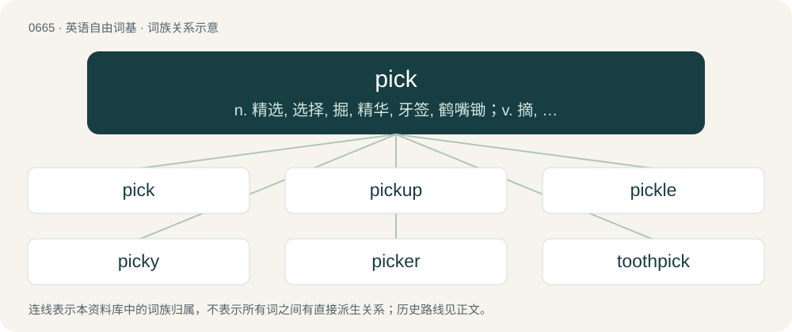

# 0739 · pick — n. 精选, 选择, 掘, 精华, 牙签, 鹤嘴锄；v. 摘, 掘, 凿, 挖, 挑选；\[计\] 拾取

[总目录](../00_总目录_按常用程度.md)

**类型**：英语自由词基　｜　**来源语言**：见词源记录

## 核心含义与来源

- 核心含义：n. 精选, 选择, 掘, 精华, 牙签, 鹤嘴锄；v. 摘, 掘, 凿, 挖, 挑选；\[计\] 拾取
- 英文含义：A tool used for digging; a pickaxe.
- 词形：pick

**来源记录 1**（名词；A tool used for digging; a pickaxe.）

From Middle English piken, picken, pikken, from Old English \*piccian, \*pīcian (attested in pīcung (“a pricking”)), and pīcan, pȳcan (“to pick, prick, pluck”), both from Proto-West Germanic \*pikkōn, from Proto-Germanic \*pikkōną (“to pick, peck, prick, knock”), from Proto-Indo-European \*bew-, \*bu- (“to make a dull, hollow sound”). Doublet of pitch and peck. Cognate with Dutch pikken (“to pick”), German picken (“to pick, peck”), Old Norse pikka, pjakka (whence Icelandic pikka (“to pick, prick”), Swedish picka (“to pick, peck”)). Compare also German Low German puken (“to pick out, rip out, pull away, extract”).

## 词族图

## 单词速览（常用到不常用）

| 单词 | 音标 | 释义 |
|---|---|---|
| [pick](#w-1) | /pɪk/ | n. 精选, 选择, 掘, 精华, 牙签, 鹤嘴锄；v. 摘, 掘, 凿, 挖, 挑选；\[计\] 拾取 |
| [pickup](#w-2) | /ˈpɪkʌp/ | n. 拾起, 加速, 刺激, 猎物的收集, 好转, 恢复健康, 搭车者, 兴奋剂, 电视摄像；\[电\] 拾音器 |
| [pickle](#w-3) | /ˈpɪkəl/ | 【英文】A kernel; a grain (of salt, sugar, etc.) |
| [picky](#w-4) | /ˈpɪki/ | a. 吹毛求疵的, 挑剔的, 找麻烦的 |
| [picker](#w-5) | /ˈpɪkə(ɹ)/ | n. 啄者, 啄物, 采摘者, 采摘机, 挖掘者, 古董收集者；\[法\] 扒手 |
| [toothpick](#w-6) | /ˈtuːθ.pɪk/ | n. 牙签 |
| [pickpocket](#w-7) | 英 /ˈpɪkpɒkɪt/ | n. 扒手；\[法\] 扒手 |
| [nitpick](#w-8) | /ˈnɪt.pɪk/ | vi. 挑剔；吹毛求疵 |

## 逐词详解

### 1. pick

**词性**：名词　｜　**音标**：/pɪk/

**中文释义**：n. 精选, 选择, 掘, 精华, 牙签, 鹤嘴锄；v. 摘, 掘, 凿, 挖, 挑选；\[计\] 拾取

**英文义项**：A tool used for digging; a pickaxe. / An anchor.

**词源与演化**：

From Middle English piken, picken, pikken, from Old English \*piccian, \*pīcian (attested in pīcung (“a pricking”)), and pīcan, pȳcan (“to pick, prick, pluck”), both from Proto-West Germanic \*pikkōn, from Proto-Germanic \*pikkōną (“to pick, peck, prick, knock”), from Proto-Indo-European \*bew-, \*bu- (“to make a dull, hollow sound”). Doublet of pitch and peck. Cognate with Dutch pikken (“to pick”), German picken (“to pick, peck”), Old Norse pikka, pjakka (whence Icelandic pikka (“to pick, prick”), Swedish picka (“to pick, peck”)). Compare also German Low German puken (“to pick out, rip out, pull away, extract”).

**用法示例／搭配（非完整句）**：

> so many picks to an inch

该用例对应义项：The blow that drives the shuttle, used in calculating the speed of a loom (in picks per minute); hence, in describing the fineness of a fabric, a weft thread.

### 2. pickup

**词性**：名词　｜　**音标**：/ˈpɪkʌp/

**中文释义**：n. 拾起, 加速, 刺激, 猎物的收集, 好转, 恢复健康, 搭车者, 兴奋剂, 电视摄像；\[电\] 拾音器

**英文义项**：In a record player, an electromagnetic component that converts the needle vibrations into an electrical signal. / Electromagnetic coil receiver of metal string oscillations.

**构词拆分**：pick + up

**词源与演化**：

From pick + up.

**例句**：

> Hey, thanks for the drink, but if this is a pickup, I'm not interested.

该用例对应义项：An instance of approaching someone and engaging in romantic flirtation and courting with the intent to pursue romance, a date, or a sexual encounter.

### 3. pickle

**词性**：名词　｜　**音标**：/ˈpɪkəl/

**英文义项**：A kernel; a grain (of salt, sugar, etc.) / A small or indefinite quantity or amount (of something); a little, a bit, a few. Usually in partitive construction, frequently without "of"; a single grain or kernel of wheat, barley, oats, sand or dust.

**构词拆分**：pick + -le (diminutive suffix)

**词源与演化**：

Perhaps from Scottish pickle, apparently from pick + -le (diminutive suffix). Compare Scots pickil.

### 4. picky

**词性**：形容词　｜　**音标**：/ˈpɪki/

**中文释义**：a. 吹毛求疵的, 挑剔的, 找麻烦的

**英文义项**：Fussy; particular; demanding to have things just right. / Of food or a meal: consisting of various small items from which the diner can pick and choose.

**构词拆分**：pick + -y

**词源与演化**：

From pick + -y.

**例句**：

> I am very picky about the way my kitchen is laid out.

该用例对应义项：Fussy; particular; demanding to have things just right.

### 5. picker

**词性**：名词　｜　**音标**：/ˈpɪkə(ɹ)/

**中文释义**：n. 啄者, 啄物, 采摘者, 采摘机, 挖掘者, 古董收集者；\[法\] 扒手

**英文义项**：A worker responsible for picking or retrieving ordered items, etc. / Any user interface control that selects something.

**构词拆分**：pick + -er

**词源与演化**：

From Middle English pikere, pykare, equivalent to pick + -er.

**用法示例／搭配（非完整句）**：

> date picker

该用例对应义项：Any user interface control that selects something.

### 6. toothpick

**词性**：名词　｜　**音标**：/ˈtuːθ.pɪk/

**中文释义**：n. 牙签

**英文义项**：A small, usually wooden, stick, often pointed at both ends, for removing food residue from between the teeth. / A very thin individual.

**构词拆分**：tooth + pick

**词源与演化**：

From tooth + pick.

**例句**：

> Mary smiled at me with a toothpick in the corner of her mouth.

### 7. pickpocket

**词性**：名词　｜　**音标**：英 /ˈpɪkpɒkɪt/

**中文释义**：n. 扒手；\[法\] 扒手

**英文义项**：One who steals from the pocket of a passerby, usually by sleight of hand.

**构词拆分**：pick + pocket

**词源与演化**：

From pick + pocket.

**例句**：

> The only one who enjoys a crowded subway car is a pickpocket.

### 8. nitpick

**词性**：动词　｜　**音标**：/ˈnɪt.pɪk/

**中文释义**：vi. 挑剔；吹毛求疵

**英文义项**：To correct insignificant mistakes or find fault in unimportant details.

**构词拆分**：nit + pick

**词源与演化**：

From nit + pick, originally referring to literally removing tiny louse eggs by hand.

**例句**：

> Someone will invariably nitpick about any spelling error posted to the forums.

该用例对应义项：To correct insignificant mistakes or find fault in unimportant details.
