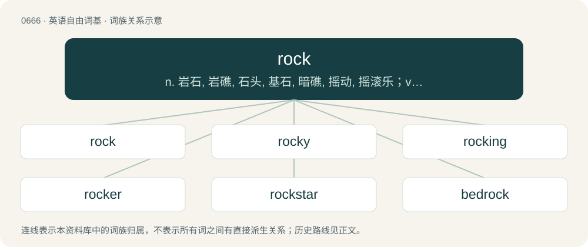

# 0740 · rock — n. 岩石, 岩礁, 石头, 基石, 暗礁, 摇动, 摇滚乐；vt. 摇摆, 摇动, 使摇晃, 使动摇；vi. 摇, 摇动

[总目录](../00_总目录_按常用程度.md)

**类型**：英语自由词基　｜　**来源语言**：见词源记录

## 核心含义与来源

- 核心含义：n. 岩石, 岩礁, 石头, 基石, 暗礁, 摇动, 摇滚乐；vt. 摇摆, 摇动, 使摇晃, 使动摇；vi. 摇, 摇动
- 英文含义：The naturally occurring aggregate of solid mineral matter that constitutes a significant part of the earth's crust.
- 词形：rock

**多个词源／构词路径**：同一拼写可能有不同来源；以下按词性和含义分别列出。

**来源记录 1**（名词；The naturally occurring aggregate of solid mineral matter that constitutes a significant part of the earth's crust.）

Inherited from Middle English rocke, rokke (“rock formation”), from Old English \*rocc (“rock”), as in Old English stānrocc (“high stone rock, peak, obelisk”), and also later from Anglo-Norman roque, (compare Modern French roc, roche, rocher), from Medieval Latin rocca (attested 767), of uncertain origin, sometimes said to be of Celtic (in particular, perhaps Gaulish) origin (compare Breton roc'h). Related also to Middle Low German rocke (“rock ledge”). One suggestion is that it derives from Vulgar Latin \*rupica, from rupes (compare rupico).

**来源记录 2**（动词；To move gently back and forth.）

Inherited from Middle English rokken, from Old English roccian, from Proto-West Germanic \*rokkōn, from Proto-Germanic \*rukkōną, from Proto-Indo-European \*h₃ruknéh₂ti, from \*h₃rewk-, \*h₃runk-. See also obsolete Dutch rokken, Middle High German rocken (“to drag, jerk”), Modern German rücken (“to move, shift”), Icelandic rukka (“to yank”); also Latin runcāre (“to weed”), Latvian rũķēt (“to toss, dig”).

**来源记录 3**（名词；A style of music characterized by basic drum-beat, generally 4/4 riffs, based on (usually electric) guitar, bass guitar, drums, keyboards (often), and vocals.）

Shortened from rock and roll. Since the meaning of rock has adapted to mean a simpler, more modern, metal-like genre, rock and roll has generally been left referring to earlier forms such as that originating in the 1950s, notably more swing-oriented style.

**来源记录 4**（名词；Distaff.）

From Middle English rok, rocke, rokke, perhaps from Middle Dutch rocke (whence Dutch rokken), Middle Low German rocken, or Old Norse rokkr (whence Icelandic / Faroese rokkur, Danish rok, Swedish spinnrock (“spinning wheel”)). Cognate with Old High German rocko (“distaff”).

## 词族图

## 单词速览（常用到不常用）

| 单词 | 音标 | 释义 |
|---|---|---|
| [rock](#w-1) | 英 /ɹɒk/；美 /ɹɑk/ | n. 岩石, 岩礁, 石头, 基石, 暗礁, 摇动, 摇滚乐；vt. 摇摆, 摇动, 使摇晃, 使动摇；vi. 摇, 摇动 |
| [rocky](#w-2) | 英 /ˈɹɒki/；美 /ˈɹɑki/ | a. 岩石的, 多石的, 像岩石的, 无情的, 摇动的, 摇晃的 |
| [rocking](#w-3) | 英 /ˈɹɒkɪŋ/；美 /ˈɹɑkɪŋ/ | a. 摇摆的, 摇动的；\[电\] 摇移 |
| [rocker](#w-4) | 英 /ˈɹɒk.ə(ɹ)/；美 /ˈɹɑ.kɚ/ | n. 摇的人, 摇杆；\[电\] 摇杆 |
| [rockstar](#w-5) |  | 摇滚歌星（游戏名） |
| [bedrock](#w-6) | 英 /ˈbɛd.ɹɒk/；美 /ˈbɛdˌɹɑk/ | n. 基岩, 基本原理, 基础 |
| [rockland](#w-7) |  | n. (Rockland)人名；(瑞典)罗克兰；罗克兰 |
| [rockwood](#w-8) |  | \[人名\] 罗克伍德; \[地名\] \[加拿大、美国\] 罗克伍德 |
| [rocksteady](#w-9) | /ˈrɔk,stedi/ | n. (起源于牙买加的)慢拍摇滚乐, 慢拍摇滚舞 |
| [rockfish](#w-10) | 英 /ˈɹɒk.fɪʃ/；美 /ˈɹɑk.fɪʃ/ | n. 岩鱼 |
| [sheetrock](#w-11) | /ˈʃiːtrɔk/ | n. (建筑用)石膏灰胶纸夹板 |

## 逐词详解

### 1. rock

**词性**：名词　｜　**音标**：英 /ɹɒk/；美 /ɹɑk/

**中文释义**：n. 岩石, 岩礁, 石头, 基石, 暗礁, 摇动, 摇滚乐；vt. 摇摆, 摇动, 使摇晃, 使动摇；vi. 摇, 摇动

**英文义项**：The naturally occurring aggregate of solid mineral matter that constitutes a significant part of the earth's crust. / A mass of stone projecting out of the ground or water.

**词源与演化**：

Inherited from Middle English rocke, rokke (“rock formation”), from Old English \*rocc (“rock”), as in Old English stānrocc (“high stone rock, peak, obelisk”), and also later from Anglo-Norman roque, (compare Modern French roc, roche, rocher), from Medieval Latin rocca (attested 767), of uncertain origin, sometimes said to be of Celtic (in particular, perhaps Gaulish) origin (compare Breton roc'h). Related also to Middle Low German rocke (“rock ledge”). One suggestion is that it derives from Vulgar Latin \*rupica, from rupes (compare rupico).

**例句**：

> The captain named it Pearl Rock after the rising sun illuminated the surface of the island.

该用例对应义项：A large hill or island having no vegetation.

### 2. rocky

**词性**：形容词　｜　**音标**：英 /ˈɹɒki/；美 /ˈɹɑki/

**中文释义**：a. 岩石的, 多石的, 像岩石的, 无情的, 摇动的, 摇晃的

**英文义项**：Abounding in, or full of, rocks; consisting of rocks. / Like a rock; rigid, solid.

**构词拆分**：rock + -y (suffix forming adjectives meaning ‘having the quality of’)

**词源与演化**：

From Middle English rokki, rokky (“rocky”), from rok, rokke (“rock; a rock or stone; large rock by a coast or in the sea; rocky outcrop on a mountain, cliff; castle, citadel, stronghold”) \[and other forms\] + -i (suffix forming adjectives). Rok, rokke are derived from: \* Old English \*rocc (“rock”); and \* Anglo-Norman roc, roce, roque, and Old French roce, roke, roque, variants of roche (“rock”); both from Medieval Latin roca, rocca; further etymology uncertain, possibly of Celtic origin. The English word is analysable as rock + -y (suffix forming adjectives meaning ‘having the quality of’).

**用法示例／搭配（非完整句）**：

> a rocky mountain a rocky shore

该用例对应义项：Abounding in, or full of, rocks; consisting of rocks.

### 3. rocking

**词性**：形容词　｜　**音标**：英 /ˈɹɒkɪŋ/；美 /ˈɹɑkɪŋ/

**中文释义**：a. 摇摆的, 摇动的；\[电\] 摇移

**英文义项**：Shaking, swaying or moving back and forth. / Excellent; great.

**构词拆分**：From rock + -ing.

**词源与演化**：

From rock + -ing.

**例句**：

> The neighbors sound like they are having a rocking party; let's gatecrash!

### 4. rocker

**词性**：名词　｜　**音标**：英 /ˈɹɒk.ə(ɹ)/；美 /ˈɹɑ.kɚ/

**中文释义**：n. 摇的人, 摇杆；\[电\] 摇杆

**英文义项**：A curved piece of wood attached to the bottom of a rocking chair or cradle that enables it to rock back and forth. / A rocking chair.

**构词拆分**：rock + -er

**词源与演化**：

From Middle English rokker, rockere, rokkere, equivalent to rock + -er.

**例句**：

> You don't look like a punk rocker.

### 5. rockstar

**词性**：名词

**中文释义**：摇滚歌星（游戏名）

**英文义项**：A member of a rock band, or a solo artist in the genre, especially one with celebrity status. / A person who is renowned or revered in his or her field of accomplishment.

**构词拆分**：rock + star

**词源与演化**：

From rock + star.

**例句**：

> By 1985, Michael Jordan had become a rockstar of the NBA.

该用例对应义项：A person who is renowned or revered in his or her field of accomplishment.

### 6. bedrock

**词性**：名词　｜　**音标**：英 /ˈbɛd.ɹɒk/；美 /ˈbɛdˌɹɑk/

**中文释义**：n. 基岩, 基本原理, 基础

**英文义项**：The solid rock found at some depth below the ground surface. / A basis or foundation.

**构词拆分**：bed (“a layer on top of which something else rests.”) + rock

**词源与演化**：

From bed (“a layer on top of which something else rests.”) + rock.

**例句**：

> If culture is the bedrock of a society, then language is the cornerstone of culture.

该用例对应义项：A basis or foundation.

### 7. rockland

**词性**：名词

**中文释义**：n. (Rockland)人名；(瑞典)罗克兰；罗克兰

**英文义项**：A rocky landscape.

**构词拆分**：rock + land

**词源与演化**：

From rock + land.

### 8. rockwood

**词性**：名词

**中文释义**：\[人名\] 罗克伍德; \[地名\] \[加拿大、美国\] 罗克伍德

**英文义项**：ligniform asbestos / fossil wood

**构词拆分**：rock + wood

**词源与演化**：

From rock + wood.

### 9. rocksteady

**词性**：名词　｜　**音标**：/ˈrɔk,stedi/

**中文释义**：n. (起源于牙买加的)慢拍摇滚乐, 慢拍摇滚舞

**英文义项**：A genre of Jamaican music somewhat slower than ska.

**构词拆分**：rock + steady

**词源与演化**：

From rock + steady.

### 10. rockfish

**词性**：名词　｜　**音标**：英 /ˈɹɒk.fɪʃ/；美 /ˈɹɑk.fɪʃ/

**中文释义**：n. 岩鱼

**英文义项**：A fish in the family Sebastidae, marine fishes that inhabit oceans around the world / Sebastes, mainly of the North Pacific

**构词拆分**：rock + fish

**词源与演化**：

From rock + fish.

### 11. sheetrock

**词性**：名词　｜　**音标**：/ˈʃiːtrɔk/

**中文释义**：n. (建筑用)石膏灰胶纸夹板

**英文义项**：A building material comprising a sheet of gypsum sandwiched between two pieces of heavy paper, used mainly for interior walls and ceilings; drywall.

**构词拆分**：sheet + rock

**词源与演化**：

Genericized trademark (originally, and also, Sheetrock); from sheet + rock.
