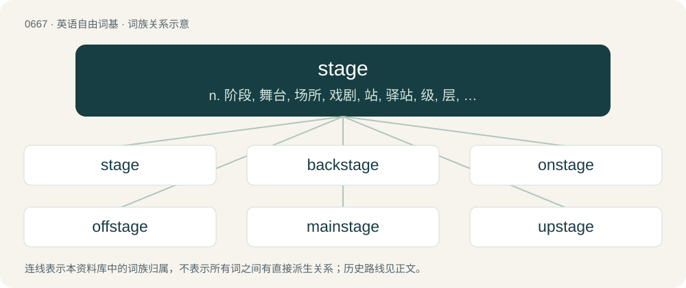

# 0741 · stage — n. 阶段, 舞台, 场所, 戏剧, 站, 驿站, 级, 层, 脚手架；vt. 上演, 表演, 筹划；vi. 适于上演, 乘驿车旅行

[总目录](../00_总目录_按常用程度.md)

**类型**：英语自由词基　｜　**来源语言**：见词源记录

## 核心含义与来源

- 核心含义：n. 阶段, 舞台, 场所, 戏剧, 站, 驿站, 级, 层, 脚手架；vt. 上演, 表演, 筹划；vi. 适于上演, 乘驿车旅行
- 英文含义：A phase.
- 词形：stage

**多个词源／构词路径**：同一拼写可能有不同来源；以下按词性和含义分别列出。

**来源记录 1**（名词；A phase.）

From Middle English stage, from Old French estage (“dwelling, residence; position, situation, condition”), from Old French ester (“to be standing, be located”). Cognate with Old English stæþþan (“to make staid, stay”), Old Norse steðja (“to place, provide, confirm, allow”), Old English stede (“state, status, standing, place, station, site”). More at stead. Doublet of étage.

**来源记录 2**（名词；An unpaid internship in a restaurant where a cook or chef is exposed to new culinary techniques.）

Borrowed from French stage (“internship”).

## 词族图

## 单词速览（常用到不常用）

| 单词 | 音标 | 释义 |
|---|---|---|
| [stage](#w-1) | /steɪd͡ʒ/ | n. 阶段, 舞台, 场所, 戏剧, 站, 驿站, 级, 层, 脚手架；vt. 上演, 表演, 筹划；vi. 适于上演, 乘驿车旅行 |
| [backstage](#w-2) | /bækˈsteɪd͡ʒ/ | adv. 在后台, 向后台 |
| [onstage](#w-3) | /ˈɔnˈsteidʒ/ | adv. 在前台；a. 在前台的 |
| [offstage](#w-4) |  | n. 台后, 幕内；a. 台后的, 幕内的 |
| [mainstage](#w-5) |  | 【英文】The largest performing space in a venue. |
| [upstage](#w-6) | /ʌpˈsteɪd͡ʒ/ | a. 在舞台后部的, 傲慢的, 自负的；adv. 在舞台后方；vt. 抢戏 |
| [multistage](#w-7) | /ˈmʌltisteidʒ/ | a. 多级的, 多阶段的；\[机\] 多级 |
| [stagecraft](#w-8) | /ˈsteidʒkrɑːft; -kræft/ | n. 演剧技巧 |

## 逐词详解

### 1. stage

**词性**：名词　｜　**音标**：/steɪd͡ʒ/

**中文释义**：n. 阶段, 舞台, 场所, 戏剧, 站, 驿站, 级, 层, 脚手架；vt. 上演, 表演, 筹划；vi. 适于上演, 乘驿车旅行

**英文义项**：A phase. / One of the portions of a device (such as a rocket or thermonuclear weapon) which are used or activated in a particular order, one after another.

**词源与演化**：

From Middle English stage, from Old French estage (“dwelling, residence; position, situation, condition”), from Old French ester (“to be standing, be located”). Cognate with Old English stæþþan (“to make staid, stay”), Old Norse steðja (“to place, provide, confirm, allow”), Old English stede (“state, status, standing, place, station, site”). More at stead. Doublet of étage.

**例句**：

> In the 1880s he ran a stage that connected various interior towns with the coastal port.

该用例对应义项：A stagecoach, an enclosed horsedrawn carriage used to carry passengers; the service that such coaches provide; a company that operates such service.

### 2. backstage

**词性**：形容词　｜　**音标**：/bækˈsteɪd͡ʒ/

**中文释义**：adv. 在后台, 向后台

**英文义项**：Relating to, or situated in the area behind a stage. / Secret, concealed from the public.

**构词拆分**：back + stage

**词源与演化**：

From back + stage.

**例句**：

> Puppeteers control the huge beasts from backstage, sending directional instructions by remote control.

### 3. onstage

**词性**：形容词　｜　**音标**：/ˈɔnˈsteidʒ/

**中文释义**：adv. 在前台；a. 在前台的

**英文义项**：On the part of a stage that is visible to the audience.

**构词拆分**：on + stage

**词源与演化**：

From on + stage.

**例句**：

> Rising from his seat, Tom made his way to the onstage lectern to applause.

### 4. offstage

**词性**：形容词

**中文释义**：n. 台后, 幕内；a. 台后的, 幕内的

**英文义项**：Of or relating to that part of a stage not visible to the audience. / Of or relating to the private life of a celebrity.

**构词拆分**：off + stage

**词源与演化**：

From off + stage.

### 5. mainstage

**词性**：名词

**英文义项**：The largest performing space in a venue. / Any prestigious performing space.

**构词拆分**：main + stage

**词源与演化**：

From main + stage.

### 6. upstage

**词性**：形容词　｜　**音标**：/ʌpˈsteɪd͡ʒ/

**中文释义**：a. 在舞台后部的, 傲慢的, 自负的；adv. 在舞台后方；vt. 抢戏

**英文义项**：At the rear of a stage.

**构词拆分**：up- + stage

**词源与演化**：

From up- + stage. The figurative uses “haughty” and “to draw attention away” derive from actors moving to a higher and thus more visible position on a sloped stage.

**例句**：

> The minimalist play used no upstage scenery.

该用例对应义项：At the rear of a stage.

### 7. multistage

**词性**：形容词　｜　**音标**：/ˈmʌltisteidʒ/

**中文释义**：a. 多级的, 多阶段的；\[机\] 多级

**英文义项**：Having more than one step or phase. / Composed of multiple detachable parts.

**构词拆分**：multi- + stage

**词源与演化**：

From multi- + stage.

**例句**：

> The multistage rocket dropped off its first stage successfully rather than carrying the extra weight higher.

该用例对应义项：Composed of multiple detachable parts.

### 8. stagecraft

**词性**：名词　｜　**音标**：/ˈsteidʒkrɑːft; -kræft/

**中文释义**：n. 演剧技巧

**英文义项**：The skills of the theater. / A specific skill of the theater.

**构词拆分**：stage + -craft

**词源与演化**：

From stage + -craft.

**例句**：

> To be a professional actor you need to learn stagecraft.

该用例对应义项：The skills of the theater.
