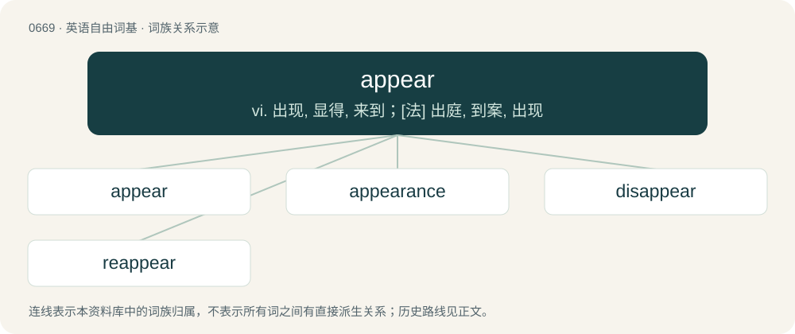

# 0743 · appear — vi. 出现, 显得, 来到；\[法\] 出庭, 到案, 出现

[总目录](../00_总目录_按常用程度.md)

**类型**：英语自由词基　｜　**来源语言**：见词源记录

## 核心含义与来源

- 核心含义：vi. 出现, 显得, 来到；\[法\] 出庭, 到案, 出现
- 英文含义：To come or be in sight; to be in view; to become visible.
- 词形：appear

**来源记录 1**（动词；To come or be in sight; to be in view; to become visible.）

From Middle English apperen, aperen, borrowed from Old French aparoir (French apparoir), from Latin appāreō (“to appear”), from ad (“to”) + pāreō (“to come forth, to become visible”), ultimately from Proto-Indo-European \*peh₂-s- (“watch, see”), s-present of \*peh₂- (“protect”).

## 词族图

## 单词速览（常用到不常用）

| 单词 | 音标 | 释义 |
|---|---|---|
| [appear](#w-1) | 英 /əˈpɪə/；美 /əˈpɪɹ/ | vi. 出现, 显得, 来到；\[法\] 出庭, 到案, 出现 |
| [appearance](#w-2) | 英 /əˈpɪə.ɹəns/；美 /əˈpiɹ.əns/ | n. 出现, 露面, 外观, 外表, 出版；\[计\] 外观, 版面 |
| [disappear](#w-3) | 英 /dɪsəˈpɪə/；美 /dɪsəˈpɪɹ/ | vi. 消失, 不见 |
| [reappear](#w-4) | /.riːəˈpiə/ | vi. 再出现 |

## 逐词详解

### 1. appear

**词性**：动词　｜　**音标**：英 /əˈpɪə/；美 /əˈpɪɹ/

**中文释义**：vi. 出现, 显得, 来到；\[法\] 出庭, 到案, 出现

**英文义项**：To come or be in sight; to be in view; to become visible. / To come before the public.

**词源与演化**：

From Middle English apperen, aperen, borrowed from Old French aparoir (French apparoir), from Latin appāreō (“to appear”), from ad (“to”) + pāreō (“to come forth, to become visible”), ultimately from Proto-Indo-European \*peh₂-s- (“watch, see”), s-present of \*peh₂- (“protect”).

**例句**：

> He appeared quite happy with the result.

该用例对应义项：To seem; to have a certain semblance; to look.

### 2. appearance

**词性**：名词　｜　**音标**：英 /əˈpɪə.ɹəns/；美 /əˈpiɹ.əns/

**中文释义**：n. 出现, 露面, 外观, 外表, 出版；\[计\] 外观, 版面

**英文义项**：The act of appearing or coming into sight; the act of becoming visible to the eye. / A thing seen; a phenomenon; an apparition.

**构词拆分**：appear + -ance

**词源与演化**：

Borrowed from Middle French apparence, from Latin apparentia, from appareo. Morphologically appear + -ance. Doublet of apparence and apparency. Displaced native Old English hīew (“the way something looks or seems”) and ætīewednes (“act of appearing or coming into view”).

**例句**：

> The patient had a small bowel obstruction and there was no appearance until after the obstruction resolved.

该用例对应义项：Chiefly used by nurses: the act of defecation by a patient.

### 3. disappear

**词性**：动词　｜　**音标**：英 /dɪsəˈpɪə/；美 /dɪsəˈpɪɹ/

**中文释义**：vi. 消失, 不见

**英文义项**：To vanish. / To go missing; to become a missing person.

**构词拆分**：dis- + appear

**词源与演化**：

From Middle English disapeeren, equivalent to dis- + appear. Displaced native Old English fordwīnan. Displaced native Old English cwincan, whose causative persists as quench (“put out (fire)”).

**例句**：

> The Chinese government is well-known for disappearing particularly vocal political dissidents.

该用例对应义项：To make vanish; especially, to abduct or murder for political reasons.

### 4. reappear

**词性**：动词　｜　**音标**：/.riːəˈpiə/

**中文释义**：vi. 再出现

**英文义项**：To appear again.

**构词拆分**：re- + appear

**词源与演化**：

From re- + appear.

**例句**：

> Halley is the comet that proved correct Edmund Halley's prediction that it would reappear.
