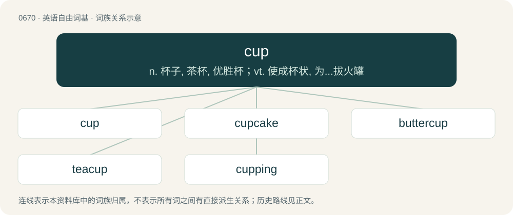

# 0745 · cup — n. 杯子, 茶杯, 优胜杯；vt. 使成杯状, 为...拔火罐

[总目录](../00_总目录_按常用程度.md)

**类型**：英语自由词基　｜　**来源语言**：见词源记录

## 核心含义与来源

- 核心含义：n. 杯子, 茶杯, 优胜杯；vt. 使成杯状, 为...拔火罐
- 英文含义：A concave vessel for drinking, usually made of opaque material (as opposed to a glass) and with a handle.
- 词形：cup

**来源记录 1**（名词；A concave vessel for drinking, usually made of opaque material (as opposed to a glass) and with a handle.）

Inherited from Middle English cuppe, coppe, from the merger of Old English cuppe (“cup”) and Old English copp (“cup, vessel”). Old English cuppe is a borrowing from Late Latin cuppa, itself of obscure origin, but probably from earlier Latin cūpa (“tub, cask”), from Proto-Indo-European \*kewp- (“a hollow”). Old English copp, however, is from Proto-West Germanic \*kopp (“round object, bowl, vessel, knoll, summit, crown of the head”), from Proto-Germanic \*kuppaz, from Proto-Indo-European \*gew- (“to bend, curve, arch”) (whence also obsolete English cop (“top, summit, crown of the head”), German Kopf (“top, head”)). The Middle English word was further reinforced by Anglo-Norman cupe and Old French cope, coupe, from Latin cuppa. Compare also Saterland Frisian Kop (“cup”), West Frisian kop (“cup”), Dutch kop (“cup”), German Low German Koppke, Köppke (“cup”), Danish kop (“cup”), Swedish kopp (“cup”). Doublet of coupe, hive, and keeve.

## 词族图

## 单词速览（常用到不常用）

| 单词 | 音标 | 释义 |
|---|---|---|
| [cup](#w-1) | 英 /ˈkʌp/ | n. 杯子, 茶杯, 优胜杯；vt. 使成杯状, 为...拔火罐 |
| [cupcake](#w-2) | /ˈkʌpkeɪk/ | n. 杯形蛋糕 |
| [buttercup](#w-3) | 英 /ˈbʌt.ə.kʌp/；美 /ˈbʌt.ɚ.kʌp/ | n. 毛茛属植物 |
| [teacup](#w-4) | /ˈtiː.kʌp/ | n. 茶杯, 满茶杯 |
| [cupping](#w-5) | /ˈkʌpɪŋ/ | n. 杯吸法, 拔火罐；\[化\] 采脂 |

## 逐词详解

### 1. cup

**词性**：名词　｜　**音标**：英 /ˈkʌp/

**中文释义**：n. 杯子, 茶杯, 优胜杯；vt. 使成杯状, 为...拔火罐

**英文义项**：A concave vessel for drinking, usually made of opaque material (as opposed to a glass) and with a handle. / The contents of said vessel.

**词源与演化**：

Inherited from Middle English cuppe, coppe, from the merger of Old English cuppe (“cup”) and Old English copp (“cup, vessel”). Old English cuppe is a borrowing from Late Latin cuppa, itself of obscure origin, but probably from earlier Latin cūpa (“tub, cask”), from Proto-Indo-European \*kewp- (“a hollow”). Old English copp, however, is from Proto-West Germanic \*kopp (“round object, bowl, vessel, knoll, summit, crown of the head”), from Proto-Germanic \*kuppaz, from Proto-Indo-European \*gew- (“to bend, curve, arch”) (whence also obsolete English cop (“top, summit, crown of the head”), German Kopf (“top, head”)). The Middle English word was further reinforced by Anglo-Norman cupe and Old French cope, coupe, from Latin cuppa. Compare also Saterland Frisian Kop (“cup”), West Frisian kop (“cup”), Dutch kop (“cup”), German Low German Koppke, Köppke (“cup”), Danish kop (“cup”), Swedish kopp (“cup”). Doublet of coupe, hive, and keeve.

**例句**：

> The World Cup is awarded to the winner of a quadrennial football tournament.

该用例对应义项：A trophy in the shape of an oversized cup.

### 2. cupcake

**词性**：名词　｜　**音标**：/ˈkʌpkeɪk/

**中文释义**：n. 杯形蛋糕

**英文义项**：A small cake baked in a usually paper container shaped like a cup, often with icing on top. / An attractive young woman.

**构词拆分**：cup + cake

**词源与演化**：

From cup + cake.

**例句**：

> Australia need a win to progress, but they have a cupcake in Italy for their last, so they're not likely to miss out.

该用例对应义项：An unskilled player or team, especially one expected to be easily defeated by a stronger opponent.

### 3. buttercup

**词性**：名词　｜　**音标**：英 /ˈbʌt.ə.kʌp/；美 /ˈbʌt.ɚ.kʌp/

**中文释义**：n. 毛茛属植物

**英文义项**：Any of many herbs, of the genus Ranunculus, having yellow flowers; the crowfoot. / Any flower of the genus Narcissus; a daffodil.

**构词拆分**：butter + cup

**词源与演化**：

From butter + cup. Both sense 1 and 2 are from the flowers' association with butter, from their yellow colour. Compare butterflower for a similar derivation; outside of English, compare Dutch boterbloem, German Butterblume.

**例句**：

> When Tom was in the first grade, he would pick buttercup flowers and give them to girls.

### 4. teacup

**词性**：名词　｜　**音标**：/ˈtiː.kʌp/

**中文释义**：n. 茶杯, 满茶杯

**英文义项**：A small cup, usually with a handle, commonly used for drinking tea; normally sits in a saucer as part of a tea set. / A unit of measure; a teacupful.

**构词拆分**：tea + cup

**词源与演化**：

From tea + cup.

**例句**：

> There is a small teacup and an egg on the table.

### 5. cupping

**词性**：名词　｜　**音标**：/ˈkʌpɪŋ/

**中文释义**：n. 杯吸法, 拔火罐；\[化\] 采脂

**英文义项**：Fire cupping, a traditional therapeutic treatment called in which heated cupping glasses are applied to the skin, supposedly to draw blood towards the surface. / The taking of a small amount of a beverage such as tea or coffee into the mouth in order to taste it; a session where this is done.

**构词拆分**：cup + -ing

**词源与演化**：

From Middle English cupping, equivalent to cup + -ing.

**用法示例／搭配（非完整句）**：

> the cupping of one's hands

该用例对应义项：The act of forming something into a cup shape.
