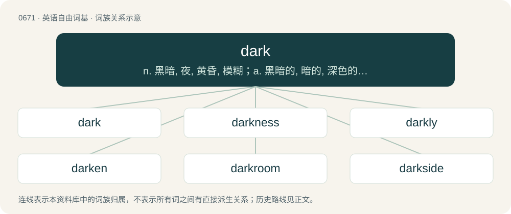

# 0746 · dark — n. 黑暗, 夜, 黄昏, 模糊；a. 黑暗的, 暗的, 深色的, 隐密的, 模糊的, 无知的

[总目录](../00_总目录_按常用程度.md)

**类型**：英语自由词基　｜　**来源语言**：见词源记录

## 核心含义与来源

- 核心含义：n. 黑暗, 夜, 黄昏, 模糊；a. 黑暗的, 暗的, 深色的, 隐密的, 模糊的, 无知的
- 英文含义：Having an absolute or (more often) relative lack of light.
- 词形：dark

**多个词源／构词路径**：同一拼写可能有不同来源；以下按词性和含义分别列出。

**来源记录 1**（形容词；Having an absolute or (more often) relative lack of light.）

From Middle English derk, from Old English deorc, from Proto-West Germanic \*derk (“dark”), of uncertain origin, but possibly from Proto-Indo-European \*dʰerg- (“dim, dull”), from Proto-Indo-European \*dʰer- (“dull, dirty”).

**来源记录 2**（名词；A complete or (more often) partial absence of light.）

From Middle English derk, derke, dirke, dyrke, from the adjective (see above), or possibly from an unrecorded Old English \*dierce, \*diercu (“dark, darkness”).

**来源记录 3**（动词；To grow or become dark, darken.）

Inherited from Middle English derken, from Old English deorcian, from Proto-West Germanic \*derkōn, from \*derk (“dirty, dark”) + \*-ōn.

## 词族图

## 单词速览（常用到不常用）

| 单词 | 音标 | 释义 |
|---|---|---|
| [dark](#w-1) | 英 /dɑːk/；美 /dɑɹk/ | n. 黑暗, 夜, 黄昏, 模糊；a. 黑暗的, 暗的, 深色的, 隐密的, 模糊的, 无知的 |
| [darkness](#w-2) | 英 /ˈdɑːk.nəs/；美 /ˈdɑɹk.nɪs/ | n. 黑暗, 暗, 深色, 隐密, 模糊, 无知 |
| [darkly](#w-3) | 英 /ˈdɑːkli/；美 /ˈdɑɹkli/ | adv. 暗, 黑, 呈黑 |
| [darken](#w-4) | 英 /ˈdɑːkən/；美 /ˈdɑɹkən/ | vt. 弄暗, 使模糊；vi. 暗下来, 颜色变深 |
| [darkroom](#w-5) | /ˈdɑːkrum/ | n. 暗房；\[医\] 暗室 |
| [darkside](#w-6) | 英 /ˈdɑːk.saɪd/；美 /ˈdɑɹkˌsaɪd/ | 【英文】The side of something that is in darkness or unlit, or has less illumination. |
| [darknet](#w-7) |  | 【英文】A network of computers that can only be accessed using special software, configuration, or authorization, usually characterized by the anonymization of users, participating hosts, or both. |
| [darkling](#w-8) | /ˈdɑː(ɹ)klɪŋ/ | adv. 在暗中；a. 黑暗的, 神秘莫测的 |

## 逐词详解

### 1. dark

**词性**：形容词　｜　**音标**：英 /dɑːk/；美 /dɑɹk/

**中文释义**：n. 黑暗, 夜, 黄昏, 模糊；a. 黑暗的, 暗的, 深色的, 隐密的, 模糊的, 无知的

**英文义项**：Having an absolute or (more often) relative lack of light. / Extinguished.

**词源与演化**：

From Middle English derk, from Old English deorc, from Proto-West Germanic \*derk (“dark”), of uncertain origin, but possibly from Proto-Indo-European \*dʰerg- (“dim, dull”), from Proto-Indo-European \*dʰer- (“dull, dirty”).

**例句**：

> The dark ages began after the collapse of the Roman Empire.

该用例对应义项：Lacking progress in science or the arts.

### 2. darkness

**词性**：名词　｜　**音标**：英 /ˈdɑːk.nəs/；美 /ˈdɑɹk.nɪs/

**中文释义**：n. 黑暗, 暗, 深色, 隐密, 模糊, 无知

**英文义项**：The state of being dark; lack of light; the absolute or comparative absence of light. / The state or quality of reflecting little light, of tending to a blackish or brownish color.

**构词拆分**：dark + -ness

**词源与演化**：

From Middle English derknesse, from Old English deorcnes; equivalent to dark + -ness.

**例句**：

> The darkness of her skin betrayed her Mediterranean heritage.

该用例对应义项：The state or quality of reflecting little light, of tending to a blackish or brownish color.

### 3. darkly

**词性**：副词　｜　**音标**：英 /ˈdɑːkli/；美 /ˈdɑɹkli/

**中文释义**：adv. 暗, 黑, 呈黑

**英文义项**：With insufficient light for easy discernment or comprehension. / With a dark appearance.

**构词拆分**：dark + -ly

**词源与演化**：

From Middle English derkly, derkely, derkliche, derkeliche; equivalent to dark + -ly. Compare Old English deorclīċe, a parallel formation.

**例句**：

> I could make out his image darkly.

该用例对应义项：With insufficient light for easy discernment or comprehension.

### 4. darken

**词性**：动词　｜　**音标**：英 /ˈdɑːkən/；美 /ˈdɑɹkən/

**中文释义**：vt. 弄暗, 使模糊；vi. 暗下来, 颜色变深

**英文义项**：To make dark or darker by reducing light. / To become dark or darker (having less light).

**构词拆分**：dark + -en

**词源与演化**：

From Middle English derkenen, dirkenen, from Old English \*deorcnian, \*diercnian (“to darken”), from Proto-West Germanic \*dirkinōn (“to darken”), equivalent to dark + -en. Cognate with Scots derken, durken (“to darken”), Old High German tarchanjan, terchinen (“to darken”), Middle High German terken, derken (“to darken”).

**例句**：

> The jealousy is starting to darken Tom's mind.

### 5. darkroom

**词性**：名词　｜　**音标**：/ˈdɑːkrum/

**中文释义**：n. 暗房；\[医\] 暗室

**英文义项**：A dark room, where photographs are developed. / A darkened room where sexual activity can take place, especially one in a gay club.

**构词拆分**：dark + room

**词源与演化**：

From dark + room.

**例句**：

> What are you looking for in the darkroom?

### 6. darkside

**词性**：名词　｜　**音标**：英 /ˈdɑːk.saɪd/；美 /ˈdɑɹkˌsaɪd/

**英文义项**：The side of something that is in darkness or unlit, or has less illumination. / The side of something that is metaphorically dark, i.e. evil, distressing or otherwise undesirable; the negative aspect of something.

**构词拆分**：dark + side

**词源与演化**：

From dark + side. Sense 2.1 (“side that is evil”) was popularized by the film Star Wars (1977; later retitled Star Wars: Episode IV – A New Hope) where the term was used to describe the aspect of a metaphysical power called the Force which could be used to act aggressively and perpetrate evil.

### 7. darknet

**词性**：名词

**英文义项**：A network of computers that can only be accessed using special software, configuration, or authorization, usually characterized by the anonymization of users, participating hosts, or both.

**构词拆分**：dark + net

**词源与演化**：

From dark + net.

### 8. darkling

**词性**：副词　｜　**音标**：/ˈdɑː(ɹ)klɪŋ/

**中文释义**：adv. 在暗中；a. 黑暗的, 神秘莫测的

**英文义项**：In the dark; in obscurity.

**构词拆分**：By surface analysis, dark + -ling

**词源与演化**：

From Middle English derkelyng. By surface analysis, dark + -ling.
