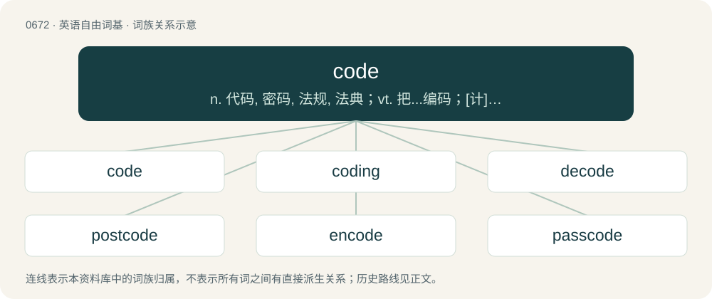

# 0747 · code — n. 代码, 密码, 法规, 法典；vt. 把...编码；\[计\] 代码

[总目录](../00_总目录_按常用程度.md)

**类型**：英语自由词基　｜　**来源语言**：见词源记录

## 核心含义与来源

- 核心含义：n. 代码, 密码, 法规, 法典；vt. 把...编码；\[计\] 代码
- 英文含义：A short textual designation, often with little relation to the item it represents.
- 词形：code

**来源记录 1**（名词；A short textual designation, often with little relation to the item it represents.）

From Middle English code (“system of law”), from Old French code (“system of law”), from Latin cōdex, later form of caudex (“the stock or stem of a tree, a board or tablet of wood smeared over with wax, on which the ancients originally wrote; hence, a book, a writing.”). Doublet of codex. Verb etymology 1, verb sense 7 is an ellipsis of code blue (“medical emergency”).

## 词族图

## 单词速览（常用到不常用）

| 单词 | 音标 | 释义 |
|---|---|---|
| [code](#w-1) | 英 /kəʊd/；美 /koʊd/ | n. 代码, 密码, 法规, 法典；vt. 把...编码；\[计\] 代码 |
| [coding](#w-2) | 英 /kəʊdɪŋ/；美 /koʊdɪŋ/ | n. 译码；\[计\] 编码 |
| [decode](#w-3) | 英 /dɪˈkəʊd/ | vt. 解码, 译解；\[计\] 译码 |
| [postcode](#w-4) | 英 /ˈpəʊs(t)kəʊd/；美 /ˈpoʊs(t)ˌkoʊd/ | n. 邮政编码 |
| [encode](#w-5) | 英 /ɪnˈkəʊd/；美 /ɪnˈkoʊd/ | vt. 把(电文、情报等)译成密码；\[计\] 编码 |
| [passcode](#w-6) |  | 密码 |
| [coder](#w-7) | /ˈkəudə/ | n. 编码器；\[计\] 编码员 |
| [codename](#w-8) |  | n. 研发代码；代号 |
| [codon](#w-9) | 英 /ˈkəʊ.dɒn/；美 /ˈkoʊ.dɑn/ | 【英文】A sequence of three adjacent nucleotides, which encode for a specific amino acid during protein synthesis or translation. |
| [codify](#w-10) | 英 /ˈkəʊ.dɪˌfaɪ/；美 /ˈkɑ.dɪˌfaɪ/ | vt. 编成法典；\[法\] 使成文法化, 编成法典, 编纂 |
| [codebase](#w-11) |  | 【英文】The body of source code used to create a particular computer program or software component. |
| [codeword](#w-12) | 美 /ˈkoʊdˌwɝd/ | \[医\]暗号用语 |
| [recode](#w-13) | /ˈriːˈkəud/ | vi. 重新编码 |

## 逐词详解

### 1. code

**词性**：名词　｜　**音标**：英 /kəʊd/；美 /koʊd/

**中文释义**：n. 代码, 密码, 法规, 法典；vt. 把...编码；\[计\] 代码

**英文义项**：A short textual designation, often with little relation to the item it represents. / A body of law, sanctioned by legislation, in which the rules of law to be specifically applied by the courts are set forth in systematic form; a compilation of laws by public authority; a digest.

**词源与演化**：

From Middle English code (“system of law”), from Old French code (“system of law”), from Latin cōdex, later form of caudex (“the stock or stem of a tree, a board or tablet of wood smeared over with wax, on which the ancients originally wrote; hence, a book, a writing.”). Doublet of codex. Verb etymology 1, verb sense 7 is an ellipsis of code blue (“medical emergency”).

**例句**：

> The naval code is a system of rules for making communications at sea by means of signals.

该用例对应义项：Any system of principles, rules or regulations relating to one subject.

### 2. coding

**词性**：名词　｜　**音标**：英 /kəʊdɪŋ/；美 /koʊdɪŋ/

**中文释义**：n. 译码；\[计\] 编码

**英文义项**：The process of encoding or decoding. / An encoding.

**构词拆分**：From code + -ing.

**词源与演化**：

From code + -ing.

**例句**：

> I spent all night on the coding, but the program was ready by morning.

该用例对应义项：The process of writing computer software code.

### 3. decode

**词性**：动词　｜　**音标**：英 /dɪˈkəʊd/

**中文释义**：vt. 解码, 译解；\[计\] 译码

**英文义项**：To convert from an encrypted form to plain text. / To figure out something difficult to interpret.

**构词拆分**：de- + code

**词源与演化**：

From de- + code.

**例句**：

> I finally managed to decode the nearly illegible doctor's prescription.

该用例对应义项：To figure out something difficult to interpret.

### 4. postcode

**词性**：名词　｜　**音标**：英 /ˈpəʊs(t)kəʊd/；美 /ˈpoʊs(t)ˌkoʊd/

**中文释义**：n. 邮政编码

**英文义项**：A sequence of letters and numbers added to a postal address to aid the sorting and delivery of post or mail. / The region denoted by such a sequence.

**构词拆分**：post + code

**词源与演化**：

From post + code.

**例句**：

> Oh, I've mistakenly written the telephone number where I should've put the postcode.

### 5. encode

**词性**：动词　｜　**音标**：英 /ɪnˈkəʊd/；美 /ɪnˈkoʊd/

**中文释义**：vt. 把(电文、情报等)译成密码；\[计\] 编码

**英文义项**：To convert (plain text) into code. / To convert source information into another form.

**构词拆分**：en- + code

**词源与演化**：

From en- + code.

**用法示例／搭配（非完整句）**：

> encode a secret message to be sent

该用例对应义项：To convert (plain text) into code.

### 6. passcode

**词性**：名词

**中文释义**：密码

**英文义项**：A string of characters used for authentication on a digital device.

**构词拆分**：pass + code

**词源与演化**：

From pass + code.

**例句**：

> Remember to lock your phone with a passcode to protect your privacy.

### 7. coder

**词性**：名词　｜　**音标**：/ˈkəudə/

**中文释义**：n. 编码器；\[计\] 编码员

**英文义项**：A device that generates a code, often as a series of pulses. / A person who assigns codes or classifications.

**构词拆分**：code + -er

**词源与演化**：

From code + -er.

### 8. codename

**词性**：动词

**中文释义**：n. 研发代码；代号

**英文义项**：To give a codename to.

**构词拆分**：code + name

**词源与演化**：

From code + name.

### 9. codon

**词性**：名词　｜　**音标**：英 /ˈkəʊ.dɒn/；美 /ˈkoʊ.dɑn/

**英文义项**：A sequence of three adjacent nucleotides, which encode for a specific amino acid during protein synthesis or translation.

**构词拆分**：code + -on

**词源与演化**：

From code + -on.

### 10. codify

**词性**：动词　｜　**音标**：英 /ˈkəʊ.dɪˌfaɪ/；美 /ˈkɑ.dɪˌfaɪ/

**中文释义**：vt. 编成法典；\[法\] 使成文法化, 编成法典, 编纂

**英文义项**：To reduce to a code, to arrange into a code. / To collect and arrange in a systematic form.

**构词拆分**：code + -ify

**词源与演化**：

From code + -ify.

**例句**：

> In a rare break from the party line, twelve Republican senators voted to codify same-sex marriage rights.

### 11. codebase

**词性**：名词

**英文义项**：The body of source code used to create a particular computer program or software component.

**构词拆分**：code + base

**词源与演化**：

From code + base.

### 12. codeword

**词性**：名词　｜　**音标**：美 /ˈkoʊdˌwɝd/

**中文释义**：\[医\]暗号用语

**英文义项**：A string representing an encoded piece of text. / A word or phrase (or by extension a concept) used to make a (concealed) reference to another word or concept.

**构词拆分**：code + word

**词源与演化**：

From code + word.

**例句**：

> Bob cannot get any information out of the codeword since he doesn't know what transmission bases Alice used.

该用例对应义项：A string representing an encoded piece of text.

### 13. recode

**词性**：动词　｜　**音标**：/ˈriːˈkəud/

**中文释义**：vi. 重新编码

**英文义项**：To reprogram; to refactor; to redevelop. / To recipher.

**构词拆分**：re- + code

**词源与演化**：

From re- + code.
