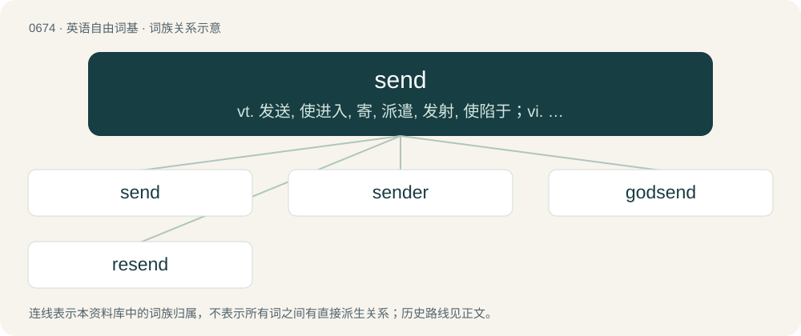

# 0750 · send — vt. 发送, 使进入, 寄, 派遣, 发射, 使陷于；vi. 寄信, 派人, 播送；n. (船的)上升运动

[总目录](../00_总目录_按常用程度.md)

**类型**：英语自由词基　｜　**来源语言**：见词源记录

## 核心含义与来源

- 核心含义：vt. 发送, 使进入, 寄, 派遣, 发射, 使陷于；vi. 寄信, 派人, 播送；n. (船的)上升运动
- 英文含义：To make something (such as an object or message) go from one place to another (or to someone).
- 词形：send

**来源记录 1**（动词；To make something (such as an object or message) go from one place to another (or to someone).）

From Middle English senden, from Old English sendan (“to send, cause to go”), from Proto-West Germanic \*sandijan, from Proto-Germanic \*sandijaną, from Proto-Indo-European \*sont-eye-ti (“to cause to go”), causative of \*sent- (“to walk, travel”). The noun derives from the verb. Cognates Cognate with Saterland Frisian seende (“to send”), Dutch zenden (“to send”), German senden (“to send”), Danish and Norwegian Bokmål sende (“to send”), Faroese, Icelandic, and Norwegian Nynorsk senda (“to send”), Swedish sända (“to send”). Related also to Old English sand, sond (“a sending, mission, message”). See also sith.

## 词族图

## 单词速览（常用到不常用）

| 单词 | 音标 | 释义 |
|---|---|---|
| [send](#w-1) | /sɛnd/ | vt. 发送, 使进入, 寄, 派遣, 发射, 使陷于；vi. 寄信, 派人, 播送；n. (船的)上升运动 |
| [sender](#w-2) | 英 /ˈsɛndəː/；美 /ˈsɛndɚ/ | n. 寄件人, 发报机；\[经\] 送货人, 发送者 |
| [godsend](#w-3) | 英 /ˈɡɒdsɛnd/；美 /ˈɡɑdˌsɛnd/ | n. 意外的幸运机会, 意外地来得正好的事物, 天赐 |
| [resend](#w-4) | /ɹiːˈsɛnd/ | vt. 再差遣；再发, 再送 |

## 逐词详解

### 1. send

**词性**：动词　｜　**音标**：/sɛnd/

**中文释义**：vt. 发送, 使进入, 寄, 派遣, 发射, 使陷于；vi. 寄信, 派人, 播送；n. (船的)上升运动

**英文义项**：To make something (such as an object or message) go from one place to another (or to someone). / To get one going; move to excitement or rapture; to delight or thrill.

**词源与演化**：

From Middle English senden, from Old English sendan (“to send, cause to go”), from Proto-West Germanic \*sandijan, from Proto-Germanic \*sandijaną, from Proto-Indo-European \*sont-eye-ti (“to cause to go”), causative of \*sent- (“to walk, travel”). The noun derives from the verb. Cognates Cognate with Saterland Frisian seende (“to send”), Dutch zenden (“to send”), German senden (“to send”), Danish and Norwegian Bokmål sende (“to send”), Faroese, Icelandic, and Norwegian Nynorsk senda (“to send”), Swedish sända (“to send”). Related also to Old English sand, sond (“a sending, mission, message”). See also sith.

**例句**：

> Every day at two o'clock, he sends his secretary out to buy him a coffee.

该用例对应义项：To make something (such as an object or message) go from one place to another (or to someone).

### 2. sender

**词性**：名词　｜　**音标**：英 /ˈsɛndəː/；美 /ˈsɛndɚ/

**中文释义**：n. 寄件人, 发报机；\[经\] 送货人, 发送者

**英文义项**：Someone who sends. / A device or component that transmits, as in telegraphy or computer networks.

**构词拆分**：send + -er

**词源与演化**：

From send + -er.

**例句**：

> The package was addressed to someone we didn't know, so we returned it to the sender.

该用例对应义项：Someone who sends.

### 3. godsend

**词性**：名词　｜　**音标**：英 /ˈɡɒdsɛnd/；美 /ˈɡɑdˌsɛnd/

**中文释义**：n. 意外的幸运机会, 意外地来得正好的事物, 天赐

**英文义项**：An instance of unexpected benefit or good fortune; a windfall. / A person who provides greatly needed assistance.

**构词拆分**：God + -’s + send (“(obsolete) act of sending”)

**词源与演化**：

A variant of God’s send, from God + -’s + send (“(obsolete) act of sending”), in the sense of someone or something sent by God.

**例句**：

> Tank tops are a godsend on hot summer days.

### 4. resend

**词性**：动词　｜　**音标**：/ɹiːˈsɛnd/

**中文释义**：vt. 再差遣；再发, 再送

**英文义项**：To send again. / To send back.

**构词拆分**：re- + send

**词源与演化**：

From re- + send. Attested since the 1550s.

**例句**：

> I didn't get your email. You'll have to resend it.

该用例对应义项：To send again.
