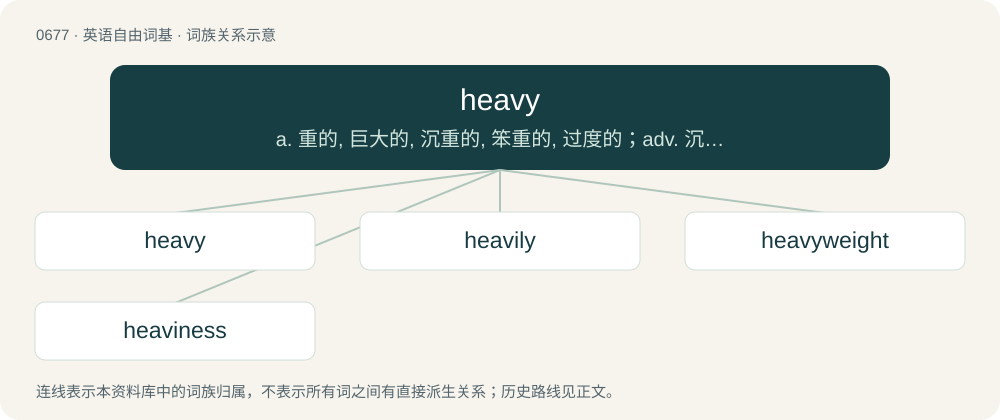

# 0752 · heavy — a. 重的, 巨大的, 沉重的, 笨重的, 过度的；adv. 沉重地；n. 重物, 严肃角色

[总目录](../00_总目录_按常用程度.md)

**类型**：英语自由词基　｜　**来源语言**：见词源记录

## 核心含义与来源

- 核心含义：a. 重的, 巨大的, 沉重的, 笨重的, 过度的；adv. 沉重地；n. 重物, 严肃角色
- 英文含义：Having great weight.
- 词形：heavy

**多个词源／构词路径**：同一拼写可能有不同来源；以下按词性和含义分别列出。

**来源记录 1**（形容词；Having great weight.）

From Middle English hevy, heviȝ, from Old English hefiġ, hefeġ, hæfiġ (“heavy; important, grave, severe, serious; oppressive, grievous; slow, dull”), from Proto-West Germanic \*habīg (“heavy, hefty, weighty”), from Proto-Germanic \*habīgaz (“heavy, hefty, weighty”), from Proto-Indo-European \*kap- (“to take, grasp, hold”). Equivalent to heave + -y. Related to have. Cognate with Scots hevy, havy, heavy (“heavy”), Saterland Frisian heeuwich, häwich (“violent, angry”), West Frisian hevich (“violent”), Dutch hevig (“violent, severe, intense, acute”), German Low German hevig (“violent, fierce, intense, angry”), German hebig (compare heftig (“fierce, severe, intense, violent, heavy”)), Icelandic höfugur (“heavy, weighty, important”), Latin capāx (“large, wide, roomy, spacious, capacious, capable, apt”). Compare typologically Russian объёмный (obʺjómnyj), ёмкий (jómkij) (akin to име́ть (imétʹ), взять (vzjatʹ)).

**来源记录 2**（形容词；Having the heaves.）

From heave + -y.

## 词族图

## 单词速览（常用到不常用）

| 单词 | 音标 | 释义 |
|---|---|---|
| [heavy](#w-1) | 英 /ˈhɛv.i/ | a. 重的, 巨大的, 沉重的, 笨重的, 过度的；adv. 沉重地；n. 重物, 严肃角色 |
| [heavily](#w-2) | /ˈhɛvɪli/ | adv. 很重地, 严重地, 难以忍受地 |
| [heavyweight](#w-3) | /ˈhɛ.vi.weɪt/ | n. 重量级拳击运动员, (非正式)有影响的要人；a. 最重量级的 |
| [heaviness](#w-4) | /ˈhɛvɪnəs/ | n. 重, 沉闷, 情绪低落, 忧伤, 迟钝, 笨拙 |

## 逐词详解

### 1. heavy

**词性**：形容词　｜　**音标**：英 /ˈhɛv.i/

**中文释义**：a. 重的, 巨大的, 沉重的, 笨重的, 过度的；adv. 沉重地；n. 重物, 严肃角色

**英文义项**：Having great weight. / Heavyset: overweight.

**构词拆分**：heave + -y

**词源与演化**：

From Middle English hevy, heviȝ, from Old English hefiġ, hefeġ, hæfiġ (“heavy; important, grave, severe, serious; oppressive, grievous; slow, dull”), from Proto-West Germanic \*habīg (“heavy, hefty, weighty”), from Proto-Germanic \*habīgaz (“heavy, hefty, weighty”), from Proto-Indo-European \*kap- (“to take, grasp, hold”). Equivalent to heave + -y. Related to have. Cognate with Scots hevy, havy, heavy (“heavy”), Saterland Frisian heeuwich, häwich (“violent, angry”), West Frisian hevich (“violent”), Dutch hevig (“violent, severe, intense, acute”), German Low German hevig (“violent, fierce, intense, angry”), German hebig (compare heftig (“fierce, severe, intense, violent, heavy”)), Icelandic höfugur (“heavy, weighty, important”), Latin capāx (“large, wide, roomy, spacious, capacious, capable, apt”). Compare typologically Russian объёмный (obʺjómnyj), ёмкий (jómkij) (akin to име́ть (imétʹ), взять (vzjatʹ)).

**例句**：

> He was a heavy sleeper, a heavy eater and a heavy smoker – certainly not an ideal husband.

该用例对应义项：Doing the specified activity more intensely than most other people.

### 2. heavily

**词性**：副词　｜　**音标**：/ˈhɛvɪli/

**中文释义**：adv. 很重地, 严重地, 难以忍受地

**英文义项**：With a great weight. / To a considerable degree, to a great extent.

**构词拆分**：heavy + -ly

**词源与演化**：

From Middle English hevely, hevyliche, from Old English hefiġlīċe (“heavily; grievously”), equivalent to heavy + -ly.

**例句**：

> He relied heavily on the data collected by the others.

该用例对应义项：To a considerable degree, to a great extent.

### 3. heavyweight

**词性**：名词　｜　**音标**：/ˈhɛ.vi.weɪt/

**中文释义**：n. 重量级拳击运动员, (非正式)有影响的要人；a. 最重量级的

**英文义项**：A very large, heavy, or impressive person. / The professional boxing weight class for boxers weighing more than 190 pounds; a boxer in that division.

**构词拆分**：heavy + weight

**词源与演化**：

From heavy + weight.

**用法示例／搭配（非完整句）**：

> an intellectual heavyweight

该用例对应义项：A very large, heavy, or impressive person.

### 4. heaviness

**词性**：名词　｜　**音标**：/ˈhɛvɪnəs/

**中文释义**：n. 重, 沉闷, 情绪低落, 忧伤, 迟钝, 笨拙

**英文义项**：The state of being heavy; weight, weightiness, force of impact or gravity.

**构词拆分**：heavy + -ness

**词源与演化**：

From Middle English hevynesse, from Old English hefiġnes (“heaviness”). Equivalent to heavy + -ness.

**例句**：

> The heaviness of lead.

该用例对应义项：the property of being comparatively great in weight
