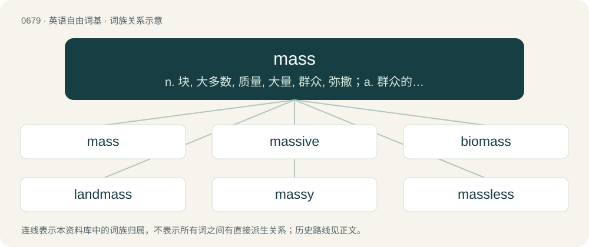

# 0755 · mass — n. 块, 大多数, 质量, 大量, 群众, 弥撒；a. 群众的, 大规模的, 整个的；vt. 使集合, 集中

[总目录](../00_总目录_按常用程度.md)

**类型**：英语自由词基　｜　**来源语言**：见词源记录

## 核心含义与来源

- 核心含义：n. 块, 大多数, 质量, 大量, 群众, 弥撒；a. 群众的, 大规模的, 整个的；vt. 使集合, 集中
- 英文含义：A quantity of matter cohering so as to make one body, or an aggregation of particles or things which collectively make one body or quantity, usually of considerable size.
- 词形：mass

**多个词源／构词路径**：同一拼写可能有不同来源；以下按词性和含义分别列出。

**来源记录 1**（名词；A quantity of matter cohering so as to make one body, or an aggregation of particles or things which collectively make one body or quantity, usually of considerable size.）

In late Middle English (circa 1400) as masse in the sense of "lump, quantity of matter", from Anglo-Norman masse, in Old French attested from the 11th century, via late Latin massa (“lump, dough”), from Ancient Greek μᾶζα (mâza, “barley-cake, lump (of dough)”). The Greek noun may be derived from the verb μάσσω (mássō, “to knead”), ultimately from a Proto-Indo-European \*maǵ- (“to oil, knead”), although this is uncertain. Doublet of masa. The sense of "a large number or quantity" arises circa 1580. The scientific sense is from 1687 (as Latin massa) in the works of Isaac Newton, with the first English use (as mass) occurring in 1704.

**来源记录 2**（名词；The Eucharist, now especially in Roman Catholicism.）

From Middle English messe, masse, from Old English mæsse (“the mass, church festival”) and Old French messe, from Vulgar Latin \*messa (“Eucharist, dismissal”), from Late Latin missa, noun use of feminine past participle of classical Latin mittere (“to send”), from ite, missa est (“go, (the assembly) is dismissed”), reanalyzed as "go, \[that\] is the missa", last words of the Roman Rite of the Catholic Church. Compare Dutch mis (“mass”), German Messe (“mass”), Danish messe (“mass”), Swedish mässa (“mass; expo”), Icelandic messa (“mass”). More at mission.

## 词族图

## 单词速览（常用到不常用）

| 单词 | 音标 | 释义 |
|---|---|---|
| [mass](#w-1) | 英 /mæs/ | n. 块, 大多数, 质量, 大量, 群众, 弥撒；a. 群众的, 大规模的, 整个的；vt. 使集合, 集中 |
| [massive](#w-2) | 英 /ˈmæs.ɪv/ | a. 大而重的, 宽大的, 宏伟的；\[医\] 大块的, 整块的, 大量的 |
| [biomass](#w-3) | 英 /ˈbaɪə(ʊ)mæs/；美 /ˈbaɪoʊˌmæs/ | n. 生物量；\[化\] 生物质; 生物量 |
| [landmass](#w-4) | 英 /ˈlænd.mæs/ | n. 陆块 |
| [massy](#w-5) | 美 /ˈmæsi/ | a. 大而重的, 厚实的, 有质量的, 实心的, 大而浓密的 |
| [massless](#w-6) | 美 /ˈmæs.ləs/ | a. \[物\]无质量的 |

## 逐词详解

### 1. mass

**词性**：名词　｜　**音标**：英 /mæs/

**中文释义**：n. 块, 大多数, 质量, 大量, 群众, 弥撒；a. 群众的, 大规模的, 整个的；vt. 使集合, 集中

**英文义项**：A quantity of matter cohering so as to make one body, or an aggregation of particles or things which collectively make one body or quantity, usually of considerable size. / A measure of the inertia of a mass of matter, one of four fundamental properties of matter. SI unit of mass: kilogram.

**词源与演化**：

In late Middle English (circa 1400) as masse in the sense of "lump, quantity of matter", from Anglo-Norman masse, in Old French attested from the 11th century, via late Latin massa (“lump, dough”), from Ancient Greek μᾶζα (mâza, “barley-cake, lump (of dough)”). The Greek noun may be derived from the verb μάσσω (mássō, “to knead”), ultimately from a Proto-Indo-European \*maǵ- (“to oil, knead”), although this is uncertain. Doublet of masa. The sense of "a large number or quantity" arises circa 1580. The scientific sense is from 1687 (as Latin massa) in the works of Isaac Newton, with the first English use (as mass) occurring in 1704.

**例句**：

> The mass of spectators didn't see the infraction on the field.

该用例对应义项：A large body of individuals, especially persons.

### 2. massive

**词性**：形容词　｜　**音标**：英 /ˈmæs.ɪv/

**中文释义**：a. 大而重的, 宽大的, 宏伟的；\[医\] 大块的, 整块的, 大量的

**英文义项**：Very large in size or extent. / Substantial in mass; bulky, heavy and solid.

**构词拆分**：mass + -ive

**词源与演化**：

From Middle English massif, from Middle French massif, equivalent to mass + -ive. The Irish sense is possibly derived from Irish mas (“fine, handsome”).

**例句**：

> Compared to its counterparts from World War II, the Abrams main battle tank is truly massive.

该用例对应义项：Very large in size or extent.

### 3. biomass

**词性**：名词　｜　**音标**：英 /ˈbaɪə(ʊ)mæs/；美 /ˈbaɪoʊˌmæs/

**中文释义**：n. 生物量；\[化\] 生物质; 生物量

**英文义项**：The total mass of a living thing or a part thereof (such as a cell). / The total mass of all, or a specified category of, living things within a specific area, habitat, etc.

**构词拆分**：bio- (prefix denoting organic life) + mass (“matter, material”)

**词源与演化**：

From bio- (prefix denoting organic life) + mass (“matter, material”).

**例句**：

> Jellyfish make up up to 40% of the biomass of the ocean.

### 4. landmass

**词性**：名词　｜　**音标**：英 /ˈlænd.mæs/

**中文释义**：n. 陆块

**英文义项**：A large, continuous area of land surrounded by sea or contiguous with another landmass.

**构词拆分**：land + mass

**词源与演化**：

From land + mass.

**例句**：

> Owing to its landmass, the Antarctic has an air temperature lower than that of the Arctic.

### 5. massy

**词性**：形容词　｜　**音标**：美 /ˈmæsi/

**中文释义**：a. 大而重的, 厚实的, 有质量的, 实心的, 大而浓密的

**英文义项**：Heavy; massive.

**构词拆分**：mass + -y

**词源与演化**：

From Middle English massy; equivalent to mass + -y.

**例句**：

> Weeds and flowers spring from its massy arches and its circling seats, and vines hang their fringes from its lofty walls.

### 6. massless

**词性**：形容词　｜　**音标**：美 /ˈmæs.ləs/

**中文释义**：a. \[物\]无质量的

**英文义项**：Having no mass.

**构词拆分**：mass + -less

**词源与演化**：

From mass + -less.

**例句**：

> The photon is a massless particle.

该用例对应义项：Having no mass.
