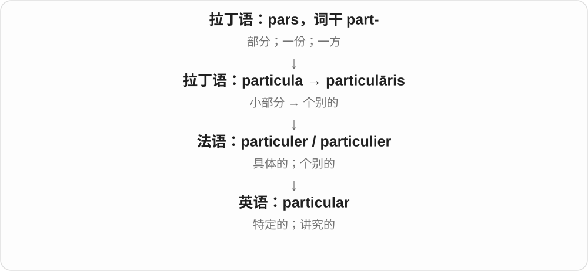
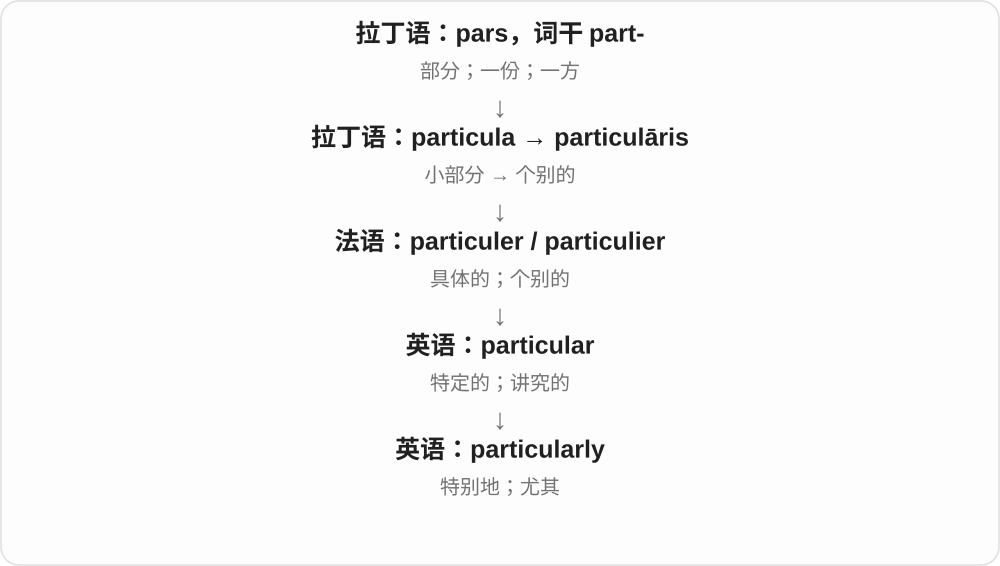

# 0755 · particular — 特定、特别；特别地与具体特点

[逐词精讲目录](../00_逐词精讲目录.md) · [总目录](../00_总目录_按常用程度.md)

## 核心词根与来源

particular 历史接拉丁小部分词族，经法语进入英语；particularity 也有相应法语、拉丁名词来路，不只是一段现代机械加尾。

**PARTICULAR：从一般整体中指到具体这一项**

particular 指特定对象或特点，particularly 强调尤其，particularity 再把具体性、独特点拿出来当名词说。

- **特定与尤其**：particular · particularly
- **具体性和特点**：particularity

## 词形与演化规律

particular → particularly、particularity；后者更正式，日常可用 details、distinctive features 按语境表达。

## 单词速览（按词族由简到繁）

同一基础词的相关扩展放在一起，先读基础形式，再读扩展；各组之间优先读常用的。具体词源关系见各词讲解。

| 单词 | 音标 | 核心意思 |
|---|---|---|
| [particular](#w-1) | 英 /pəˈtɪkjələ/；美 /pərˈtɪkjələr/ | 特定的；特别的；讲究的 |
| [particularly](#w-2) | 英 /pəˈtɪkjələli/；美 /pərˈtɪkjələrli/ | 尤其；特别；格外 |
| [particularity](#w-3) | 英 /pəˌtɪkjʊˈlærəti/；美 /pərˌtɪkjəˈlærəti/ | 具体特点；特殊性；详细、精确 |

## 逐词讲解

### 1. particular — 特定的；特别的；讲究的

**音标**：英 /pəˈtɪkjələ/；美 /pərˈtɪkjələr/

**先抓住这个画面**

从一堆东西里用手指点出“就这个”，这是 particular 的核心画面。一个人只接受自己选中的细节，就显得很讲究。

**怎么拆**

来自拉丁语 particulāris，再经法语进入英语；particula 是“小部分”。不是英语 particle 先变成形容词才传遍欧洲。

**怎么变成今天的意思**

从一般整体转向某一个具体部分，得到“特定的”。be particular about 把注意力放在很细的要求上，因此可表示挑剔或讲究。

**常见搭配与例句**

a particular problem；in particular；be particular about food。

> Is there a particular reason you chose this seat?

你选这个座位有什么具体原因吗？

> She is particular about the quality of her coffee.

她对咖啡的品质很讲究。

**别混淆**

particular 常强调具体选定的对象；special 更常强调不同寻常、受特殊对待。a particular day 未必是特别重要的一天。

### 2. particularly — 尤其；特别；格外

**音标**：英 /pəˈtɪkjələli/；美 /pərˈtɪkjələrli/

**先抓住这个画面**

把聚光灯从一大群对象移到其中一个：尤其值得提的，就是 particularly 后面那一项。

**怎么拆**

particular + -ly，形容词变副词。

**怎么变成今天的意思**

它可以挑出特别相关的对象，也可以加强程度。not particularly interested 通常是“不怎么感兴趣”，语气比直接说讨厌温和。

**常见搭配与例句**

particularly useful；particularly when；not particularly。

> The map is particularly useful when you travel alone.

独自旅行时，这张地图尤其有用。

> I am not particularly fond of sweet drinks.

我不怎么喜欢甜饮料。

**别混淆**

particularly 多用于突出程度或某一项；in particular 是短语，可放在名词后单独强调它。

### 3. particularity — 具体特点；特殊性；详细、精确

**音标**：英 /pəˌtɪkjʊˈlærəti/；美 /pərˌtɪkjəˈlærəti/

**先抓住这个画面**

不把事物揉成一般一团，而是指出这一个究竟有什么细节、有什么独到之处。

**怎么拆**

现代可认 particular + -ity；历史接法语 particularité、拉丁语相应名词。particular 再接小部分词族，但不是把英文 particle 临时改尾就能任意造词。

**怎么变成今天的意思**

**拉丁 particulāris → particularitās、法语 particularité**  
涉及具体部分、特定的 → 具体性、特征

↓

**英语 particularity**  
特殊性、具体特点；细致精确

the particularity of a place 一个地方的独特具体面貌，describe with particularity 详尽、具体地描述；复数 particularities 常指具体特色、细节。

**常见搭配与例句**

the particularity of；with particularity；local particularities。

> The writer captures the particularity of life in the village.

作家写出了村庄生活具体而独特的面貌。

> The report describes the events with considerable particularity.

报告相当详细、具体地描述了事件。

**别混淆**

particularity 是较正式名词；日常说具体细节常用 details，特别之处可用 distinctive features，别为词根学习强行把它塞进所有句子。

## 这一组要分清什么

particularly 是副词尤其，particularity 是名词；particular 不只等于奇怪，还常是某个特定的。

## 串起来练习

The book pays particular attention to the particularities of local speech.

这本书特别关注当地说话方式的具体特点。
