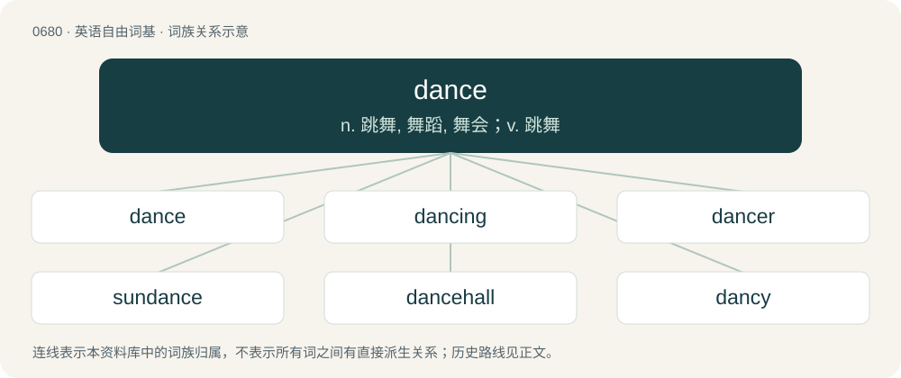

# 0756 · dance — n. 跳舞, 舞蹈, 舞会；v. 跳舞

[总目录](../00_总目录_按常用程度.md)

**类型**：英语自由词基　｜　**来源语言**：见词源记录

## 核心含义与来源

- 核心含义：n. 跳舞, 舞蹈, 舞会；v. 跳舞
- 英文含义：A sequence of rhythmic steps or movements usually performed to music, for pleasure or as a form of social interaction.
- 词形：dance

**多个词源／构词路径**：同一拼写可能有不同来源；以下按词性和含义分别列出。

**来源记录 1**（名词；A sequence of rhythmic steps or movements usually performed to music, for pleasure or as a form of social interaction.）

Inherited from Middle English dauncen, borrowed from Anglo-Norman dauncer, from Vulgar Latin \*dantiāre, of uncertain origin. Displaced native Old English sealtian, Old English frīcian, and partially displaced Old English hlēapan (“to leap, dance, run”, whence modern leap). Doublet of danza.

**来源记录 2**（名词；A normally horizontal stripe called a fess that has been modified to zig-zag across the center of a coat of arms from dexter to sinister.）

Related to dancy, dancetté, French danché.

## 词族图

## 单词速览（常用到不常用）

| 单词 | 音标 | 释义 |
|---|---|---|
| [dance](#w-1) | 英 /dɑːns/；美 /dæns/ | n. 跳舞, 舞蹈, 舞会；v. 跳舞 |
| [dancing](#w-2) | 英 /ˈdɑːns.ɪŋ/；美 /ˈdæns.ɪŋ/ | n. 舞蹈；\[建\] 跳动的 |
| [dancer](#w-3) | 英 /ˈdɑːnsə(ɹ)/；美 /ˈdænsəɹ/ | n. 舞蹈演员, 跳舞者 |
| [sundance](#w-4) |  | 【英文】Any of various Native American religious rituals with songs, dances, praying, etc. |
| [dancehall](#w-5) | /ˈdɑːnsˌhɔːl/ | 【英文】A public hall for dancing. |
| [dancy](#w-6) |  | \[人名\] \[英格兰人姓氏\] 丹西 Dansie的变体 |
| [danceable](#w-7) | /ˈdɑːnseɪbl/ | a. （指音乐）适合跳舞的 |
| [riverdance](#w-8) |  | 【英文】A theatrical show based on traditional Irish music and dance. |

## 逐词详解

### 1. dance

**词性**：名词　｜　**音标**：英 /dɑːns/；美 /dæns/

**中文释义**：n. 跳舞, 舞蹈, 舞会；v. 跳舞

**英文义项**：A sequence of rhythmic steps or movements usually performed to music, for pleasure or as a form of social interaction. / A social gathering where dancing is the main activity.

**词源与演化**：

Inherited from Middle English dauncen, borrowed from Anglo-Norman dauncer, from Vulgar Latin \*dantiāre, of uncertain origin. Displaced native Old English sealtian, Old English frīcian, and partially displaced Old English hlēapan (“to leap, dance, run”, whence modern leap). Doublet of danza.

**例句**：

> The dance we had in August 2008 is one of the greatest moments of my life!

该用例对应义项：A social gathering where dancing is the main activity.

### 2. dancing

**词性**：名词　｜　**音标**：英 /ˈdɑːns.ɪŋ/；美 /ˈdæns.ɪŋ/

**中文释义**：n. 舞蹈；\[建\] 跳动的

**英文义项**：The activity of taking part in a dance.

**构词拆分**：dance + -ing；English dance + -ing

**词源与演化**：

From dance + -ing. The sense "dance club" is from French dancing, a pseudo-anglicism derived from English dance + -ing.

**例句**：

> Do you want to go out dancing with me on Saturday night?

### 3. dancer

**词性**：名词　｜　**音标**：英 /ˈdɑːnsə(ɹ)/；美 /ˈdænsəɹ/

**中文释义**：n. 舞蹈演员, 跳舞者

**英文义项**：A person who dances, usually as a hobby, an occupation, or a profession. / A stripper.

**构词拆分**：dance + -er

**词源与演化**：

From Middle English dauncer, dawncere, dancere, equivalent to dance + -er.

**例句**：

> I'm a terrible dancer.

该用例对应义项：A person who dances, usually as a hobby, an occupation, or a profession.

### 4. sundance

**词性**：名词

**英文义项**：Any of various Native American religious rituals with songs, dances, praying, etc. / Gaillardia pulchella, a flowering plant of the Southern United States, from Arizona to Florida, and northern Mexico.

**构词拆分**：sun + dance

**词源与演化**：

From sun + dance.

### 5. dancehall

**词性**：名词　｜　**音标**：/ˈdɑːnsˌhɔːl/

**英文义项**：A public hall for dancing. / A genre of Jamaican dance music derived from dub and reggae.

**构词拆分**：dance + hall

**词源与演化**：

From dance + hall.

### 6. dancy

**词性**：形容词

**中文释义**：\[人名\] \[英格兰人姓氏\] 丹西 Dansie的变体

**英文义项**：Ready to dance. / Of music: suitable for dancing to.

**构词拆分**：dance + -y

**词源与演化**：

From dance + -y.

**例句**：

> After a few slow numbers, the band moved on to some more dancy tunes.

该用例对应义项：Of music: suitable for dancing to.

### 7. danceable

**词性**：形容词　｜　**音标**：/ˈdɑːnseɪbl/

**中文释义**：a. （指音乐）适合跳舞的

**英文义项**：Suitable for dancing. / Danceworthy.

**构词拆分**：dance + -able

**词源与演化**：

From dance + -able.

### 8. riverdance

**词性**：名词

**英文义项**：A theatrical show based on traditional Irish music and dance.

**构词拆分**：river + dance

**词源与演化**：

From river + dance, originally the trademarked name of an interval performance act during the 1994 Eurovision Song Contest.
