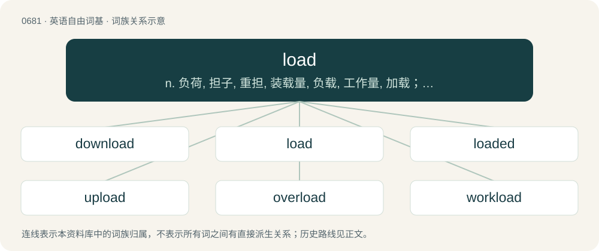

# 0757 · load — n. 负荷, 担子, 重担, 装载量, 负载, 工作量, 加载；vt. 装载, 装填, 使担负；vi. 装货, 上客, 装料

[总目录](../00_总目录_按常用程度.md)

**类型**：英语自由词基　｜　**来源语言**：见词源记录

## 核心含义与来源

- 核心含义：n. 负荷, 担子, 重担, 装载量, 负载, 工作量, 加载；vt. 装载, 装填, 使担负；vi. 装货, 上客, 装料
- 英文含义：A burden; a weight to be carried.
- 词形：load

**来源记录 1**（名词；A burden; a weight to be carried.）

The sense of “burden” first arose in the 13th century as a secondary meaning of Middle English lode, loade, which had the main significance of “way, course, journey”, from Old English lād (“course, journey; way, street, waterway; leading, carrying; maintenance, support”) (ultimately from Proto-Germanic \*laidō (“leading, way”), Proto-Indo-European \*leyt- (“to go, go forth, die”). Cognate with Middle Low German leide (“entourage, escort”), German Leite (“line, course, load”), Swedish led (“way, trail, line”), Icelandic leið (“way, course, route”). As such, load is a doublet of lode, which has preserved the older meaning. Most likely, the semantic extension of the Middle English substantive arose by conflation with the (etymologically unrelated) verb lade; however, Middle English lode occurs only as a substantive; the transitive verb load (“to charge with a load”) is recorded only in the 16th century (frequently in Shakespeare), and (except for the participle laden) has largely supplanted lade in modern English. For the meaning development from PIE, compare Latin carrus (whence carry) akin to currō.

## 词族图

## 单词速览（常用到不常用）

| 单词 | 音标 | 释义 |
|---|---|---|
| [download](#w-1) | 美 /ˈdaʊnˌloʊd/；/ˈdaʊnˌləʊd/ | \[计\] 卸载, 下栽 |
| [load](#w-2) | 英 /ləʊd/；美 /loʊd/ | n. 负荷, 担子, 重担, 装载量, 负载, 工作量, 加载；vt. 装载, 装填, 使担负；vi. 装货, 上客, 装料 |
| [loaded](#w-3) | 英 /ˈləʊ.dəd/；美 /ˈloʊ.dɪd/ | a. 有负载的, 有含蓄的, 加重的, 不公正的, 偏袒的, 喝醉了的, 富有的；\[计\] 有负载的 |
| [upload](#w-4) | 英 /ˌʌpˈləʊd/；美 /ˈʌpˌloʊd/ | \[计\] 上装, 加载, 储入 |
| [overload](#w-5) | 英 /ˌəʊvəˈləʊd/；美 /ˌoʊvɚˈloʊd/ | vt. 超载, 过载, 超过负荷；n. 超载, 负荷过多 |
| [workload](#w-6) | /ˈwəːkləud/ | n. 工作量；\[化\] 工作量 |
| [payload](#w-7) | 英 /ˈpeɪləʊd/；美 /ˈpeɪloʊd/ | n. 商务载重, 工资负担, 净载重量, 有效负荷, 弹头；\[化\] 负荷量 |
| [reload](#w-8) | /ˈɹiːləʊd/ | vt. 再装；vi. 再装填弹药 |
| [unload](#w-9) | 英 /ʌnˈləʊd/；美 /ʌnˈloʊd/ | vi. 卸货；vt. 从...卸下, 摆脱...之负担, 倾销, 卸(货)；\[计\] 卸载 |
| [loader](#w-10) | 美 /ˈloʊdɚ/ | n. 载入程序, 载入者, 装货的人；\[计\] 装入程序 |
| [shitload](#w-11) | 美 /ˈʃɪtˌloʊd/ | 【英文】A large amount. |
| [offload](#w-12) | 美 /ˌɑfˈloʊd/；/ˌɒfˈləʊd/ | v. 卸下, 卸货 |
| [truckload](#w-13) | 美 /ˈtɹʌkˌloʊd/ | n. 货车荷载, 最低起运量 |
| [caseload](#w-14) | /ˈkeisləjd/ | \[法\] 工作量, 承办案件数 |
| [boatload](#w-15) | 英 /ˈbəʊtˌləʊd/；美 /ˈboʊtˌloʊd/ | n. 船的载货量, 一条船的货物 |
| [preload](#w-16) | /ˈpriːˈləud/ | \[计\] 预加载, 预装入, 预填入；\[化\] 预加荷载 |
| [freeloader](#w-17) | 英 /ˈfɹiːləʊdə(ɹ)/；美 /ˈfɹiloʊdɚ/ | n. 不速之客, 揩油的人 |

## 逐词详解

### 1. download

**词性**：名词　｜　**音标**：美 /ˈdaʊnˌloʊd/；/ˈdaʊnˌləʊd/

**中文释义**：\[计\] 卸载, 下栽

**英文义项**：A file transfer to a given computer or device from a remote one through a network connection. / A file that has been or is intended to be transferred in this way.

**构词拆分**：down- + load

**词源与演化**：

From down- + load. Verbal form first appears c. 1962 in the Wichita Falls (Texas) Times. Nominal form first appears c. 1977 in Scientific American.

**例句**：

> I got the download but it wouldn't work on my computer.

该用例对应义项：A file that has been or is intended to be transferred in this way.

### 2. load

**词性**：名词　｜　**音标**：英 /ləʊd/；美 /loʊd/

**中文释义**：n. 负荷, 担子, 重担, 装载量, 负载, 工作量, 加载；vt. 装载, 装填, 使担负；vi. 装货, 上客, 装料

**英文义项**：A burden; a weight to be carried. / A worry or concern to be endured, especially in the phrase a load off one's mind.

**词源与演化**：

The sense of “burden” first arose in the 13th century as a secondary meaning of Middle English lode, loade, which had the main significance of “way, course, journey”, from Old English lād (“course, journey; way, street, waterway; leading, carrying; maintenance, support”) (ultimately from Proto-Germanic \*laidō (“leading, way”), Proto-Indo-European \*leyt- (“to go, go forth, die”). Cognate with Middle Low German leide (“entourage, escort”), German Leite (“line, course, load”), Swedish led (“way, trail, line”), Icelandic leið (“way, course, route”). As such, load is a doublet of lode, which has preserved the older meaning. Most likely, the semantic extension of the Middle English substantive arose by conflation with the (etymologically unrelated) verb lade; however, Middle English lode occurs only as a substantive; the transitive verb load (“to charge with a load”) is recorded only in the 16th century (frequently in Shakespeare), and (except for the participle laden) has largely supplanted lade in modern English. For the meaning development from PIE, compare Latin carrus (whence carry) akin to currō.

**例句**：

> Each of the cross-members must withstand a tensile load of 1,000 newtons.

该用例对应义项：The force exerted on a structural component such as a beam, girder, cable etc.

### 3. loaded

**词性**：形容词　｜　**音标**：英 /ˈləʊ.dəd/；美 /ˈloʊ.dɪd/

**中文释义**：a. 有负载的, 有含蓄的, 加重的, 不公正的, 偏袒的, 喝醉了的, 富有的；\[计\] 有负载的

**英文义项**：Burdened by some heavy load; packed. / Having a live round of ammunition in the chamber.

**构词拆分**：From load + -ed.

**词源与演化**：

From load + -ed.

**例句**：

> "Ignorant" is a loaded word, often implying lack of intelligence rather than just lack of knowledge.

该用例对应义项：Having strong connotations that colour the literal meaning and are likely to provoke an emotional response. Sometimes used loosely to describe a word that simply has many different meanings.

### 4. upload

**词性**：动词　｜　**音标**：英 /ˌʌpˈləʊd/；美 /ˈʌpˌloʊd/

**中文释义**：\[计\] 上装, 加载, 储入

**英文义项**：To transfer data to a computer on a network, especially to a server on the Internet. / To transfer jurisdiction and responsibility of a government asset or service to a higher level of government.

**构词拆分**：From up- + load.

**词源与演化**：

From up- + load.

**例句**：

> You will have to convert your photograph to a jpg format if you wish to upload it.

该用例对应义项：To transfer data to a computer on a network, especially to a server on the Internet.

### 5. overload

**词性**：动词　｜　**音标**：英 /ˌəʊvəˈləʊd/；美 /ˌoʊvɚˈloʊd/

**中文释义**：vt. 超载, 过载, 超过负荷；n. 超载, 负荷过多

**英文义项**：To load excessively. / To provide too much power to a circuit.

**构词拆分**：over- + load

**词源与演化**：

From over- + load.

**例句**：

> Don't overload the car.

该用例对应义项：place too much a load on

### 6. workload

**词性**：名词　｜　**音标**：/ˈwəːkləud/

**中文释义**：n. 工作量；\[化\] 工作量

**英文义项**：The amount of work assigned to a particular worker, normally in a specified time period. / The amount of work that a machine can handle or produce.

**构词拆分**：work + load

**词源与演化**：

From work + load.

**例句**：

> Tom was advised, for medical reasons, to cut back on his workload.

### 7. payload

**词性**：名词　｜　**音标**：英 /ˈpeɪləʊd/；美 /ˈpeɪloʊd/

**中文释义**：n. 商务载重, 工资负担, 净载重量, 有效负荷, 弹头；\[化\] 负荷量

**英文义项**：That part of a cargo that produces revenue. / The total weight of passengers, crew, equipment, and cargo carried by an aircraft or spacecraft.

**构词拆分**：pay + load

**词源与演化**：

From pay + load. From the early 20th century.

**例句**：

> Tucked inside the payload bay of Space Shuttle Discovery, the 24,000-pound telescope carried five science instruments.

### 8. reload

**词性**：名词　｜　**音标**：/ˈɹiːləʊd/

**中文释义**：vt. 再装；vi. 再装填弹药

**英文义项**：The process by which something is reloaded. / An ammunition cartridge prepared from previously fired ammunition.

**构词拆分**：re- + load

**词源与演化**：

From re- + load.

**例句**：

> Each reload of the weapon took about 30 seconds.

该用例对应义项：The process by which something is reloaded.

### 9. unload

**词性**：动词　｜　**音标**：英 /ʌnˈləʊd/；美 /ʌnˈloʊd/

**中文释义**：vi. 卸货；vt. 从...卸下, 摆脱...之负担, 倾销, 卸(货)；\[计\] 卸载

**英文义项**：To remove the load or cargo from (a vehicle, etc.). / To remove (the load or cargo) from a vehicle, etc.

**构词拆分**：un- + load

**词源与演化**：

From un- + load.

**例句**：

> He unloaded his revolver and put the cartridges away to be reloaded later.

该用例对应义项：To remove the charge from; to discharge.

### 10. loader

**词性**：名词　｜　**音标**：美 /ˈloʊdɚ/

**中文释义**：n. 载入程序, 载入者, 装货的人；\[计\] 装入程序

**英文义项**：A program that prepares other programs for execution. / A tractor with a scoop, for example: front-end loader, front loader, endloader, payloader, bucket loader, tracked loader, wheel loader, etc.

**构词拆分**：From load + -er.

**词源与演化**：

From load + -er.

**例句**：

> Have you ever driven a front loader?

### 11. shitload

**词性**：名词　｜　**音标**：美 /ˈʃɪtˌloʊd/

**英文义项**：A large amount.

**构词拆分**：shit + load

**词源与演化**：

From shit + load.

**例句**：

> They say the best fertilizer is manure, so I bought a shitload of it.

### 12. offload

**词性**：动词　｜　**音标**：美 /ˌɑfˈloʊd/；/ˌɒfˈləʊd/

**中文释义**：v. 卸下, 卸货

**英文义项**：To unload. / To get rid of things, work, or problems by passing them on to someone or something else.

**构词拆分**：From off- + load.

**词源与演化**：

From off- + load.

**例句**：

> The driver of the car carrier offloaded the cars at the dealership.

该用例对应义项：To unload.

### 13. truckload

**词性**：名词　｜　**音标**：美 /ˈtɹʌkˌloʊd/

**中文释义**：n. 货车荷载, 最低起运量

**英文义项**：The contents of a full truck or lorry. / A large number.

**构词拆分**：truck + load

**词源与演化**：

From truck + load.

**例句**：

> We were expecting just a handful of people to come to the festival, but then a truckload of revellers started arriving at the festival gates.

该用例对应义项：A large number.

### 14. caseload

**词性**：名词　｜　**音标**：/ˈkeisləjd/

**中文释义**：\[法\] 工作量, 承办案件数

**英文义项**：The workload of a person or group that handles cases; the relative volume of cases expected to be worked upon. / The set of persons whose cases are being handled by such a worker or group.

**构词拆分**：case + load

**词源与演化**：

From case + load.

**例句**：

> As a public defender, Jonas had a crushing caseload and never felt that he could prepare his clients' defenses properly.

该用例对应义项：The workload of a person or group that handles cases; the relative volume of cases expected to be worked upon.

### 15. boatload

**词性**：名词　｜　**音标**：英 /ˈbəʊtˌləʊd/；美 /ˈboʊtˌloʊd/

**中文释义**：n. 船的载货量, 一条船的货物

**英文义项**：Cargo or passengers that fill a boat. / A large quantity.

**构词拆分**：boat + load

**词源与演化**：

From boat + load. The figurative sense is extended from the literal sense.

**例句**：

> He showed up an hour later with a whole boatload of hamburgers, chips, cookies, and assorted other munchies, not to mention sodas and beer, and we all fell in and stuffed ourselves silly.

该用例对应义项：A large quantity.

### 16. preload

**词性**：动词　｜　**音标**：/ˈpriːˈləud/

**中文释义**：\[计\] 预加载, 预装入, 预填入；\[化\] 预加荷载

**英文义项**：To load in advance (used especially in reference to software installed on a computer prior to sale). / To drink (cheaper) alcohol at home before going out socially.

**构词拆分**：pre- + load

**词源与演化**：

From pre- + load.

**例句**：

> That nightclub is so expensive. Let's preload at your flat.

该用例对应义项：To drink (cheaper) alcohol at home before going out socially.

### 17. freeloader

**词性**：名词　｜　**音标**：英 /ˈfɹiːləʊdə(ɹ)/；美 /ˈfɹiloʊdɚ/

**中文释义**：n. 不速之客, 揩油的人

**英文义项**：One who does not contribute or pay appropriately; one who gets a free ride, etc. without paying a fair share. / A person who takes expired unsold merchandise from the back of supermarket premises.

**构词拆分**：free + load + -er

**词源与演化**：

From free + load + -er, originally US 1930s.

**例句**：

> You're such a freeloader! You're always taking candy from me but you never give me any.
